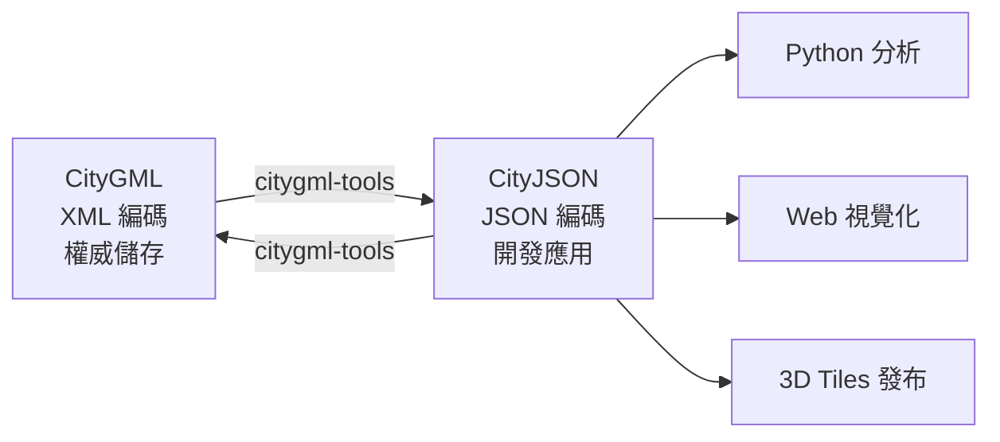

# Day 3：CityJSON vs CityGML — 為什麼需要另一個格式？

> CityJSON 不是要取代 CityGML，而是給開發者一個更順手的使用方式——就像你可以用 SQL 查資料庫，也可以透過 REST API 做同樣的事。

---

## 從一個實際問題出發

想像你是一個後端工程師，老闆交給你一個任務：「把蘇黎世這座城市的 3D 建築模型資料拿來分析，看看哪些屋頂適合裝太陽能板。」

你找到了資料，下載下來——一個 **2.1 GB** 的 XML 檔案[^cityjson-filesize]。你的 API Server 光是讀取這個檔案，記憶體就快要撐不住。就算勉強讀進去了，解析 XML 的那些 namespace、處理 XLink 連結、遍歷深層巢狀結構，又是一場煎熬。

但如果同樣的資料只需要 **293 MB**，且用 `json.loads()` 一行就能讀進來呢？

這正是 CityJSON 要解決的核心問題。

## CityGML 的成就與包袱

要理解 CityJSON 的價值，得先理解 CityGML 的貢獻。

**CityGML**（City Geography Markup Language）是 OGC 自 2008 年起制訂的國際標準，它定義了 3D 城市模型的**資料模型**（Data Model）——哪些類型的城市物件存在（建築、道路、橋樑、植栽……），它們之間如何關聯，各自有哪些屬性[^citygml-ogc]。

這些規範本身是極有價值的。真正的瓶頸出在 CityGML 的**編碼方式**——它採用 **GML（Geography Markup Language）** 來序列化資料，而 GML 是基於 XML 的。

在學術論文中，研究團隊將 CityGML 在實務上的問題歸納為三個層次[^ledoux-2019]：

### XML 層級的問題

| 問題 | 說明 |
|------|------|
| **標記冗長** | XML 的本質是標記語言（markup language），每個元素有開標籤和閉標籤，資料量中夾雜大量標記符號 |
| **檔案過大** | 城市尺度的 XML 檔案動輒數 GB，經常超出記憶體限制 |
| **解析緩慢** | 需要 XML 函式庫，還得處理 namespace、schema 驗證等額外開銷 |
| **格式破損** | 實務上常見格式不正確的 XML，處理起來相當棘手 |

### GML 層級的問題

| 問題 | 說明 |
|------|------|
| **幾何表示方式過多** | 一個簡單的方形，在 GML 中竟然有 **25 種以上**的表示方式[^ledoux-2019] |
| **開發者負擔沉重** | 為每種幾何類型的每種變體都寫處理程式碼，是個不合理的期望 |
| **軟體行為不一致** | 不同工具對同一份資料可能產生不同結果 |

### CityGML 層級的問題

| 問題 | 說明 |
|------|------|
| **物件階層過深** | 一個簡單建築物會展開成層層嵌套的 XML 類別樹 |
| **XLink 解析困難** | 物件間的連結透過 XML Linking Language 實現，許多函式庫不完整支援 |
| **語意表面多種存法** | 類似 GML 幾何變體的問題 |
| **多個 CRS 共存** | 甚至窗戶都可以有自己的座標系統，強迫軟體引入投影轉換套件 |
| **缺乏原生中繼資料** | 僅有 bounding box 和 CRS，要更多資訊就得仰賴 ADE |
| **無完整 JavaScript 解析器** | 截至 2019 年，仍沒有能完整處理 CityGML 的 JavaScript 套件[^ledoux-2019] |

一句話總結：**CityGML 的資料模型是好模型，但 XML/GML 這層編碼為開發者帶來了過高的成本。**

## 量化比較：用數據說話

### 檔案大小

來自官方網站的比較數據[^cityjson-filesize]：

| 資料集 | CityGML-XML | CityJSON v2.0 | 壓縮比 |
|--------|-------------|---------------|--------|
| 蘇黎世（Zürich） | 2,100 MB | 293 MB | **7.0×** |
| 紐約（New York） | 682 MB | 110 MB | **6.0×** |
| 蒙特婁（Montréal） | 53 MB | 5.6 MB | **9.5×** |
| 因戈爾施塔特（Ingolstadt） | 40 MB | 4.8 MB | **8.3×** |
| 海牙（Den Haag） | 19 MB | 2.7 MB | **7.0×** |
| 鹿特丹（Rotterdam） | 18 MB | 2.7 MB | **6.7×** |
| 維也納（Vienna） | 40 MB | 5.6 MB | **7.1×** |
| 鐵路示範（Railway） | 39 MB | 4.5 MB | **8.7×** |

**平均壓縮約 7 倍**，且資訊完全無損失。

### 解析速度

CityJSON 只需一個 `json.loads()` 呼叫；CityGML 則需要 XML 解析器、namespace 處理、XLink 解析、複雜物件樹遍歷。

根據實務經驗，CityJSON 的解析速度大約是 CityGML 的 **兩個數量級（約 100 倍）** 以上[^spatialworkflow]。

> 「`json.loads` 比含 namespace 處理的 XML 解析快了兩個數量級。」
>
> — Spatial Workflow, *CityJSON and CityGML explained*

### 為什麼 CityJSON 比較小？

CityJSON 的輕量有幾個關鍵設計：

1. **共享頂點陣列**：所有頂點集中在一個陣列，幾何透過索引參考，不重複儲存座標值。這套機制借用了 Wavefront OBJ 格式的做法。
2. **Transform 壓縮**：可將座標以整數儲存再透過 scale/translate 還原，額外節省 5–10%。
3. **扁平結構**：物件之間以 ID 參考取代 XML 的巢狀層疊。
4. **沒有 XML 包袱**：不需要 namespace 宣告、schemaLocation、重複的開閉標籤。

## CityJSON 的 8 大特色

官方網站列出了選擇 CityJSON 的 8 個理由[^cityjson-org]：

| # | 特色 | 說明 |
|---|------|------|
| 1 | **簡單** | 為 CityJSON 增加軟體支援很容易，已有多種工具 |
| 2 | **一鍵轉換** | CityGML ↔ CityJSON 雙向轉換只需 `citygml-tools` |
| 3 | **更小** | 平均 **7 倍**壓縮率 |
| 4 | **相容 CityGML v3.0** | 自動與 CityGML-XML v3.0 轉換 |
| 5 | **Web 檢視器** | 拖拉檔案到瀏覽器即顯示（viewer.cityjson.org） |
| 6 | **cjio 操作工具** | 合併、過濾、變換 CRS、管理紋理 |
| 7 | **Extensions** | 比 CityGML 的 ADE 更簡單的擴充機制 |
| 8 | **開源開發** | GitHub 上的開放社群 |

## 不是取代，而是互補

這可能是整個系列最重要的一句話：

> **CityJSON 不是 CityGML 的取代品，而是 CityGML 的另一種編碼方式。**[^cityjson-about]

兩者共享完全相同的**資料模型**——Building、Road、Bridge 這些物件的定義一模一樣，語意表面和屬性都沒有差別。差別只在於序列化的語法：XML vs JSON。

兩者的關係可以這樣理解：

實際工作流程通常是：

1. **儲存/管理**原始資料用 CityGML（如果來源就是這個格式）
2. **用 `citygml-tools` 轉換**為 CityJSON
3. **在 CityJSON 上開發應用**：Python 分析、Web 視覺化、轉為 3D Tiles
4. **如有需要再轉回** CityGML 進行官方交換或歸檔

> 「因為我們提供了 CityJSON 與 CityGML-XML 之間的雙向轉換，所以使用 CityJSON 就等同於在使用 CityGML 資料模型。」[^cityjson-org]

## 小結

| 面向 | CityGML（XML） | CityJSON（JSON） |
|------|---------------|-----------------|
| 檔案大小 | 大（基準） | **小 7 倍** |
| 解析速度 | 慢（需要 XML 工具鏈） | **快 ~100 倍**（json.loads） |
| 學習曲線 | 高（XML + GML + CityGML） | **低（JSON）** |
| 幾何表示 | 25+ 種變體 | **每種一種方式** |
| 開發者友善度 | 低 | **高** |
| Web 整合 | 困難 | **原生支援** |
| OGC 標準 | ✅ 是 | ✅ 是（v2.0） |
| 角色定位 | 權威儲存格式 | **開發應用格式** |

明天，我們將正式解剖一個 CityJSON 檔案的內部結構，看看那 7 個根層級成員分別是什麼、做什麼用。

---

## 參考資料

[^cityjson-org]: CityJSON. (n.d.). CityJSON: A JSON-based encoding for 3D city models. Retrieved 2026-09-27, from https://www.cityjson.org/

[^cityjson-about]: CityJSON. (n.d.). About CityJSON. Retrieved 2026-09-27, from https://www.cityjson.org/about/

[^cityjson-filesize]: CityJSON. (n.d.). File size: CityJSON vs CityGML-XML: 7X compression. Retrieved 2026-09-27, from https://www.cityjson.org/filesize/

[^ledoux-2019]: Ledoux, H., Arroyo Ohori, K., Kumar, K., Dukai, B., Labetski, A., & Vitalis, S. (2019). CityJSON: A compact and easy-to-use encoding of the CityGML data model. *Open Geospatial Data, Software and Standards, 4*(1), Article 4. Retrieved 2026-09-27, from https://doi.org/10.1186/s40965-019-0064-0

[^spatialworkflow]: Spatial Workflow. (2026, September 15). CityJSON and CityGML explained. Retrieved 2026-09-27, from https://www.spatialworkflow.io/cityjson-and-citygml-explained/

[^citygml-ogc]: Open Geospatial Consortium. (n.d.). OGC CityGML. Retrieved 2026-09-27, from https://www.ogc.org/standards/citygml/