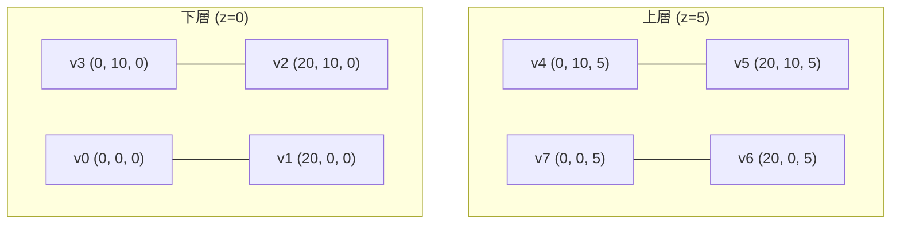

# Day 5：Hello CityJSON — 從一個最簡單的檔案開始

> 學程式語言的第一天都從 `Hello, World!` 開始。學 CityJSON 的第一個檔案，就從一棟簡單的建築物開始吧。

---

## 下載範例 vs 自己動手寫

網路上可以下載到現成的 CityJSON 範例檔案（如 `twobuildings.city.json`），但今天我們要做的是——**打開文字編輯器，從零開始寫一個**。

為什麼要自己動手寫？

- JSON 是可讀的（human-readable），你完全可以理解每一行程式碼在做什麼
- 手寫一次比讀十次更有助於建立「幾何感」
- 寫錯了也沒關係——我們有驗證工具幫你抓蟲

我們要做的就是：定義一棟簡單的建築物，8 個頂點、6 個面、一個屋頂。

## 第一步：先畫出建築物的草圖

在碰鍵盤之前，先想像一座 20 × 10 公尺的矩形建築物，高度 5 公尺，平屋頂。在 3D 空間中，它有 **8 個頂點**：



等一下，先別急著寫座標。還記得 Day 4 我們提過的 Transform 機制嗎？CityJSON 的頂點是以**整數**儲存的。為了讓範例簡單易懂，今天我們讓 Transform 為單位矩陣（scale=1, translate=0），這樣整數座標就等於真實世界座標。

## 第二步：寫出根層級結構

打開你的文字編輯器，建立一個 `hello.city.json` 檔案，先寫上空殼：

```json
{
  "type": "CityJSON",
  "version": "2.0",
  "transform": {
    "scale": [1.0, 1.0, 1.0],
    "translate": [0.0, 0.0, 0.0]
  },
  "vertices": [],
  "CityObjects": {}
}
```

這是城鎮的「空地」——什麼都沒有，但骨架已經齊全了。現在開始填入內容。

## 第三步：填入頂點

根據我們的草圖，8 個頂點的座標如下（單位：公尺）：

| 頂點 | 索引 | X | Y | Z | 說明 |
|------|------|---|---|---|------|
| v0 | 0 | 0 | 0 | 0 | 左下前（地面） |
| v1 | 1 | 20 | 0 | 0 | 右下前（地面） |
| v2 | 2 | 20 | 10 | 0 | 右下後（地面） |
| v3 | 3 | 0 | 10 | 0 | 左下後（地面） |
| v4 | 4 | 0 | 10 | 5 | 左上後（屋頂） |
| v5 | 5 | 20 | 10 | 5 | 右上後（屋頂） |
| v6 | 6 | 20 | 0 | 5 | 右上前（屋頂） |
| v7 | 7 | 0 | 0 | 5 | 左上前（屋頂） |

在 `vertices` 陣列中按順序填入：

```json
"vertices": [
  [0, 0, 0],
  [20, 0, 0],
  [20, 10, 0],
  [0, 10, 0],
  [0, 10, 5],
  [20, 10, 5],
  [20, 0, 5],
  [0, 0, 5]
]
```

## 第四步：定義建築物

現在我們要把這棟建築物「放進」城市中。在 `CityObjects` 中建立一個物件，ID 取名為 `"building-1"`：

```json
"CityObjects": {
  "my-first-building": {
    "type": "Building",
    "attributes": {
      "name": "我的第一棟 CityJSON 建築物",
      "storeysAboveGround": 1
    },
    "geometry": [
      {
        "type": "Solid",
        "lod": "1.2",
        "boundaries": [
          [
            [3, 2, 1, 0],
            [4, 5, 6, 7],
            [0, 1, 6, 7],
            [1, 2, 5, 6],
            [2, 3, 4, 5],
            [3, 0, 7, 4]
          ]
        ]
      }
    ]
  }
}
```

這裡最需要仔細說明的就是 `boundaries`。我們的建築物是一個 **Solid（實體）**，由 6 個面（外殼）構成。每個面由 4 個頂點索引定義，頂點的**順序必須以逆時針方向**從外側看向該面：

| 面 | 頂點索引 | 說明 |
|----|---------|------|
| `[3, 2, 1, 0]` | v3→v2→v1→v0 | 底面（地面） |
| `[4, 5, 6, 7]` | v4→v5→v6→v7 | 頂面（屋頂） |
| `[0, 1, 6, 7]` | v0→v1→v6→v7 | 前面 |
| `[1, 2, 5, 6]` | v1→v2→v5→v6 | 右面 |
| `[2, 3, 4, 5]` | v2→v3→v4→v5 | 後面 |
| `[3, 0, 7, 4]` | v3→v0→v7→v4 | 左面 |

我們使用的 `lod` 值為 `"1.2"`——這不是 CityGML 傳統的 LoD1，而是 TU Delft 改良的細緻度表示法[^tudelft-lod]，`1.2` 代表比 LoD1 更精確一些（有屋頂形狀，但細節還不算多）。

### 為什麼頂點順序很重要？

如果你把其中一個面的順序寫反了（例如寫成 `[0, 1, 2, 3]` 而非 `[3, 2, 1, 0]`），這個面就會變成**朝內**而不是朝外。在 3D 圖學中，面的方向決定了渲染時是否可見——朝外的面會顯示，朝內的面會消失。

## 第五步：加上 Metadata

雖然選用，但養成好習慣，為資料集加上基本的後設資料：

```json
"metadata": {
  "title": "Hello CityJSON 教學範例",
  "referenceSystem": "https://www.opengis.net/def/crs/EPSG/0/4326",
  "geographicalExtent": [0, 0, 0, 20, 10, 5]
}
```

## 完整檔案

把以上所有片段拼起來，完整的 `hello.city.json` 檔案如下：

```json
{
  "type": "CityJSON",
  "version": "2.0",
  "transform": {
    "scale": [1.0, 1.0, 1.0],
    "translate": [0.0, 0.0, 0.0]
  },
  "vertices": [
    [0, 0, 0],
    [20, 0, 0],
    [20, 10, 0],
    [0, 10, 0],
    [0, 10, 5],
    [20, 10, 5],
    [20, 0, 5],
    [0, 0, 5]
  ],
  "CityObjects": {
    "my-first-building": {
      "type": "Building",
      "attributes": {
        "name": "我的第一棟 CityJSON 建築物",
        "storeysAboveGround": 1
      },
      "geometry": [
        {
          "type": "Solid",
          "lod": "1.2",
          "boundaries": [
            [
              [3, 2, 1, 0],
              [4, 5, 6, 7],
              [0, 1, 6, 7],
              [1, 2, 5, 6],
              [2, 3, 4, 5],
              [3, 0, 7, 4]
            ]
          ]
        }
      ]
    }
  },
  "metadata": {
    "title": "Hello CityJSON 教學範例",
    "referenceSystem": "https://www.opengis.net/def/crs/EPSG/0/4326",
    "geographicalExtent": [0, 0, 0, 20, 10, 5]
  }
}
```

總共大約 60 行——就完成了你的第一個 3D 城市模型！

## 視覺化：拖進 Ninja 就對了

現在把 `hello.city.json` 檔案存好，打開瀏覽器前往 **[ninja.cityjson.org](https://ninja.cityjson.org)**[^ninja]：

1. 找到你電腦上的 `hello.city.json` 檔案
2. 直接把檔案**拖曳**到瀏覽器視窗中
3. 看到一棟白色的 3D 建築物了嗎？你可以用滑鼠旋轉、縮放、平移來檢視它

Ninja 是 CityJSON 的官方 Web 檢視器，由 TU Delft 開發，基於 three.js 和 Vue.js 實作[^ninja-github]。它完全在瀏覽器端運作——你的檔案不會上傳到任何伺服器。

![Ninja 檢視器示意圖：白色方塊建築物在 3D 空間中展示]

（如果你沒看到圖像，請想像一座白色半透明的 3D 盒子——那就是你親手建出來的第一棟數位建築！）

如果拖曳後什麼都沒發生，檢查一下 JSON 格式是否正確：最常見的錯誤是結尾多了一個逗號（JSON 不允許 trailing comma）。

## 驗證：用 cjval 確保檔案合法

看到 3D 模型很開心，但怎麼確定我們寫的檔案完全符合 CityJSON 標準？這時候需要 **cjval**——官方驗證器[^cjval]。

### 安裝 cjval

有兩種方式：

**方式 A：透過 Rust 安裝（推薦，功能最完整）**

```bash
cargo install cjval --features build-binary
```

**方式 B：透過 Python 安裝（如果已在使用 cjio）**

```bash
pip install cjvalpy
```

### 執行驗證

```bash
cjval hello.city.json
```

如果一切正確，你會看到所有檢查項目都通過（綠燈）。如果 `cjval` 回報錯誤，最常見的問題包括：

| 錯誤訊息 | 可能原因 |
|---------|---------|
| `JSON syntax error` | JSON 格式錯誤（多餘逗號、缺少引號） |
| `Wrong vertex index` | 頂點索引超出 `vertices` 陣列長度（索引從 0 開始！） |
| `Parents/children consistency` | CityObject 缺少必要的 `parents` 或 `children` |
| `Semantics arrays` | 語意陣列長度與幾何面數不符 |

你也可以輸出 JSON 格式的驗證報告：

```bash
cjval --report hello.city.json > report.json
```

或只要簡短摘要：

```bash
cjval --summary hello.city.json
```

對於我們的範例檔案，`cjval` 應該會告訴你：**這個檔案是合法的 CityJSON**。

## 進階挑戰：改成 L 形建築物

如果你的心臟夠大顆，試著把這棟方盒子改成 L 形的建築物。提示如下：

1. L 形需要 **12 個頂點**（不是 8 個）
2. 地面輪廓不再是矩形，而是 L 形
3. 屋頂同樣是 L 形，每個面都需要正確的頂點順序

這裡給一個起點——只需要修改 `vertices` 和 `boundaries`：

```json
"vertices": [
  [0, 0, 0], [12, 0, 0], [12, 5, 0], [8, 5, 0], [8, 10, 0], [0, 10, 0],
  [0, 0, 5], [12, 0, 5], [12, 5, 5], [8, 5, 5], [8, 10, 5], [0, 10, 5]
]
```

試試看能不能把 6 個以上的面正確寫出來。如果成功的話，恭喜你——你已經完全掌握了 CityJSON 幾何的核心概念！

## 小結

今天我們從零開始，用手寫了一個包含單一建築物的 CityJSON 檔案——定義了 8 個頂點、6 個面構成的 Solid，並指定了 LoD 和一些基本屬性。我們學會了：

- 如何規劃一個簡單 3D 建築物的頂點與面
- 用 Ninja Viewer 即時視覺化 CityJSON 檔案
- 用 `cjval` 驗證檔案是否合法
- 一個檔案從 60 行 JSON 變成 3D 建築物的完整流程

明天我們將進入開發環境與工具鏈的介紹，看看除了 Ninja 和 cjval 之外，CityJSON 生態系還有哪些好用的工具。

---

## 參考資料

[^cityjson-spec-v2]: CityJSON. (n.d.). CityJSON v2.0.2 Specification: The CityJSON Object. Retrieved 2026-09-27, from https://www.cityjson.org/specs/2.0.2/

[^transform-spec]: CityJSON. (n.d.). CityJSON v2.0.2 Specification: Transform Object. Retrieved 2026-09-27, from https://www.cityjson.org/specs/2.0.2/#transform-object

[^tudelft-lod]: TU Delft 3D Geoinformation. (n.d.). Improved LoDs for CityJSON. Retrieved 2026-09-27, from https://3d.bk.tudelft.nl/lod

[^ninja]: CityJSON. (n.d.). CityJSON Ninja — Web Viewer. Retrieved 2026-09-27, from https://ninja.cityjson.org/

[^ninja-github]: CityJSON. (n.d.). ninja: CityJSON Web Viewer [Source code]. GitHub. Retrieved 2026-09-27, from https://github.com/cityjson/ninja

[^cjval]: CityJSON. (n.d.). cjval: The official CityJSON validator [Source code]. GitHub. Retrieved 2026-09-27, from https://github.com/cityjson/cjval

[^cjvalpy]: CityJSON. (n.d.). cjvalpy: Python bindings for cjval [Source code]. GitHub. Retrieved 2026-09-27, from https://github.com/cityjson/cjvalpy

[^geometry-spec]: CityJSON. (n.d.). CityJSON v2.0.2 Specification: Geometry Objects. Retrieved 2026-09-27, from https://www.cityjson.org/specs/2.0.2/#geometry-objects

[^getting-started]: CityJSON. (n.d.). Getting Started Tutorial. Retrieved 2026-09-27, from https://www.cityjson.org/tutorials/getting-started/