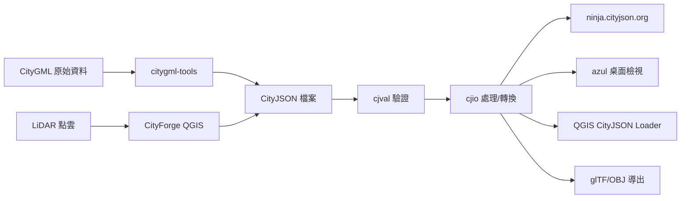
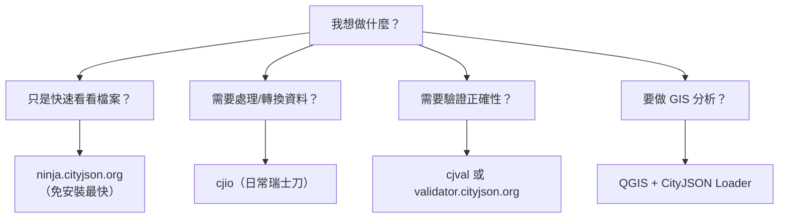

# Day 6：開發環境與工具鏈 — 一手搞定 CityJSON 的 6 大神器

> 經過前五天的學習，你已經知道 CityJSON 是什麼、長什麼樣子、怎麼手寫一個檔案。但真實世界不會有人手寫每一棟建築物——我們需要工具。今天來盤點 CityJSON 生態系中最實用的 6 個工具。

---

## 工具全景圖

在開始之前，先看看這些工具在 CityJSON 工作流程中的定位：



這條從原始資料到視覺化的管線，涵蓋了 CityJSON 生態系的全部環節。今天我們逐一介紹每個工具，明天開始就會頻繁使用它們。

---

## 1. cjio — Python CLI 瑞士刀

**用途**：CityJSON 檔案的核心處理工具，**最常使用**。  
**安裝**：`pip install cjio`（可選附加功能 `pip install 'cjio[export,reproject,validate]'`）[^cjio-github]  
**GitHub**：https://github.com/cityjson/cjio  
**文件**：https://cjio.readthedocs.io

cjio 是一把「瑞士刀」，幾乎所有 CityJSON 的日常操作都可以用它完成。它最大的特色是 **operator chaining（指令串接）**——你可以把多個操作串在一行指令裡，像管線一樣依序執行[^cjio-docs]：

```bash
# 升級舊版 → 驗證 → 儲存
cjio old.city.json upgrade validate save new.city.json

# 依 bounding box 篩選 → 移除材質 → 儲存
cjio bigfile.city.json subset --bbox 104607 490148 104703 490257 materials_remove save subset.city.json

# 合併多個檔案
cjio file1.city.json merge '/data/*.city.json' save all_merged.city.json

# 匯出為 glTF 二進位檔
cjio example.city.json export glb /home/user/gltfs/
```

### 常用指令一覽

| 指令 | 作用 |
|------|------|
| `info` | 顯示資料集資訊（bbox、CRS、物件數量） |
| `subset` | 依 ID、bbox、半徑、類型或隨機篩選 |
| `merge` | 合併多個 CityJSON 檔案 |
| `export` | 匯出為 glTF/glb、OBJ、JSONL 等格式 |
| `validate` | 驗證 CityJSON 合法性（含 Extensions） |
| `upgrade` | 升級 v1.0/v1.1 到最新版 |
| `crs_reproject` | 座標重新投影 |
| `lod_filter` | 只保留特定 LoD |
| `vertices_clean` | 清除重複與孤立頂點 |
| `attribute_remove` / `attribute_rename` | 屬性管理 |

cjio 也支援 **stdin/stdout 串流**，可以和其他 Unix 指令串接：

```bash
# 透過 pipe 處理 CityJSONSeq 串流
cat mystream.city.jsonl | cjio --suppress_msg stdin textures_remove save stdout
```

如果不想安裝 Python，也可以用 Docker[^cjio-docker]：

```bash
docker run --rm -v /your/data:/data tudelft3d/cjio:latest cjio --help
```

---

## 2. cjval — 官方驗證器

**用途**：確保你的 CityJSON 檔案符合規格。  
**安裝**：`cargo install cjval --features build-binary`（需要 Rust 編譯器）[^cjval-github]  
**Web 版**：https://validator.cityjson.org  
**GitHub**：https://github.com/cityjson/cjval

Day 5 我們手寫了一個 `hello.city.json`——你怎麼知道它寫對了？把檔案丟給 cjval 就知道了。

cjval 用 Rust 撰寫，速度極快，能檢查的項目包括[^cjval-features]：

- JSON 語法正確性
- CityJSON Schema 合規性（v1.0 / v1.1 / v2.0）
- Extension Schema 合規性
- parents/children 一致性
- 頂點索引是否超出範圍
- 語意陣列長度是否匹配
- 紋理與材質引用是否正確
- 重複頂點與孤立頂點警告

```bash
# 基本驗證
cjval hello.city.json

# 只看結果摘要
cjval --summary hello.city.json

# 輸出詳細 JSON 報告
cjval --report hello.city.json > report.json
```

如果你不想安裝任何東西，直接打開 https://validator.cityjson.org 把檔案拖進去——因為驗證是在瀏覽器端透過 WebAssembly 執行，你的檔案**不會上傳到伺服器**[^cjval-web]。

---

## 3. ninja.cityjson.org — 網頁版 3D 檢視器

**用途**：**最快速**的視覺化方式，不需要安裝任何東西。  
**網址**：https://ninja.cityjson.org

打開瀏覽器，把 `.city.json` 檔案拖進去，建築物就在你眼前了。ninja 完全在瀏覽器端執行，支援：

- 3D 旋轉、平移、縮放
- 含洞口的建築物正確顯示
- 基本編輯功能
- 物件選取與屬性瀏覽

這是「我想快速看一下這個檔案長什麼樣子」的首選工具，也是我們之前手寫範例後拿來驗證視覺成果的好幫手。

---

## 4. azul — 原生桌面檢視器

**用途**：高效能 3D 城市模型檢視，支援 CityJSON 與 CityGML。  
**安裝**：Mac App Store 免費下載，或從 GitHub Releases 取得[^azul-github]  
**GitHub**：https://github.com/tudelft3d/azul  
**支援平台**：macOS 13+（Apple Silicon & Intel）、iOS 13+

azul 是 TU Delft 團隊開發的原生 3D 檢視器，採用 Apple Metal 和 SIMD 指令集最佳化，效能極佳。它可以同時載入多個檔案，並支援[^azul-features]：

- 滑鼠點選選取物件或從側邊欄選取
- 依 LoD 過濾顯示
- 瀏覽物件屬性
- 材質與紋理顯示
- 夜間模式、自訂顏色
- 匯出圖片、搜尋物件、複製 ID

操作方式[^azul-controls]：

| 動作 | 操作 |
|------|------|
| 平移 | 滾輪捲動 |
| 旋轉 | 按住左鍵拖曳 |
| 縮放 | 觸控板雙指縮放，或按住右鍵拖曳 |
| 選取 | 點選物件或從側邊欄點選 |

如果你在 macOS 上工作，azul 是目前最順暢的 CityJSON 桌面檢視體驗。

---

## 5. citygml-tools — CityGML ↔ CityJSON 雙向轉換

**用途**：如果你手上有 CityGML 檔案想轉成 CityJSON（或反過來），就靠它。  
**安裝**：從 GitHub Releases 下載 ZIP，或 `git clone` 後用 Gradle 建置[^citygml-tools-github]  
**GitHub**：https://github.com/citygml4j/citygml-tools  
**需求**：Java 17+

```bash
# CityGML → CityJSON
citygml-tools to-cityjson myfile.gml

# CityJSON → CityGML
citygml-tools from-cityjson myfile.city.json

# 合併多個 CityGML 檔案
citygml-tools merge city1.gml city2.gml city3.gml

# 產出統計資訊
citygml-tools stats /path/to/city.gml
```

citygml-tools 使用 Java 撰寫，基於 citygml4j 函式庫，支援 CityGML 1.0、2.0 和 3.0[^citygml-tools-features]。除了雙向轉換，它還能：

- 依 LoD 過濾
- 座標重新投影
- 升級 CityGML 1.0/2.0 到 3.0
- 批次處理大量檔案

```bash
# Docker 批次轉換
docker run --rm -u 1000 -v /path/to/data:/data citygml-tools to-cityjson *.gml
```

---

## 6. QGIS 外掛生態系

**用途**：在 GIS 桌面環境中載入、視覺化與分析 CityJSON。  
**安裝**：QGIS → `外掛` → `管理與安裝外掛` → 搜尋安裝

QGIS 有兩個重要的 CityJSON 相關外掛：

### CityJSON Loader

官方外掛，由 TU Delft 維護，可以將 CityJSON 直接載入 QGIS 作為圖層[^cityjson-qgis-plugin]：

- 自動啟用 3D 檢視
- 可依物件類型拆分圖層（建築物、道路、植栽各自獨立）
- 保留所有屬性與語意資訊
- 支援 QGIS 3.40 (LTR)、3.44 (LTR) 及 QGIS 4.x

安裝後從選單 `圖層 → CityJSON Loader → Load CityJSON...` 選取檔案即可。

### CityForge

由 Oslandia 開發的 **3D 建築物重建** 外掛[^cityforge]——從建築物足跡（footprint）加上分類點雲（LiDAR），自動生成 CityJSON 格式的 3D 建築模型。適合從原始測量資料建立城市模型的場景。

---

## 選工具的策略建議

這麼多工具，新手該從哪個開始？這裡提供一個簡單的決策流程：



如果你是新手，建議的學習順序是：

1. **ninja.cityjson.org** — 先看看 CityJSON 檔案「長什麼樣子」
2. **cjio** — 學習用指令處理檔案（這會是你最常用的工具）
3. **cjval** — 寫完或轉檔後記得驗證
4. **QGIS CityJSON Loader** — 需要 GIS 分析時裝上
5. **citygml-tools** — 遇到 CityGML 轉換需求時再學
6. **azul** — 如果你用 macOS，這是檢視體驗最棒的選擇

---

## 總結

| 工具 | 一句話定位 | 必學程度 |
|------|-----------|---------|
| **cjio** | Python 瑞士刀，日常處理全靠它 | ⭐⭐⭐⭐⭐ |
| **cjval** | 驗證正確性，避免踩坑 | ⭐⭐⭐⭐ |
| **ninja** | 免安裝網頁檢視，快速看一眼 | ⭐⭐⭐⭐ |
| **azul** | macOS 原生高效能檢視器 | ⭐⭐⭐ |
| **citygml-tools** | CityGML ↔ CityJSON 轉換橋樑 | ⭐⭐⭐ |
| **QGIS 外掛** | GIS 分析與 3D 重建 | ⭐⭐⭐ |

明天開始，我們就要正式進入 Phase 2——**幾何核心**。我們會從 Transform（座標壓縮機制）講起，這是一切幾何操作的基礎。

---

## 參考資料

[^cjio-github]: cityjson. (n.d.). cjio: Python CLI to process and manipulate CityJSON files (Version 0.10.1) [Computer software]. GitHub. Retrieved 2026-09-27, from https://github.com/cityjson/cjio

[^cjio-docs]: cjio Documentation. (n.d.). cjio: Operators and usage. Read the Docs. Retrieved 2026-09-27, from https://cjio.readthedocs.io/en/stable/

[^cjio-docker]: tudelft3d. (n.d.). cjio Docker image. Docker Hub. Retrieved 2026-09-27, from https://hub.docker.com/r/tudelft3d/cjio

[^cjval-github]: cityjson. (n.d.). cjval: A Rust library and CLI to validate CityJSON datasets (Version latest) [Computer software]. GitHub. Retrieved 2026-09-27, from https://github.com/cityjson/cjval

[^cjval-features]: cityjson. (n.d.). cjval README: Validation features. GitHub. Retrieved 2026-09-27, from https://github.com/cityjson/cjval

[^cjval-web]: cityjson. (n.d.). CityJSON Validator. Retrieved 2026-09-27, from https://validator.cityjson.org

[^azul-github]: tudelft3d. (n.d.). azul: A native 3D city model viewer for macOS and iOS (Version latest) [Computer software]. GitHub. Retrieved 2026-09-27, from https://github.com/tudelft3d/azul

[^azul-features]: tudelft3d. (n.d.). azul README: Features. GitHub. Retrieved 2026-09-27, from https://github.com/tudelft3d/azul

[^azul-controls]: tudelft3d. (n.d.). azul README: Controls and usage. GitHub. Retrieved 2026-09-27, from https://github.com/tudelft3d/azul

[^citygml-tools-github]: citygml4j. (n.d.). citygml-tools: CLI tools for CityGML (Version latest) [Computer software]. GitHub. Retrieved 2026-09-27, from https://github.com/citygml4j/citygml-tools

[^citygml-tools-features]: citygml4j. (n.d.). citygml-tools README: Features and usage. GitHub. Retrieved 2026-09-27, from https://github.com/citygml4j/citygml-tools

[^cityjson-qgis-plugin]: cityjson. (n.d.). CityJSON QGIS Plugin (Version 1.0.1) [Computer software]. GitHub. Retrieved 2026-09-27, from https://github.com/cityjson/cityjson-qgis-plugin

[^cityforge]: Oslandia. (n.d.). CityForge: 3D building reconstruction QGIS plugin (Version 1.2.1) [Computer software]. GitLab. Retrieved 2026-09-27, from https://gitlab.com/Oslandia/qgis/cityforge