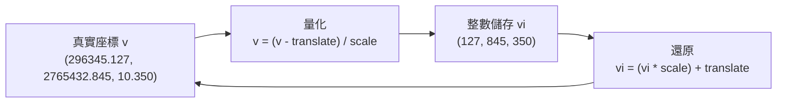

# Day 7：頂點系統與 Transform — 整數座標的壓縮魔法

> Day 4 我們提到 CityJSON 的頂點是以整數儲存的。但你一定想過：真實世界的建築物座標是 296345.127 這樣的小數，為什麼 CityJSON 要把它存成整數？今天深入這個讓 CityJSON 比 CityGML 小 6 倍的關鍵機制。

---

## 從一個實際的座標說起

假設臺北 101 的某個角落座標是 `(296345.127, 2765432.845, 10.350)`——這是真實世界的 TWD97 座標。如果直接用 JSON 浮點數儲存，檔案會又大又囉嗦。而且 JSON 對浮點數的處理在不同語言之間可能出現細微誤差。

CityJSON 的做法是：**把座標存成整數，再用 Transform 物件記錄「怎麼還原」**[^cityjson-specs-transform]。

```json
{
  "transform": {
    "scale": [0.001, 0.001, 0.001],
    "translate": [296345.0, 2765432.0, 10.0]
  },
  "vertices": [
    [127, 845, 350]
  ]
}
```

要還原真實座標，只要套用這個公式：

```
v[0] = (127 * 0.001) + 296345.0 = 296345.127
v[1] = (845 * 0.001) + 2765432.0 = 2765432.845
v[2] = (350 * 0.001) + 10.0 = 10.350
```

完全吻合![^cityjson-specs-transform]

---

## 靈感來自 TopoJSON 的 Quantization

這套機制並非 CityJSON 原創，而是向 **TopoJSON** 借來的[^topojson-spec]。TopoJSON 是 Mike Bostock（D3.js 作者）在 2013 年左右提出的地理資料格式，它用一個叫做 **quantization（量化）** 的技巧來壓縮座標：

1. 先決定你要保留多少位精確度（scale）
2. 把座標減去最小值（translate）
3. 除以 scale 後取整數

TopoJSON 做的是 2D 的經緯度壓縮，CityJSON 把它延伸到 3D，加上了第三個座標軸。TU Delft 團隊在設計 CityJSON 時，直接借用了這個成熟且經過驗證的方案[^cityjson-specs-transform]。

---

## Transform 成員拆解

Transform 只有兩個成員，非常簡單[^cityjson-specs-transform]：

```json
"transform": {
  "scale": [0.001, 0.001, 0.001],
  "translate": [442464.879, 5482614.692, 310.19]
}
```

### scale — 決定精確度

`scale` 的三個數值分別對應 X、Y、Z 軸，代表「每個整數單位對應多少真實世界單位」。常見的設定：

| scale 值 | 精確度 | 適用場景 |
|-----------|--------|----------|
| `[1.0, 1.0, 1.0]` | 整數公尺 | 簡單範例、LoD0 粗略模型 |
| `[0.1, 0.1, 0.1]` | 公寸（10cm） | 一般城市模型 |
| `[0.01, 0.01, 0.01]` | 公分 | 細緻建築模型 |
| `[0.001, 0.001, 0.001]` | 公釐 | 最高精度、室內模型 |

### translate — 決定基準點

`translate` 通常是整個資料集 bounding box 的最小值（但不強制）。這樣一來，所有的整數頂點都是**相對於這個基準點的正整數偏移**，數字小、好壓縮。

來看個對照範例。同樣一棟建築物，不同 scale 設定會產生不同大小的 vertex 陣列：

| scale | vertices 儲存值 | 檔案大小佔比 |
|-------|----------------|-------------|
| `[0.1, 0.1, 0.1]` | `[2963451, 27654328, 103]` | 約 100%（基準） |
| `[0.01, 0.01, 0.01]` | `[29634513, 276543285, 1035]` | 約 130% |
| `[1.0, 1.0, 1.0]` | `[296345, 2765432, 10]` | 約 70% |

這也解釋了為什麼 CityJSON 選擇整數儲存——**整數在 JSON 中不帶小數點，字串更短，而且沒有浮點數精確度問題**。

---

## 還原公式視覺化

把 Transform 的運作想像成一個「壓縮袋」：



所有讀取 CityJSON 的軟體（cjio、ninja.cityjson.org、azul）都會自動幫你做還原。一般開發者**不太需要手動計算**，但知道原理能幫助你理解為什麼 CityJSON 這麼小、以及如何控制精確度。

---

## 誰被 Transform？誰沒有？

非常重要的一個細節：**只有根層級的 `vertices` 受 Transform 影響**[^cityjson-specs-transform]。以下這些**不會被 transform**：

- **Geometry Templates 的 `vertices-templates`** — 因為模板的頂點是相對座標，需要另外處理
- **紋理的 `vertices-texture`** — 紋理座標是 UV 空間的 2D 值，不是真實世界座標
- **`geographicalExtent`** — metadata 中的 bounding box 直接記錄真實世界的小數座標，不受壓縮[^cityjson-specs-metadata]

---

## 單位 Transform 的特殊意義

你可能已經注意到，最小的合法 CityJSON 檔案是用「單位 Transform」：

```json
"transform": {
  "scale": [1.0, 1.0, 1.0],
  "translate": [0.0, 0.0, 0.0]
}
```

**這代表整數座標就等於真實世界座標**，沒有任何壓縮效果[^cityjson-specs-object]。對簡單範例來說很方便——就像我們 Day 5 手寫的建築物，用單位 Transform 讓初學者更容易理解。但對真實資料集來說，你永遠不應該用單位 Transform——那會讓你失去 CityJSON 最大的優勢之一。

---

## 小結

今天我們學到了：

- CityJSON 用**整數儲存頂點**，透過 Transform 物件記錄還原參數
- 這個點子來自 **TopoJSON 的 quantization**，CityJSON 擴展到 3D
- **scale 控制精確度**（公釐到公尺等級），**translate 控制基準點**
- 還原公式很簡單：`v[i] = (vi[i] * scale[i]) + translate[i]`
- **只有根層級的 vertices 受影響**，templates、textures、geographicalExtent 不受 transform

明天我們進入 Phase 2 的第二站——基本的幾何類型！

---

## 參考資料

[^cityjson-specs-transform]: Ledoux, H., & Dukai, B. (2023). CityJSON Specifications 2.0.0: §4 Transform Object. Retrieved 2026-09-27, from https://www.cityjson.org/specs/2.0.0/#transform-object

[^cityjson-specs-object]: Ledoux, H., & Dukai, B. (2023). CityJSON Specifications 2.0.0: §1 CityJSON Object. Retrieved 2026-09-27, from https://www.cityjson.org/specs/2.0.0/#cityjson-object

[^cityjson-specs-metadata]: Ledoux, H., & Dukai, B. (2023). CityJSON Specifications 2.0.0: §5.1 geographicalExtent (bbox). Retrieved 2026-09-27, from https://www.cityjson.org/specs/2.0.0/#geographicalextent-bbox

[^topojson-spec]: TopoJSON. (n.d.). TopoJSON Specification: §2.1.2 Transforms. Retrieved 2026-09-27, from https://github.com/topojson/topojson-specification/blob/master/README.md#212-transforms