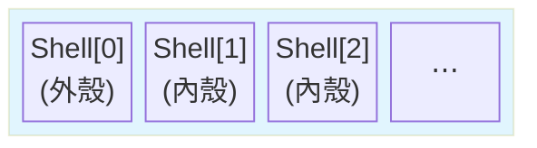
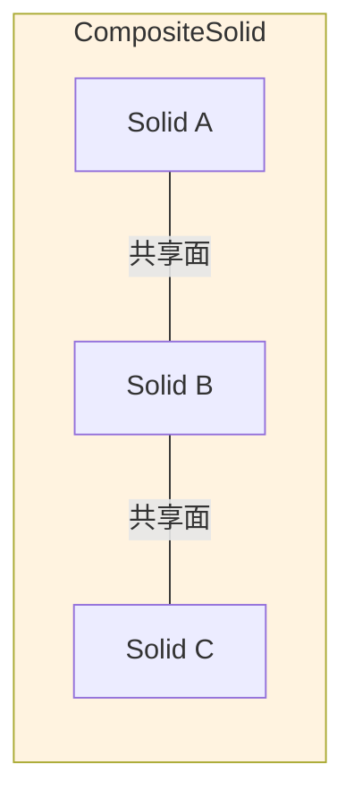

# Day 9：實體幾何 — Solid、CompositeSolid、MultiSolid

> Day 8 我們學會了基礎的點線面幾何類型。但真正的建築物不是一堆漂浮的平面——它是**體積**。今天要介紹的 Solid 系列幾何，就是 CityJSON 用來表達「體積」的方式。

---

## 從平面到立體：為什麼需要 Solid？

Day 8 的箱型橋樑用了 6 個表面（MultiSurface）來表示一個盒子。但 MultiSurface 有一個根本的限制：**它不知道這些面有沒有構成封閉體積**。6 片牆擺在一起，對電腦來說只是 6 片牆，不是「一個房間」。

Solid 就是為了解決這個問題而生的——它強制要求面必須形成**封閉的體積**，並且可以明確指定內部空洞（例如中庭或管道間）[^cityjson-specs-geometry]。

```
┌─────────────────────────────────────────────┐
│                                             │
│  MultiSurface    Solid        CompositeSolid │
│  ┌──────┐      ┌──────┐      ┌──────┬─────┐ │
│  │ 面集合 │      │ 封閉體 │      │ 體+體 │ │
│  │ 不保證 │  →   │ 有內殼 │  →   │ 共享面 │ │
│  │ 封閉  │      │ 可挖洞 │      │ 單一體 │ │
│  └──────┘      └──────┘      └──────┴─────┘ │
│                                             │
│  深度 3          深度 4          深度 5      │
└─────────────────────────────────────────────┘
```

---

## Solid — 封閉體積的基本單位

Solid 是 CityJSON 中表達「體積」的最小單位。它的 `boundaries` 深度為 4，結構是：**Shell（殼）→ Surface（面）→ Ring（環）→ Vertex（頂點）**[^cityjson-specs-geometry]。



其中 **Shell[0] 永遠是外殼**，之後的所有 Shell 都是**內殼（空洞）**[^cityjson-val3dity]。

### 邊界陣列深度圖解

```json
{
  "type": "Solid",
  "lod": "2",
  "boundaries": [
    // ── Shell[0]：外殼（Depth 1）──
    [
      // ── Surface[0]：第一個面（Depth 2）──
      [
        // ── Ring[0]：外環（Depth 3）──
        [0, 3, 2, 1],  // ← Depth 4：頂點索引
        // ── Ring[1]：內環（這個面的洞）
        [22, 23, 24]
      ],
      // ── Surface[1]：第二個面
      [[4, 5, 6, 7]],
      [[0, 1, 5, 4]],
      [[1, 2, 6, 5]]
    ],
    // ── Shell[1]：內殼（空洞）──
    [
      [[240, 243, 124]],
      [[244, 246, 724]],
      [[34, 414, 45]],
      [[111, 246, 5]]
    ]
  ]
}
```

### 深度對照表

| 層級 | 陣列 | 意義 |
|------|------|------|
| Depth 1 | `boundaries[i]` | 第 i 個 Shell |
| Depth 2 | `boundaries[i][j]` | 第 j 個 Surface |
| Depth 3 | `boundaries[i][j][k]` | 第 k 個 Ring（外環或內環） |
| Depth 4 | `boundaries[i][j][k][l]` | 頂點索引 |

### 真實案例：有中庭的建築物

想像一棟 L 型建築，中間有一個露天中庭。外殼描述建築物的外部輪廓，內殼描述中庭的「空心空間」[^cityjson-specs-geometry]：

```json
{
  "type": "Solid",
  "lod": "2",
  "boundaries": [
    [
      // 外殼：6 個面
      [[0, 1, 2, 3]],    // 頂面
      [[4, 5, 6, 7]],    // 底面
      [[0, 3, 7, 4]],    // 左面
      [[1, 5, 6, 2]],    // 右面
      [[0, 1, 5, 4]],    // 前面
      [[3, 2, 6, 7]]     // 後面
    ],
    [
      // 內殼：中庭空洞（同樣 6 個面，但方向相反）
      [[8, 11, 10, 9]],   // 中庭頂（面向下）
      [[12, 13, 14, 15]], // 中庭底（面向上）
      [[8, 9, 13, 12]],
      [[11, 10, 14, 15]],
      [[8, 12, 15, 11]],
      [[9, 10, 14, 13]]
    ]
  ]
}
```

### 誰可以用 Solid？

不是所有城市物件都可以用 Solid。規格書明確限制某些物件的幾何類型：

| 城市物件 | 可用 Solid？ | 備註 |
|----------|-------------|------|
| Building、BuildingPart | **是** | 最常見的 Solid 使用者 |
| Bridge、BridgePart | **是** | 只允許 Solid/CompositeSolid/MultiSurface/CompositeSurface[^cityjson-specs-objects] |
| Road、Railway | 否 | 通常用 MultiLineString 或 MultiSurface |
| SolitaryVegetationObject | 否 | 只能用 MultiPoint 或 MultiSurface |

---

## CompositeSolid — 共享邊界的複合體

CompositeSolid 和 MultiSolid 的 **資料結構完全一樣**（深度 5），但語意不同。CompositeSolid 要求其內部的所有 Solid **必須共享邊界**，形成一個**拓撲相連**的單一物體[^cityjson-specs-geometry]。



### 真實案例：橋樑的橋墩 + 橋面

一座橋通常由多個部分組成——橋面、橋墩、橋塔——但它們在結構上相連。用 CompositeSolid 可以精確表達這種「相連但分部件」的關係[^cityjson-specs-objects]：

```json
{
  "type": "CompositeSolid",
  "lod": "2.1",
  "boundaries": [
    [
      // Solid[0]：橋面
      [
        [[0, 1, 2, 3]],   // 頂面
        [[4, 5, 6, 7]],   // 底面
        [[0, 3, 7, 4]],
        [[1, 5, 6, 2]],
        [[0, 1, 5, 4]],
        [[3, 2, 6, 7]]
      ]
    ],
    [
      // Solid[1]：左橋墩（與橋面共享面）
      [
        [[8, 9, 10, 11]],
        [[12, 13, 14, 15]],
        [[8, 11, 15, 12]],
        [[9, 13, 14, 10]],
        [[8, 9, 13, 12]],
        [[11, 10, 14, 15]]
      ]
    ],
    [
      // Solid[2]：右橋墩（與橋面共享面）
      [
        [[16, 17, 18, 19]],
        [[20, 21, 22, 23]],
        [[16, 19, 23, 20]],
        [[17, 21, 22, 18]],
        [[16, 17, 21, 20]],
        [[19, 18, 22, 23]]
      ]
    ]
  ]
}
```

---

## MultiSolid — 不相連的實體集合

MultiSolid 和 CompositeSolid 的邊界陣列深度相同（5 層），但它的內部 Solid **不需要共享邊界**。它們只是「被放在同一個 geometry 陣列裡」的一群體積[^cityjson-specs-geometry]。

```mermaid
flowchart LR
    subgraph MS["MultiSolid"]
        S1["Solid A"] S2["Solid B"] S3["Solid C"]
    end
    S1 -.- S2
    S2 -.- S3
    style MS fill:#f3e5f5
```

### 真實案例：同一土地上的多棟獨立建築

一塊土地上有三棟不相連的建築物，但它們共享同一個 land use 分區。用 MultiSolid 可以把它們放在同一個幾何物件中，方便一起處理：

```json
{
  "type": "MultiSolid",
  "lod": "2",
  "boundaries": [
    [
      // Solid[0]：建築 A
      [
        [[0, 3, 2, 1]], [[4, 5, 6, 7]],
        [[0, 1, 5, 4]], [[1, 2, 6, 5]],
        [[2, 3, 7, 6]], [[3, 0, 4, 7]]
      ]
    ],
    [
      // Solid[1]：建築 B（與 A 沒共用邊界）
      [
        [[100, 103, 102, 101]], [[104, 105, 106, 107]],
        [[100, 101, 105, 104]], [[101, 102, 106, 105]],
        [[102, 103, 107, 106]], [[103, 100, 104, 107]]
      ]
    ]
  ]
}
```

---

## CompositeSolid vs MultiSolid：一句話區別

| 面向 | CompositeSolid | MultiSolid |
|------|---------------|-----------|
| **邊界關係** | Solid 間共享邊界 | Solid 間不強制相連 |
| **語意** | 單一連貫物體 | 多個獨立物體的集合 |
| **驗證工具** | val3dity 會檢查共享邊界 | val3dity 只檢查每個 Solid 封閉 |
| **資料結構** | 深度 5 | 深度 5 |
| **應用場景** | 橋樑、有連接結構的建築 | 校區多棟建築、工業園區 |

**資料結構上兩者完全相同**，差異只在於 `type` 欄位的值——以及處理軟體對待它們的方式[^cityjson-specs-geometry]。

---

## 深度規則總複習

到目前為止，我們已經學了 7 種幾何類型的邊界陣列深度：

| 幾何類型 | 深度 | 陣列結構 |
|----------|------|----------|
| `MultiPoint` | 1 | `[v]` |
| `MultiLineString` | 2 | `[[v]]` |
| `MultiSurface` | 3 | `[[[v]]]` |
| `CompositeSurface` | 3 | `[[[v]]]` |
| **`Solid`** | **4** | `[[[[v]]]]` |
| **`CompositeSolid`** | **5** | `[[[[[v]]]]]` |
| **`MultiSolid`** | **5** | `[[[[[v]]]]]` |

記住這個規則：每一層巢狀代表**往內走一層容器**（MultiSurface → Solid 多了一層 Shell，Solid → MultiSolid 又多了一層 Solid 集合）。

---

## 小結

今天我們學到了三個實體幾何類型：

- **Solid** — 最基本的體積單位，有外殼和內殼（空洞），深度 4
- **CompositeSolid** — 多個共享邊界的 Solid（橋樑、複合建築），深度 5
- **MultiSolid** — 多個不相連的 Solid（獨立建築群），深度 5
- **Solid 系列的驗證**依賴 **val3dity** 工具檢查封閉性、方向正確性和共享邊界

明天進入幾何邊界陣列與索引機制的深度解析，我們會用更視覺化的方式理解這些巢狀陣列。

---

## 參考資料

[^cityjson-specs-geometry]: Ledoux, H., & Dukai, B. (2023). CityJSON Specifications 2.0.0: §3 Geometry Objects. Retrieved 2026-09-27, from https://www.cityjson.org/specs/2.0.0/#geometry-objects

[^cityjson-specs-objects]: Ledoux, H., & Dukai, B. (2023). CityJSON Specifications 2.0.0: §2 City Objects. Retrieved 2026-09-27, from https://www.cityjson.org/specs/2.0.0/#city-objects

[^cityjson-val3dity]: Ledoux, H. (n.d.). val3dity: Validation of 3D City Models — Geometric Definitions. Retrieved 2026-09-27, from https://geovalidation.bk.tudelft.nl/val3dity/docs/definitions/