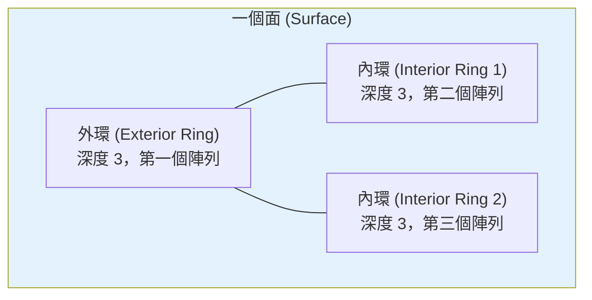
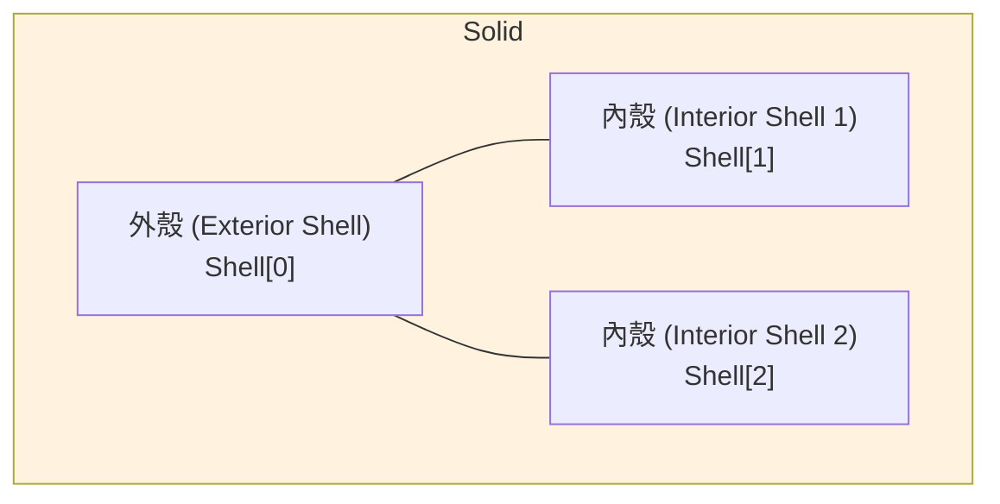

# Day 10：幾何邊界陣列深度解析與索引機制

> Day 8 和 Day 9 我們學會了 8 種幾何類型各自的結構。今天要深入核心機制——邊界陣列（Boundary Array）的深度規則與 Wavefront OBJ 索引機制——這才是 CityJSON 幾何系統最關鍵的設計，也是最容易出錯的地方。

---

## 從 Wavefront OBJ 借來的索引機制

CityJSON 的幾何設計借用了一個非常重要的概念 — **Wavefront OBJ 格式的索引機制**[^cityjson-specs]。在 OBJ 格式中，面的定義不是直接寫頂點座標，而是寫頂點在列表中的**索引編號**。

CityJSON 沿用了同樣的哲學：所有的 `(x, y, z)` 座標都集中存放在根層級的 `vertices` 陣列中，而每個幾何物件的 `boundaries` 陣列只存放**整數索引**來指向這些頂點[^cityjson-specs]。

```json
{
  "vertices": [
    [0, 0, 0],   // ← 索引 0
    [10, 0, 0],  // ← 索引 1
    [10, 10, 0],  // ← 索引 2
    [0, 10, 0]    // ← 索引 3
  ],
  "CityObjects": {
    "my-building": {
      "geometry": [{
        "type": "MultiSurface",
        "lod": "2",
        "boundaries": [
          [[0, 1, 2, 3]]  // ← 引用 vertices[0]~vertices[3]
        ]
      }]
    }
  }
}
```

### 為什麼要用索引？

這個設計至少帶來三個好處[^cityjson-specs]：

| 好處 | 說明 |
|------|------|
| **節省空間** | 一個座標值 `78248.663` 是 9 個字元，同樣數值以整數毫米索引表示只需 6 個字元。數百萬頂點時差距驚人 |
| **避免精確度損失** | 頂點座標是經過 Transform 壓縮的整數，直接索引整數不會有浮點數回存誤差 |
| **共享頂點** | 相鄰面可以共用同一頂點索引，而非重複儲存相同座標 |

---

## 邊界陣列深度規則總表

每個幾何類型的 `boundaries` 陣列**巢狀深度都不一樣**。深度就是你要從最外層的 `[]` 走到真正整數索引所需要經過的層數[^cityjson-geom-arrays]。

| 幾何類型 | 陣列深度 | 結構說明 |
|---------|---------|---------|
| `MultiPoint` | 1 | `[idx1, idx2, ...]` |
| `MultiLineString` | 2 | `[[idx1, idx2, ...], [idx3, idx4, ...]]` |
| `MultiSurface` | 3 | `[[[idx1, idx2, ...]], [[idx3, idx4, ...]]]` |
| `CompositeSurface` | 3 | 同 MultiSurface |
| `Solid` | 4 | `[ [ [[...]], [[...]], ... ], [ [[...]], ... ] ]` |
| `MultiSolid` | 5 | `[ [ [ [[...]], ... ], ... ], ... ]` |
| `CompositeSolid` | 5 | 同 MultiSolid |

這個規則可以用一句話記：**從點到線到面到體，每增加一個層次就多一層深度**。

---

## 逐層圖解：從 Depth 1 到 Depth 5

### Depth 1：MultiPoint — 最簡單的點集合

Depth 1 就是直接列出頂點索引，沒有任何巢狀結構[^cityjson-geom-arrays]。

```json
{ "type": "MultiPoint", "lod": "1.0", "boundaries": [2, 44, 0, 7] }
```

這裡的 `[2, 44, 0, 7]` 就是 4 個獨立的點。

### Depth 2：MultiLineString — 多條折線

每一條折線用一個陣列表示，多條折線再用外層陣列包起來[^cityjson-geom-arrays]。

```json
{
  "type": "MultiLineString",
  "lod": "1.0",
  "boundaries": [
    [2, 3, 5],
    [77, 55, 212]
  ]
}
```

`[2, 3, 5]` 是一條折線（從頂點 2 到 3 到 5），`[77, 55, 212]` 是另一條。

### Depth 3：MultiSurface / CompositeSurface — 平面集合

到了面層級，深度變為 3。每個面由一個或多個環（Ring）組成——**第一個環是外環，後面的環都是洞**[^cityjson-geom-arrays]。

```json
{
  "type": "MultiSurface",
  "lod": "2.1",
  "boundaries": [
    // 第一個面：有兩個洞的矩形
    [ [1, 2, 3, 4, 5], [6, 8, 7], [9, 12, 11, 10] ],
    // 第二個面：簡單三角形（無洞）
    [[14, 15, 16]]
  ]
}
```

### Depth 4：Solid — 立體

Solid 的深度為 4。最外層是 Shell（殼），**Shell[0] 永遠是外殼**，Shell[1] 到 Shell[n] 是內殼（空洞）[^cityjson-geom-arrays]。

```json
{
  "type": "Solid",
  "lod": "2",
  "boundaries": [
    // Shell[0]：外殼（6 個面）
    [ [[0, 3, 2, 1]], [[4, 5, 6, 7]], [[0, 1, 5, 4]], [[1, 2, 6, 5]], [[0, 1, 2, 3]], [[4, 7, 6, 5]] ],
    // Shell[1]：內殼（空洞，4 個面）
    [ [[240, 243, 124]], [[244, 246, 724]], [[34, 414, 45]], [[111, 246, 5]] ]
  ]
}
```

### Depth 5：MultiSolid / CompositeSolid — 複合體

Depth 5 在最外層又包了一層 Solid 陣列，可以容納多個 Solid[^cityjson-geom-arrays]。

```json
{
  "type": "CompositeSolid",
  "lod": "3.0",
  "boundaries": [
    // 第一個 Solid
    [ [ [[0, 3, 2, 1]], [[4, 5, 6, 7]] ] ],
    // 第二個 Solid
    [ [ [[666, 667, 668]], [[74, 75, 76]] ] ]
  ]
}
```

---

## 外環與內環的視覺化

在 Depth 3 以上的幾何中，每個面的第一個 Ring 是外環（Exterior Ring），後面的都是內環（Interior Ring，也就是洞）。用 mermaid 圖解一個帶洞的矩形面：



對於 Solid 來說，同樣的概念適用於殼層級——Shell[0] 是外殼，Shell[1..n] 是內殼（中空空洞）[^cityjson-specs-geometry]：



---

## 常見錯誤與除錯技巧

### 錯誤 1：頂點索引超出範圍

`boundaries` 中某個索引值大於等於 `vertices` 陣列的長度。這是最常見的幾何錯誤之一，`cjval` 驗證器會報告 `wrong_vertex_index` 錯誤[^cityjson-corpus]。

**檢查方式**：找到 `boundaries` 中最大值，確認 `max(boundaries_flat) < len(vertices)`。

### 錯誤 2：陣列深度錯誤

使用了錯誤的巢狀深度——例如把 `MultiSurface` 的 `boundaries` 寫成了 Depth 2 而非 Depth 3。

**檢查方式**：對照深度總表，確認巢狀層數符合幾何類型。`val3dity` 可以直接驗證 ISO 19107 的幾何正確性[^val3dity-errors]。

### 錯誤 3：內殼不在外殼內部

對 Solid 來說，內殼（空洞）的範圍必須完全位於外殼內部，否則 `val3dity` 會報告**錯誤 403**（`INNER_SHELL_OUTSIDE`）[^val3dity-errors]。

### 錯誤 4：Shell 不封閉

Solid 的外殼如果沒有完全封閉（不是水密容器），`val3dity` 會報**錯誤 302**（`SHELL_NOT_CLOSED`）[^val3dity-errors]。

### 錯誤 5：Transform 忘了套用

這不是 `boundaries` 本身的錯誤，但卻是讀取 CityJSON 時**最常見的 bug**——直接使用未經 Transform 還原的整數座標[^spatialworkflow]。

```python
# ❌ 錯誤：直接用整數座標
x = vertices[0][0]

# ✅ 正確：套用 Transform
x = vertices[0][0] * transform["scale"][0] + transform["translate"][0]
```

### val3dity 快速錯誤代碼參考

| 代碼 | 錯誤 | 說明 |
|------|------|------|
| 101 | `TOO_FEW_POINTS` | Ring 少於 3 個點 |
| 104 | `RING_SELF_INTERSECTION` | Ring 自相交（蝴蝶結形狀） |
| 203 | `NON_PLANAR_POLYGON` | 多邊形頂點不在同一平面 |
| 302 | `SHELL_NOT_CLOSED` | Shell 未封閉（非水密） |
| 403 | `INNER_SHELL_OUTSIDE` | 內殼超出外殼範圍 |
| 905 | `INVALID_JSON` | CityJSON 不符合 JSON Schema |

完整的錯誤代碼可參考 val3dity 官方文件[^val3dity-errors]。

---

## 除錯工具鏈

處理 CityJSON 幾何時，建議的檢查流程：

1. **cjval** — 先做 JSON Schema 驗證，檢查語法、索引範圍、parent/children 一致性[^cjval]
2. **val3dity** — 再做 ISO 19107 幾何驗證，檢查 Shell 封閉性、面方向、空間關係[^val3dity]
3. **視覺化** — 使用 [CJLoupe](https://geovalidation.bk.tudelft.nl/val3dity/browser/) 在 3D 中檢視錯誤位置，或上傳到 [ninja.cityjson.org](https://ninja.cityjson.org) 直接看模型
4. **cjio** — 用 Python 處理時，`cjio` 會自動幫你 dereference boundaries，讓你直接操作真實座標[^cjio]

---

## 小結

邊界陣列是 CityJSON 幾何系統的核心機制。從 Wavefront OBJ 借來的索引設計讓檔案更小、精確度更高、頂點可共享；而巢狀深度規則（Depth 1~5）則讓不同幾何類型能夠用統一的資料結構表達。最重要的實戰心得是：**隨時參照深度總表，用 cjval + val3dity 雙重驗證，並記得套用 Transform**。

下一步，Day 11 要介紹 Geometry Templates——CityJSON 最強的省空間武器。

---

## 參考資料

[^cityjson-specs]: CityJSON. (n.d.). CityJSON Specifications 2.2: Geometry Objects. Retrieved 2026-09-27, from https://www.cityjson.org/specs/

[^cityjson-geom-arrays]: CityJSON. (n.d.). Geometric primitives and depth of arrays. Retrieved 2026-09-27, from https://www.cityjson.org/dev/geom-arrays/

[^cityjson-specs-geometry]: CityJSON. (n.d.). CityJSON Specifications: Arrays to represent boundaries. Retrieved 2026-09-27, from https://www.cityjson.org/specs/#arrays-to-represent-boundaries

[^val3dity]: tudelft3d. (n.d.). val3dity: Validation of 3D GIS primitives according to ISO 19107. Retrieved 2026-09-27, from https://github.com/tudelft3d/val3dity

[^val3dity-errors]: tudelft3d. (n.d.). val3dity error code reference. Retrieved 2026-09-27, from https://val3dity.readthedocs.io/2.5.1/errors.html

[^cjval]: CityJSON. (n.d.). cjval: CityJSON Validator. Retrieved 2026-09-27, from https://github.com/cityjson/cjval

[^cjio]: CityJSON. (n.d.). cjio: CityJSON CLI and Python API. Retrieved 2026-09-27, from https://cityjson.github.io/cjio/

[^cityjson-corpus]: 3DGI. (n.d.). CityJSON corpus: Invalid test cases. Retrieved 2026-09-27, from https://3dgi.github.io/cityjson-corpus/cases/invalid/

[^spatialworkflow]: Spatial Workflow. (n.d.). CityJSON coordinates look tiny? Don't forget the transform!. Retrieved 2026-09-27, from https://www.spatialworkflow.io/cityjson-coordinates-look-tiny/