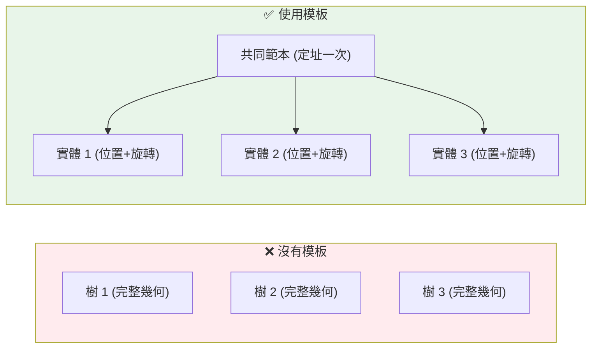

# Day 11：幾何模板 (Geometry Templates) — 省空間的殺手級功能

> Day 8 到 Day 10 我們深入了 CityJSON 的幾何系統，學會了 8 種幾何類型與邊界陣列的運作方式。但試想一座城市裡有上千棵相同的路樹、上百盞同樣的路燈——如果每一棵樹都要重複儲存完整的幾何資料，檔案會膨脹好幾倍。今天要介紹的 Geometry Templates 正是為了解決這個問題而生的殺手級功能。

---

## 重複幾何的困境

在真實的 3D 城市模型中，**大量物件共用相同的幾何形狀**。想像一條林蔭大道：

- **50 棵行道樹**：每棵都是同樣的樹冠形狀
- **30 盞路燈**：全部來自同一型號
- **20 張長椅**：同一設計

如果用傳統方式為每個物件各自儲存幾何資料，光是「同一棵樹」的頂點就會被重複儲存 50 次，檔案瞬間暴漲。CityJSON 的 **Geometry Templates**（幾何模板）機制正是為此而設計——**將共用幾何定義一次，然後在不同位置重複使用**[^cityjson-specs-templates]。

這項設計借鑑自 CityGML 的 **ImplicitGeometry**（隱式幾何）概念，但在實作上更簡潔、更集中：CityJSON 把所有模板集中在根層級的 `geometry-templates` 物件中，而不是散落在各個 GML 元素裡[^cityjson-specs-templates]。



---

## Geometry Templates 的結構

根層級的 `geometry-templates` 物件有兩個必要成員[^cityjson-specs-templates]：

```json
"geometry-templates": {
  "templates": [ ... ],           // 幾何物件陣列（定義形狀）
  "vertices-templates": [ ... ]   // 模板專用的頂點座標
}
```

### `templates` — 幾何定義陣列

這裡的每一個元素都是一個標準的 **Geometry Object**（幾何物件）——可以是 MultiSurface、Solid、CompositeSolid 等你已經學會的任何幾何類型。模板內的 `boundaries` 陣列引用的是 `vertices-templates` 中的頂點索引，而非根層級的 `vertices`[^cityjson-specs-templates]。

### `vertices-templates` — 專用頂點陣列

模板的頂點**獨立存放**在 `vertices-templates` 陣列中，不與根層級的 `vertices` 共用。這是一個重要的設計決策：**只有根層級的 `vertices` 會受到檔案層級 `transform` 的影響**，模板頂點則只由自身的 transformation matrix 控制。這確保了座標轉換、CRS 變換、邊界框計算等操作不會被模板頂點干擾[^cityjson-specs-templates]。

此外，模板幾何也可以擁有語意表面（semantic surfaces）和外觀材質（appearance）[^cityjson-specs-templates]：

```json
{
  "type": "MultiSurface",
  "lod": "2.1",
  "boundaries": [
    [[0, 3, 2, 1]], [[4, 5, 6, 7]], [[0, 1, 5, 4]]
  ],
  "semantics": {
    "surfaces": [
      { "type": "+Skylight" },
      { "type": "+PatioDoor" }
    ],
    "values": [0, 0, 1]
  }
}
```

---

## GeometryInstance — 把模板放到世界裡

定義好模板之後，城市物件要怎麼使用它？答案是 **GeometryInstance** 這個特殊的幾何類型。它不是一個獨立的幾何形狀，而是指向模板加上一個變換矩陣的「實體參考」[^cityjson-specs-templates]。

```json
{
  "type": "SolitaryVegetationObject",
  "geometry": [
    {
      "type": "GeometryInstance",
      "template": 0,
      "boundaries": [372],
      "transformationMatrix": [
        2.0, 0.0, 0.0, 0.0,
        0.0, 2.0, 0.0, 0.0,
        0.0, 0.0, 2.0, 0.0,
        0.0, 0.0, 0.0, 1.0
      ]
    }
  ]
}
```

GeometryInstance 的 4 個必要成員[^cityjson-specs-templates]：

| 成員 | 型態 | 說明 |
|------|------|------|
| `type` | 字串 | 固定為 `"GeometryInstance"` |
| `template` | 整數 | 引用 `templates` 陣列的第幾個模板（0 為基準） |
| `boundaries` | `[整數]` | 恰好一個頂點索引，指向根層級 `vertices` 陣列。這個點稱為**錨點**（anchor point），相當於 CityGML 的 referencePoint |
| `transformationMatrix` | `[16 個數字]` | 4×4 轉換矩陣，**逐行儲存**（row-by-row） |

---

## 4×4 轉換矩陣完全解析

轉換矩陣是 Geometry Templates 最核心也最容易令人困惑的部分。它是一個標準的 **4×4 齊次變換矩陣**（homogeneous transformation matrix）[^cityjson-geom-templates-dev]：

```
[ r11, r12, r13, tx,    // 第 0 列：X 軸旋轉/縮放 + X 平移
  r21, r22, r23, ty,    // 第 1 列：Y 軸旋轉/縮放 + Y 平移
  r31, r32, r33, tz,    // 第 2 列：Z 軸旋轉/縮放 + Z 平移
   0,   0,   0,  1  ]   // 第 3 列：齊次座標，永遠 [0,0,0,1]
```

### 最終座標計算方式

對於模板中的每個頂點 `(vx, vy, vz)`，最終的世界座標計算公式為[^cityjson-geom-templates-dev]：

```
x_final = r11×vx + r12×vy + r13×vz + tx + anchor_x
y_final = r21×vx + r22×vy + r23×vz + ty + anchor_y
z_final = r31×vx + r32×vy + r33×vz + tz + anchor_z
```

其中 `(anchor_x, anchor_y, anchor_z)` 是 `boundaries` 指向的頂點經過檔案 `transform` 解壓縮後的真實世界座標。

### 常用矩陣範例

**單位矩陣** — 不改變模板[^cityjson-geom-templates-dev]：
```
[1, 0, 0, 0,
 0, 1, 0, 0,
 0, 0, 1, 0,
 0, 0, 0, 1]
```

**等比例縮放 2 倍** — 把 5 公尺的樹變成 10 公尺[^cityjson-geom-templates-dev]：
```
[2, 0, 0, 0,
 0, 2, 0, 0,
 0, 0, 2, 0,
 0, 0, 0, 1]
```

**平移 (Tx, Ty, Tz)** — 在模板原本位置之外再移動[^cityjson-geom-templates-dev]：
```
[1, 0, 0, Tx,
 0, 1, 0, Ty,
 0, 0, 1, Tz,
 0, 0, 0, 1 ]
```

**繞 Z 軸旋轉 90 度** — 讓樹面向另一側[^cityjson-geom-templates-dev]：
```
[ 0, 1, 0, 0,
 -1, 0, 0, 0,
  0, 0, 1, 0,
  0, 0, 0, 1]
```

### ⚠️ 旋轉的中心點很重要

旋轉永遠是**以模板的局部座標系統原點 (0,0,0) 為中心**[^cityjson-github-discussion-201]。如果你的模板幾何沒有以原點為中心（例如一個從原點偏右的矩形），旋轉時它會繞著原點進行公轉而非自轉。

**解決方案**：設計模板時將幾何頂點置中於 (0,0,0)，或者將平移與旋轉組合在同一個矩陣中。

---

## 完整實例：一棵 10 公尺的方塊樹

以下是一個完整的 CityJSON 範例檔案，摘自官方教學資源。它描述了一棵位於荷蘭臺夫特理工大學 BK-City 建築前方的「樹」（以 10m×10m×10m 的立方體來代表）[^cityjson-geom-templates-dev]：

```json
{
  "type": "CityJSON",
  "version": "1.1",
  "CityObjects": {
    "mybigtree": {
      "type": "SolitaryVegetationObject",
      "attributes": {
        "shape": "kind of a box",
        "size": "very big"
      },
      "geometry": [{
        "type": "GeometryInstance",
        "template": 0,
        "boundaries": [0],
        "transformationMatrix": [
          1, 0, 0, 0,
          0, 1, 0, 0,
          0, 0, 1, 0,
          0, 0, 0, 1
        ]
      }]
    }
  },
  "geometry-templates": {
    "templates": [{
      "type": "MultiSurface",
      "lod": "1",
      "boundaries": [
        [[0, 3, 2, 1]],  // 頂面
        [[4, 5, 6, 7]],  // 底面
        [[0, 1, 5, 4]],  // 前面
        [[1, 2, 6, 5]],  // 右面
        [[2, 3, 7, 6]],  // 後面
        [[0, 4, 7, 3]]   // 左面
      ]
    }],
    "vertices-templates": [
      [0, 0, 5],   // 頂點 0：下方西北
      [10, 0, 5],  // 頂點 1：下方東北
      [10, 10, 5], // 頂點 2：下方東南
      [0, 10, 5],  // 頂點 3：下方西南
      [0, 0, 15],  // 頂點 4：上方西北
      [10, 0, 15], // 頂點 5：上方東北
      [10, 10, 15],// 頂點 6：上方東南
      [0, 10, 15]  // 頂點 7：上方西南
    ]
  },
  "vertices": [
    [174000, 875000, 0]
  ],
  "transform": {
    "scale": [0.001, 0.001, 0.001],
    "translate": [85000, 446000, 0]
  },
  "metadata": {
    "referenceSystem": "https://www.opengis.net/def/crs/EPSG/0/7415"
  }
}
```

### 座標計算步驟

**Step 1**：將錨點 `vertices[0] = [174000, 875000, 0]` 透過檔案級別的 `transform` 解壓縮：
```
x = (174000 × 0.001) + 85000 = 85174
y = (875000 × 0.001) + 446000 = 446875
z = (0 × 0.001) + 0 = 0
```

**Step 2**：由於 `transformationMatrix` 是單位矩陣，模板頂點保持原樣，以錨點為基準定位。最終這棵樹的中心約在 `(85178, 446878, 10)`[^cityjson-geom-templates-dev]。

### 如何變成一千棵樹？

把上述的 `mybigtree` 複製成 `mybigtree2`、`mybigtree3`……每一棵樹只需要：
- 在 `vertices` 中加入新的錨點
- 在 `CityObjects` 中加入新的 `GeometryInstance`，指向不同的 `boundaries` 索引

**模板幾何只存一次**，但可以透過不同錨點和變換矩陣產生無限多個實體。

---

## CityGML ImplicitGeometry 對比

CityJSON 的 Geometry Templates 與 CityGML 的 ImplicitGeometry 概念相似，但實作上有一個關鍵差異[^cityjson-specs-templates]：

| 面向 | CityGML (ImplicitGeometry) | CityJSON (Geometry Templates) |
|------|---------------------------|-------------------------------|
| **儲存位置** | 散落在各 CityObject 的 GML 元素內 | 集中在檔案根層級的 `geometry-templates` |
| **頂點管理** | 每個引用者各自管理 | 統一存放在 `vertices-templates` |
| **變換方式** | TransformationMatrix | 4×4 matrix（相同概念） |
| **重複利用** | 透過外部位址參考，無中央登記處 | 集中索引管理，更易於批次處理 |
| **CRS 處理** | 與檔案 CRS 一致 | 模板頂點不受檔案 CRS 影響 |

CityJSON 的設計更符合開發者直覺——「定義一次，集中管理，多次引用」——也是為什麼官方形容它「與 CityGML 的實作方式完全不同」[^cityjson-specs-templates]。

---

## 什麼時候用模板？

不是所有幾何都適合做成模板。以下是一些實際的適用場景判斷：

| 適合用模板 | 不適合用模板 |
|-----------|-------------|
| 行道樹、灌木叢（大量且形狀相同） | 每棟建築物（幾乎都不一樣） |
| 路燈、長椅、垃圾桶（標準化街道家具） | 特殊地標建築（有獨特外型） |
| 交通號誌、路牌（同一型號） | 地形 TINRelief（不可重複） |
| 窗戶、門（同一建築中的重複元素） | 客製化橋樑或隧道（工程結構獨特） |

經驗法則：**如果同一個幾何形狀在檔案中出現超過 5 次，就值得考慮用模板**。

---

## 本日小結

Geometry Templates 是 CityJSON 在壓縮率上的一大亮點——透過「定義一次、多次重用」的機制，讓含有大量重複物件的城市模型檔案大幅瘦身。今天我們學會了：

1. **`geometry-templates` 結構**：`templates` + `vertices-templates`
2. **`GeometryInstance`**：template 索引、錨點、4×4 變換矩陣
3. **矩陣運算**：單位矩陣、縮放、平移、旋轉
4. **與 CityGML 的差異**：CityJSON 更集中、更開發者友善

明天我們要進入另一個幾何核心概念——**多層級細節（Level of Detail, LoD）**——從 LOD0 到 LOD3，城市模型如何在不同精細度之間切換。

---

## 參考資料

[^cityjson-specs-templates]: CityJSON Specification 2.0.2. (2024). Geometry Templates. Retrieved 2026-09-27, from https://www.cityjson.org/specs/2.0.2#geometry-templates

[^cityjson-geom-templates-dev]: CityJSON Developer Pages. (2024). Geometry Templates — developer guide and matrix reference. Retrieved 2026-09-27, from https://www.cityjson.org/dev/geom-templates/

[^cityjson-github-discussion-201]: GitHub: cityjson/specs Discussion #201. (2024). Clarification on rotation matrix behaviour with geometry templates. Retrieved 2026-09-27, from https://github.com/cityjson/specs/discussions/201