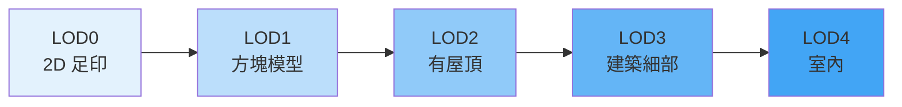

# Day 12：多層級細節 (LoD) — 從 LOD0 到 LOD3 的進化

> Day 9 我們學會了 Solid、CompositeSolid、MultiSolid 這三種實體幾何類型，Day 10 深入了邊界陣列的索引機制，Day 11 則探討了 Geometry Templates 如何節省空間。今天我們要拉高視角，從「精細度」的維度來理解 3D 城市模型——什麼是 Level of Detail (LoD)，CityGML 的 5 層 LoD 有什麼問題，TU Delft 如何改良出 16 層精細結構，以及 CityJSON 怎麼支援同一個物件的多重 LoD。

---

## 什麼是 Level of Detail (LoD)？

在 3D 城市模型中，**Level of Detail（LoD，多層級細節）** 指的是同一棟建築物可以用不同精細程度的幾何來表達[^biljecki2016]。從最粗略的「一塊扁平地面」到最細緻的「包含門窗、陽臺、屋頂煙囪的完整建築」，每一級 LoD 都有其適用的應用場景。



這不是 CityJSON 或 CityGML 獨有的概念——3D 圖形學、GIS、遊戲開發中都有類似的層級化細節設計。但在 3D 城市模型的脈絡下，LoD 有更明確的定義和標準。

---

## 原始 CityGML 的五個 LoD

CityGML 2.0 定義了 5 個 LoD 等級（LOD0 到 LOD4），每一級代表了從宏觀到微觀的視角變化[^biljecki2016]：

| LoD | 名稱 | 說明 |
|-----|------|------|
| **LOD0** | 區域/景觀 | 最粗略的 2.5D 足印（footprint），通常是建築物底面多邊形，可能有高程 |
| **LOD1** | 城市/街區 | 方塊模型（block model），將足印直接向上拉伸成平頂的稜柱體 |
| **LOD2** | 街區/鄰里 | 有屋頂結構的建築，例如斜屋頂、圓頂，但不包含陽臺或窗框等細節 |
| **LOD3** | 建築細部 | 高精細度的建築外觀，包含門窗、陽臺、階梯、裝飾構件 |
| **LOD4** | 室內 | 在 LOD3 基礎上加入室內結構，如房間、樓梯、傢俱、管線 |

### 存在已久的問題

Biljecki、Ledoux 與 Stoter（2016）在研究中指出，CityGML 的 LoD 規範存在三個主要問題[^biljecki2016]：

1. **幾何規範不足**：同一 LoD 等級內允許過多的建模自由，導致兩個同樣標示為 LOD2 的資料集，幾何細節天差地遠。例如 LOD2 可以只是一個簡單的雙斜屋頂，也可以包含老虎窗和屋頂煙囪。
2. **語意不一致**：現有的 LoD 規範並未明確定義每個等級應包含哪些語意表面（如牆面、屋頂面、地面等）。
3. **缺少過渡等級**：從 LOD1（無屋頂）到 LOD2（有屋頂）之間的差距過大，中間缺少合理的過渡等級。

---

## TU Delft 的改良方案：16 層精細 LoD

為了解決上述問題，TU Delft 3D 地理資訊研究團隊提出了**改良式 LoD 規範（Improved LOD Specification）**，將「單層 LoD」細分為「`X.Y` 格式」的 16 個子等級[^tudelft-lod][^biljecki2016]。

### `X.Y` 格式的含義

在改良系統中，LoD 以字串 `"X.Y"` 表示：

- **`X`**（整數部分）= 對應原始 CityGML 的 LoD 層級（0、1、2、3）
- **`Y`**（小數部分）= 該層級內的細分等級（0、1、2、3）

例如 `"2.2"` 代表 LOD2 層級中第二精細的子等級。

### 16 個 LoD 的幾何定義

下表整理了每個子等級的幾何特徵[^biljecki2016][^random3dcity]：

**LOD0 群組（2D 足印等級）**

| 子等級 | 幾何描述 |
|--------|----------|
| **LOD0.0** | 最簡單的 2D 足印多邊形 |
| **LOD0.1** | 僅含建築物足印 |
| **LOD0.2** | 含足印與屋簷邊緣多邊形，高度為屋頂的一半 |
| **LOD0.3** | 含足印與屋簷邊緣，使用實際高度值 |

**LOD1 群組（方塊模型等級）**

| 子等級 | 幾何描述 |
|--------|----------|
| **LOD1.0** | 最粗略的拉伸方塊 |
| **LOD1.1** | 使用實際足印，高度為屋頂一半（B-rep） |
| **LOD1.2** | 實際足印，屋頂一半高度（B-rep 或 Solid），足印可能與屋簷偏移 20cm |
| **LOD1.3** | 實際足印，屋頂一半高度（Solid） |

**LOD2 群組（屋頂結構等級）**

| 子等級 | 幾何描述 |
|--------|----------|
| **LOD2.0** | 實際足印 + 基本屋頂形狀，牆面從屋簷投影（B-rep） |
| **LOD2.1** | 更詳細的屋頂幾何（B-rep） |
| **LOD2.2** | 詳細屋頂結構（B-rep），可選屋簷投影，語意表面區分 |
| **LOD2.3** | 最精細的 LOD2 屋頂結構（B-rep） |

**LOD3 群組（建築細部等級）**

| 子等級 | 幾何描述 |
|--------|----------|
| **LOD3.0** | **混合模型—鳥瞰型**：牆面從屋簷投影，詳細屋頂，無門窗細部 |
| **LOD3.1** | **混合模型—地面型**：詳細牆面與地面層特徵，簡化屋頂 |
| **LOD3.2** | 包含門窗開口的完整細部模型 |
| **LOD3.3** | 最精細等級，包含窗戶、門、建築構件的完整建築模型 |

### 兩種混合模型（Hybrid Models）

改良 LoD 系統中最特別的設計是 LOD3.0 與 LOD3.1 這兩個**混合模型**[^biljecki2016]：

- **LOD3.0（鳥瞰型／Aerial）**：結合了 LOD2 的牆面投影方式與 LOD3 的詳細屋頂，適用於**空拍視角**的應用，如太陽能潛力分析、屋頂規劃。
- **LOD3.1（地面型／Terrestrial）**：結合了 LOD3 的詳細牆面與 LOD2 的簡化屋頂，適用於**地面視角**的應用，如行人風場分析、街道噪音模擬。

這反映了真實世界的資料採集現況——空載 LiDAR 能拍到詳細屋頂但拍不到牆面細節，地面掃描則相反。

---

## CityJSON 中的 LoD 實作

### 每個幾何物件都必須有 LoD

在 CityJSON 中，**每個 Geometry Object 都必須有一個 `lod` 成員**[^cityjson-specs]：

```json
{
  "type": "Solid",
  "lod": "2.2",
  "boundaries": [ ... ]
}
```

`lod` 的值可以是**單一數字字串**（如 `"2"`，相容原始 CityGML 方式），也可以是 **`X.Y` 格式**（如 `"2.2"`，使用 TU Delft 改良 LoD）[^cityjson-specs]。

### 同一物件可擁有多個 LoD

CityJSON 最強大的設計之一，是**一個城市物件可以擁有多個不同 LoD 的幾何**[^cityjson-specs-cityobj]：

```json
{
  "type": "Building",
  "geometry": [
    {
      "type": "Solid",
      "lod": "1.2",
      "boundaries": [ ... ]
    },
    {
      "type": "MultiSurface",
      "lod": "2.2",
      "boundaries": [ ... ]
    },
    {
      "type": "CompositeSolid",
      "lod": "3.2",
      "boundaries": [ ... ]
    }
  ]
}
```

這段範例中的同一棟 Building，同時儲存了 LOD1.2（方塊模型）、LOD2.2（詳細屋頂）和 LOD3.2（包含門窗）三種精細度的幾何。應用程式可以依需求選擇載入哪一個等級。

### 實際案例：荷蘭 3DBAG

荷蘭的 **3DBAG**（3D BAG，Basisregistratie Adressen en Gebouwen）是目前最大的 CityJSON 實例資料集之一，由 TU Delft 維護。它為全荷蘭約 1,000 萬棟建築物提供了 LoD1.2、LoD1.3 與 LoD2.2 三種等級的 3D 模型，全部以 CityJSON 格式釋出[^3dbag]。

這意味著你可以從同一個檔案中，同時取得建築物的粗略方塊模型（適合城市尺度能源模擬）與精細屋頂模型（適合太陽能潛力分析），而無需切換資料集。

---

## 不同 LoD 的應用場景對照

了解各 LoD 的幾何定義後，最重要的是知道**什麼場景該用哪個等級**[^biljecki2016]：

| 應用領域 | 建議 LoD | 原因 |
|----------|----------|------|
| 城市尺度能源估算 | LOD1.2 / LOD1.3 | 只需要建築體積與樓地板面積 |
| 人口估算 | LOD1 | 體積與人口統計模型的關聯 |
| 大尺度噪音地圖 | LOD1.2 | 噪音傳播主要受建築物高度影響 |
| 太陽能潛力分析 | LOD2.2 / LOD2.3 | 需要精確屋頂面向與傾斜角度 |
| 風場模擬（CFD） | LOD2.2 | 屋頂形狀對氣流有顯著影響 |
| 都市規劃/景觀衝擊 | LOD2 | 足夠評估建築量體與天際線 |
| 街道級噪音/風場 | LOD3.1（地面型） | 需要地面層特徵但屋頂可簡化 |
| 建築保存數位典藏 | LOD3.3 | 需要最高精細度的幾何與細節 |
| 室內導航/BIM 整合 | LOD4（或室內 LoD） | 需要房間、走廊、樓梯等內部結構 |

---

## 小結

今天我們從三個層次全面了解了 LoD：

1. **原始 CityGML 的 LOD0~LOD4**：5 個層級的設計存在幾何規範不足與缺乏過渡等級的問題。
2. **TU Delft 改良的 16 層 LoD**：以 `X.Y` 格式細分，新增了 LOD3.0/LOD3.1 兩種混合模型，為不同視角與應用場景提供更精確的細節控制。
3. **CityJSON 的 LoD 實作**：每個 Geometry Object 強制標記 `lod`，同一 City Object 可以儲存多個 LoD 的幾何，讓一個檔案同時滿足多種應用需求。

Phase 2（幾何核心）到此告一段落。從 Day 7 的頂點系統與 Transform、Day 8 的基礎幾何類型、Day 9 的實體幾何、Day 10 的邊界陣列索引機制、Day 11 的 Geometry Templates，到今天的 LoD——你已經掌握了 CityJSON 幾何系統的完整面貌。明天開始的 **Phase 3**，我們將進入城市物件與語意的世界。

---

[^biljecki2016]: Biljecki, F., Ledoux, H., & Stoter, J. (2016). An improved LOD specification for 3D building models. *Computers, Environment and Urban Systems*, 59, 25–37. Retrieved 2026-09-27, from https://doi.org/10.1016/j.compenvurbsys.2016.04.005

[^tudelft-lod]: TU Delft 3D Geoinformation Group. (n.d.). Refined LoDs for CityGML Buildings. Retrieved 2026-09-27, from https://3d.bk.tudelft.nl/lod

[^random3dcity]: Biljecki, F. (n.d.). Random3Dcity — An improved LOD specification. Retrieved 2026-09-27, from https://filipbiljecki.com/code/Random3Dcity.html

[^cityjson-specs]: CityJSON Specification 2.0.0 — Section 3: Geometry Objects. Retrieved 2026-09-27, from https://www.cityjson.org/specs/2.0.0/

[^cityjson-specs-cityobj]: CityJSON Specification 2.0.0 — Section 2: City Objects. Retrieved 2026-09-27, from https://www.cityjson.org/specs/2.0.0/

[^3dbag]: 3DBAG Project — TU Delft. (n.d.). 3D BAG Documentation. Retrieved 2026-09-27, from https://docs.3dbag.nl/en/