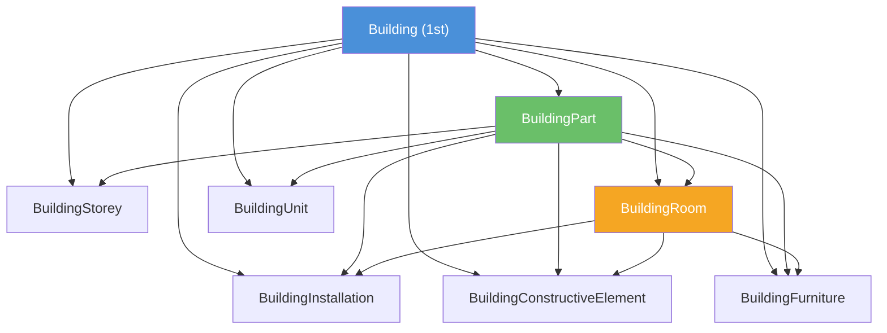

# Day 14｜建築物家族 — Building、BuildingPart、BuildingInstallation 等 8 種物件

## 前言

昨天我們學習了城市物件的整體架構——第一層級與第二層級的分類、`parents` 與 `children` 的雙向鏈結機制。今天，我們要深入探討 CityJSON 中**最豐富、最常用**的物件家族：**建築物系列 (Building Module)**。

在 CityJSON 的 33 種城市物件當中，光是建築相關就佔了 **8 種**，比橋樑家族（6 種）和隧道家族（6 種）都要多。這反映了建築物在 3D 城市模型中的核心地位——無論是數位雙生、都市規劃、不動產管理還是防災模擬，建築物永遠是主角。

這 8 種建築物件源自 CityGML v3.0 的 Building module[^citygml-building]，經過扁平化後融入 CityJSON 的展平結構中。

---

## 建築物家族的 8 種物件總覽

| 類型 | 層級 | 限制的幾何類型 | 補充說明 |
|------|------|----------------|----------|
| `Building` | 第一層級 | Solid, CompositeSolid, MultiSurface, CompositeSurface | 可獨立存在，可擁有 `address` |
| `BuildingPart` | 第二層級 | Solid, CompositeSolid, MultiSurface, CompositeSurface | 必須有父物件 (Building)，也可擁有 `address` |
| `BuildingInstallation` | 第二層級 | 任何幾何類型 | 陽台、煙囪、外牆設備 |
| `BuildingConstructiveElement` | 第二層級 | 任何幾何類型 | 樑、柱、牆等結構元素 |
| `BuildingFurniture` | 第二層級 | 任何幾何類型 | 內部家具設備 |
| `BuildingStorey` | 第二層級 | Solid, CompositeSolid, MultiSurface, CompositeSurface | 樓層 |
| `BuildingRoom` | 第二層級 | Solid, CompositeSolid, MultiSurface, CompositeSurface | 房間 |
| `BuildingUnit` | 第二層級 | Solid, CompositeSolid, MultiSurface, CompositeSurface | 產權單位（公寓單元），可擁有 `address` |

從上表可以看出幾個重要規律：

1. **幾何限制是依功能性劃分的**：整棟建築物（Building、BuildingPart）、樓層（BuildingStorey）、房間（BuildingRoom）和產權單位（BuildingUnit）這類代表「空間容器」的物件，只能用 Solid、CompositeSolid、MultiSurface、CompositeSurface 這四種封閉或半封閉的幾何類型來表達。而安裝設備（Installation）、結構元素（ConstructiveElement）和家具（Furniture）這種「內部物件」則可以使用任何幾何類型。

2. **只有 Building 可以獨立存在**：其餘 7 種都是第二層級，必須透過 `parents` 指向父物件。

3. **只有 Building、BuildingPart 和 BuildingUnit 可以有地址**：這符合現實世界——整棟建築物、建築物的某一部分（如一棟大樓的 A 棟）或某個產權單位（如一間公寓）都可能有自己的地址。

---

## Building — 建築物的核心

`Building` 是建築物家族中唯一的第一層級物件，也是整個建築樹狀結構的根節點[^cityjson-spec]。

### 最小表達

```json
{
  "type": "Building"
}
```

僅僅一個 `type` 欄位就是一個合法的 Building 物件。當然，實務上不會這麼做。

### 完整的 Building 範例

```json
{
  "type": "Building",
  "attributes": {
    "roofType": "gabled roof",
    "measuredHeight": 22.3,
    "owner": "Elvis Presley"
  },
  "geographicalExtent": [
    84710.1, 446846.0, -5.3,
    84757.1, 446944.0, 40.9
  ],
  "children": ["id-56", "id-832", "mybalcony"],
  "geometry": [
    {
      "type": "MultiSurface",
      "lod": "2",
      "boundaries": [
        [[0, 3, 2, 1]],
        [[4, 5, 6, 7]],
        [[0, 1, 5, 4]]
      ]
    }
  ]
}
```

這個範例展示了 Building 物件的所有常用欄位[^cityjson-spec]：

- **`attributes`**：任意 JSON 物件，儲存建築物的屬性資料。與 CityGML 不同，CityJSON 不強制規定屬性欄位名稱——你想放什麼都可以。
- **`geographicalExtent`**：軸對齊邊界框 (axis-aligned bounding box)，格式為 `[minx, miny, minz, maxx, maxy, maxz]`。
- **`children`**：直接子物件的 ID 陣列，這裡指向一個 BuildingPart（`id-56`）、一個 BuildingInstallation（`mybalcony`）等。
- **`geometry`**：幾何物件陣列，可以包含多個不同 LoD 的幾何表達。

### address 欄位

Building 可以（選擇性地）擁有 `address` 欄位，其值為一個 JSON 物件陣列——因為一棟建築物可能有多個地址（例如一個街角建築有兩個門牌號碼）[^cityjson-spec]。

```json
{
  "type": "Building",
  "address": [
    {
      "country": "Canada",
      "locality": "Chibougamau",
      "thoroughfareNumber": "1",
      "thoroughfareName": "rue de la Patate",
      "postcode": "H0H 0H0",
      "location": {
        "type": "MultiPoint",
        "lod": "1",
        "boundaries": [231]
      }
    }
  ]
}
```

地址物件的成員名稱不是強制的（unprescribed），這是為了適應不同國家的地址格式。如果需要指定位置，可以使用 `location` 欄位存放一個 MultiPoint 幾何（代表門口或信箱位置）。

---

## BuildingPart — 複雜建築的拆分

當一棟建築物由多個結構體組成時（例如有不同高度的塔樓、相連但風格不同的翼樓），就需要使用 `BuildingPart` 來拆分[^citygml-building]。

```json
{
  "id-1": {
    "type": "Building",
    "children": ["id-56"],
    "geometry": [{...}]
  },
  "id-56": {
    "type": "BuildingPart",
    "parents": ["id-1"],
    "attributes": {
      "roofType": "flat"
    },
    "children": ["room-a"],
    "geometry": [{
      "type": "Solid",
      "lod": "2",
      "boundaries": [...]
    }]
  }
}
```

一個常見的問題是：**BuildingPart 可以再擁有 BuildingPart 嗎？** CityJSON 的 schema 並沒有明確禁止，但官方文件暗示這在語意上可能不被鼓勵[^cityjson-spec]。

BuildingPart 也可以擁有 `address` 欄位，因為建築物的不同部分可能有不同的地址。

---

## BuildingInstallation — 建築附屬設備

`BuildingInstallation` 代表建築物上的附屬設備——陽台、遮雨棚、煙囪、冷氣室外機、天線等[^citygml-building]。

```json
{
  "mybalcony": {
    "type": "BuildingInstallation",
    "parents": ["id-1"],
    "geometry": [{
      "type": "MultiSurface",
      "lod": "2",
      "boundaries": [
        [[0, 3, 2, 1]],
        [[4, 5, 6, 7]],
        [[0, 1, 5, 4]],
        [[1, 2, 6, 5]],
        [[2, 3, 7, 6]],
        [[3, 0, 4, 7]]
      ]
    }]
  }
}
```

它的幾何類型「**不限**」——可以用 MultiPoint 代表點狀設備、MultiLineString 代表管線、MultiSurface 或 Solid 代表有體積的物件。

它的父物件可以是 `Building`、`BuildingPart` 或 `BuildingRoom`。

---

## BuildingConstructiveElement — 結構元素

`BuildingConstructiveElement` 代表建築物的結構構件——樑、柱、承重牆、樓板等[^citygml-building]。

與 BuildingInstallation 類似，它的幾何類型也不限，父物件可以是 Building、BuildingPart 或 BuildingRoom。

```json
{
  "main-beam": {
    "type": "BuildingConstructiveElement",
    "parents": ["room-a"],
    "geometry": [{
      "type": "MultiLineString",
      "lod": "3",
      "boundaries": [
        [[10, 11, 12]],
        [[12, 13, 14]]
      ]
    }]
  }
}
```

---

## BuildingFurniture — 室內家具

`BuildingFurniture` 代表房間內的可移動家具或設備——桌子、椅子、床、櫥櫃、燈具等。它的幾何類型不限，可以從簡單的 MultiPoint（定位點）到完整的 Solid 模型[^citygml-building]。

```json
{
  "kitchen-table": {
    "type": "BuildingFurniture",
    "parents": ["kitchen-room"],
    "geometry": [{
      "type": "MultiSurface",
      "lod": "4",
      "boundaries": [...]
    }]
  }
}
```

父物件可以是 Building、BuildingPart 或 BuildingRoom。

---

## BuildingStorey — 樓層

`BuildingStorey` 代表建築物中的一個樓層。它的幾何類型限制與 Building 相同——只有 Solid、CompositeSolid、MultiSurface、CompositeSurface——因為樓層本質上是一個「空間容器」[^cityjson-spec]。

```json
{
  "floor-1": {
    "type": "BuildingStorey",
    "parents": ["id-1"],
    "attributes": {
      "level": 0,
      "function": "retail"
    },
    "children": ["shop-a", "shop-b"],
    "geometry": [{
      "type": "Solid",
      "lod": "2",
      "boundaries": [
        [
          [[0, 3, 2, 1]],
          [[4, 5, 6, 7]],
          [[0, 1, 5, 4]],
          ...
        ]
      ]
    }]
  }
}
```

BuildingStorey 的父物件可以是 Building、BuildingPart 或 BuildingRoom（雖然將樓層放在房間下在實務上較罕見）。

---

## BuildingRoom — 房間

`BuildingRoom` 代表建築物中的一個房間。它與 BuildingStorey 的關鍵差異是：**BuildingStorey 是整個樓層的空間容器，而 BuildingRoom 是樓層內的子空間**[^citygml-building]。

```json
{
  "myroom": {
    "type": "BuildingRoom",
    "attributes": {
      "usage": "living room"
    },
    "parents": ["id-1"],
    "geometry": [{
      "type": "Solid",
      "lod": "2",
      "boundaries": [
        [
          [[0, 3, 2, 1]],
          [[4, 5, 6, 7]],
          [[0, 1, 5, 4]],
          ...
        ]
      ]
    }]
  }
}
```

BuildingRoom 的父物件可以是 Building 或 BuildingPart，但不能是 BuildingStorey（即使從常識上來說房間應該屬於某個樓層，但在 CityJSON 的設計中，房間與樓層是平行關係，都直接掛在 Building 或 BuildingPart 下）。

---

## BuildingUnit — 產權單位

`BuildingUnit` 是 CityJSON 2.0 新增的物件類型，代表建築物中的**產權單元**——例如一棟公寓大樓中的某一戶[^cityjson-spec]。

它與 BuildingRoom 的差異是：BuildingRoom 是物理空間，而 BuildingUnit 是**法律/產權概念**。同一間房可以是 BuildingRoom，也可以被劃分為一個 BuildingUnit。

BuildingUnit 也可以擁有 `address` 欄位（因為每一戶都可能有不一樣的門牌號碼）。

---

## 完整階層範例

以下是將以上所有概念整合起來的完整範例：

```json
{
  "CityObjects": {
    "my-building": {
      "type": "Building",
      "attributes": {
        "roofType": "gabled",
        "measuredHeight": 35.0
      },
      "children": [
        "tower-part",
        "main-balcony",
        "floor-1",
        "floor-2",
        "unit-101"
      ],
      "geometry": [{"...": "..."}]
    },
    "tower-part": {
      "type": "BuildingPart",
      "parents": ["my-building"],
      "children": ["tower-beam"],
      "geometry": [{"...": "..."}]
    },
    "tower-beam": {
      "type": "BuildingConstructiveElement",
      "parents": ["tower-part"],
      "geometry": [{"...": "..."}]
    },
    "main-balcony": {
      "type": "BuildingInstallation",
      "parents": ["my-building"],
      "geometry": [{"...": "..."}]
    },
    "floor-1": {
      "type": "BuildingStorey",
      "parents": ["my-building"],
      "attributes": { "level": 0 },
      "children": ["living-room"],
      "geometry": [{"...": "..."}]
    },
    "floor-2": {
      "type": "BuildingStorey",
      "parents": ["my-building"],
      "attributes": { "level": 1 },
      "children": ["bedroom"],
      "geometry": [{"...": "..."}]
    },
    "living-room": {
      "type": "BuildingRoom",
      "parents": ["my-building"],
      "attributes": { "usage": "living room" },
      "children": ["sofa"],
      "geometry": [{"...": "..."}]
    },
    "sofa": {
      "type": "BuildingFurniture",
      "parents": ["living-room"],
      "geometry": [{"...": "..."}]
    },
    "bedroom": {
      "type": "BuildingRoom",
      "parents": ["my-building"],
      "attributes": { "usage": "bedroom" },
      "geometry": [{"...": "..."}]
    },
    "unit-101": {
      "type": "BuildingUnit",
      "parents": ["my-building"],
      "address": [
        {
          "country": "Taiwan",
          "locality": "Taipei",
          "thoroughfareNumber": "101",
          "thoroughfareName": "Section 2, Xinyi Road",
          "postcode": "110"
        }
      ],
      "geometry": [{"...": "..."}]
    }
  }
}
```

這個範例展示了：

1. 一個 Building 擁有多種類型的子物件（BuildingPart、BuildingInstallation、BuildingStorey、BuildingUnit）
2. BuildingPart 又可以有它自己的子物件（BuildingConstructiveElement）
3. BuildingStorey 可以有 BuildingRoom 作為子物件
4. BuildingRoom 可以有 BuildingFurniture 作為子物件
5. BuildingUnit 擁有自己的地址
6. 這形成了一個**多層次的樹狀結構**——全部透過 `children` 和 `parents` 鏈結還原

---

## 父子關係合法性對照表

為了幫助記憶，以下是完整的父子關係矩陣：



| 子物件 | 可接受的父物件 |
|--------|---------------|
| BuildingPart | Building |
| BuildingInstallation | Building, BuildingPart, BuildingRoom |
| BuildingConstructiveElement | Building, BuildingPart, BuildingRoom |
| BuildingFurniture | Building, BuildingPart, BuildingRoom |
| BuildingStorey | Building, BuildingPart, BuildingRoom |
| BuildingRoom | Building, BuildingPart |
| BuildingUnit | Building, BuildingPart |

---

## 今日總結

| 概念 | 重點 |
|------|------|
| **Building** | 唯一的第一層級建築物件，可獨立存在，可擁有 `address` |
| **BuildingPart** | 拆分複雜建築，也可擁有 `address` |
| **BuildingInstallation** | 附屬設備（陽台、煙囪），幾何類型不限 |
| **BuildingConstructiveElement** | 結構構件（樑、柱），幾何類型不限 |
| **BuildingFurniture** | 室內家具，幾何類型不限 |
| **BuildingStorey** | 樓層，限制 Solid/CompositeSolid/MultiSurface/CompositeSurface |
| **BuildingRoom** | 房間，限制同上，父物件不可為 BuildingStorey |
| **BuildingUnit** | 產權單位，可擁有 `address`，CityJSON 2.0 新增 |

明天我們將探討**運輸與基礎設施**——Road、Railway、Tunnel、Bridge 這幾個家族如何在 3D 城市模型中表達交通網絡。

---

## 參考資料

[^cityjson-spec]: Ledoux, H., & Dukai, B. (2026). CityJSON Specifications 2.0.2 — Building. Retrieved 2026-09-27, from https://www.cityjson.org/specs/2.0.2/#building

[^citygml-building]: Open Geospatial Consortium. (2021). OGC CityGML v3.0.0 — Building module (Doc No. 20-010). Retrieved 2026-09-27, from https://docs.ogc.org/is/20-010/20-010.html#toc45