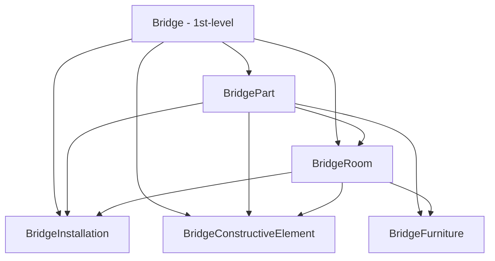
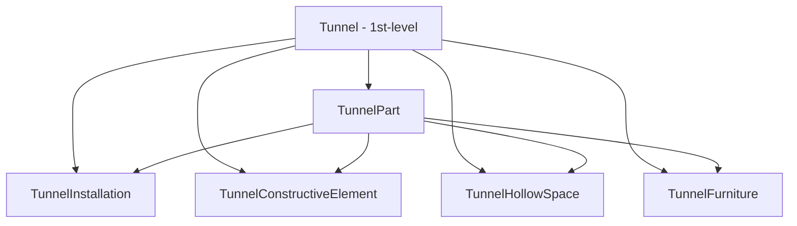

# Day 15｜運輸與基礎設施 — Road、Railway、Tunnel、Bridge 等 16 種物件

## 前言

昨天我們深入探討了最豐富的建築物家族（8 種物件）。今天，我們要繼續 Phase 3 的旅程，認識城市中另一個不可或缺的面向：**運輸與基礎設施 (Transportation & Infrastructure)**。

在 CityJSON 中，與交通和基礎建設相關的物件多達 **16 種**，涵蓋了你每天都會接觸到的道路、鐵路、橋樑、隧道，以及水路和交通廣場。這些物件可分為三大群組：

1. **Transportation 模組**（4 種）：Road、Railway、Waterway、TransportSquare
2. **Bridge 橋樑家族**（6 種）：Bridge、BridgePart、BridgeInstallation、BridgeConstructiveElement、BridgeRoom、BridgeFurniture
3. **Tunnel 隧道家族**（6 種）：Tunnel、TunnelPart、TunnelInstallation、TunnelConstructiveElement、TunnelHollowSpace、TunnelFurniture

這 16 種物件全部源自 CityGML v3.0 的 Transportation、Bridge 和 Tunnel 模組[^citygml-transportation][^citygml-bridge][^citygml-tunnel]，並保留了三者之間的設計相似性——特別是橋樑與隧道家族的結構幾乎是建築物家族的鏡像。

---

## Transportation 模組 — 城市的血管

Transportation 模組涵蓋了城市中用於移動與運輸的所有空間[^citygml-transportation]。在 CityJSON 中，它包含 **4 種第一層級物件**：

| 類型 | 中文描述 | 1st/2nd-level | 限制的幾何類型 |
|------|----------|---------------|----------------|
| `Road` | 道路 | 第一層級 | 任何幾何類型 |
| `Railway` | 鐵路 | 第一層級 | 任何幾何類型 |
| `Waterway` | 水路 | 第一層級 | 任何幾何類型 |
| `TransportSquare` | 交通廣場（停車場、廣場） | 第一層級 | 任何幾何類型 |

與建築物家族不同，所有 Transportation 物件都是**第一層級**，可以獨立存在，且幾何類型**完全不受限制**——你可以用 MultiPoint 代表道路中心線、用 MultiLineString 代表鐵軌路線、用 MultiSurface 或 Solid 代表路面或停車場的立體結構。

### Road 範例

以下是一個簡單的道路物件，使用 MultiLineString 表達道路中心線：

```json
{
  "ma_rue": {
    "type": "Road",
    "attributes": {
      "class": "backwards",
      "clearanceSpace": 2.23,
      "clearanceSpaceUnit": "meter"
    },
    "children": ["sect1", "sect2"],
    "geometry": [...]
  }
}
```

值得注意的是，CityJSON 的 Road 物件跳過了 CityGML 中的 "Section"、"Intersection" 和 "Track" 類別，因為這些可以透過簡單的 `attributes` 來指定[^cityjson-spec]。例如上例中，`ma_rue` 的子物件 `sect1` 仍然是 `Road` 類型，但透過 attribute 標記為一個路段。

### 語意表面 (Semantic Surfaces)

運輸物件的一個重要特色是支援**語意表面**。CityGML 中的 "TrafficArea"、"AuxiliaryTrafficArea"、"Marking" 和 "Hole" 等類別，在 CityJSON 中是以**幾何表面的語意**來實現的[^cityjson-spec]。這意味著道路的表面會被分割成多個子表面，每個子表面都有自己的語意類型。

```json
{
  "ma_rue": {
    "type": "Road",
    "geometry": [{
      "type": "MultiSurface",
      "lod": "2",
      "boundaries": [
        [[0, 3, 2, 1, 4]],
        [[4, 5, 6, 9, 12]],
        [[0, 1, 5]],
        [[20, 21, 75]]
      ],
      "semantics": {
        "surfaces": [
          {
            "type": "TrafficArea",
            "surfaceMaterial": ["asphalt"],
            "function": "road"
          },
          {
            "type": "AuxiliaryTrafficArea",
            "function": "green areas"
          },
          {
            "type": "TrafficArea",
            "surfaceMaterial": ["dirt"],
            "function": "road"
          }
        ],
        "values": [0, 1, null, 2]
      }
    }]
  }
}
```

上面這個範例展示了一條道路的四個子表面：第一塊是柏油路面（index 0）、第二塊是綠化帶（index 1）、第三塊沒有語意（`null`）、第四塊是泥土路面（index 2）。透過 `semantics.values` 陣列，每個邊界（boundary）被對應到 `semantics.surfaces` 陣列中的一個語意定義。

### TransportSquare

`TransportSquare` 用來建模停車場、廣場等開放交通空間。與 Road 相同，它可以使用任何幾何類型：

```json
{
  "main-square": {
    "type": "TransportSquare",
    "attributes": {
      "function": "parking lot",
      "capacity": 200
    },
    "geometry": [{
      "type": "MultiSurface",
      "lod": "2",
      "boundaries": [
        [[0, 1, 2, 3]],
        [[1, 4, 5, 2]]
      ]
    }]
  }
}
```

---

## Bridge 橋樑家族 — 跨越障礙的結構

橋樑家族與昨天的建築物家族有著驚人的相似性。在 CityGML v3.0 中，Bridge 被歸類在 **Construction 模組**中，與 Building 屬於同一上層類別——因為它們都是「人造結構物」(man-made construction)[^citygml-bridge]。

### 6 種物件總覽

| 類型 | 層級 | 限制的幾何類型 | 補充說明 |
|------|------|----------------|----------|
| `Bridge` | 第一層級 | Solid, CompositeSolid, MultiSurface, CompositeSurface | 可獨立存在，可擁有 `address` |
| `BridgePart` | 第二層級 | Solid, CompositeSolid, MultiSurface, CompositeSurface | 必須有父物件 (Bridge)，可擁有 `address` |
| `BridgeInstallation` | 第二層級 | 任何幾何類型 | 橋面設備、照明、纜繩 |
| `BridgeConstructiveElement` | 第二層級 | 任何幾何類型 | 橋墩、橋塔、鋼索等結構元素 |
| `BridgeRoom` | 第二層級 | 任何幾何類型 | 橋樑內部的房間（如值班室） |
| `BridgeFurniture` | 第二層級 | 任何幾何類型 | 橋樑內的家具設備 |

從上表可以發現一個有趣的差別：橋樑的 `BridgeRoom` 幾何類型**不受限制**，但建築物的 `BuildingRoom` 只能用 Solid、CompositeSolid、MultiSurface、CompositeSurface[^cityjson-spec]。這是因為橋樑空間的使用方式比建築物更靈活。

### Bridge 的父子結構



### Bridge 完整範例

以下是以倫敦塔橋為靈感的 Bridge 範例[^cityjson-spec]：

```json
{
  "LondonTower": {
    "type": "Bridge",
    "address": [
      {
        "city": "London",
        "country": "UK"
      }
    ],
    "children": ["Bext1", "Bext2", "Inst-2017-11-14"],
    "geometry": [{
      "type": "MultiSurface",
      "lod": "2",
      "boundaries": [
        [[0, 3, 2, 1]],
        [[4, 5, 6, 7]],
        [[0, 1, 5, 4]],
        [[1, 2, 6, 5]],
        [[2, 3, 7, 6]],
        [[3, 0, 4, 7]]
      ]
    }]
  }
}
```

`Bridge` 和 `BridgePart` 都可以擁有 `address` 欄位，格式與 Building 完全相同[^cityjson-spec]。

---

## Tunnel 隧道家族 — 地下的通道

隧道家族同樣有 6 種物件，結構與橋樑非常相似，但多了一個獨特的 **`TunnelHollowSpace`**（中空空間）取代了 Bridge 和 Building 家族的 Room。

### 6 種物件總覽

| 類型 | 層級 | 限制的幾何類型 | 補充說明 |
|------|------|----------------|----------|
| `Tunnel` | 第一層級 | Solid, CompositeSolid, MultiSurface, CompositeSurface | 可獨立存在 |
| `TunnelPart` | 第二層級 | Solid, CompositeSolid, MultiSurface, CompositeSurface | 必須有父物件 (Tunnel) |
| `TunnelInstallation` | 第二層級 | 任何幾何類型 | 通風設備、照明設備 |
| `TunnelConstructiveElement` | 第二層級 | 任何幾何類型 | 襯砌、支撐結構 |
| `TunnelHollowSpace` | 第二層級 | 任何幾何類型 | **中空空間**（隧道內部可通行空間） |
| `TunnelFurniture` | 第二層級 | 任何幾何類型 | 隧道內的家具設備 |

### Tunnel 的父子結構



### Tunnel 完整範例

以下是以挪威最長的公路隧道——**Lærdalstunnelen**（萊達爾隧道，全長 24.5 公里）為靈感的範例[^cityjson-spec]：

```json
{
  "Lærdalstunnelen": {
    "type": "Tunnel",
    "attributes": {
      "yearOfConstruction": 2000,
      "length": "24.5km"
    },
    "children": ["stoparea1"],
    "geometry": [{
      "type": "Solid",
      "lod": "2",
      "boundaries": [
        [ [[0, 3, 2, 1]], [[4, 5, 6, 7]], [[0, 1, 5, 4]] ]
      ]
    }]
  }
}
```

Tunnel 和 TunnelPart 的限制幾何類型與 Bridge、Building 相同：只能用 Solid、CompositeSolid、MultiSurface、CompositeSurface。而其餘四種（Installation、ConstructiveElement、HollowSpace、Furniture）則可以使用任何幾何類型。

Tunnel 與 Bridge 的一個關鍵差異是：**Tunnel 和 TunnelPart 沒有 `address` 欄位**——畢竟隧道不像建築物或橋樑一樣需要門牌號碼。

---

## 三個家族的對比總結

為了幫助記憶，以下是 Building、Bridge、Tunnel 三個家族的對照表：

| 面向 | Building 家族 | Bridge 家族 | Tunnel 家族 |
|------|-------------|-------------|-------------|
| 物件數量 | 8 種 | 6 種 | 6 種 |
| 第一層級 | Building | Bridge | Tunnel |
| 子元件 Part | BuildingPart | BridgePart | TunnelPart |
| 附屬設備 | BuildingInstallation | BridgeInstallation | TunnelInstallation |
| 結構元件 | BuildingConstructiveElement | BridgeConstructiveElement | TunnelConstructiveElement |
| 家具 | BuildingFurniture | BridgeFurniture | TunnelFurniture |
| 房間/空間 | BuildingRoom, BuildingStorey, BuildingUnit | BridgeRoom | TunnelHollowSpace |
| 地址支援 | Building, BuildingPart, BuildingUnit | Bridge, BridgePart | 無 |

從表中可以清楚看到，CityJSON 的設計遵循著非常一致的**模式 (pattern)**——一旦你學會了一個家族，其他兩個家族的學習曲線就會大幅下降。

---

## 結語

今天我們認識了 CityJSON 中與運輸和基礎設施相關的 16 種物件，涵蓋了 Transportation 模組的四種開放交通空間（Road、Railway、Waterway、TransportSquare），以及 Bridge 和 Tunnel 兩個結構龐大的物件家族。

這些物件在真實應用中隨處可見——數位雙生城市的道路網絡、橋樑結構分析、隧道安全監控等等。特別是語意表面 (Semantic Surfaces) 的機制，讓道路資料不再只是一堆幾何形狀，而是可以區分車道、人行道、綠化帶的智慧資料。

明天，我們將繼續 Phase 3 的旅程，探索城市中其他重要的第一層級物件——包括地形、植被、水體、城市家具等。

---

## 參考資料

[^cityjson-spec]: CityJSON Specification 2.0. (2024). City Objects — Transportation, Bridge, Tunnel. Retrieved 2026-09-27, from https://www.cityjson.org/specs/2.0.0/#city-objects

[^citygml-transportation]: Open Geospatial Consortium. (2021). OGC City Geography Markup Language (CityGML) Part 1: Conceptual Model Standard — Transportation module (Clause 7.11). OGC Document 20-010, Version 3.0.0. Retrieved 2026-09-27, from https://docs.ogc.org/is/20-010/20-010.html#toc39

[^citygml-bridge]: Open Geospatial Consortium. (2021). OGC City Geography Markup Language (CityGML) Part 1: Conceptual Model Standard — Bridge module (Clause 7.16). OGC Document 20-010, Version 3.0.0. Retrieved 2026-09-27, from https://docs.ogc.org/is/20-010/20-010.html#toc44

[^citygml-tunnel]: Open Geospatial Consortium. (2021). OGC City Geography Markup Language (CityGML) Part 1: Conceptual Model Standard — Tunnel module (Clause 7.18). OGC Document 20-010, Version 3.0.0. Retrieved 2026-09-27, from https://docs.ogc.org/is/20-010/20-010.html#toc46