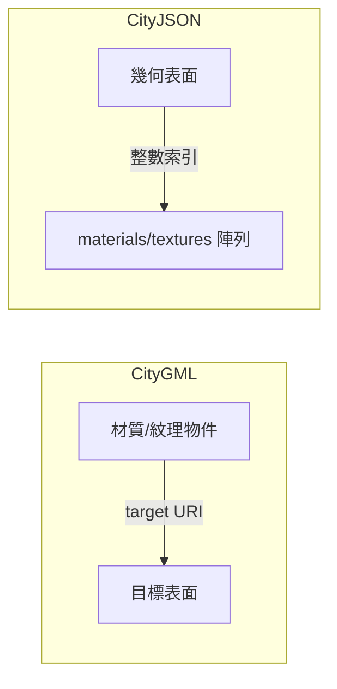

# Day 19｜外觀材質 (Appearance) — 材質與紋理

## 前言

到目前為止，我們討論的 3D 城市模型都是**只有幾何的素模**。現實世界中的建築有顏色、有材質——磚牆有紅磚紋理、玻璃幕牆會反光、屋頂可能是灰色的金屬板。這些外觀資訊對於視覺化、模擬與分析至關重要。

**Appearance Object（外觀物件）** 就是 CityJSON 用來描述 3D 城市模型「長相」的機制。它涵蓋兩個層面：

- **Material（材質）**：定義表面的光學特性——顏色、反光、透明度——採用 X3D 規格[^x3d-material]
- **Texture（紋理）**：將圖片貼到幾何表面——採用 COLLADA 標準[^collada]

今天我們將從整體架構開始，逐步深入這兩個機制。

---

## Appearance Object 整體結構

Appearance Object 位於 CityJSON 根層級的 `"appearance"` 成員中，是一個 JSON 物件，包含五個選填成員[^cityjson-appearance]：

| 成員 | 型態 | 說明 |
|------|------|------|
| `materials` | Material 物件陣列 | 材質定義列表 |
| `textures` | Texture 物件陣列 | 紋理定義列表 |
| `vertices-texture` | UV 座標陣列 | 紋理貼圖使用的 (u,v) 頂點座標 |
| `default-theme-texture` | 字串 | 預設顯示的紋理主題名稱 |
| `default-theme-material` | 字串 | 預設顯示的材質主題名稱 |

一個完整但為空的 Appearance Object 長這樣：

```json
"appearance": {
  "materials": [],
  "textures": [],
  "vertices-texture": [],
  "default-theme-texture": "myDefaultTheme1",
  "default-theme-material": "myDefaultTheme2"
}
```

> **注意**：如果有 `"textures"` 成員，則必須同時有 `"vertices-texture"` 成員——因為沒有 UV 座標就無法進行紋理貼圖[^cityjson-appearance]。

---

## Material Object — 材質的物理光學定義

Material Object 繼承自 **X3D 的 Material 節點**，定義了一個表面的光學反應特性[^x3d-material]：

```json
{
  "name": "roofandground",
  "ambientIntensity": 0.2000,
  "diffuseColor": [0.9000, 0.1000, 0.7500],
  "emissiveColor": [0.9000, 0.1000, 0.7500],
  "specularColor": [0.9000, 0.1000, 0.7500],
  "shininess": 0.2,
  "transparency": 0.5,
  "isSmooth": false
}
```

| 屬性 | 型態 | 範圍 | 預設值 | 說明 |
|------|------|------|--------|------|
| `name` | 字串 | — | 必填 | 材質識別名稱 |
| `ambientIntensity` | 數值 | 0.0 ~ 1.0 | 0.2 | 環境光反射強度 |
| `diffuseColor` | RGB 陣列 | [0,0] ~ [1,1] | [0.8,0.8,0.8] | 漫射色（物體主色） |
| `emissiveColor` | RGB 陣列 | [0,0] ~ [1,1] | [0,0,0] | 自發光色（黑=不發光） |
| `specularColor` | RGB 陣列 | [0,0] ~ [1,1] | [0,0,0] | 鏡面反射色 |
| `shininess` | 數值 | 0.0 ~ 1.0 | 0.2 | 光澤度（低=柔和，高=銳利） |
| `transparency` | 數值 | 0.0 ~ 1.0 | 0.0 | 透明度（1.0=完全透明） |
| `isSmooth` | 布林值 | — | — | 平滑著色（Gouraud）或平面著色 |

這套屬性源於 X3D 的 Phong 光照模型[^x3d-material]：

- **環境光（Ambient）**：來自四面八方的間接照明，與光源位置無關。最終環境色 = `ambientIntensity × diffuseColor`
- **漫射光（Diffuse）**：表面面向光源時反射的主色。光源垂直照射時最亮，角度越大越暗
- **鏡面光（Specular）**：光源在光滑表面產生的亮點。`shininess` 控制亮點的大小與銳利度
- **自發光（Emissive）**：物體自身發出的顏色，常用於模擬發光物體或科學視覺化中的偽色（false colour）
- **透明度（Transparency）**：`1.0` 為完全透明（玻璃效果），`0.0` 為完全不透明

Material Object 可以只有 `name`，其他屬性留待特定應用程式自行定義。也就是說，最小合法 Material Object 可以只給一個名稱標籤[^cityjson-appearance]。

---

## Texture Object — 紋理的圖片貼圖

Texture Object 繼承自 **COLLADA 標準**，定義了一張圖片如何被貼到幾何表面[^collada]：

```json
{
  "type": "PNG",
  "image": "http://www.someurl.org/filename.jpg"
}
```

| 屬性 | 型態 | 必填 | 說明 |
|------|------|------|------|
| `type` | 字串 | ✅ | `"PNG"` 或 `"JPG"` |
| `image` | 字串 | ✅ | 圖片來源（URL、相對路徑或絕對路徑） |
| `wrapMode` | 字串 | ❌ | 紋理座標超出 [0,1] 範圍時的處理方式 |
| `textureType` | 字串 | ❌ | 紋理類型：`"unknown"`、`"specific"`、`"typical"` |
| `borderColor` | RGBA 陣列 | ❌ | 邊界顏色（wrapMode 為 `"border"` 時使用） |

### `image` 的支援路徑格式

`"image"` 支援三種路徑格式[^cityjson-appearance]：

```json
// 絕對 URL
"image": "http://www.someurl.org/filename.jpg"

// 相對路徑（相對於 CityJSON 檔案）
"image": "appearances/myroof.jpg"

// 絕對路徑
"image": "/home/elvis/mycityjson/appearances/myroof.jpg"
```

### `wrapMode` 的五種模式

`wrapMode` 控制 UV 座標超出 `[0.0, 1.0]` 範圍時的紋理映射行為，取自 COLLADA 標準[^collada-wrap]：

| 模式 | 行為 |
|------|------|
| `"none"` | 不做任何包裹，座標超出範圍的行為由實作決定 |
| `"wrap"` | 重複貼圖（瓷磚效應），1~2 之間重複一次，2~3 再重複 |
| `"mirror"` | 翻轉鏡像貼圖，0~1 正常，1~2 鏡像，2~3 再正常 |
| `"clamp"` | 夾至邊緣，超出範圍的座標取最接近邊緣的顏色 |
| `"border"` | 類似 clamp，但超出範圍時回傳 `borderColor` |

---

## Vertices-Texture — UV 座標陣列

要將 2D 圖片貼到 3D 幾何表面上，必須告訴電腦圖片的哪個點對應到幾何的哪個頂點。這就是 **UV 座標**（也稱紋理座標）的作用[^cityjson-appearance]。

`"vertices-texture"` 是一個二維座標陣列，每個元素是 `[u, v]` 兩個值，範圍通常為 `[0.0, 1.0]`：

```json
"vertices-texture": [
  [0.0, 0.5],
  [1.0, 0.0],
  [1.0, 1.0],
  [0.0, 1.0]
]
```

陣列中的位置（0-based）就是 Geometry Object 中 `"texture"` 成員引用的索引。頂點可以重複——同一個 (u,v) 座標可能被幾個不同的表面共用。

---

## Geometry Object 使用 Material — `material` 成員

有了材質定義和 UV 座標後，需要在 Geometry Object 中告訴系統「我的每一個面使用哪個材質」。這就是 Geometry Object 的 `"material"` 成員的任務[^cityjson-appearance]。

### 主題機制（Themes）

CityJSON 支援**多主題材質**。同一個幾何可以有不同的材質版本——例如「日照模擬 A 方案」和「日照模擬 B 方案」，分別給予不同的顏色。在 Geometry Object 的 `"material"` 中，每一個 key 就是一個主題名稱[^cityjson-appearance]：

```json
"material": {
  "irradiation": {
    "values": [[0, 0, 1, null]]
  },
  "irradiation-2": {
    "values": [[2, 2, 1, null]]
  }
}
```

### `values` vs `value`

材質指派有兩種模式[^cityjson-appearance]：

1. **`"values"`**（陣列模式）：巢狀整數陣列，深度等於 boundary 陣列深度減 2（因為每個 surface `[[]]` 獲得一個材質）。`null` 代表該表面沒有材質
2. **`"value"`**（單值模式）：一個整數，所有表面共用同一個材質。常用於對整個物件上色，避免重複

範例：一個 Solid 有 4 個 surface，2 個日照模擬主題。注意第 4 個 surface 沒有材質，使用 `null`：

```json
{
  "type": "Solid",
  "lod": "2.1",
  "boundaries": [
    [ [[0, 3, 2, 1]], [[4, 5, 6, 7]], [[0, 1, 5, 4]], [[1, 2, 6, 5]] ]
  ],
  "material": {
    "irradiation": {
      "values": [[0, 0, 1, null]]
    },
    "irradiation-2": {
      "values": [[2, 2, 1, null]]
    }
  }
}
```

在這個範例中：
- `"irradiation"` 主題：surface 0 和 1 使用 `materials[0]`，surface 2 使用 `materials[1]`，surface 3 無材質
- `"irradiation-2"` 主題：surface 0 和 1 使用 `materials[2]`，surface 2 使用 `materials[1]`，surface 3 無材質

---

## Geometry Object 使用 Texture — `texture` 成員

紋理貼圖的結構類似，但 `"values"` 陣列更複雜——每一個環（ring）的陣列長度為「頂點數 + 1」，第一個值為 `"textures"` 陣列索引，其後為各頂點的 `"vertices-texture"` 索引[^cityjson-appearance]：

```json
{
  "type": "Solid",
  "lod": "2.2",
  "boundaries": [
    [ [[0, 3, 2, 1]], [[4, 5, 6, 7]], [[0, 1, 5, 4]], [[1, 2, 6, 5]] ]
  ],
  "texture": {
    "winter-textures": {
      "values": [
        [ [[0, 10, 23, 22, 21]], [[0, 1, 2, 6, 5]], [[null]], [[null]] ]
      ]
    },
    "summer-textures": {
      "values": [
        [
          [[1, 10, 23, 22, 21]],
          [[1, 1, 2, 6, 5]],
          [[1, 66, 12, 64, 5]],
          [[2, 99, 21, 16, 25]]
        ]
      ]
    }
  }
}
```

來解析其中一個環 `[[1, 10, 23, 22, 21]]`：

| 值 | 意義 |
|----|------|
| `1` | 使用 `textures[1]` 這張圖片 |
| `10` | 第一個頂點使用 `vertices-texture[10]` 的 UV 座標 |
| `23` | 第二個頂點使用 `vertices-texture[23]` 的 UV 座標 |
| `22` | 第三個頂點使用 `vertices-texture[22]` 的 UV 座標 |
| `21` | 第四個頂點使用 `vertices-texture[21]` 的 UV 座標 |

這個範例展示了「冬季紋理」與「夏季紋理」兩種主題。在冬天視覺化時使用冬季紋理（有些面無紋理顯示為 `null`），夏季時切換到夏季版本——完全不用修改檔案結構。

---

## CityGML 與 CityJSON 在外觀上的三大關鍵差異

CityJSON 在設計上刻意與 CityGML 保持相容，但在外觀處理上有三個重大差異[^cityjson-appearance][^cityjson-citygml]：

### 差異一：無 GeoreferencedTexture

CityGML 的 `GeoreferencedTexture` 使用**地理參考投影**來定位紋理——透過參考點（referencePoint）與方位矩陣（orientation）或 GeoTIFF 內嵌的地理資訊，將紋理圖片「投影」到真實世界座標上[^citygml-appearance]。

CityJSON **不支援** `GeoreferencedTexture`。所有紋理必須使用明確的 UV 座標進行貼圖。這是因為地理參考紋理相對少用，且實作上複雜度較高——需要處理 world file、GeoTIFF metadata 與投影數學[^cityjson-paper]。

### 差異二：無 TexCoordGen

CityGML 的 `TexCoordGen` 使用一個 **3×4 轉換矩陣**（`worldToTexture`），在執行期將世界座標（X, Y, Z）即時轉換為 UV 紋理座標[^citygml-appearance]。這意味著紋理座標不是預先計算好的，而是在渲染時動態產生。

CityJSON **不支援** `TexCoordGen`。必須提供明確的 UV 座標（透過 `"vertices-texture"`）。這讓 CityJSON 的處理更簡單、更可預測——不需要實作矩陣乘法來計算紋理座標。

### 差異三：誰 reference 誰（反轉的控制流）

這是最核心的架構差異[^cityjson-appearance]：



- **CityGML**：每一個 `X3DMaterial` 或 `ParameterizedTexture` 物件包含一個 `target` URI 屬性，列出使用它的所有表面。外觀物件是「擁有者」，負責記錄哪些表面使用它
- **CityJSON**：Geometry Object 直接包含 `"material"` 或 `"texture"` 成員，用整數索引指向 `"appearance"` 中的材質或紋理。幾何表面是「擁有者」，主動宣告自己使用哪個外觀

這種設計讓 CityJSON 的資料流向更直觀：**從幾何到外觀**，而非反過來。當你讀取一個幾何時，立刻就能知道它的外觀是什麼，不需要回頭查詢外觀物件的 `target` 列表。

這也是 CityJSON 能夠原生支援**多主題機制**的原因——同一個幾何可以同時宣告 `"winter-textures"` 和 `"summer-textures"`，而 CityGML 需要多個外觀物件才能做到類似效果。

---

## 結語

Appearance Object 是 CityJSON 讓 3D 城市模型「活起來」的關鍵機制。它透過兩套標準（X3D Material 與 COLLADA Texture）為開發者提供了完整的表面外觀描述能力：

- **Material Object**：8 個屬性定義表面的光學特性，遵循 Phong 光照模型
- **Texture Object**：圖片貼圖搭配 UV 座標，支援 5 種包裹模式
- **主題機制**：同一個幾何可以有多組材質/紋理，透過主題名稱切換
- **控制流反轉**：Geometry Object 主動宣告自己的外觀，而非由外觀物件被動宣告

而 CityJSON 刻意捨棄 CityGML 的 `GeoreferencedTexture` 與 `TexCoordGen`，換來了更簡單、更可預測的實作——這正是 CityJSON 一貫的設計哲學：「為開發者而生」。

明天我們將深入探討 **UV 座標與紋理貼圖實戰**，包括 `vertices-texture` 陣列的運作細節、`values` 陣列的深度規則，以及一個完整的建築物四季紋理範例。

---

## 參考資料

[^cityjson-appearance]: CityJSON Specification 2.0. (2024). Appearance Object. Retrieved 2026-09-27, from https://www.cityjson.org/specs/2.0.0/#appearance-object

[^cityjson-citygml]: CityJSON. (n.d.). CityGML compatibility. Retrieved 2026-09-27, from https://www.cityjson.org/citygml/v20/

[^cityjson-paper]: Ledoux, H., Arroyo Ohori, K., & Kumar, K. (2019). CityJSON: a compact and easy-to-use encoding of the CityGML data model. Open Geospatial Data, Software and Standards, 4(1), 4. Retrieved 2026-09-27, from https://link.springer.com/article/10.1186/s40965-019-0064-0

[^x3d-material]: Web3D Consortium. (n.d.). X3D Specification — Material Node (ISO/IEC 19775-1). Retrieved 2026-09-27, from http://www.web3d.org/documents/specifications/19775-1/V3.2/Part01/components/shape.html#Material

[^collada]: Khronos Group. (n.d.). COLLADA — Digital Asset Schema. Retrieved 2026-09-27, from https://www.khronos.org/collada/

[^collada-wrap]: Khronos Group. (n.d.). COLLADA 1.5 Schema — fx_sampler_wrap_enum. Retrieved 2026-09-27, from https://www.khronos.org/files/collada_schema_1_5

[^citygml-appearance]: Open Geospatial Consortium. (2021). OGC City Geography Markup Language (CityGML) Part 1: Conceptual Model Standard (OGC 20-010) — GeoreferencedTexture & TexCoordGen. Retrieved 2026-09-27, from https://docs.ogc.org/is/20-010/20-010.html