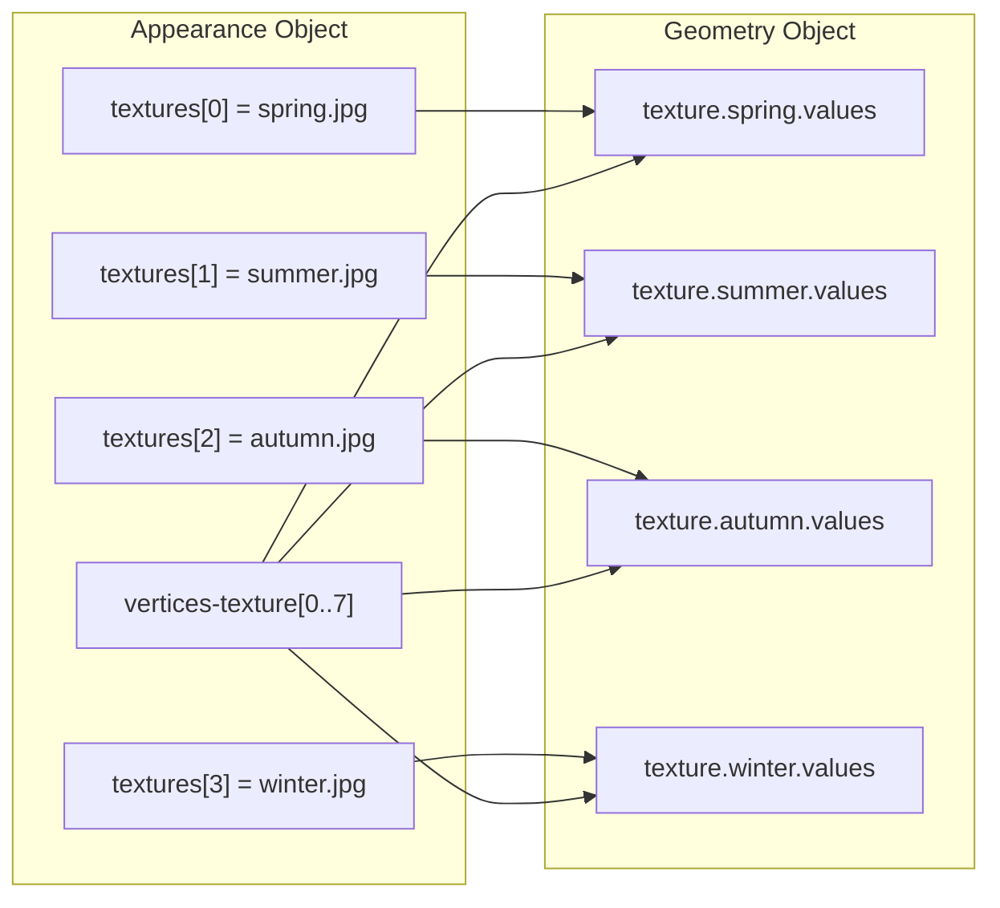

# Day 20｜UV 座標與紋理貼圖實戰

## 前言

昨天我們認識了 Appearance Object 的整體架構，理解了 Material 與 Texture 的基本概念。今天要進入**真正的紋理貼圖實戰**——UV 座標的背後機制、`texture` 成員的 `values` 陣列深度規則，以及如何讓建築物在不同主題下展現不同紋理。

如果你對 UV 座標還沒有直觀感受，可以把整個過程想成**用包裝紙包禮物**：

- 禮物的每個面都需要計算好包裝紙的哪個部分要蓋在哪裡
- **包裝紙就是紋理圖片**（Texture Object 定義來源）
- **UV 座標就是裁切線**（`vertices-texture` 定義圖片擷取點）
- **主題就是不同的包裝方案**——聖誕節用紅色金邊、春節用喜慶花樣

開始吧。

---

## `vertices-texture` — UV 座標陣列的運作細節

### 什麼是 UV 座標？

3D 模型的頂點是用 `(X, Y, Z)` 表示的**三維空間座標**。紋理圖片是 2D 的，座標用 `(U, V)` 表示——這就是我們常說的「UV 座標」[^cityjson-appearance]：

| 座標 | 用途 | 範圍（慣例） |
|------|------|-------------|
| **U** | 水平方向（對應圖片 X 軸） | `0.0`（圖片左）～ `1.0`（圖片右） |
| **V** | 垂直方向（對應圖片 Y 軸） | `0.0`（圖片底）～ `1.0`（圖片頂） |

> **注意**：在某些圖學 API（如 DirectX）中 V 軸方向相反（`0.0` 在頂部），但 CityJSON 採用 OpenGL 慣例——V 軸向上。

`"vertices-texture"` 就是存放這些 UV 座標的陣列，位於 Appearance Object 中[^cityjson-appearance]：

```json
"vertices-texture": [
  [0.0, 0.0],
  [1.0, 0.0],
  [1.0, 1.0],
  [0.0, 1.0]
]
```

陣列的**位置（0-based index）** 就是後續幾何物件引用的識別碼。這與 `"vertices"` 陣列的原理完全相同——只是一個存 3D 座標、一個存 UV 座標。

### 為什麼 UV 頂點可以重複？

在 `"vertices"` 陣列中，我們盡量**不重複頂點**以節省空間。但 UV 座標不同——因為同一個 3D 頂點在不同面上可能需要不同的 UV 位置。

舉例來說，一棟建築物的屋頂角落：

- 作為**牆壁面**的一部分時，UV 可能是 `[0.5, 0.0]`（牆壁的中下位置）
- 作為**屋頂面**的一部分時，UV 可能是 `[0.25, 0.75]`（屋頂圖片的特定位置）

這就是 CityJSON 允許 UV 頂點重複的原因——`vertices-texture` 陣列中的同一個 UV 座標可以出現多次，各取所需[^cityjson-appearance]。

### UV 座標沒有 Transform 機制

熟悉 CityJSON 的人可能會問：「`"vertices"` 有 `"transform"` 壓縮，那 `"vertices-texture"` 有嗎？」

答案是**沒有**。因為[^cityjson-appearance]：

- UV 座標範圍通常固定為 `[0.0, 1.0]`，不需要壓縮
- 座標值都是小數且密度均勻，compression 效益不大
- UV 值超出 `[0.0, 1.0]` 被視為包裹模式（wrapMode）處理，而非資料壓縮問題

---

## Geometry Object 的 `texture` 成員

### 基本結構

昨天我們看到 Geometry Object 可以有 `"material"` 成員，今天來看它的姊妹——`"texture"` 成員[^cityjson-appearance]：

```json
{
  "type": "Solid",
  "lod": "2.2",
  "boundaries": [
    [ [[0, 3, 2, 1]], [[4, 5, 6, 7]], [[0, 1, 5, 4]], [[1, 2, 6, 5]] ]
  ],
  "texture": {
    "winter-textures": {
      "values": [
        [ [[0, 10, 23, 22, 21]], [[0, 1, 2, 6, 5]], [[null]], [[null]] ]
      ]
    }
  }
}
```

### `values` 陣列的深度規則

Texture 的 `values` 陣列深度規則與 Material 不同——它**等於 boundary 陣列的深度**[^cityjson-appearance]。為什麼？因為紋理貼圖需要為每一個環（ring）中的**每一個頂點**指定 UV 索引。

對於一個 Solid（boundary 深度 = 3），texture 的 `values` 結構深度也是 3：

```
Solid boundaries: [ [ surface1, surface2, ... ] ]
                    ↓ 深度 3
Texture values:   [ [ ring1, ring2, ... ] ]
                    ↓ 每個 ring 陣列描述
```

每個 ring 陣列的元素比頂點數**多 1**，因為：

| 位置 | 用途 |
|------|------|
| 第 1 個值 | `textures[]` 陣列索引（選用哪張圖片） |
| 第 2～N+1 個值 | 各頂點對應的 `vertices-texture[]` UV 索引 |

### 逐層解析範例

以 winter-textures 範例中的第一個環 `[[0, 10, 23, 22, 21]]` 為例，該 surface 有 4 個頂點（索引 0、3、2、1），因此 ring 陣列需要 **5 個值**：

```
[0, 10, 23, 22, 21]
 │   │   │   │   └── vertex[3] → UV vertices-texture[21] = (0.12, 0.34)
 │   │   │   └────── vertex[2] → UV vertices-texture[22] = (0.56, 0.78)
 │   │   └────────── vertex[1] → UV vertices-texture[23] = (0.90, 0.11)
 │   └────────────── vertex[0] → UV vertices-texture[10] = (0.22, 0.33)
 └────────────────── 使用 textures[0] 這張圖片
```

如果你仔細對照 boundary `[0, 3, 2, 1]`，會發現頂點的對應關係是：

| 頂點索引 | boundary 值 | UV 索引 |
|----------|------------|---------|
| 0 | 0 | 10 |
| 1 | 3 | 23 |
| 2 | 2 | 22 |
| 3 | 1 | 21 |

頂點順序必須與 boundary 完全一致，否則紋理會錯位。

### `null` 的使用

如果某個 surface 不需要紋理，使用 `null` 取代整個 ring 陣列：

```json
[[null]]
```

這在真實案例中很常見——建築物的底面（與地面接觸的部分）通常沒有紋理[^cityjson-appearance]。

---

## 多主題機制（Themes）在紋理上的應用

### 同一個幾何，多組紋理

主題（theme）是 CityJSON 最強大的功能之一。一個 Geometry Object 的 `"texture"` 可以同時容納多組完全不同的紋理配置，透過不同的 key 名稱區分[^cityjson-appearance]：

```json
"texture": {
  "winter-textures": {
    "values": [ /* 冬季紋理 */ ]
  },
  "summer-textures": {
    "values": [ /* 夏季紋理 */ ]
  }
}
```

### 主題沒有全域列表

與 `"materials"` 或 `"textures"` 不同，主題名稱**沒有全域列表**。每個幾何物件可以自由定義自己的主題名稱[^modelling-guide]：

- Geometry A 可以有 `"winter-textures"` 與 `"summer-textures"`
- Geometry B 也可以有 `"winter-textures"` 與 `"summer-textures"`
- 但 Geometry A 的 `"winter-textures"` 配置不需要與 Geometry B 相同

### 預設主題

當一個 Viewer 開啟 CityJSON 檔案時，如果它支援多主題，該顯示哪一個？Appearance Object 的 `"default-theme-texture"` 就是用來解決這個問題的[^cityjson-appearance]：

```json
"appearance": {
  "textures": [ /* ... */ ],
  "vertices-texture": [ /* ... */ ],
  "default-theme-texture": "summer-textures"
}
```

這樣 Viewer 一開啟就會顯示夏季紋理，使用者可以自行切換到冬季版本。

---

## 完整實戰：一棟建築的四季紋理

讓我們把學到的知識整合起來，建立一棟擁有**四季紋理**的建築物。

### 第一步：定義紋理圖片

在 `"appearance.textures"` 中定義四張圖片[^cityjson-appearance]：

```json
"textures": [
  { "type": "JPG", "image": "facade_spring.jpg" },
  { "type": "JPG", "image": "facade_summer.jpg" },
  { "type": "JPG", "image": "facade_autumn.jpg" },
  { "type": "JPG", "image": "facade_winter.jpg" }
]
```

### 第二步：定義 UV 座標

簡單的房屋有 6 個面，我們需要為每個面的每個頂點指定 UV 座標[^cityjson-appearance]：

```json
"vertices-texture": [
  [0.0, 0.0], [1.0, 0.0], [1.0, 1.0], [0.0, 1.0],
  [0.0, 0.0], [1.0, 0.0], [1.0, 0.5], [0.0, 0.5]
]
```

這裡定義了 8 個 UV 頂點：前 4 個是完整的 `[0,0]` 到 `[1,1]` 區塊（覆蓋整個紋理圖片），後 4 個是 `[0,0]` 到 `[1,0.5]` 區塊（只用上半部圖片）。

### 第三步：設定 Geometry Object

現在在 Building 的幾何上，為四個季節建立四個主題[^modelling-guide]：

```json
{
  "type": "Solid",
  "lod": "2.2",
  "boundaries": [
    [ [[0, 1, 2, 3]], [[7, 6, 5, 4]],
      [[0, 4, 5, 1]], [[1, 5, 6, 2]],
      [[2, 6, 7, 3]], [[3, 7, 4, 0]] ]
  ],
  "texture": {
    "spring": {
      "values": [
        [ [[0, 0, 1, 2, 3]], [[0, 4, 5, 6, 7]],
          [[0, 0, 4, 5, 1]], [[0, 1, 5, 6, 2]],
          [[0, 2, 6, 7, 3]], [[null]] ]
      ]
    },
    "summer": {
      "values": [
        [ [[1, 0, 1, 2, 3]], [[1, 4, 5, 6, 7]],
          [[1, 0, 4, 5, 1]], [[1, 1, 5, 6, 2]],
          [[1, 2, 6, 7, 3]], [[null]] ]
      ]
    },
    "autumn": {
      "values": [
        [ [[2, 0, 1, 2, 3]], [[2, 4, 5, 6, 7]],
          [[2, 0, 4, 5, 1]], [[2, 1, 5, 6, 2]],
          [[2, 2, 6, 7, 3]], [[null]] ]
      ]
    },
    "winter": {
      "values": [
        [ [[3, 0, 1, 2, 3]], [[3, 4, 5, 6, 7]],
          [[3, 0, 4, 5, 1]], [[3, 1, 5, 6, 2]],
          [[3, 2, 6, 7, 3]], [[null]] ]
      ]
    }
  }
}
```

注意到每組 theme 的 `values` 陣列**結構完全相同**，只有第一個值不同——那是 `textures[]` 的索引，指向不同季節的紋理圖片。第 6 個 surface（底面）使用 `null`，因為建築物底面不需要紋理。

### 第四步：設定預設主題

```json
"appearance": {
  "textures": [ /* 四張圖片 */ ],
  "vertices-texture": [ /* 8 個 UV 頂點 */ ],
  "default-theme-texture": "summer"
}
```

### 視覺化對應關係



---

## 常見錯誤與除錯技巧

### 錯誤一：頂點數量不匹配

這是**最常見的錯誤**[^cityjson-discussion-196]。每個 ring 的紋理值陣列長度必須等於頂點數 + 1。如果一個 surface 是三角形（3 個頂點），ring 陣列需要 4 個值。使用 5 個或 2 個都會導致解析錯誤。

### 錯誤二：有 textures 但無 vertices-texture

如果 `"appearance"` 有 `"textures"` 成員，則**必須**同時有 `"vertices-texture"` 成員[^cityjson-appearance]。這是很嚴格的規定——因為沒有 UV 座標就無法進行紋理貼圖。

### 錯誤三：索引超出範圍

這是執行期最容易發生的錯誤：

- `textures` 陣列只有 4 個元素，但 ring 陣列中的第一個值是 `4`——超出範圍
- `vertices-texture` 陣列只有 8 個元素，但 ring 陣列中某個 UV 索引是 `9`——超出範圍

建議使用 cjval 驗證工具檢查這些索引是否合法[^cjval]。

### 錯誤四：UV 座標沒有對應幾何頂點順序

這是一個「語意上正確但視覺上錯誤」的陷阱。如果 boundary 的頂點順序是 `[0, 3, 2, 1]`，但 UV 索引對應的是 `[頂點0, 頂點1, 頂點2, 頂點3]` 而非 `[頂點0, 頂點3, 頂點2, 頂點1]`，紋理會呈現扭曲。

### 除錯流程

當紋理顯示不正確時，按照這個順序檢查[^modelling-guide]：

1. **檢查 cjval 輸出**——是否有驗證錯誤？
2. **逐面檢查**——關閉所有 surface 的紋理，一個個打開，找出哪個面出問題
3. **比對頂點順序**——boundary 的頂點順序與 UV 索引順序是否一致？
4. **檢查圖片路徑**——`"image"` 路徑是否可被 Viewer 存取？
5. **確認 wrapMode**——UV 座標超出 `[0,1]` 時的行為是否符合預期？

---

## 結語

UV 座標與紋理貼圖是 3D 城市模型從素模走向擬真視覺化的關鍵一步。今天我們學到了：

- **`vertices-texture` 陣列**儲存 UV 座標，允許重複，沒有 transform 壓縮
- **`texture` 成員的 `values`** 陣列深度等於 boundary 深度，每個 ring 陣列比頂點數多 1
- **多主題機制**讓同一個幾何可以擁有多組紋理配置，透過主題名稱切換
- **完整四季紋理範例**展示了從圖片定義到 UV 座標到主題設定的完整流程

明天我們將進入 Metadata 與 CRS 的世界——了解如何讓 CityJSON 資料擁有座標系統、來源資訊與身份認證。

---

## 參考資料

[^cityjson-appearance]: CityJSON Specification 2.0. (2024). Appearance Object. Retrieved 2026-09-27, from https://www.cityjson.org/specs/2.0.0/#appearance-object

[^modelling-guide]: CityJSON. (n.d.). Modelling Guide — Themes of Materials and Textures. Retrieved 2026-09-27, from https://www.cityjson.org/dev/modelling-guide/

[^cityjson-discussion-196]: CityJSON Specifications Repository. (2024). Clarify vertices-texture and texture.values relation — GitHub Discussion #196. Retrieved 2026-09-27, from https://github.com/cityjson/specs/discussions/196

[^cjval]: cjval. (n.d.). CityJSON Validator. Retrieved 2026-09-27, from https://github.com/cityjson/cjval