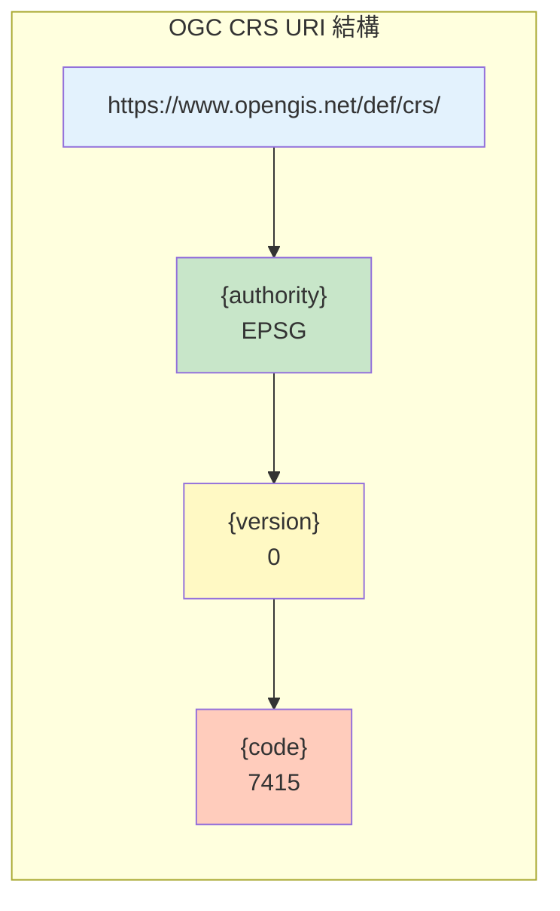

# Day 21｜Metadata 與 CRS — 讓資料有座標、有來源、有身份

## 前言

在前 20 天，我們學習了 CityJSON 的幾何結構、城市物件、語意表面、以及外觀材質。這些元素組合起來已經可以建立一個完整的 3D 城市模型。但對於一份「有生產力」的 GIS 資料來說，還缺少三個關鍵要素：

- **資料的來源是誰？** —— 誰製作的？該怎麼聯絡？
- **資料的座標在哪裡？** —— 這些頂點數字對應到地球上哪個位置？
- **資料的身份是什麼？** —— 版本、時間、內容摘要？

這些問題正是 **Metadata（後設資料）** 與 **CRS（座標參考系統）** 要回答的。今天我們就來深入了解 CityJSON 的 metadata 機制。

---

## 核心 Metadata 的 6 個屬性

CityJSON 的 `"metadata"` 物件位於根層級，是一個選填成員。它包含 **6 個 ISO 19115 相容**的屬性[^cityjson-specs]：

| 屬性 | 型態 | 必填 | 說明 |
|------|------|------|------|
| `geographicalExtent` | 數值陣列 [6] | ❌ | 地理範圍（bounding box） |
| `identifier` | 字串 | ❌ | 資料集唯一識別碼 |
| `pointOfContact` | 物件 | ❌ | 聯絡人詳細資訊 |
| `referenceDate` | 字串（日期） | ❌ | 資料集編製日期 |
| `referenceSystem` | 字串（URI） | ❌ | 座標參考系統 |
| `title` | 字串 | ❌ | 資料集標題 |

一個完整的 metadata 物件長這樣[^cityjson-specs]：

```json
{
  "type": "CityJSON",
  "version": "2.0",
  "metadata": {
    "geographicalExtent": [ 84710.1, 446846.0, -5.3, 84757.1, 446944.0, 40.9 ],
    "identifier": "eaeceeaa-3f66-429a-b81d-bbc6140b8c1c",
    "pointOfContact": {
      "contactName": "3D geoinformation group, Delft University of Technology",
      "contactType": "organization",
      "role": "owner",
      "phone": "+31-6666666666",
      "emailAddress": "3dgeoinfo-bk@tudelft.nl",
      "website": "https://3d.bk.tudelft.nl",
      "address": {
        "thoroughfareNumber": "134",
        "thoroughfareName": "Julianalaan",
        "locality": "Delft",
        "postcode": "2628BL",
        "country": "the Netherlands"
      }
    },
    "referenceDate": "1977-02-28",
    "referenceSystem": "https://www.opengis.net/def/crs/EPSG/0/2355",
    "title": "Buildings in LoD2.3 of Chibougamau, Québec"
  }
}
```

> **注意**：所有 6 個屬性都是選填的，但強烈建議至少填寫 `referenceSystem` 和 `title`——否則使用者無法知道資料的座標含義與內容。

---

## `geographicalExtent` — 地理範圍

`geographicalExtent` 是一個 6 元素的浮點數陣列，代表資料集的軸對齊包圍盒（axis-aligned bounding box）[^cityjson-specs]：

```json
"geographicalExtent": [ 84710.1, 446846.0, -5.3, 84757.1, 446944.0, 40.9 ]
```

格式：`[minx, miny, minz, maxx, maxy, maxz]`

| 元素 | 含義 |
|------|------|
| minx | X 軸最小值（東向） |
| miny | Y 軸最小值（北向） |
| minz | Z 軸最小值（高度） |
| maxx | X 軸最大值 |
| maxy | Y 軸最大值 |
| maxz | Z 軸最大值 |

### 與 Transform 的區別

這個邊界框使用的是**真實世界座標系**（基於 `referenceSystem` 定義的 CRS），**沒有經過 `transform` 壓縮**[^cityjson-specs]。相較之下 `vertices` 陣列中的數字是壓縮後的整數，需要套用 `transform.scale` 和 `transform.translate` 才能還原。

為什麼要儲存這個值？因為邊界框可以從資料中計算出來，但**預先儲存**可以讓軟體在不載入完整檔案的情況下就快速判斷空間範圍——例如在地圖上顯示資料集的覆蓋區域。

---

## `identifier` — 資料集身份證

每個 CityJSON 資料集可以有一個唯一的識別碼。官方建議使用 **UUID（通用唯一識別碼）**，但並不強制[^cityjson-specs]：

```json
"identifier": "44574905-d2d2-4f40-8e96-d39e1ae45f70"
```

UUID 的好處是可以在不依賴中心伺服器的情況下產生全域唯一的值，適合用於分散式環境中的資料追蹤與引用。

---

## `pointOfContact` — 誰做了這份資料？

`pointOfContact` 是最複雜的 metadata 屬性，它是一個 JSON 物件，用來描述資料集的聯絡窗口[^cityjson-specs]：

```json
{
  "contactName": "Justin Trudeau",
  "emailAddress": "justin.trudeau@parl.gc.ca",
  "phone": "+1-613-992-4211",
  "address": {
    "thoroughfareNumber": "24",
    "thoroughfareName": "Sussez Drive",
    "postcode": "H0H 0H0",
    "locality": "Ottawa",
    "country": "Canada"
  },
  "contactType": "individual",
  "role": "pointOfContact"
}
```

### 必填與選填欄位

| 欄位 | 必填 | 值範例 |
|------|------|--------|
| `contactName` | ✅ | `"Justin Trudeau"` |
| `emailAddress` | ✅ | `"justin@example.com"` |
| `role` | ❌ | ISO 19115 的 20 種角色之一 |
| `contactType` | ❌ | `"individual"` 或 `"organization"` |
| `website` | ❌ | `"https://3d.bk.tudelft.nl"` |
| `phone` | ❌ | `"+31-6666666666"` |
| `organization` | ❌ | 當 `contactName` 是個人名稱時使用 |
| `address` | ❌ | 彈性結構，適應各國地址格式 |

### 20 種 ISO 19115 角色

`role` 欄位必須是以下 ISO 19115 定義的角色之一[^cityjson-specs]：

`resourceProvider`、`custodian`、`owner`、`user`、`distributor`、`originator`、`pointOfContact`、`principalInvestigator`、`processor`、`publisher`、`author`、`sponsor`、`co-author`、`collaborator`、`editor`、`mediator`、`rightsHolder`、`contributor`、`funder`、`stakeholder`

### 地址的彈性結構

`address` 物件的欄位名稱由各國自訂，不拘泥於固定格式。CityJSON 規範中的範例只示範了常見欄位（`thoroughfareNumber`、`thoroughfareName`、`locality`、`postcode`、`country`），但你可以根據需要擴充——例如加入 `state`、`district` 等[^cityjson-specs]。

---

## `referenceDate` — 資料的「生產日期」

這個屬性記錄資料集的編製日期，使用 **RFC 3339 §5.6** 定義的 `full-date` 格式——只有日期，沒有時間[^cityjson-specs]：

```json
"referenceDate": "1977-02-28"
```

JSON 本身沒有原生日期型別，因此 RFC 3339 的日期字串是官方推薦的表示方式。如果你需要在 City Objects 的 attributes 中儲存含時間的日期，可以使用 `full-time` 格式：`"1985-04-12T23:20:50.52Z"`。

---

## `referenceSystem`（CRS）— 座標的「地圖」

這可以說是 metadata 中**最重要的屬性**。沒有 CRS 的座標數字只是抽象數字——有了 CRS 才知道 `(84710.1, 446846.0)` 是荷蘭的某個點還是巴黎的某個點。

CityJSON 的 CRS 使用 **OGC Name Type Specification** 定義的 URL 格式[^ogc-crs-uri]：

```
http://www.opengis.net/def/crs/{authority}/{version}/{code}
```

| 組成 | 說明 | 範例值 |
|------|------|--------|
| `{authority}` | 負責維護此 CRS 的機構 | `EPSG` 或 `OGC` |
| `{version}` | 特定版本號，無版本用 `0` | `0` |
| `{code}` | CRS 代碼 | `7415`、`2355`、`4326` |

常見範例[^cityjson-specs]：

```json
// 荷蘭國家 CRS（RD New + NAP 高程）
"referenceSystem": "https://www.opengis.net/def/crs/EPSG/0/7415"

// 加拿大魁北克 CRS
"referenceSystem": "https://www.opengis.net/def/crs/EPSG/0/2355"
```

### 重要限制

與 CityGML 的關鍵差異在此顯現：**CityGML 允許每個物件有不同 CRS**（甚至同一建築的不同牆面可以使用不同 CRS），但 **CityJSON 要求所有城市物件使用同一個 CRS**[^cityjson-specs]。這簡化了實作，但也意味著如果你的資料涵蓋跨 CRS 的範圍，需要先進行座標轉換。

此外，CRS 必須是**三維的**——即高程值必須相對於特定的基準面（datum），而非單純的橢球體高度。



---

## `title` — 一句話介紹資料

最簡單的屬性，就是一個描述資料集內容的字串[^cityjson-specs]：

```json
"title": "3D city model of Chibougamau, Canada"
```

雖然簡單，但好的 title 能讓使用者在瀏覽資料列表時快速判斷這份資料是否相關。

---

## MetadataExtended Extension — 當核心不夠用時

### 為什麼需要擴充？

6 個核心屬性雖然涵蓋了基本需求，但在正式的地理資訊應用中，ISO 19115 規範的 metadata 欄位遠多於此——例如資料的語系、處理歷程（lineage）、空間表示類型、關鍵字、使用限制等。

為此，CityJSON 官方提供了 **MetadataExtended Extension**[^metadata-extended]：

```json
{
  "extensions": {
    "Metadata-Extended": {
      "url": "https://raw.githubusercontent.com/cityjson/metadata-extended/0.6/metadata-extended.ext.json",
      "version": "0.6"
    }
  }
}
```

啟用後，可以加入 `+metadata-extended` 根層級屬性，新增以下重要資訊：

| 屬性 | 說明 | 範例值 |
|------|------|--------|
| `datasetTopicCategory` | ISO 19115 主題分類 | `"geoscientificInformation"` |
| `spatialRepresentationType` | 空間表示類型 | `["vector"]` |
| `metadataDateStamp` | 中繼資料記錄日期 | `"2021-07-12"` |
| `lineage` | 資料處理歷程 | `[{ "statement": "原始資料來源..." }]` |
| `keywords` | 關鍵字 | `["3D city", "building"]` |
| `presentLoDs` | 各 LoD 的物件數量 | `{"2.2": 120, "2.3": 85}` |
| `textures` / `materials` | 紋理/材質是否存在 | `"present"` 或 `"absent"` |
| `isTriangulated` | 幾體是否三角化 | `false` |
| `constraints` | 法律與安全限制 | `{ "accessConstraints": "otherRestrictions" }` |

### cjio 的 metadata 操作

[cjio](https://github.com/cityjson/cjio) CLI 工具提供了 4 個專門操作 metadata 的指令[^metadata-extended]：

```bash
# 新增 metadata-extended 屬性
cjio myfile.city.json metadata_create

# 顯示 metadata 內容
cjio myfile.city.json metadata_get

# 移除 metadata-extended（保留核心 metadata）
cjio myfile.city.json metadata_remove

# 更新 metadata-extended
cjio myfile.city.json metadata_update
```

有趣的是，許多 cjio 操作（如 `subset`、`lod_filter`）**會自動更新** `+metadata-extended` 的統計資料——例如篩選出特定 LoD 的建築後，`presentLoDs` 和 `cityfeatureMetadata` 會自動重新計算。

---

## 結語

今天我們了解了 CityJSON 的 Metadata 與 CRS 機制。這些「看不見的資訊」雖然不像幾何資料那樣直接呈現在視覺化中，但它們是讓 3D 城市模型真正「有用」的基礎：

- **`geographicalExtent`** 讓軟體快速定位資料範圍
- **`referenceSystem`** 賦予座標數字地理意義
- **`pointOfContact`** 確保資料可以被追蹤與詢問
- **`MetadataExtended Extension`** 補足 ISO 19115 的完整需求

明天我們將進入 Phase 4 的另一個進階主題——**Extensions 擴充機制**，學習當 CityJSON 標準不夠用時，如何定義自己的資料結構。

---

## 參考資料

[^cityjson-specs]: CityJSON Specification 2.0.2. (2024). §5 Metadata. Retrieved 2026-09-27, from https://www.cityjson.org/specs/2.0.2/#metadata

[^ogc-crs-uri]: Open Geospatial Consortium. (2011). OGC Name Type Specification — Definition identifier URIs (09-048r5). Retrieved 2026-09-27, from https://docs.opengeospatial.org/pol/09-048r5.html

[^metadata-extended]: CityJSON. (2024). MetadataExtended Extension (v0.6). Retrieved 2026-09-27, from https://github.com/cityjson/metadata-extended

[^iso19115]: International Organization for Standardization. (2014). ISO 19115-1:2014 — Geographic information — Metadata — Part 1: Fundamentals. Retrieved 2026-09-27, from https://www.iso.org/standard/53798.html

[^rfc3339]: Internet Engineering Task Force. (2002). RFC 3339 — Date and Time on the Internet: Timestamps. Retrieved 2026-09-27, from https://tools.ietf.org/html/rfc3339

[^cjval]: cjval. (n.d.). CityJSON Validator. Retrieved 2026-09-27, from https://github.com/cityjson/cjval