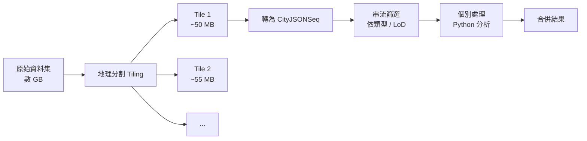

# Day 25｜大型檔案處理策略 — 分割、切片、串流

## 前言

昨天我們學會了 CityJSONSeq 格式，了解到它如何透過串流處理來解決記憶體問題。但 CityJSONSeq 只是大型檔案處理戰術中的一環——今天我們要把視角拉高，從**策略層面**來探討：當你的 3D 城市資料集大到數百 MB 甚至 GB 等級時，有哪些具體的處理方法？

城市模型資料的規模膨脹得非常快——荷蘭 3DBAG 的全國 1000 萬棟建築物[^3dbag]、瑞士蘇黎世的全市區模型[^zurich]、紐約的 2.3 萬棟建築物[^nyc]——這些資料集在 CityJSON 格式下仍然有數百 MB。要有效處理它們，你必須有一套完整的**策略工具箱**。

今天我們會介紹三種互補的策略：地理分割（tiling）、串流處理（CityJSONSeq）、以及 cjio 的實戰技巧。這三種方法可以單獨使用，也可以組合起來應對真實世界的場景。

---

## 策略一：地理分割（Tiling） — 把大象切小塊

### 為什麼要分割？

CityJSON 的最佳實踐很明確：**單一檔案不要超過數百 MB**[^cityjson-large-files]。原因很簡單：

- 瀏覽器中的 ninja.cityjson.org 載入超過 ~200 MB 的檔案就會明顯卡頓。
- QGIS 外掛載入大型 CityJSON 時需要大量記憶體。
- 即便只是執行 `cjio info` 查看統計資訊，也需要把整個檔案解析進記憶體。

因此，官方建議的第一道防線就是**地理分割（tiling）**[^cityjson-tiling]——將大範圍區域切割成多個較小的地理區塊（tiles），每個 tile 存成一個獨立的 `.city.json` 檔案。

### Tile 的劃分方法

最常見的做法是使用**規則格網（regular grid）**，依照某個投影座標系統來劃分：

```mermaid
graph TD
    subgraph 全市區
        A[全市 CityJSON<br/>~800 MB]
    end
    subgraph 2×2 格網
        B1[Tile 1<br/>~200 MB]
        B2[Tile 2<br/>~220 MB]
        B3[Tile 3<br/>~180 MB]
        B4[Tile 4<br/>~200 MB]
    end
    subgraph 4×4 格網（細切）
        C1["Tile 1-1<br/>~55 MB"]
        C2["Tile 1-2<br/>~48 MB"]
        C3["Tile 1-3<br/>~52 MB"]
        C4["Tile 1-4<br/>~45 MB"]
    end
    
    A --> B1 & B2 & B3 & B4
    B1 --> C1 & C2 & C3 & C4
```

以荷蘭 3DBAG 資料集為例，他們使用荷蘭國家座標系統（EPSG:7415 / Amersfoort / RD New）的規則格網，每個 tile 的大小約為 1 km × 1 km[^3dbag-tiles]，檔案大小約在 20–60 MB 之間——這對任何工具來說都可輕鬆處理。

### 實作地理分割

用 cjio 來分割一個大型 CityJSON 檔案，最直接的方式是使用 `subset --bbox` 搭配多個邊界框：

```bash
# 範例：將大檔案依 bbox 切為 4 個 tile
cjio big_city.city.json \
  subset --bbox 120000 2500000 120500 2500500 \
  save tile_nw.city.json

cjio big_city.city.json \
  subset --bbox 120500 2500000 121000 2500500 \
  save tile_ne.city.json

cjio big_city.city.json \
  subset --bbox 120000 2500500 120500 2501000 \
  save tile_sw.city.json

cjio big_city.city.json \
  subset --bbox 120500 2500500 121000 2501000 \
  save tile_se.city.json
```

`--bbox` 參數接受 `minx miny maxx maxy` 四個值，會選取幾何中心落在這個矩形內的所有 City Objects[^cjio-subset]。

如果你只需要特定類型的物件，可以加上 `--cotype`：

```bash
# 只取出 Tile 1 中的建築物
cjio tile_1.city.json subset --cotype Building --cotype BuildingPart \
  save tile_1_buildings.city.json
```

---

## 策略二：串流處理（CityJSONSeq） — 逐行處理不爆記憶

昨天我們詳細介紹了 CityJSONSeq 格式，它在大型檔案處理中的角色是**串流方案**——讓你可以逐行讀取、逐行處理，不需要將整個資料集載入記憶體。

### 什麼時候用 Tiling？什麼時候用串流？

| 場景 | 適用策略 | 原因 |
|------|----------|------|
| 你要將資料載入 QGIS 或 ninja 檢視 | **Tiling** | 視覺化工具需要隨機存取某個區域的資料 |
| 你要批次計算所有建築物的平均高度 | **串流** | 只需掃描一次，不需要隨機存取 |
| 你要建立一個全域的空間索引 | **兩者搭配** | 先切 tiles，再對每個 tile 串流處理 |
| 你只想查詢某個範圍內有哪些建築 | **Tiling** | 直接載入該範圍的 tile 即可 |

### 轉換與串流處理

將一個大的 CityJSON 轉為 CityJSONSeq：

```bash
# 使用 cjseq（Rust）轉換
cjseq cat big_city.city.json > big_city.city.jsonl
```

```bash
# 使用 cjio（Python）轉換
cjio big_city.city.json export jsonl big_city.city.jsonl
```

轉換後，你可以用標準的 Unix pipeline 來串流處理：

```bash
# 從 CityJSONSeq 篩選出 Building 型別，再轉回 CityJSON
cat big_city.city.jsonl \
  | cjseq filter --cotype Building \
  | cjseq collect > only_buildings.city.json
```

這種 pipeline 的好處是**每個環節都是串流的**——不會有任何階段需要將整個資料集載入記憶體。

---

## 策略三：cjio 實戰 — 分割、合併、管線化

### 用 cjio 子集與篩選

除了 `--bbox` 之外，cjio 的 `subset` 命令還提供多種篩選方式[^cjio-subset]：

```bash
# 半徑篩選：以某點為中心 500 公尺內的物件
cjio big_city.city.json subset --radius 500 121000 2500500 save nearby.city.json

# 隨機取樣：抽出 100 個物件（適合做測試資料）
cjio big_city.city.json subset --random 100 save sample.city.json

# 依 ID 篩選：只保留指定的物件
cjio big_city.city.json subset --id building_001 --id building_002 save two_buildings.city.json
```

### 用 cjio 合併 tiles

合併是分割的逆操作。當你處理完各個 tile 後，可以用 cjio 的 `merge` 將它們合併回一個檔案[^cjio-merge]：

```bash
# 從一個基礎檔案開始，合併所有 tile
cjio base.city.json merge '/data/tiles/*.city.json' save merged.city.json
```

合併時 cjio 自動處理以下事項：

1. **座標解壓縮**——每個 tile 可能使用不同的 `transform` 參數，cjio 會先將所有頂點還原為真實世界座標。
2. **頂點陣列拼接**——將多個 tiles 的頂點陣列串接在一起。
3. **索引偏移**——將幾何邊界陣列中的頂點索引，加上目前頂點總數的偏移量。
4. **Appearance 與 Template 偏移**——材質、紋理、幾何模板的索引也會一併調整。

### 管線化（Pipeline）的最佳實踐

cjio 最強大的設計就是**操作子可以串聯**——一次解析、多次操作、一次寫出[^cjio-pipeline]：

```bash
# 完整管線範例
cjio old_v11.city.json \
  upgrade \
  lod_filter 2.2 \
  subset --bbox 120000 2500000 120500 2500500 \
  vertices_clean \
  save cleaned_tile.city.json
```

這個管線依序做了：
1. **`upgrade`**——先將 CityJSON 1.1 升級為 2.0，確保後續操作使用一致的版本。
2. **`lod_filter 2.2`**——只保留 LoD 2.2 的幾何，丟棄其他 LoD。放在前面做可以減少後續處理的資料量。
3. **`subset --bbox`**——依空間範圍篩選物件。
4. **`vertices_clean`**——移除 subset 後殘留的孤立頂點與重複頂點，壓縮檔案大小。
5. **`save`**——將結果寫入檔案。

> **管線順序很重要**：先過濾 LoD、再篩選範圍、最後清理頂點——這樣的順序可以讓每一步處理的資料量越來越小，整體效能最佳。

---

## 三種策略的組合打法

真實世界的專案通常不是只使用一種策略，而是將它們組合起來。以下是一個完整的處理流程：



這個流程的優點是：

1. **Tiling** 將資料降到可管理的規模（~50 MB / tile）。
2. **CityJSONSeq** 讓每個 tile 可以串流處理。
3. **Unix pipeline** 讓處理步驟可以組合而不佔用記憶體。
4. 最後再用 **cjio merge** 將處理結果合併。

---

## 真實案例：荷蘭 3DBAG 的資料交付策略

荷蘭的 **3DBAG**（3D BAG，3D 建築物與地址）是世界最大規模的開放 3D 城市模型之一，涵蓋荷蘭全境約 **1000 萬棟建築物**[^3dbag]。它是 CityJSON 大型檔案處理策略的最佳示範。

### 三種交付格式

3DBAG 同時提供三種格式來滿足不同的使用場景[^3dbag-delivery]：

| 格式 | 優點 | 適合場景 |
|------|------|----------|
| **CityJSON tiles** | 直接可用於 QGIS、ninja | 視覺化瀏覽、小區域分析 |
| **CityJSONSeq (.city.jsonl)** | 串流處理、低記憶體 | 大規模分析、批次處理 |
| **3D Tiles (glTF)** | 高效渲染 | Web 瀏覽器、CesiumJS |

### Tile 的命名規則與下載

3DBAG 使用基於 RD 座標系統的規則格網：

```
https://data.3dbag.nl/cityjson/v20230809/tiles/9/284/556/9-284-556.city.json
```

路徑中的 `9/284/556` 分別是縮放等級（zoom level）、行（column）、列（row）——這與 Slippy Map 的 Tile 命名慣例一致，也說明了 3DBAG 的 tile 大小對應到地圖縮放等級 9。

3DBAG 官方提供了一個 Python 腳本來下載指定範圍的 tiles[^3dbag-scripts]：

```bash
# 下載 Amsterdam 市中心區域的 tiles
python tile_download.py \
  --bbox 120000 2500000 121000 2501000 \
  --lod 2.2 \
  --output ./amsterdam_tiles/
```

### 用 API 串流查詢

3DBAG 也提供 Web API，直接回傳 CityJSONFeature 序列[^3dbag-api]：

```bash
# 查詢某個範圍內的建築物，以 CityJSONSeq 回傳
curl "https://api.3dbag.nl/v2/collections/bag/items?bbox=120000,2500000,120500,2500500" \
  -H "Accept: application/city+json-seq" \
  | gunzip \
  | cjseq filter --cotype Building \
  > amsterdam_buildings.city.jsonl
```

當查詢結果超過 10 棟建築物時，API 會自動以分頁（pagination）回傳，每個分頁就是一組 CityJSONFeature 序列[^3dbag-api-pagination]。

---

## 效能數據對比

根據 2024 年的論文《Streaming CityJSON datasets》，以下是各種資料集在 CityJSON 與 CityJSONSeq 之間的效能差異[^streaming-paper]：

| 資料集 | 物件數 | CityJSON 大小 | CityJSONSeq 大小 | 記憶體（CJ） | 記憶體（CJSeq） | 處理加速 |
|--------|--------|--------------|-----------------|-------------|----------------|---------|
| 赫爾辛基 | 77,231 | 572 MB | **412 MB** (-28%) | 3,743 MB | **15 MB** | **4.9×** |
| 紐約 | 23,777 | 105 MB | **95 MB** (-10%) | 950 MB | **16 MB** | **2.5×** |
| 蘇黎世 | 52,834 | 279 MB | **247 MB** (-11%) | 2,793 MB | **16 MB** | **3.0×** |
| 3DBV | 71,634 | 378 MB | **317 MB** (-16%) | 4,102 MB | **124 MB** | **3.1×** |

關鍵發現：

- CityJSONSeq 平均比 CityJSON **節省 10–12% 的磁碟空間**（最大 28%）。
- 記憶體使用量的降幅最為驚人——赫爾辛基從 **3.7 GB 降到 15 MB**，差了兩個數量級。
- 處理時間加速 **2.5–4.9 倍**。

這組數據清楚地說明：如果你的資料集超過 100 MB，**CityJSONSeq 應該是你的預設選擇**。

---

## 結語

今天我們完整檢視了 CityJSON 大型檔案處理的三道防線：

1. **地理分割（Tiling）**——將大區域切成小區塊，每個 tile 保持在可管理的大小（<100 MB），適合視覺化與隨機存取。
2. **串流處理（CityJSONSeq）**——逐行讀取、逐行處理，記憶體使用量極低，適合批次分析與大量資料掃描。
3. **cjio 工具鏈**——提供 subset、merge、pipeline 等實用功能，讓分割與合併變得簡單。

這三種策略可以**獨立使用，也可以組合搭配**。對於大型專案，典型的建議是：

> 先用地理分割將資料切為 tiles，對每個 tile 進行獨立的 CityJSONSeq 串流處理，最後再將結果合併。

明天我們將深入介紹 **cjio 指令一把罩**——從安裝、常用操作、到自動化腳本，讓 cjio 成為你處理 CityJSON 資料的瑞士刀。

---

## 參考資料

[^3dbag]: 3DBAG. (n.d.). 3DBAG — 3D BAG van heel Nederland. Retrieved 2026-09-27, from https://3dbag.nl

[^3dbag-tiles]: 3DBAG. (n.d.). 3DBAG CityJSON delivery format — Tiling. Retrieved 2026-09-27, from https://docs.3dbag.nl/en/delivery/cityjson/#tiling

[^3dbag-delivery]: 3DBAG. (n.d.). 3DBAG data delivery formats. Retrieved 2026-09-27, from https://docs.3dbag.nl/en/delivery/

[^3dbag-scripts]: 3DBAG. (n.d.). 3dbag-scripts — tile_download.py. Retrieved 2026-09-27, from https://github.com/3DBAG/3dbag-scripts/

[^3dbag-api]: 3DBAG. (n.d.). 3DBAG Web Services. Retrieved 2026-09-27, from https://api.3dbag.nl

[^3dbag-api-pagination]: 3DBAG. (n.d.). 3DBAG API Pagination. Retrieved 2026-09-27, from https://docs.3dbag.nl/en/delivery/webservices/#pagination

[^cityjson-large-files]: CityJSON. (2024). CityJSON Specification 2.0.2 — §7 Handling large files. Retrieved 2026-09-27, from https://www.cityjson.org/specs/2.0.2/#handling-large-files

[^cityjson-tiling]: CityJSON. (2024). CityJSON Specification 2.0.2 — §7.1 Decomposing an area into parts/tiles. Retrieved 2026-09-27, from https://www.cityjson.org/specs/2.0.2/#decomposing-an-area-into-partstiles

[^cjio-subset]: cjio. (n.d.). cjio documentation — Subsetting. Retrieved 2026-09-27, from https://cjio.readthedocs.io/en/stable/

[^cjio-merge]: cjio. (n.d.). cjio documentation — Merging. Retrieved 2026-09-27, from https://cjio.readthedocs.io/en/stable/

[^cjio-pipeline]: cjio. (n.d.). cjio documentation — CLI commands reference. Retrieved 2026-09-27, from https://cjio.readthedocs.io/en/stable/

[^zurich]: CityJSON. (n.d.). CityJSON datasets — Zürich. Retrieved 2026-09-27, from https://www.cityjson.org/datasets/

[^nyc]: New York City DoITT. (n.d.). NYC 3D Building Model. Retrieved 2026-09-27, from https://github.com/CityOfNewYork/nyc-3d-building-model

[^streaming-paper]: Ledoux, H., Stavropoulou, G., & Dukai, B. (2024). Streaming CityJSON datasets. arXiv:2407.00017. Retrieved 2026-09-27, from https://arxiv.org/abs/2407.00017