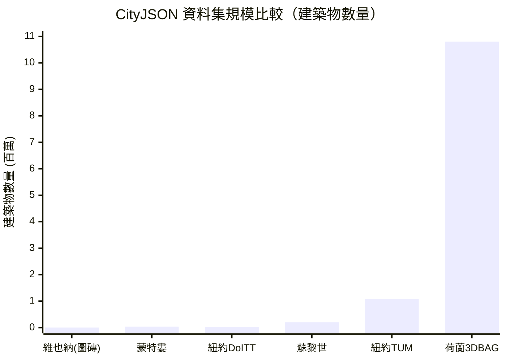

# Day 28｜真實案例 — 全球城市資料集巡禮

## 前言

經過 27 天的學習，你已經掌握了 CityJSON 的格式結構、幾何核心、語意表面、外觀材質、擴充機制，甚至學會了如何從 CityGML 轉換到 CityJSON。但是，這些知識最令人興奮的部分是什麼？當然是**實際資料**。

今天我們要來一趟全球城市資料集巡禮——看看世界各地有哪些開放、可下載的 CityJSON 資料集，以及它們各自的特色與用途[^cityjson-datasets-page]。

---

## 🇳🇱 荷蘭 3DBAG：全球最大的開放 3D 建築資料集

### 基本資訊

**3DBAG（3D Basisregistratie Adressen en Gebouwen）** 是由 TU Delft 3D 地理資訊研究組與 3DGI 共同開發的國家級 3D 建築資料集，涵蓋荷蘭全國約 **1,080 萬棟建築物**[^3dbag-docs]。

| 項目 | 內容 |
|------|------|
| **建築物數量** | ~10,771,547（v2025.09.03 版） |
| **LoD 等級** | LoD1.2（方塊模型）、LoD1.3（分段屋頂）、LoD2.2（完整屋頂形狀） |
| **檔案格式** | CityJSON、GeoPackage、OBJ、IFC 4.3、3D Tiles |
| **授權** | **CC BY 4.0** |
| **語意表面** | GroundSurface、RoofSurface、OuterWallSurface、InnerWallSurface |
| **更新頻率** | 每年多次更新 |

### 取得方式

3DBAG 提供多種下載途徑[^3dbag-download]：

- **互動式地圖**：在 https://3dbag.nl/en/download 上選取區域
- **OGC API**：https://api.3dbag.nl/ 回傳 CityJSONFeature
- **3D Tiles**：Cesium 相容的串流 tileset
- **Tile 索引**：https://data.3dbag.nl/latest/tile_index.fgb

### 為什麼 3DBAG 這麼重要？

3DBAG 不僅是規模最大的開放 CityJSON 資料集，更是 CityJSON 格式的重要推手。TU Delft 團隊同時維護了 **cjio**（Python CLI）、**ninja**（Web Viewer）、**azul**（桌面 Viewer）和 **QGIS 外掛**，形成了完整的工具生態系[^cityjson-ecosystem]。

---

## 🇳🇱 PDOK 3D Basisvoorziening：荷蘭全國 3D 地形圖

### 與 3DBAG 的區別

3DBAG 只包含建築物，而 **PDOK 3D Basisvoorziening**（3D 基礎設施）則是由荷蘭地籍局（Kadaster）維護的**全國水密 3D 模型**，包含地形、道路、橋樑和水體[^pdok-3d]：

| 集合 | 內容 |
|------|------|
| 3D Objecten Gebouwen | 建築物（CityJSON） |
| 3D Objecten Gebouwen en Terreinen | 建築物 + 地形 + 道路 + 水體（CityJSON） |
| 3D Tiles Gebouwen | 建築物 3D Tiles |
| 3D Tiles Terreinen | 地形 3D Tiles |

同樣採用 **CC BY 4.0** 授權，可透過 OGC API 取得每個地圖圖磚（kaartblad）的 CityJSON 資料。

---

## 🇨🇭 蘇黎世：CityJSON 壓縮效率的最佳示範

蘇黎世市的 LoD2 3D 城市模型是 CityJSON 官網展示的經典案例——它完美展示了 CityJSON 相較 CityGML 的壓縮優勢[^zurich-dataset]：

| 項目 | CityGML (XML) | CityJSON |
|------|--------------|----------|
| **檔案大小** | 2,990 MB (~2.99 GB) | **293 MB** |
| **壓縮倍率** | — | **~10 倍** |
| **建築物數量** | 198,699 | 相同 |
| **LoD** | LoD2（光測屋頂形狀） | 相同 |
| **語意表面** | 有 | 完全相同 |
| **紋理** | 無 | 無 |
| **授權** | **CC0-1.0**（公眾領域） | 相同 |

蘇黎世的資料是 CC0 授權，意味著你可以自由地用於任何商業或非商業用途，不需要標註來源。

---

## 🇺🇸 紐約市：兩個截然不同的資料集

### A) NYC DoITT / OTI 官方 3D 建築模型

由紐約市技術創新辦公室（OTI，前身為 DoITT）發布的官方 3D 建築模型[^nyc-doitt-dataset]：

| 項目 | 內容 |
|------|------|
| **圖磚 DA13 數量** | 23,777 棟建築 |
| **CityJSON 大小** | 110 MB（原 CityGML 為 980 MB） |
| **LoD** | LoD2（但幾何接近 LoD1） |
| **幾何正確率** | 99.9%（僅 21 棟無效） |
| **授權** | NYC Open Data ToU |

### B) TUM 紐約 3D 城市模型（研究計畫）

由慕尼黑工業大學（TUM）基於 NYC Open Data 建構的大規模語意 3D 城市模型[^tum-nyc-dataset]：

| 項目 | 內容 |
|------|------|
| **建築物** | 1,082,015 棟（LoD1） |
| **街道空間物件** | 508,660 個（LoD2）——車道、人行道、路緣、交叉口 |
| **其他** | 土地（866,853）、道路（149,292）、公園、水體 |
| **格式** | CityGML、KML、COLLADA、glTF |
| **特色** | 多達 90 個語意屬性 — 鋪面狀況、日照分析、交通模擬 |

---

## 🇨🇦 蒙特婁：紋理建築的 CityJSON 範例

蒙特婁市的 3D 城市模型最特別的地方在於它包含**紋理**（textures）[^montreal-dataset]：

| 項目 | 內容 |
|------|------|
| **總建築物數** | 38,214 棟（跨多個圖磚） |
| **範例圖磚 VM05** | 5.6 MB（CityJSON）vs 75 MB（CityGML） |
| **LoD** | LoD2（光測法） |
| **紋理** | **有** — 基於 2013 年航照/衛星影像 |
| **語意表面** | 有 |
| **授權** | **CC-BY-4.0** |

蒙特婁是少數在 CityJSON 中保留紋理的公開資料集之一，對於視覺化應用特別有價值。

---

## 🇦🇹 維也納：高品質的 LoD2 建築模型

維也納的資料以極高的幾何正確率著稱[^vienna-dataset]：

| 項目 | 內容 |
|------|------|
| **範例圖磚** | 1,322 棟建築 |
| **CityJSON 大小** | 5.6 MB（原 CityGML 為 58 MB） |
| **LoD** | LoD2（半自動屋頂形式） |
| **幾何正確率** | **98.5%** |
| **屬性** | 屋頂形式（roofType）、建築高度、簷高 |
| **授權** | **CC-BY-4.0** |

維也納同時也提供全市的 LoD1 模型（Baukörpermodell LoD1.4），同樣為 CC-BY-4.0 開放資料。

---

## 🌍 更多城市的 CityJSON 資料

除了上述主要城市，TU Delft 的 **Open 3D Cities STAC 目錄** 還收錄了更多資料集[^stac-catalog]：

| 城市/地區 | 國家 | 特色 |
|-----------|------|------|
| **Den Haag** | 🇳🇱 | 建築物 + 地形合併的 CityJSON 範例 |
| **Rotterdam** | 🇳🇱 | Delfshaven 社區的 LoD2 建築 |
| **Ingolstadt** | 🇩🇪 | LoD3 建築模型（極高細節） |
| **Hamburg** | 🇩🇪 | LoD1 與 LoD2 全市模型 |
| **Linz** | 🇦🇹 | 奧地利第三大城 |
| **Luxembourg** | 🇱🇺 | 全國試點建築模型 |
| **Prague** | 🇨🇿 | 布拉格 3D 建築模型 |
| **Riga** | 🇱🇻 | 里加 3D 建築模型 |
| **Kuopio** | 🇫🇮 | 紋理建築（LoD2） |
| **Poznań** | 🇵🇱 | 波茲南 3D 城市模型 |
| **Freiburg** | 🇩🇪 | LoD2 建築模型 |
| **Hannover** | 🇩🇪 | LoD2 建築模型 |
| **Baden-Württemberg** | 🇩🇪 | 全邦 LoD2 建築模型 |
| **Bayern（巴伐利亞）** | 🇩🇪 | 全邦 LoD2 建築模型 |
| **Brandenburg** | 🇩🇪 | 全邦 LoD2 建築模型 |
| **Bremen** | 🇩🇪 | 布萊梅 3D 建築模型 |
| **Singapore（HDB）** | 🇸🇬 | 組屋 3D 建築模型 |
| **Estonia** | 🇪🇪 | 全國 3D 建築模型 |
| **Vantaa** | 🇫🇮 | LoD1+LoD2 城市模型 |
| **Auvergne-Rhône-Alpes** | 🇫🇷 | 法國大區 3D 建築模型 |

---

## 📊 全球資料集快速比較



| 資料集 | 建築數 | CityJSON 大小 | LoD | 紋理 | 授權 |
|--------|--------|--------------|-----|------|------|
| **3DBAG** 🇳🇱 | ~1,080 萬 | 依圖磚分割 | 1.2/1.3/2.2 | ❌ | CC BY 4.0 |
| **PDOK 3D** 🇳🇱 | ~1,000 萬+（含地形） | 依圖磚分割 | 2.2/1.3 | ❌ | CC BY 4.0 |
| **Zürich** 🇨🇭 | 198,699 | 293 MB | LoD2 | ❌ | **CC0** |
| **NYC (TUM)** 🇺🇸 | 1,082,015 | ~2.4 GB (GML zip) | LoD1+2 | ❌ | NYC ToU |
| **NYC (DoITT)** 🇺🇸 | 23,777（圖磚） | 110 MB | LoD2 | ❌ | NYC ToU |
| **Montréal** 🇨🇦 | 38,214 | ~5.6 MB/圖磚 | LoD2 | ✅ | CC BY 4.0 |
| **Vienna** 🇦🇹 | 1,322（範例） | 5.6 MB | LoD2 | ❌ | CC BY 4.0 |

---

## 🗺️ 自建你的 CityJSON 資料集

不只有各國政府提供的資料，你也可以用開源工具自行產生 CityJSON 資料集：

### 3dfier：2D 地圖 → 3D 城市模型

**3dfier** 是由 TU Delft 開發的開源工具，可以將 2D 地圖資料（如 OpenStreetMap 的建築物足跡 + LiDAR 點雲）自動重建為 3D 城市模型，並直接輸出 CityJSON[^3dfier-tutorial]：

```bash
# 安裝 3dfier（Linux/macOS）
git clone https://github.com/tudelft3d/3dfier.git
cd 3dfier
mkdir build && cd build
cmake ..
make

# 執行重建（需設定檔）
./3dfier -c my_config.yml -i input_data.shp
```

### 自行轉換 CityGML

如果你手上只有 CityGML，Day 27 教過的 citygml-tools 隨時可以派上用場[^cityjson-conversion]：

```bash
./citygml-tools to-cityjson --vertex-precision=3 your_city.gml
```

---

## 🔍 如何尋找更多 CityJSON 資料集？

### 1️⃣ TU Delft Open 3D Cities STAC Catalog

這是目前最完整的 CityJSON 資料集目錄，使用 STAC（SpatioTemporal Asset Catalog）標準，支援程式化查詢[^stac-catalog]：

```bash
# 查看目錄內容
curl -s https://storage.googleapis.com/city3d-stac/catalog.json | jq '.links[].title'
```

### 2️⃣ CityJSON 官網資料集頁面

https://www.cityjson.org/datasets/ 列出了精選的轉換範例，包含每個資料集的 CityGML 與 CityJSON 大小對比以及幾何正確率統計[^cityjson-datasets-page]。

### 3️⃣ Open3D City Catalog

https://catalog.open3d.city/ 是一個社群維護的開放 3D 城市資料目錄，整合了多個來源的資料集。

### 4️⃣ 各國開放資料平台

越來越多的國家測繪機構開始提供 CityJSON 格式的 3D 資料。建議直接查詢你感興趣城市的開放資料入口，搜尋關鍵字如 "3D city model"、"LoD2"、"CityJSON"。

---

## 小結

今天我們走訪了全球各地的 CityJSON 資料集，從荷蘭的千萬建築到蒙特婁的紋理模型，每個資料集都有自己的特色。以下是今天的重點回顧：

| 關鍵發現 | 說明 |
|----------|------|
| **荷蘭是 CityJSON 大本營** | 3DBAG + PDOK 3D 提供最完整的開放 3D 城市資料 |
| **CityJSON 壓縮 7~10 倍** | 蘇黎世 2.99 GB → 293 MB 是最佳範例 |
| **CC0 / CC BY 為主** | 各大城市多採用 Creative Commons 開放授權 |
| **LoD2 是主流（但有例外）** | 多數城市以 LoD2 為主，荷蘭同時提供低 LoD |
| **STAC 目錄是入口** | TU Delft 的 STAC Catalog 統一了資料查詢介面 |
| **你也可以自建資料** | 3dfier + 開放資料 = 你自己的 CityJSON |

明天，我們將學習如何用 Python 直接處理 CityJSON 資料——從最基礎的讀取解析，到統計分析，再到轉換為 3D Tiles 或 glTF——讓你的程式碼真正駕馭這些資料集！

---

## 參考資料

[^cityjson-datasets-page]: CityJSON. (n.d.). Datasets. Retrieved 2026-09-27, from https://www.cityjson.org/datasets/

[^3dbag-docs]: 3DBAG. (2025). 3DBAG Documentation. Retrieved 2026-09-27, from https://docs.3dbag.nl/en/

[^3dbag-download]: 3DBAG. (2025). Download page. Retrieved 2026-09-27, from https://3dbag.nl/en/download

[^cityjson-ecosystem]: 3D Geoinformation Research Group, TU Delft. (2026). CityJSON ecosystem. Retrieved 2026-09-27, from https://www.cityjson.org/

[^pdok-3d]: PDOK. (2026). 3D Basisvoorziening. Retrieved 2026-09-27, from https://www.pdok.nl/introductie/-/article/3d-basisvoorziening-1

[^zurich-dataset]: Stadt Zürich Open Data. (2018). 3D-Dachmodell LoD2 Jahresstand 2018. Retrieved 2026-09-27, from https://data.stadt-zuerich.ch/dataset/geo_3d_dachmodell_lod2_jahresstand_2018

[^nyc-doitt-dataset]: NYC Open Data. (n.d.). 3-D Building Model. Retrieved 2026-09-27, from https://data.cityofnewyork.us/City-Government/3-D-Building-Model/tnru-abg2

[^tum-nyc-dataset]: Beil, C., & Kolbe, T. H. (2017). 3D City Model of New York City (LoD1). Technical University of Munich. Retrieved 2026-09-27, from https://www.asg.ed.tum.de/en/gis/projects/3d-city-model-of-new-york-city/

[^montreal-dataset]: Données Montréal. (n.d.). Maquette numérique — Bâtiments CityGML LOD2 avec textures. Retrieved 2026-09-27, from https://donnees.montreal.ca/dataset/maquette-numerique-plateau-mont-royal-batiments-lod2-avec-textures

[^vienna-dataset]: Stadt Wien. (n.d.). 3D Gebäudemodell LoD2. Retrieved 2026-09-27, from https://www.wien.gv.at/stadtplanung/baukoerpermodell-daten-beziehen

[^stac-catalog]: 3D Geoinformation Research Group, TU Delft. (2026). TU Delft 3D Open Cities Portal (STAC Catalog). Retrieved 2026-09-27, from https://storage.googleapis.com/city3d-stac/catalog.json

[^3dfier-tutorial]: CityJSON. (n.d.). 3dfier tutorial. Retrieved 2026-09-27, from https://www.cityjson.org/tutorials/3dfier/

[^cityjson-conversion]: CityJSON. (n.d.). Converting to/from CityGML files. Retrieved 2026-09-27, from https://www.cityjson.org/tutorials/conversion/