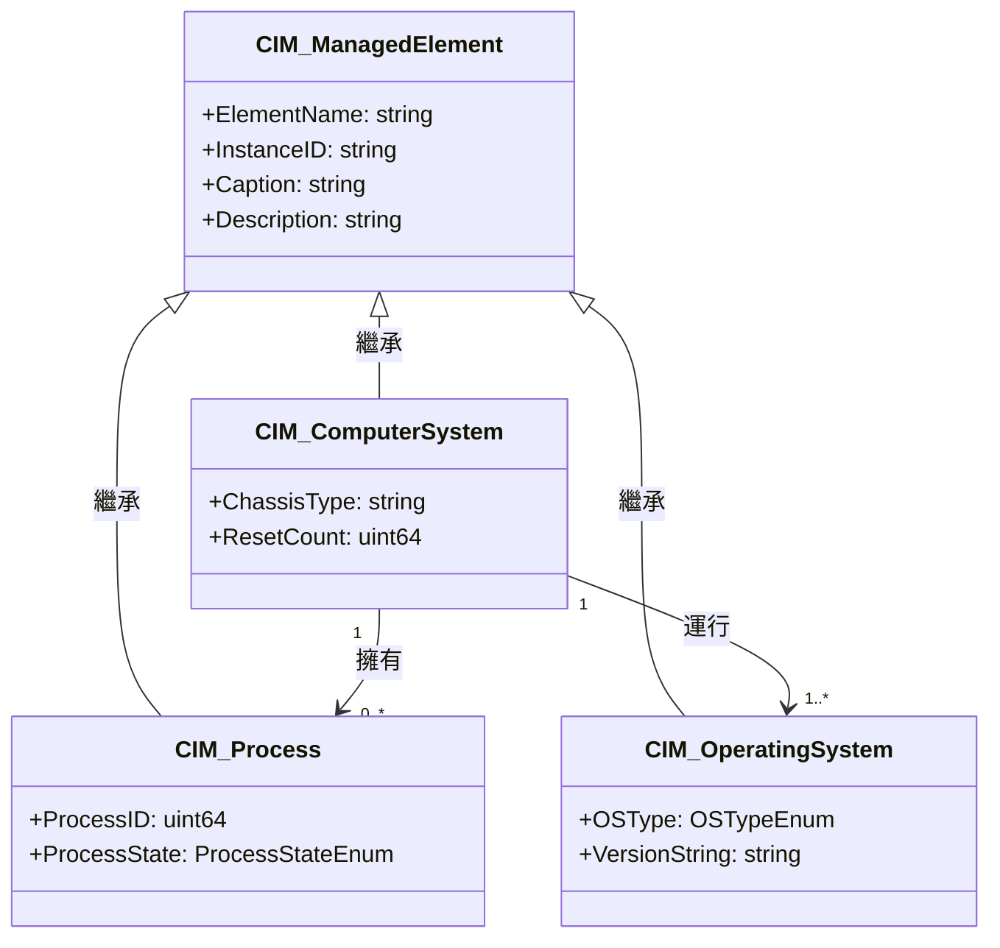

# Day 3：CIM 的核心設計哲學 — 物件導向、三層架構與協定中立

前兩天的文章為我們鋪設了 CIM 誕生的歷史舞台。今天我們將深入 CIM 的設計核心，探討它與 SNMP SMI 的本質差異，以及為何一個管理模型需要在設計之初就將 UML 和協定中立性納入 DNA。

## 物件導向的管理模型

CIM 最大的設計決策，就是選擇以 **物件導向（Object-Oriented）** 的方式來建模管理資訊[^cim-wikipedia]。這在今日看來稀鬆平常，但在 1990 年代末期，網路管理的主流仍是 SNMP 的純量變數（Scalar Variable）模型，CIM 的選擇可謂相當前瞻。

CIM 的物件導向模型由以下四個基本元素構成[^dmtf-cim-page]：

| 元素 | 說明 | 範例 |
|------|------|------|
| **Class（類別）** | 被管理元素的抽象型別 | `CIM_ComputerSystem`、`CIM_Process` |
| **Property（屬性）** | 類別的特性描述 | `ElementName`、`OperationalStatus` |
| **Association（關聯）** | 類別之間的關係 | `CIM_ComputerSystem` 擁有 `CIM_Process` |
| **Method（方法）** | 類別可執行的行為 | `Reset()`、`PowerDown()` |

**類別（Class）** 是所有管理物件的藍圖。每一個被管理的實體——無論是一台伺服器、一個作業系統程序、還是一張網路介面卡——都被表示為某個 CIM 類別的實例（Instance）。與純量變數不同，一個 CIM 類別可以同時包含資料（Property）和行為（Method），使其更能反映真實世界的管理需求。

**屬性（Property）** 則承載了管理物件的狀態。例如 `CIM_ComputerSystem` 的 `OperationalStatus` 屬性可以表示該系統目前是「正常運行」、「關機中」還是「未知狀態」。屬性的資料型別涵蓋基本型別（字串、整數、布林值）、列舉、結構陣列等。

**關聯（Association）** 是 CIM 與 SNMP 最關鍵的差異之一。在 SNMP 中，兩個被管理物件之間的關係只能透過間接方式（如 OID 樹的階層位置或表格索引）推斷。CIM 則將關聯視為**一等公民（First-class Citizen）**——可以明確表示「擁有」（Aggregation）、「依賴」（Dependency）、「組成」（Composition）等語意[^cim-wikipedia]。

## 三層架構：Core → Common → Extension

CIM Schema 並非一個龐大單一的類別清單，而是精心設計的**三層架構**[^dmtf-cim-page]：

### Layer 1：Core Model（核心模型）

核心模型定義了**跨所有管理領域都適用**的基礎概念。最具代表性的就是 `CIM_ManagedElement`——它是所有非關聯類別的抽象根類別（Abstract Root Class），提供了 `ElementName`、`InstanceID`、`Caption`、`Description` 等通用屬性[^cim-managedelement]。除了根類別，核心模型還定義了：
- `CIM_ManagedSystemElement`——系統元素層次的基礎
- `CIM_Collection`——任意群組的抽象
- `CIM_Product`——產品/FRU（Field Replaceable Unit）建模
- `CIM_Location`——位置資訊

### Layer 2：Common Model（共通模型）

共通模型在核心模型的基礎上，針對特定的管理領域定義標準類別。這些類別獨立於任何特定技術或平台[^wbemsolutions-tutorial]：
- **System**：`CIM_ComputerSystem`、`CIM_OperatingSystem`、`CIM_Process`
- **Device**：`CIM_Processor`、`CIM_Memory`、`CIM_StorageDrive`
- **Network**：`CIM_NetworkInterface`、`CIM_ProtocolEndpoint`
- **Application**：`CIM_Application`、`CIM_Service`
- **Physical**：`CIM_Chassis`、`CIM_Slot`、`CIM_Card`

### Layer 3：Extension Schema（擴充綱要）

擴充層允許各廠商和組織在標準類別上衍生自己的專屬類別。例如 Solaris 有 Solaris Schema、微軟有 WMI Schema、Linux 生態系有 SBLIM Schema[^cim-schema-wikipedia]。DMTF 預期透過這種機制，成熟的擴充類別可以逐步「晉升」到共通模型中。

## 與 SNMP SMI 的關鍵差異

CIM 與 SNMP SMI 的差異不僅是語法層面，而是設計哲學的根本分歧[^linktionary-cim]：

| 面向 | CIM | SNMP SMI |
|------|-----|----------|
| **範例** | 物件導向（UML 類別、繼承、關聯） | 純量變數（ASN.1 MIB 表格） |
| **關係表達** | 一等公民的 Association，語意明確 | 隱含於 OID 階層與索引 |
| **協定耦合** | 協定中立（可經由多種協定存取） | 緊密耦合 SNMP 協定 |
| **擴充方式** | 三層架構 + 繼承 + Qualifier | Enterprise MIB + OID 分支 |
| **Schema 語言** | MOF、UML、XML Schema | ASN.1 SMI 語法 |

最核心的差異在於：**SNMP SMI 定義的是「變數」，而 CIM 定義的是「物件」**。SNMP 的管理資料以離散的 OID（Object Identifier）節點為單位，每個節點是一個純量值或表格中的一個欄位；CIM 則以具備屬性、關聯和行為的類別為單位。這讓 CIM 在描述複雜系統時遠比 SNMP 的扁平結構更具表達力[^wikipedia-cim].

此外，CIM 的設計從一開始就考慮了**跨協定映射**——CIM Infrastructure Specification 定義了將 CIM 映射到 SNMP MIB 和 DMTF MIF 的技術，使得 CIM 可以作為「通用語言」橋接不同的管理生態系[^linktionary-cim].

## 協定中立性與 UML 第一公民

CIM 的設計哲學中，**「模型的定義」與「模型的存取」是被明確分離的**[^dmtf-cim-page]。同一個 CIM 類別，可以經由以下多種協定存取而不需改變模型本身：

| 協定 | 規格 | 特性 |
|------|------|------|
| **CIM-XML** | DSP0200：HTTP 上的 XML RPC | 最早、最成熟的協定綁定 |
| **WS-Management** | DSP0226：SOAP/Web Services | 企業級、安全功能完備 |
| **CIM-RS** | DSP0210：RESTful API + JSON | 現代化、輕量級 |

這種分離是 CIM 能夠歷經 25 年而保持活力的關鍵——網路協定會演進，但模型本身可以保持穩定。

最後，**UML 在 CIM 中不僅僅是文件工具，而是模型的定義語言本身**。DMTF 制定了專門的 DSP0219（UML Profile for CIM），定義了標準的 Stereotype 和 Tagged Value，使 UML 工具可以直接用於 CIM 建模[^dsp0219]。CIM Schema 2.56.0 的釋出檔中，包含 UML Visio 格式和 PDF 格式的完整類別圖[^cim-schema-2560]。

## 小結

CIM 的核心設計哲學可用一句話概括：**以物件導向的三層 Schema 定義管理資訊，保持協定中立，並以 UML 為第一語言。** 這個設計使得 CIM 在 SNMP 主宰網路管理、CMIP 在電信管理、DMI 在桌面管理的年代，走出了一條「統一而非取代」的路——它不試圖消滅其他管理模型，而是提供一個可以映射它們的共通語言。明天我們將走進 CIM 的核心類別，看看 `CIM_ManagedElement` 的實際子類別如何描述真實世界的管理元素。

## 參考資料

[^dmtf-cim-page]: DMTF. (n.d.). CIM — Common Information Model. Retrieved 2026-10-03, from https://www.dmtf.org/standards/cim

[^cim-wikipedia]: Wikipedia. (2025). Common Information Model (computing). Retrieved 2026-10-03, from https://en.wikipedia.org/wiki/Common_Information_Model_(computing)

[^cim-schema-wikipedia]: Wikipedia. (2024). CIM Schema. Retrieved 2026-10-03, from https://en.wikipedia.org/wiki/CIM_Schema

[^linktionary-cim]: Linktionary. (n.d.). CIM — Common Information Model. Retrieved 2026-10-03, from http://www.linktionary.com/c/cim.html

[^cim-managedelement]: DMTF. (2017). CIM_ManagedElement — CIM Schema 2.49.0. Retrieved 2026-10-03, from https://schemas.dmtf.org/wbem/cim-html/2.49.0/CIM_ManagedElement.html

[^wbemsolutions-tutorial]: WBEM Solutions. (n.d.). CIM Core Model Tutorial. Retrieved 2026-10-03, from https://web.archive.org/web/20190418232008/http://wbemsolutions.com/tutorials/CIM/cim-core.html

[^dsp0219]: DMTF. (2009). DSP0219 — UML Profile for CIM v1.0.0. Retrieved 2026-10-03, from https://www.dmtf.org/dsp/DSP0219

[^cim-schema-2560]: DMTF. (2026). CIM Schema v2.56.0 Release. Retrieved 2026-10-03, from https://www.dmtf.org/standards/cim/cim_schema_v2560