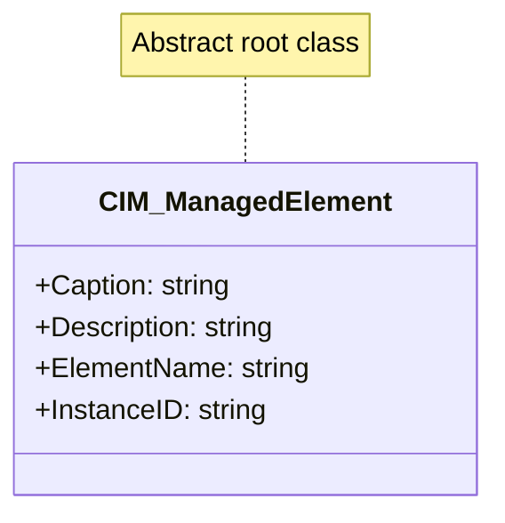
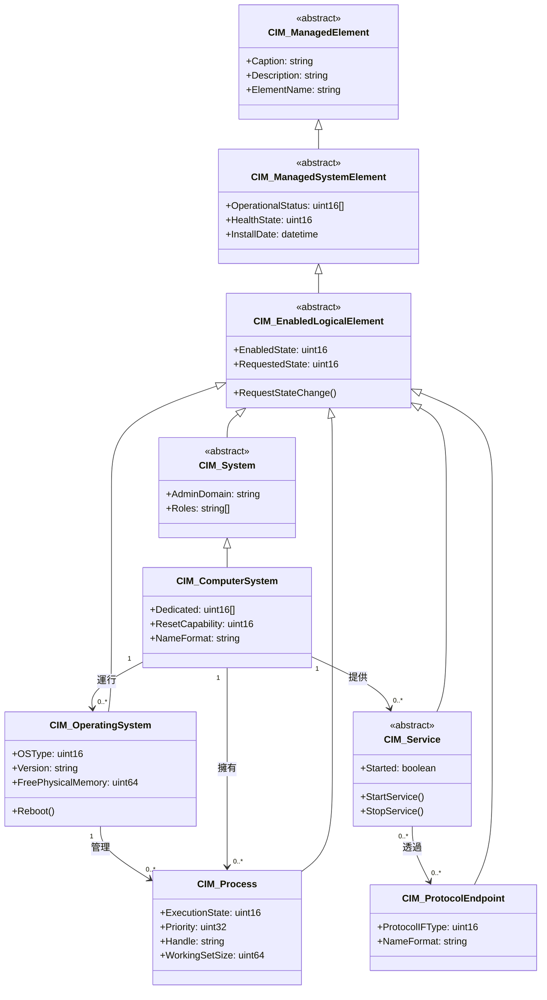
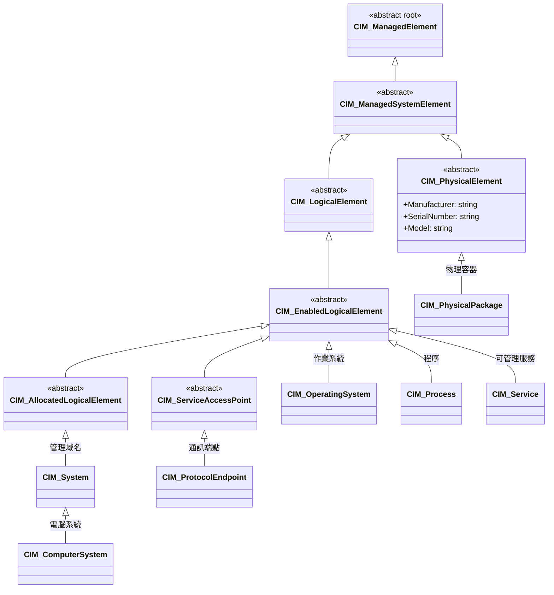

# Day 4：走進 CIM 的核心類別 — 從 CIM_ManagedElement 到實際管理元素

前三篇文章分別介紹了 CIM 的誕生背景與其設計哲學。今天我們將展開 CIM Schema 的類別地圖，逐一檢視從根類別 `CIM_ManagedElement` 到具體管理類別的繼承鏈條。你將發現，CIM 的所有管理類別都共享同一套 DNA——而這個 DNA 正是 CIM 能夠統一跨廠商管理資訊的關鍵。

## CIM_ManagedElement：一切的起點

`CIM_ManagedElement` 是 CIM Schema 中所有非關聯類別（Non-Association Class）的共同抽象超類別（Abstract Superclass），處於繼承樹的頂端[^cim-managedelement]。它自 CIM Schema 2.45.0 起已存在，歸屬於 `CIM::Core::CoreElements` 套件。由於它被標記為 `Abstract = true`，你不能直接實體化它——所有的管理物件都是其子類別的實例。

這個根類別為所有子類別提供了五個通用屬性：

| 屬性 | 資料型別 | 說明 |
|------|---------|------|
| **Caption** | string（MaxLen: 64） | 單行簡短描述 |
| **Description** | string | 較長的文字描述 |
| **ElementName** | string | 使用者友善名稱（非 key，與 `Name` 不同） |
| **InstanceID** | string（可選） | 在命名空間內唯一識別的 ID（建議格式：`<OrgID>:<LocalID>`） |
| **Generation** | uint64（可選） | 單調遞增的版本號，用於樂觀並行控制 |

[^cim-managedelement]: DMTF. (2024). CIM_ManagedElement — CIM HTML Schema 2.55.0. Retrieved 2026-10-03, from https://schemas.dmtf.org/wbem/cim-html/2.55.0/CIM_ManagedElement.html

這五個屬性是所有 CIM 管理物件的「基本識別資訊」——無論是一台伺服器、一個作業系統程序，還是一張網路卡，都從 `CIM_ManagedElement` 繼承了 `ElementName` 與 `Description` 等共同欄位。



## 兩大分支：ManagedSystemElement 與其他

`CIM_ManagedElement` 的直接子類別可分成兩個陣營。第一大陣營是 **CIM_ManagedSystemElement**——它添加了系統層級的通用屬性，如 `InstallDate`、`OperationalStatus`、`HealthState`、`Name` 等[^cim-managedsystemelement]。絕大多數管理物件都落在這個分支。

第二大陣營則包含不具「系統元素」特性的其他類別，包括集合類別（`CIM_Collection`、`CIM_SystemSpecificCollection`）、定位類別（`CIM_Location`、`CIM_Product`）、安全類別（`CIM_Policy`、`CIM_Credential`）等。

今天的重點將放在 **ManagedSystemElement 分支**的六個核心類別上，它們各自代表了管理資訊的不同面向。

[^cim-managedsystemelement]: DMTF. (2024). CIM_ManagedSystemElement — CIM HTML Schema 2.55.0. Retrieved 2026-10-03, from https://schemas.dmtf.org/wbem/cim-html/2.55.0/CIM_ManagedSystemElement.html

## CIM_ComputerSystem：管理的第一站

`CIM_ComputerSystem` 的繼承鏈條是一條長路，每一層都為其添加了重要的管理語意：

```
CIM_ManagedElement
  └── CIM_ManagedSystemElement
        └── CIM_LogicalElement
              └── CIM_EnabledLogicalElement
                    └── CIM_System
                          └── CIM_ComputerSystem
```

從底層往上：`CIM_ManagedSystemElement` 帶來 `OperationalStatus` 與 `HealthState`；`CIM_LogicalElement` 是邏輯（非物理）元素的基礎；`CIM_EnabledLogicalElement` 增加了 `EnabledState`、`RequestedState` 等可變狀態管理；`CIM_System` 則引入了管理域名（`AdminDomain`）與角色（`Roles`）概念[^cim-computersystem]。

[^cim-computersystem]: DMTF. (2024). CIM_ComputerSystem — CIM HTML Schema 2.55.0. Retrieved 2026-10-03, from https://schemas.dmtf.org/wbem/cim-html/2.55.0/CIM_ComputerSystem.html

`CIM_ComputerSystem` 本身的核心屬性包含：

- **Dedicated[]**（uint16）— 列舉系統用途（伺服器、路由器、防火牆、列印伺服器等）
- **ResetCapability**（uint16）— 硬體重置功能的啟用/禁用狀態
- **NameFormat**（string）— 系統名稱的生成方式（UUID、IP、Dial、HID、WWN 等）
- **OtherIdentifyingInfo[]**（string）— 額外的系統識別資訊（如光纖通道 WWN）

它同時是 **拓撲聚合點**，透過關聯（Association）連結 `FileSystem`、`OperatingSystem`、`Processor` 和 `Memory` 等元素。完整繼承的屬性包括 `CreationClassName`（Key）、`Name`（Key）、`EnabledState`、`OperationalStatus`、`HealthState` 等從各祖先類別累積而來的產物。

## CIM_OperatingSystem：作業系統的標準化描述

`CIM_OperatingSystem` 的繼承鏈條較短：`CIM_ManagedElement` → `CIM_ManagedSystemElement` → `CIM_LogicalElement` → `CIM_EnabledLogicalElement` → `CIM_OperatingSystem`[^cim-operatingsystem]。

它的角色是「描述一台電腦上運行的作業系統軟體」，其關鍵屬性（Key）由 `CSCreationClassName`、`CSName`（所屬 ComputerSystem）、`CreationClassName` 和 `Name` 組成——這意味著作業系統實例的識別依賴於其所屬的 ComputerSystem，清楚地反映了「作業系統是運行在電腦上」的本質。

[^cim-operatingsystem]: DMTF. (2024). CIM_OperatingSystem — CIM HTML Schema 2.55.0. Retrieved 2026-10-03, from https://schemas.dmtf.org/wbem/cim-html/2.55.0/CIM_OperatingSystem.html

`CIM_OperatingSystem` 最豐富的屬性是記憶體與程序相關的計量：

| 類別 | 屬性舉例 | 意義 |
|------|---------|------|
| **基本資訊** | `OSType`、`Version`、`LastBootUpTime` | 識別 OS 類型與版本 |
| **記憶體** | `TotalVisibleMemorySize`、`FreePhysicalMemory`、`TotalVirtualMemorySize`、`FreeVirtualMemory` | 實體/虛擬記憶體狀態 |
| **程序** | `NumberOfProcesses`、`MaxNumberOfProcesses`、`MaxProcessMemorySize`、`MaxProcessesPerUser` | 程序數量與限制 |
| **交換空間** | `TotalSwapSpaceSize`、`SizeStoredInPagingFiles`、`FreeSpaceInPagingFiles` | 分頁/置換空間狀態 |
| **使用者** | `NumberOfUsers`、`NumberOfLicensedUsers` | 使用者會話 |
| **方法** | `Reboot()`、`Shutdown()` | 控制方法 |

## CIM_Process：程序中執行的單位

`CIM_Process` 代表一個正在運行的程式實例，其繼承鏈條與 `CIM_OperatingSystem` 相同[^cim-process]：

```
CIM_ManagedElement → ... → CIM_EnabledLogicalElement → CIM_Process
```

[^cim-process]: DMTF. (2024). CIM_Process — CIM HTML Schema 2.55.0. Retrieved 2026-10-03, from https://schemas.dmtf.org/wbem/cim-html/2.55.0/CIM_Process.html

它的關鍵屬性最為複雜——使用了**四層範疇（Scoping）**：`CSCreationClassName` / `CSName`（所屬 ComputerSystem）、`OSCreationClassName` / `OSName`（所屬 OperatingSystem）、`CreationClassName`、`Handle`（程序 ID/識別碼）。這表示一個 Process 實例是透過其所屬的 ComputerSystem + OperatingSystem + 本身 PID 來唯一識別的。

`CIM_Process` 的獨立屬性聚焦於程序執行狀態：

- **ExecutionState**（uint16）— 列舉目前狀態：Ready、Running、Blocked、Terminated、Stopped、Hung 等
- **Priority**（uint32）— 排程優先級（數值越低越優先，與多數 OS 的 Linux nice 值概念相反）
- **CreationDate / TerminationDate**（datetime）— 程序生命週期
- **KernelModeTime / UserModeTime**（uint64）— 核心/使用者模式 CPU 時間（毫秒）
- **WorkingSetSize**（uint64）— 有效執行所需的記憶體位元組數

有一個值得注意的子類別：`CIM_UnixProcess`，它專為 Unix/Linux 系統擴充了更多程序管理屬性[^cim-unixprocess]。

[^cim-unixprocess]: DMTF. (2024). CIM_UnixProcess — CIM HTML Schema 2.55.0. Retrieved 2026-10-03, from https://schemas.dmtf.org/wbem/cim-html/2.55.0/CIM_UnixProcess.html

## CIM_ProtocolEndpoint：網路通訊的接點

在 CIM 中，**沒有直接名為 `CIM_Endpoint` 的類別**——更精確的名稱是 **`CIM_ProtocolEndpoint`**，代表一個可傳送或接收資料的通訊端點，是系統介面與邏輯網路（LogicalNetwork）之間的橋樑[^cim-protocolendpoint]。

[^cim-protocolendpoint]: DMTF. (2024). CIM_ProtocolEndpoint — CIM HTML Schema 2.55.0. Retrieved 2026-10-03, from https://schemas.dmtf.org/wbem/cim-html/2.55.0/CIM_ProtocolEndpoint.html

它的繼承鏈條：`... → CIM_EnabledLogicalElement → CIM_ServiceAccessPoint → CIM_ProtocolEndpoint`

`CIM_ServiceAccessPoint` 的中間角色很重要——它代表了**利用或呼叫服務的能力**，而 `ProtocolEndpoint` 則是這種能力的具體化。它的關鍵屬性只有一個：`Name`（Key，override），並懂得如何用 `NameFormat` 來保證唯一性。

`ProtocolEndpoint` 本身最重要的屬性是 **`ProtocolIFType`**（uint16）——這是一個與 IANA ifType MIB 同步的列舉，涵蓋了數百種網路介面類型（乙太網路、Wi-Fi、ATM、Frame Relay 等）。此外，`OperationalStatus`、`EnabledState` 和 `Description` 等屬性都被 override 為直接對應 IF-MIB 的 `ifOperStatus`、`ifAdminStatus` 和 `ifDescr`，顯示了 CIM Schema 與 IETF 標準的互通設計。

CIM 定義了 18 個以上的 `ProtocolEndpoint` 子類別，包括 `CIM_IPProtocolEndpoint`、`CIM_TCPProtocolEndpoint`、`CIM_UDPProtocolEndpoint`、`CIM_LANEndpoint` 等[^cim-ipprotocolendpoint]。

[^cim-ipprotocolendpoint]: DMTF. (2024). CIM_IPProtocolEndpoint — CIM HTML Schema 2.55.0. Retrieved 2026-10-03, from https://schemas.dmtf.org/wbem/cim-html/2.55.0/CIM_IPProtocolEndpoint.html

## CIM_Service：可管理的功能

`CIM_Service` 是一個抽象類別，代表**可被管理的功能可用性**。它與我們日常理解的「系統服務」（如 SSH Service、HTTP Service）概念一致，但更抽象——它可以由一個 LogicalDevice、一個 SoftwareFeature、或兩者共同提供[^cim-service]。

[^cim-service]: DMTF. (2024). CIM_Service — CIM HTML Schema 2.55.0. Retrieved 2026-10-03, from https://schemas.dmtf.org/wbem/cim-html/2.55.0/CIM_Service.html

`CIM_Service` 的關鍵屬性需要三個維度：`SystemCreationClassName` / `SystemName`（所屬 System）、`CreationClassName`、`Name`。它的獨立屬性包括 `Started`（boolean）表示服務是否已啟動，以及 `StartService()`、`StopService()` 兩個控制方法。

值得一提的是，CIM 定義了 **60 個以上的 `CIM_Service` 子類別**，涵蓋從 `CIM_BIOSService`、`CIM_BootService`、`CIM_DiagnosticService`、`CIM_NetworkService` 到 `CIM_PowerManagementService`、`CIM_SNMPService`、`CIM_WBEMService` 等幾乎所有可管理的系統功能。



## CIM_PhysicalPackage：物理容器

最後，`CIM_PhysicalPackage` 走了一條與前述「邏輯元素」不同的分支——它繼承自 `CIM_PhysicalElement`，代表**可容納或主導其他元件的物理實體**[^cim-physicalpackage]。

```
CIM_ManagedElement → CIM_ManagedSystemElement → CIM_PhysicalElement → CIM_PhysicalPackage
```

[^cim-physicalpackage]: DMTF. (2024). CIM_PhysicalPackage — CIM HTML Schema 2.55.0. Retrieved 2026-10-03, from https://schemas.dmtf.org/wbem/cim-html/2.55.0/CIM_PhysicalPackage.html

它的屬性側重於實體維度與可維護性：

| 屬性 | 型別 | 說明 |
|------|------|------|
| **PackageType** | uint16 | 類型：Rack、Chassis、Backplane、Power Supply、Fan、Blade 等 |
| **Height / Width / Depth** | real32 | 實體尺寸（英吋） |
| **Weight** | real32 | 重量（磅） |
| **Removable / Replaceable / HotSwappable** | boolean | 已被 `RemovalConditions` 取代，但保留向後相容 |
| **RemovalConditions** | uint16 | 移除條件：不可移除、可關機後移除、可熱插拔 |
| **VendorCompatibilityStrings[]** | string[] | 相容元件的識別字串 |

從 `CIM_PhysicalElement` 繼承的屬性還包括 `Manufacturer`、`Model`、`SerialNumber`、`PartNumber`、`SKU`、`AssetTag`、`ManufactureDate`、`Version` 等——將 IT 資產管理的所有欄位標準化。

## 核心類別的完整繼承全景



## 小結

今天我們走進了 CIM 類別繼承樹的核心，從 `CIM_ManagedElement` 的五個通用屬性開始，沿著 `ManagedSystemElement` 分支深入到了六個代表性類別。這些類別之間的關係體現了 CIM 的設計智慧：

| 類別 | 角色 | 關聯核心 |
|------|------|---------|
| `CIM_ManagedElement` | 所有管理物件的抽象根 | 提供基礎識別屬性 |
| `CIM_ComputerSystem` | 拓撲聚合點 | 作為 OperatingSystem、Process、Service 的範疇 |
| `CIM_OperatingSystem` | 作業系統軟體 | 以 ComputerSystem 為父，管理 Process |
| `CIM_Process` | 運行中的程式實例 | 以 ComputerSystem + OperatingSystem 為雙重範疇 |
| `CIM_ProtocolEndpoint` | 網路通訊端點 | 連結 Service 與 LogicalNetwork |
| `CIM_Service` | 可管理的功能 | 由 ComputerSystem 提供，透過 ProtocolEndpoint 存取 |
| `CIM_PhysicalPackage` | 物理容器 | 獨立於邏輯分支，描述實體資產 |

明天（Day 5）我們將深入探討 CIM 最強大的設計元素——Association（關聯）與 Inheritence（繼承），看看 CIM 如何用這些機制精準地模化真實世界管理概念之間的錯綜關係。

## 參考資料

[^cim-managedelement]: DMTF. (2024). CIM_ManagedElement — CIM HTML Schema 2.55.0. Retrieved 2026-10-03, from https://schemas.dmtf.org/wbem/cim-html/2.55.0/CIM_ManagedElement.html

[^cim-managedsystemelement]: DMTF. (2024). CIM_ManagedSystemElement — CIM HTML Schema 2.55.0. Retrieved 2026-10-03, from https://schemas.dmtf.org/wbem/cim-html/2.55.0/CIM_ManagedSystemElement.html

[^cim-computersystem]: DMTF. (2024). CIM_ComputerSystem — CIM HTML Schema 2.55.0. Retrieved 2026-10-03, from https://schemas.dmtf.org/wbem/cim-html/2.55.0/CIM_ComputerSystem.html

[^cim-operatingsystem]: DMTF. (2024). CIM_OperatingSystem — CIM HTML Schema 2.55.0. Retrieved 2026-10-03, from https://schemas.dmtf.org/wbem/cim-html/2.55.0/CIM_OperatingSystem.html

[^cim-process]: DMTF. (2024). CIM_Process — CIM HTML Schema 2.55.0. Retrieved 2026-10-03, from https://schemas.dmtf.org/wbem/cim-html/2.55.0/CIM_Process.html

[^cim-unixprocess]: DMTF. (2024). CIM_UnixProcess — CIM HTML Schema 2.55.0. Retrieved 2026-10-03, from https://schemas.dmtf.org/wbem/cim-html/2.55.0/CIM_UnixProcess.html

[^cim-protocolendpoint]: DMTF. (2024). CIM_ProtocolEndpoint — CIM HTML Schema 2.55.0. Retrieved 2026-10-03, from https://schemas.dmtf.org/wbem/cim-html/2.55.0/CIM_ProtocolEndpoint.html

[^cim-ipprotocolendpoint]: DMTF. (2024). CIM_IPProtocolEndpoint — CIM HTML Schema 2.55.0. Retrieved 2026-10-03, from https://schemas.dmtf.org/wbem/cim-html/2.55.0/CIM_IPProtocolEndpoint.html

[^cim-service]: DMTF. (2024). CIM_Service — CIM HTML Schema 2.55.0. Retrieved 2026-10-03, from https://schemas.dmtf.org/wbem/cim-html/2.55.0/CIM_Service.html

[^cim-physicalpackage]: DMTF. (2024). CIM_PhysicalPackage — CIM HTML Schema 2.55.0. Retrieved 2026-10-03, from https://schemas.dmtf.org/wbem/cim-html/2.55.0/CIM_PhysicalPackage.html