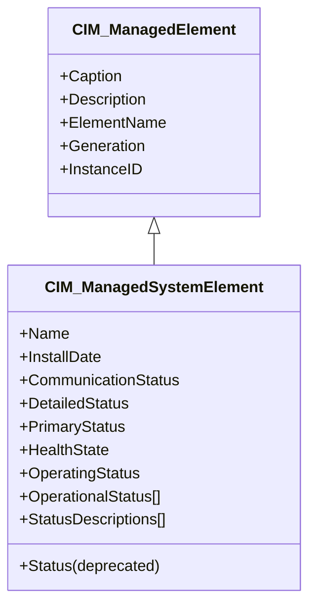
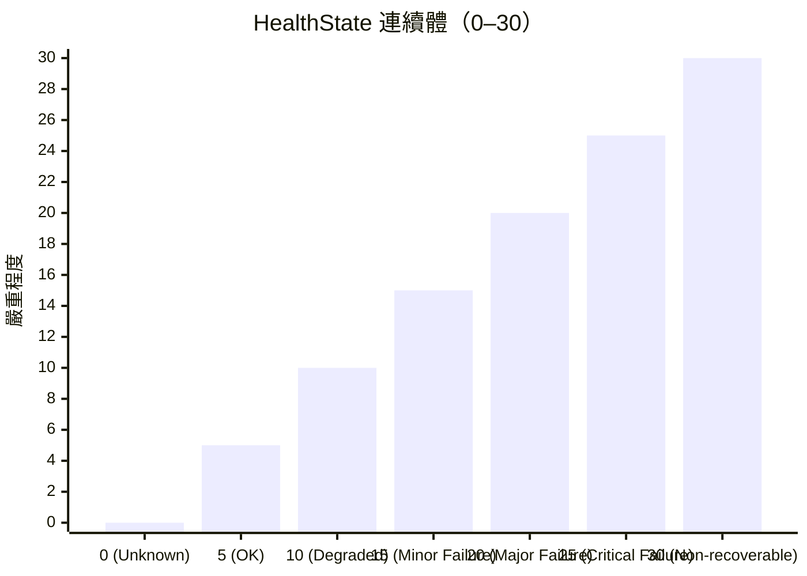

# Day 7：Core Schema — 管理模型的共同 DNA

昨天我們走完了 CIM Schema 27 年的版本演化史。從今天起，我們要展開為期 5 天的 **第二階段：CIM Schema 架構**，深入 Schema 的內容與領域模組。今天先從最根本的開始——**Core Schema（核心模型）**，也就是 CIM 所有管理類別的共同 DNA。

## CIM_ManagedElement：一切的起點

在 CIM 的類別階層中，`CIM_ManagedElement` 是所有非關聯（non-association）類別的**抽象根類別**[^cim-managedelement-html]。白話文就是：在 CIM 的世界裡，只要一個類別代表的是「可以被管理的東西」，而且不是一個單純的關聯，它就繼承自 `CIM_ManagedElement`。

這個類別定義於 `CIM::Core::CoreElements` UML 套件（自 v2.45.0 起），其上定義了 5 個最基礎的屬性：

| 屬性 | 資料型別 | 語意 |
|------|---------|------|
| **Caption** | `string`（MaxLen=64） | 一個非常簡短的文字標籤，適合 UI 或顯示用途，最多 64 字元 |
| **Description** | `string` | 該物件的自由文字描述 |
| **ElementName** | `string` | 賦予該實例一個「人類友善的名稱」，獨立於 Key 身分識別 |
| **Generation** | `uint64`（可選） | 一個單調遞增的版本號，每次底層資源被修改就更新一次 |
| **InstanceID** | `string`（可選） | 在不重複命名空間（Namespace）內不透明地唯一標示一個實例 |

其中 **ElementName、Description、Caption** 這三者的關係經常引起困惑。讓我用一個實際例子來說明：

```
Caption: "Web Server #3"
Description: "The primary Apache HTTP server handling all production HTTPS traffic"
ElementName: "prod-web-03"
```

- **Caption** 是最短的（64 字元上限），像是一個 UI 標籤
- **Description** 是最自由的，可以寫一整段來說明這個物件是什麼
- **ElementName** 則是一個「友善名稱」，與 Key 屬性是分開的——Schema 文件特別說明了為什麼要有這個區別[^cim-managedelement-html]：

> *「當 Name 存在且不是 Key 時（例如 LogicalDevice 的實例），同樣的資訊可以同時存在於 Name 和 ElementName 中。但當 Name 被覆寫為 Key 時，就需要 ElementName 來提供使用友善的名稱，因為 Key 通常不適合人類閱讀。」*

這反映了 CIM 設計中的一個重要哲學：**識別（identity）與命名（naming）是兩個不同的概念**。

`CIM_ManagedElement` 的直接已知子類別多達 40 多個，從 `CIM_ManagedSystemElement`、`CIM_Product`、`CIM_Collection` 到 `CIM_Policy`、`CIM_RecordForLog`——幾乎 CIM Schema 中的所有非關聯類別都間接源於此。

## CIM_ManagedSystemElement：系統元素的基礎

`CIM_ManagedSystemElement` 繼承自 `CIM_ManagedElement`，是**系統元素階層（System Element hierarchy）的基底類別**[^cim-managedsystemelement-html]。Schema 文件對它的定義是：

> *「CIM_ManagedSystemElement 是 System Element 階層的基底類別。任何可區分的系統元件都是此類別的候選者。範例包括：軟體元件（應用伺服器、資料庫、應用程式）、作業系統元件（檔案、行程、執行緒）、裝置元件（磁碟、控制器、處理器、印表機），以及實體元件（晶片、卡）。」*

它新增的屬性中，最關鍵的是一套**狀態與健康狀況的報告機制**：



這套狀態機制就是 CIM 管理模型的共同語言——無論你管理的是一個 CPU、一個資料庫、還是一個作業系統行程，你都可以用同一套屬性來表達它的健康與狀態。

## OperationalStatus：為什麼陣列而非單值？

`OperationalStatus` 的資料型別是 **`uint16` 陣列**（Indexed）。這是有歷史原因的——它取代了被標記為 **deprecated** 的舊 `Status` 屬性（字串型別）[^cim-managedsystemelement-html]。Schema 文件列出了三個理由：

1. **狀態本質上是陣列**：一個元素可能同時處於多種狀態（例如「OK」+「Stopped」），單值無法完整表達
2. **10 字元的 MaxLen 太短**：舊的 Status 字串型別最多 10 個字元，導致列舉值難以理解（例如 `Pred Fail` 不是 `Predictive Failure`）
3. **uint16 比字串更適合列舉**：二進位列舉在程式上更有效率

`OperationalStatus` 的列舉值定義如下[^cim-managedsystemelement-html]：

| 值 | 名稱 | 說明 |
|----|------|------|
| 0 | Unknown | 此時無法回報 |
| 1 | Other | 其他 |
| 2 | OK | 正常運作 |
| 3 | Degraded | 功能下降 |
| 4 | Stressed | 需要關注（過載、過熱等） |
| 5 | Predictive Failure | 預測近期故障 |
| 6 | Error | 錯誤 |
| 7 | Non-Recoverable Error | 不可修復的錯誤 |
| 8 | Starting | 初始化中 |
| 9 | Stopping | 正在有序停止 |
| 10 | Stopped | 已有序停止 |
| 11 | In Service | 正在配置、維護或管理中 |
| 12 | No Contact | 監控系統知道它但從未通訊過 |
| 13 | Lost Communication | 曾通訊成功但目前無法連線 |
| 14 | Aborted | 突然停止（非有序） |
| 15 | Dormant | 休眠或靜止中 |
| 16 | Supporting Entity in Error | 依賴的元件出錯 |
| 17 | Completed | 操作已完成（需搭配 OK/Error/Degraded） |
| 18 | Power Mode | 電源模式（詳細資訊在 PowerManagementService） |
| 19 | Relocating | 正在搬遷 |
| 20.. | DMTF Reserved | DMTF 保留 |
| 0x8000.. | Vendor Reserved | 廠商自定義 |

**陣列的第一個元素應代表主要狀態**，而 `StatusDescriptions[]` 陣列中的對應元素則提供人類可讀的解釋。

## HealthState：0 到 30 的健康連續體

`HealthState` 採用一個從 0 到 30 的 **數值連續體** 來表達元素健康度[^cim-managedsystemelement-html]：



| 值 | 名稱 | 語意 |
|----|------|------|
| **0** | Unknown | 無法回報健康狀況 |
| **5** | OK | 完全正常運作，無錯誤 |
| **10** | Degraded/Warning | 功能完整但效能非最佳，可能回報可回復錯誤 |
| **15** | Minor Failure | 所有功能可用但部分可能下降 |
| **20** | Major Failure | 正在失敗，部分或全部功能下降 |
| **25** | Critical Failure | 完全非功能，可能無法恢復 |
| **30** | Non-recoverable Error | 完全失敗、完全無功能、無法恢復 |

需要注意的是：**HealthState 表達的是此元素本身的健康，而非其子元件**[^cim-managedsystemelement-html]。舉例來說，一個磁碟陣列控制器（RAID Controller）可能 HealthState=5（OK），即使其中一顆磁碟已經 HealthState=20（Major Failure）——因為控制器本身仍在正常運作。

## PrimaryStatus + DetailedStatus：紅黃綠的高層次組合

`PrimaryStatus` 提供一個高層次的狀態值，類似紅黃綠燈號[^cim-managedsystemelement-html]：

- **0: Unknown** → 無法回報
- **1: OK** → 正常運作（綠燈）
- **2: Degraded** → 功能低於正常（黃燈）
- **3: Error** → 錯誤狀態（紅燈）

它與 `DetailedStatus` 搭配使用，後者提供額外細節：

| DetailedStatus 值 | 說明 |
|------------------|------|
| 0: Not Available | 不適用 |
| 1: No Additional Information | 無額外資訊（配合 PrimaryStatus=OK 表示一切正常） |
| 2: Stressed | 元素需關注（過載、過熱） |
| 3: Predictive Failure | 正常但預測近期故障 |
| 4: Non-Recoverable Error | 需人為介入 |
| 5: Supporting Entity in Error | 依賴元件出錯 |

Schema 中明確將這三者以 `ModelCorrespondence` 連接：「PrimaryStatus ↔ DetailedStatus ↔ HealthState」[^cim-managedsystemelement-html]。舉例來說：

- `PrimaryStatus=OK` + `DetailedStatus=No Additional Information` = **一切正常**
- `PrimaryStatus=Degraded` + `DetailedStatus=Stressed` = **黃燈，過載中**
- `PrimaryStatus=Error` + `DetailedStatus=Non-Recoverable Error` = **紅燈，需人為介入**

## CommunicationStatus：儀器化的通達性

`CommunicationStatus` 表達的是**管理儀器（instrumentation）與被管理元素之間的通訊能力**[^cim-managedsystemelement-html]：

| 值 | 語意 |
|----|------|
| 0: Unknown | 無法回報 |
| 1: Not Available | 對此元素不適用 |
| 2: Communication OK | 通訊已建立（不保證服務品質） |
| 3: Lost Communication | 曾可達但現在不可達 |
| 4: No Contact | 知其存在但從未成功通訊 |

這與 `OperationalStatus` 中的 `No Contact` / `Lost Communication` 相對應——但 `CommunicationStatus` 是單值，而 `OperationalStatus` 陣列可以包含其他狀態並列。

## 為什麼 Functional 不是 OK？

文章開頭提到的問題來自在 CIM 設計中，**語意的精確標準化**是一個核心關注點。

在 SNMP 的 SMI 中，`ifOperStatus` 列舉值 `up(1)` 同時包含了「正常運作」和「功能完整」的混和語意。但在 CIM 中，**不同維度的狀態被嚴格分離到不同屬性中**[^cim-managedsystemelement-html]：

| 維度 | 屬性 | 值域 |
|------|------|------|
| 元素本身的健康程度 | **HealthState** | 0–30（OK=5, Degraded=10, …） |
| 目前操作狀態（陣列） | **OperationalStatus[]** | OK, Degraded, Stressed, Stopped, … |
| 高層級概覽（紅黃綠） | **PrimaryStatus** | OK, Degraded, Error |
| 儀器通訊狀態 | **CommunicationStatus** | Communication OK, Lost, No Contact |
| 啟用/禁用狀態 | **EnabledState**（在 `CIM_EnabledLogicalElement` 上） | Enabled, Disabled, EnabledButOffline |

所以回到「為什麼 Functional 不是 OK？」這個問題：

- **Functional 描述的是功能性**（可以正常工作）
- **OK 描述的是狀態**（在正常參數範圍內無錯誤運作）

一個元件可以是 **Functional**（功能完整）但 **Degraded**（效能不如最佳）——例如一個 CPU 正在降頻運作以避免過熱，它仍在提供服務（Functional），但其狀態不是 OK（因為不在正常參數範圍內）。CIM 的 `OperationalStatus=Stressed` 正是為此場景設計的。

**CIM 的哲學是：每個語意維度都有其專屬屬性，寧可多屬性精確，也不要少屬性模糊。**

## Core Schema 的兩大分支

從 `CIM_ManagedSystemElement` 往下，CIM 將所有系統元素分為兩大類[^cim-managedsystemelement-html]：

```mermaid
classDiagram
    class CIM_ManagedElement {
        Caption, Description, ElementName
    }
    class CIM_ManagedSystemElement {
        Name, HealthState, OperationalStatus[],
        PrimaryStatus, DetailedStatus,
        CommunicationStatus
    }
    class CIM_LogicalElement {
        Abstract: 邏輯元件
        (檔案、行程、軟體、裝置)
    }
    class CIM_PhysicalElement {
        Abstract: 實體元件
        (晶片、卡、機箱)
    }
    class CIM_EnabledLogicalElement {
        EnabledState, RequestedState
    }
    class CIM_AllocatedLogicalElement {
        資源配置狀態
    }
    CIM_ManagedElement <|-- CIM_ManagedSystemElement
    CIM_ManagedSystemElement <|-- CIM_LogicalElement
    CIM_ManagedSystemElement <|-- CIM_PhysicalElement
    CIM_LogicalElement <|-- CIM_EnabledLogicalElement
    CIM_EnabledLogicalElement <|-- CIM_AllocatedLogicalElement
```

這意味著一個新的管理資源（比如 `CIM_OracleDatabase`）只需要繼承 `CIM_Service`（它本身繼承自 `CIM_EnabledLogicalElement` → `CIM_LogicalElement` → `CIM_ManagedSystemElement`），就能自動獲得：`ElementName`、`Description`、`Caption`、`Name`、`InstallDate`、`HealthState`、`OperatingStatus`、`OperationalStatus[]`、`PrimaryStatus`、`DetailedStatus`、`CommunicationStatus`、`EnabledState`、`RequestedState`，以及 `RequestStateChange()` 方法——**完全不需要重新定義任何一個**。

這就是標題所說的「共同 DNA」的威力。

## 小結

今天我們深入了 Core Schema 的核心：`CIM_ManagedElement` 提供的是管理的**基本身份**（命名、描述、版本），而 `CIM_ManagedSystemElement` 提供的則是管理的**狀態語言**（健康、操作狀態、通訊狀態、高層級概覽）。CIM 將元件狀態拆解為多個正交維度（HealthState、OperationalStatus、PrimaryStatus、CommunicationStatus），每個維度有精確定義的列舉值域——這種設計使得跨類別、跨領域的管理資訊能夠用同一套語言來表達。

明天（Day 8）我們將進入 **System & Device Schema**，探討 `CIM_ComputerSystem`、`CIM_Device` 層次，以及實際的 MOF 檔案片段。

## 參考資料

[^cim-managedelement-html]: DMTF. (n.d.). CIM_ManagedElement HTML Documentation (v2.55.0). Retrieved 2026-10-03, from http://schemas.dmtf.org/wbem/cim-html/2.55.0/CIM_ManagedElement.html

[^cim-managedsystemelement-html]: DMTF. (n.d.). CIM_ManagedSystemElement HTML Documentation (v2.55.0). Retrieved 2026-10-03, from http://schemas.dmtf.org/wbem/cim-html/2.55.0/CIM_ManagedSystemElement.html