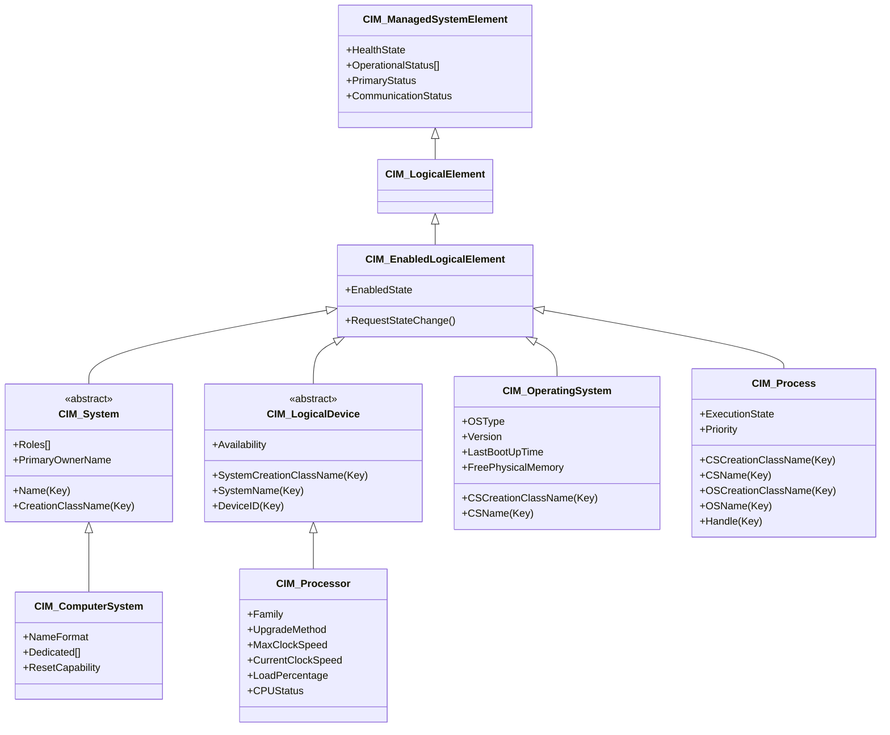

# Day 8：System & Device Schema — 管理電腦系統

昨天我們深入探討了 Core Schema 中 `CIM_ManagedElement` 與 `CIM_ManagedSystemElement` 的「共同 DNA」——那套貫穿整個 CIM 的狀態與健康報告機制。今天我們將從這套 DNA 出發，沿著類別繼承鏈一路向下，走進 **System Schema** 與 **Device Schema** 這兩個最核心的領域模組，看看 CIM 如何為一台真實的電腦系統建模。

## 類別繼承全景

在 Core Schema 的 `CIM_ManagedSystemElement` 之下，System 與 Device Schema 建構了以下的管理類別階層[^cim-mof-system][^cim-mof-logicaldevice]：



這裡有一個重要的設計觀察：**`CIM_ComputerSystem` 繼承自 `CIM_System`，而 `CIM_OperatingSystem` 與 `CIM_Process` 繼承自 `CIM_EnabledLogicalElement`**——意思是作業系統與行程**不是**電腦系統的子類別，而是透過 **Key Propagation（金鑰傳播）** 機制建立關聯[^cim-mof-operatingsystem]。

---

## 第一站：CIM_ComputerSystem — 管理電腦系統的頂層物件

`CIM_ComputerSystem` 是 CIM 中最重要的「**頂層物件（Top Level Object）**」之一[^cim-mof-computersystem]。它是 `CIM_System` 的子類別，而 `CIM_System` 被定義為：「由元件組成的、作為『功能性整體』運作的實體」，且「應可在企業層級被唯一命名和管理」[^cim-mof-system]。

### 繼承鏈上的關鍵屬性

| 繼承層級 | 關鍵屬性 | 說明 |
|---------|---------|------|
| `CIM_ManagedElement` | `ElementName`、`Description`、`Caption`、`Generation`、`InstanceID` | 最基礎的身份與描述（Day 7 已詳細探討） |
| `CIM_ManagedSystemElement` | `HealthState`、`OperationalStatus[]`、`PrimaryStatus`、`CommunicationStatus` | 狀態與健康報告（Day 7 已詳細探討） |
| `CIM_LogicalElement` | （中間標記類別，無新增屬性） | 區分「邏輯元素」與「實體元素」 |
| `CIM_EnabledLogicalElement` | `EnabledState`、`RequestStateChange()` | 代表該元素可以被啟用/禁用，且有方法請求狀態轉換[^cim-mof-enabledlogicalelement] |
| `CIM_System` | **`Name`** (Key, Override)、**`CreationClassName`** (Key)、`Roles[]`、`PrimaryOwnerName`、`PrimaryOwnerContact`、`OtherIdentifyingInfo[]` | 企業層級可識別的系統 |
| **`CIM_ComputerSystem`** | `NameFormat`、`Dedicated[]`、`ResetCapability` | 電腦系統特有屬性 |

### CIM_System 的 Key 結構

`CIM_System` 定義了兩部分組成的複合金鑰（Composite Key）[^cim-mof-system]：

```mof
// CIM_System.mof（簡化片段）
[Abstract, Version ("2.15.0"),
 UMLPackagePath ("CIM::Core::CoreElements"),
 Description ("CIM_System 是由元件組成的功能性整體...")]
class CIM_System : CIM_EnabledLogicalElement {

    [Key, MaxLen (256)]
    string CreationClassName;
    // ↑ 用於建立實例的類別名稱

    [Key, Override ("Name"), MaxLen (256)]
    string Name;
    // ↑ 企業環境中唯一識別此系統的名稱

    [Write, MaxLen (64)]
    string PrimaryOwnerName;
    // ↑ 主要系統擁有者姓名（可寫入）

    [Write]
    string Roles[];
    // ↑ 管理員定義的系統角色陣列
};
```

這個設計的用意是：**任何企業中的系統都可以透過「建立類別名稱 + 系統名稱」這個組合來被唯一識別**，不需要依賴 IP 位址或 MAC 位址這類可能變動的識別符。

### Dedicated（專用用途）：36 種預定義的系統角色

`CIM_ComputerSystem` 上定義了一個最值得關注的屬性——`Dedicated`（專用用途陣列）[^cim-mof-computersystem]。它是一個 `uint16[]` 陣列，代表電腦系統被指定擔當的角色：

| 值 | 角色 | 範例場景 |
|----|------|---------|
| 0 | Not Dedicated | 通用伺服器，未指定專門用途 |
| 3 | Storage | 儲存伺服器 |
| 4 | Router | 路由器 |
| 5 | Switch | 網路交換器 |
| 6 | Layer 3 Switch | L3 交換器 |
| 8 | Hub | 集線器 |
| 11 | Print | 列印伺服器 |
| 14 | Management | 管理控制器（如 BMC） |
| 15 | Block Server | 區塊層級儲存伺服器 |
| 16 | File Server | 檔案伺服器 |
| 17 | Mobile User Device | 行動使用者裝置 |
| 21 | UPS | 不斷電系統 |
| 23 | Management Controller | 管理控制器（如 iDRAC、iLO） |
| 24 | Chassis Manager | 機箱管理員 |
| 27 | Desktop | 桌上型電腦 |
| 28 | Laptop | 筆記型電腦 |
| 31 | FC Switch | Fiber Channel 交換器 |
| 32 | Ethernet Switch | 乙太網路交換器 |
| 33 | DMTF Reserved | DMTF 保留 |
| 0x8000.. | Vendor Reserved | 廠商自定義 |

值得注意的是，`Dedicated` 是一個陣列，因為一個電腦系統可以同時扮演多個角色——例如一台伺服器可能同時是「File Server」和「Management Controller」（內建 BMC）。

### ResetCapability：硬體重置能力

`ResetCapability` 屬性描述該系統是否可以透過硬體方式（如重啟按鈕）被重置[^cim-mof-computersystem]：

| 值 | 語意 |
|----|------|
| 1 | Other |
| 2 | Unknown |
| 3 | Disabled — 硬體重置被禁用 |
| 4 | **Enabled — 可透過硬體按鈕重置** |
| 5 | Not Implemented — 不支援此功能 |

---

## 第二站：CIM_LogicalDevice — 裝置的抽象基礎

從 `CIM_EnabledLogicalElement` 出發，另一條重要的繼承分支是 `CIM_LogicalDevice`——它是**所有可管理裝置的抽象根類別**[^cim-mof-logicaldevice]：

```
CIM_EnabledLogicalElement
 └── CIM_LogicalDevice (abstract)
      ├── CIM_Processor          ← 處理器
      ├── CIM_Sensor             ← 感應器（溫度、電壓等）
      ├── CIM_MediaAccessDevice  ← 儲存裝置
      │    ├── CIM_DiskDrive
      │    ├── CIM_DisketteDrive
      │    └── CIM_TapeDrive
      ├── CIM_PowerSource        ← 電源供應
      ├── CIM_Battery            ← 電池
      ├── CIM_Fan / CIM_CoolingDevice ← 散熱裝置
      ├── CIM_AlarmDevice        ← 警報裝置
      ├── CIM_Controller         ← 控制器
      └── ...
```

`CIM_LogicalDevice` 定義了 4 部分組成的複合金鑰，使其被 `CIM_ComputerSystem` 範疇化（scoped）[^cim-mof-logicaldevice]：

```mof
[Key] string SystemCreationClassName;  // 所屬 ComputerSystem 的 CreationClassName
[Key] string SystemName;               // 所屬 ComputerSystem 的 Name
[Key] string CreationClassName;        // 此裝置的建立類別名稱
[Key] string DeviceID;                 // 在此系統內唯一的裝置 ID
```

它還定義了一套統一的裝置操作方法：
- `SetPowerState(PowerState, Time)` — 設定電源狀態
- `Reset()` — 重置裝置
- `EnableDevice(Enabled)` — 啟用/禁用
- `OnlineDevice(Online)` — 設定上線/離線
- `QuiesceDevice(Quiesce)` — 設定靜止模式
- `SaveProperties()` / `RestoreProperties()` — 保存/還原屬性

### CIM_Processor：處理器管理

`CIM_Processor` 是 `CIM_LogicalDevice` 的子類別，用於管理 CPU 處理器[^cim-mof-processor]：

```mof
[Version ("2.10.0"),
 UMLPackagePath ("CIM::Device::Processor"),
 Description ("處理器 LogicalDevice 的能力與管理。")]
class CIM_Processor : CIM_LogicalDevice {

    [Description ("處理器家族類型（Intel、AMD、ARM 等）")]
    uint16 Family;

    [Description ("插槽類型/升級方式，例如 ZIF Socket、LGA775 等")]
    uint16 UpgradeMethod;

    [Description ("最大時脈速度 (MHz)")]
    uint32 MaxClockSpeed;

    [Description ("目前時脈速度 (MHz)")]
    uint32 CurrentClockSpeed;

    [Description ("過去一分鐘的 CPU 負載（百分比）"), Gauge]
    uint16 LoadPercentage;

    [Description ("資料匯流排寬度（位元）")]
    uint16 DataWidth;

    [Description ("位址匯流排寬度（位元）")]
    uint16 AddressWidth;

    [Description ("CPU 狀態"), 
     ValueMap {"0", "1", "2", "3", "4", "7"},
     Values {"Unknown", "CPU Enabled", "CPU Disabled by User",
             "CPU Disabled by BIOS", "CPU Is Idle", "Other"}]
    uint16 CPUStatus;

    [Description ("處理器特性陣列"),
     ValueMap {"2", "3", "4", "5", "6", "7", "8"},
     Values {"64-bit Capable", "32-bit Capable",
             "Enhanced Virtualization", "Hardware Thread",
             "NX-bit", "Power/Performance Control",
             "Core Frequency Boosting"}]
    uint16 Characteristics[];

    [Description ("已啟用的核心數量")]
    uint16 NumberOfEnabledCores;
};
```

`Family` 屬性擁有龐大的列舉值域（從 Intel 8086 到 AMD K8、ARM 等數十種處理器家族），`UpgradeMethod` 則定義了從「Daughter Board」到「LGA775」、「Socket 478」等 42 種插槽類型。在最新的 CIM 2.56.0 中，`UpgradeMethod` 又新增了 7 種插槽類型以反映現代處理器的封裝趨勢[^cim-256-relnotes]。

### CIM_Sensor：環境感應器

`CIM_Sensor` 用於管理伺服器中各種環境感應器[^cim-mof-sensor]：

```mof
class CIM_Sensor : CIM_LogicalDevice {

    [ValueMap {"2", "3", "4", "5", "6", "7", "8",
               "9", "10", "11", "12", "13", "14", "15", "16"},
     Values {"Temperature", "Voltage", "Current", "Tachometer",
             "Counter", "Switch", "Lock", "Humidity",
             "Smoke Detection", "Presence", "Air Flow",
             "Power Consumption", "Power Production",
             "Pressure", "Intrusion"}]
    uint16 SensorType;

    string PossibleStates[];  // 可能的輸出值
    string CurrentState;      // 目前狀態（如 "Normal", "Warning"）
    uint64 PollingInterval;   // 輪詢間隔（奈秒）
};
```

一個常見的應用場景：伺服器中的溫度感應器（SensorType=2）在 BMC 管理軟體中持續回報 `CurrentState="Normal"`，直到溫度超出臨界值，狀態變為 `"Warning"` 或 `"Critical"`。

---

## 第三站：CIM_OperatingSystem — 作業系統模型

`CIM_OperatingSystem` 是 `CIM_EnabledLogicalElement` 的子類別，被 `CIM_ComputerSystem` 透過金鑰傳播（Key Propagation）所範疇化[^cim-mof-operatingsystem]：

```mof
class CIM_OperatingSystem : CIM_EnabledLogicalElement {

    [Key, Propagated ("CIM_ComputerSystem.CreationClassName")]
    string CSCreationClassName;  // 所屬 ComputerSystem 的 CreationClassName

    [Key, Propagated ("CIM_ComputerSystem.Name")]
    string CSName;               // 所屬 ComputerSystem 的 Name

    [Key] string CreationClassName;
    [Key, Override ("Name")] string Name;

    [ValueMap {"0", "1", ..., "23", "38", "67", "93", "95", "103", "104", ...},
     Values {"Unknown", "Other", ..., "LINUX", "FreeBSD", "Windows XP",
             "Ubuntu", "Debian", "VMware ESXi", "Windows 7", ...}]
    uint16 OSType;               // 作業系統類型（超過 110 種預定義）

    string Version;              // 版本號（如 "3.10.0-23-generic"）
    datetime LastBootUpTime;     // 最後啟動時間
    datetime LocalDateTime;      // 目前本地時間
    sint16 CurrentTimeZone;      // GMT 偏移（分鐘）

    uint32 NumberOfProcesses;    // 目前執行中的行程數量（Gauge）
    uint32 NumberOfUsers;        // 目前使用者工作階段數量（Gauge）
    uint32 NumberOfLicensedUsers;// 授權使用者數（0=無限制）

    uint64 TotalVirtualMemorySize;    // 總虛擬記憶體（KB）
    uint64 FreeVirtualMemory;         // 可用虛擬記憶體（KB, Gauge）
    uint64 FreePhysicalMemory;        // 可用實體記憶體（KB, Gauge）
    uint64 TotalVisibleMemorySize;    // OS 可見總記憶體（KB）
    uint64 SizeStoredInPagingFiles;   // 分頁檔案總容量（KB）
    uint64 FreeSpaceInPagingFiles;    // 可用分頁空間（KB, Gauge）
    uint64 MaxProcessMemorySize;      // 每個行程最大記憶體（KB）

    boolean Distributed;              // 是否分散於多個節點

    // 方法
    uint32 Reboot();                  // 請求重新啟動
    uint32 Shutdown();                // 請求關機
};
```

這裡的 OSType 列舉涵蓋了從大型主機（OS/390）、UNIX 家族（AIX、HPUX、Solaris）、Linux 發行版（Ubuntu、Debian、RHEL、SLES）、Windows 家族（從 WIN3x 到 Windows 7/Server 2011）到虛擬化平台（VMware ESXi）的**超過 110 種**作業系統類型[^cim-mof-operatingsystem]。

**Key Propagation 的運作方式**：`CIM_OperatingSystem` 的 `CSCreationClassName` 與 `CSName` 屬性帶有 `Propagated` 限定詞，代表它們的值來自於其所屬的 `CIM_ComputerSystem` 實例的 `CreationClassName` 與 `Name`。這意味著一個 `CIM_OperatingSystem` 必然存在於一個 `CIM_ComputerSystem` 的上下文之中——你不能有一個作業系統不屬於任何電腦。

---

## 第四站：CIM_Process — 行程模型

`CIM_Process` 是 CIM 中最「深」的類別之一——它有**6 個 Key 屬性**構成的複合金鑰，反映了它在階層中的嵌套位置[^cim-mof-process]：

| Key 屬性 | 來源 | 說明 |
|---------|------|------|
| `CSCreationClassName` | Propagated from `CIM_OperatingSystem.CSCreationClassName` | 所屬 ComputerSystem 的類別名稱 |
| `CSName` | Propagated from `CIM_OperatingSystem.CSName` | 所屬 ComputerSystem 的名稱 |
| `OSCreationClassName` | Propagated from `CIM_OperatingSystem.CreationClassName` | 所屬 OS 的類別名稱 |
| `OSName` | Propagated from `CIM_OperatingSystem.Name` | 所屬 OS 的名稱 |
| `CreationClassName` | 本類別定義 | 此行程的建立類別 |
| `Handle` | 本類別定義 | 行程 ID/控制代碼 |

行程模型的核心屬性[^cim-mof-process]：

```mof
class CIM_Process : CIM_EnabledLogicalElement {

    [Override ("Name")]
    string Name;              // 行程名稱（如 "nginx", "sshd"）

    uint32 Priority;          // 優先權（數值越小越優先）

    [ValueMap {"0", "1", "2", "3", "4", "5", "6",
               "7", "8", "9", "10", "11"},
     Values {"Unknown", "Other", "Ready", "Running", "Blocked",
             "Suspended Blocked", "Suspended Ready", "Terminated",
             "Stopped", "Growing",
             "Ready But Relinquished Processor", "Hung"}]
    uint16 ExecutionState;    // 執行狀態

    datetime CreationDate;    // 行程啟動時間
    datetime TerminationDate; // 行程終止時間

    uint64 KernelModeTime;    // 核心模式時間（毫秒）
    uint64 UserModeTime;      // 使用者模式時間（毫秒）

    [Gauge] uint64 WorkingSetSize;  // 工作集大小（bytes）
};
```

`ExecutionState` 的 12 種狀態涵蓋了行程生命週期的完整階段：從 `Ready`（就緒）、`Running`（執行中）、`Blocked`（阻塞）到 `Hung`（無回應）——甚至包含了 `Suspended Blocked`（阻塞且被暫停）這種較罕見的狀態。

---

## 第五站：CIM_DataFile — 檔案模型

`CIM_DataFile` 是 `CIM_LogicalFile` 的空子類別，用於區分「資料檔案」與其他邏輯檔案型別（如 `CIM_DeviceFile`、`CIM_Directory`）[^cim-mof-datafile]：

```mof
class CIM_DataFile : CIM_LogicalFile {
    // 無額外屬性——僅作為區分類別
};

class CIM_LogicalFile : CIM_LogicalElement {
    [Key] string CSCreationClassName;  // 所屬 FileSystem 的上層 ComputerSystem
    [Key] string CSName;
    [Key] string FSCreationClassName;  // 所屬 FileSystem 的 CreationClassName
    [Key] string FSName;
    [Key] string CreationClassName;
    [Key, Override ("Name")] string Name;  // 完整路徑名稱（MaxLen 1024）

    uint64 FileSize;          // 檔案大小（bytes, Gauge）
    datetime CreationDate;     // 建立時間
    datetime LastModified;     // 最後修改時間
    datetime LastAccessed;     // 最後存取時間
    boolean Readable;          // 是否可讀
    boolean Writeable;         // 是否可寫
    boolean Executable;        // 是否可執行
    string CompressionMethod;  // 壓縮方法（或 "Not Compressed"）
    string EncryptionMethod;   // 加密方法（或 "Not Encrypted"）
    uint64 InUseCount;         // 目前開啟此檔案的控制代碼數（Counter）
};
```

請注意：`CIM_DataFile` 的金鑰結構包含了其**所屬 FileSystem 的金鑰**，而 FileSystem 又包含了其**所屬 ComputerSystem 的金鑰**。這種多層的金鑰傳播鏈，使得 CIM 能夠在不依賴外部關聯表的情況下，從 `CIM_ComputerSystem` → `CIM_FileSystem` → `CIM_DataFile` 進行層層的範疇化查詢。

---

## 實際 MOF 片段展示：CIM_System.mof

以下是一個真實的 MOF 檔案片段，來自 DMTF 官方發布的 CIM Schema 2.28.0 中 `CIM_System.mof` 的完整定義[^cim-mof-system]：

```mof
// ==================================================================
//  CIM_System
// ==================================================================
   [Abstract, Version ("2.15.0"),
    UMLPackagePath ("CIM::Core::CoreElements"),
    Description (
       "CIM_System represents an entity made up of component parts "
       "(defined by the SystemComponent relationship), that operates "
       "as a 'functional whole'. Systems are top-level objects in "
       "the CIM hierarchy, requiring no scoping or weak relationships "
       "in order to exist and have context. It should be reasonable to "
       "uniquely name and manage a System at an enterprise level.")]
class CIM_System : CIM_EnabledLogicalElement {

      [Key, Description (
          "CreationClassName indicates the name of the class or the "
          "subclass used in the creation of an instance."),
       MaxLen (256)]
   string CreationClassName;

      [Key, Override ("Name"),
       Description ("The inherited Name serves as the key of a System "
          "instance in an enterprise environment."),
       MaxLen (256)]
   string Name;

      [Write, Description ("The name of the primary system owner."),
       MaxLen (64)]
   string PrimaryOwnerName;

      [Write, Description (
          "An array of strings that specifies the administrator-defined "
          "roles this System plays.")]
   string Roles[];

      [Description (
          "OtherIdentifyingInfo captures additional data beyond "
          "System Name information that could be used to identify "
          "a ComputerSystem."),
       ArrayType ("Indexed"), MaxLen (256)]
   string OtherIdentifyingInfo[];
};
```

而 `CIM_ComputerSystem` 的 MOF 定義則在此基礎上增加了專用用途列舉與重置能力[^cim-mof-computersystem]：

```mof
// ==================================================================
//  CIM_ComputerSystem
// ==================================================================
   [Version ("2.28.0"),
    UMLPackagePath ("CIM::System::SystemElements"),
    Description (
       "A class derived from System that is a special collection of "
       "ManagedSystemElements. This collection is related to the "
       "providing of compute capabilities...")]
class CIM_ComputerSystem : CIM_System {

      [Override ("NameFormat"),
       ValueMap {"Other", "IP", "Dial", "HID", "NWA", "HWA", "X25",
          "ISDN", "IPX", "DCC", "ICD", "E.164", "SNA", "OID/OSI",
          "WWN", "NAA", "UUID"}]
   string NameFormat;

      [ValueMap {"0", "1", ..., "32", "..", "32568..65535"},
       Values {"Not Dedicated", "Unknown", "Other", "Storage", ...,
               "Ethernet Switch", "DMTF Reserved", "Vendor Reserved"},
       ArrayType ("Indexed")]
   uint16 Dedicated[];

      [ValueMap {"1", "2", "3", "4", "5"},
       Values {"Other", "Unknown", "Disabled", "Enabled",
               "Not Implemented"}]
   uint16 ResetCapability;
};
```

---

## 建構一台完整伺服器的 CIM 模型

綜合以上各節，一台實體伺服器的 CIM 模型可以表達為：

```
ComputerSystem "prod-db-01" (Dedicated=Storage, ResetCapability=Enabled)
 ├── OperatingSystem "Ubuntu 22.04 LTS" (OSType=93, Version=5.15.0)
 │    ├── Process "postgres" (Handle=1234, ExecutionState=Running)
 │    ├── Process "nginx" (Handle=5678, ExecutionState=Running)
 │    └── Process "sshd" (Handle=9012, ExecutionState=Ready)
 ├── Processor "Intel Xeon" (Family=..., MaxClockSpeed=4200, CPUStatus=Enabled)
 ├── Processor "Intel Xeon" (Family=..., MaxClockSpeed=4200, CPUStatus=Enabled)
 ├── PhysicalMemory "DIMM-A1" (MemoryType=DDR5, Capacity=68719476736, Speed=1.25)
 ├── PhysicalMemory "DIMM-A2" (MemoryType=DDR5, Capacity=68719476736, Speed=1.25)
 ├── DiskDrive "sda" (Capabilities={"SATA"}, MaxMediaSize=4000787017728)
 ├── Sensor "Temp_CPU" (SensorType=Temperature, CurrentState="Normal")
 ├── Sensor "Fan_1" (SensorType=Tachometer, CurrentState="OK")
 └── DataFile "/var/lib/postgresql/data/pgdata/base/..."
      (FileSize=2147483648, Readable=true, Writeable=true)
```

請注意，上述模型中的 **縮排關係** 並不代表類別繼承，而是代表 **金鑰傳播（Key Propagation）的範疇化關係**——例如 `Process` 之所以在 `OperatingSystem` 之下，是因為其複合金鑰包含了 `OSCreationClassName` 與 `OSName`，這兩個屬性被 Propagated 來自 `CIM_OperatingSystem`。

---

## 小結

今天我們看到 CIM 如何透過 System Schema 與 Device Schema 為一台完整的電腦系統建立管理模型：

1. **`CIM_ComputerSystem`** 作為頂層物件，透過 `CIM_System` 繼承了企業層級可識別的複合金鑰，並以 `Dedicated[]` 陣列描述系統的多重角色。

2. **`CIM_LogicalDevice`** 層次涵蓋了處理器（`CIM_Processor`）、感應器（`CIM_Sensor`）、儲存裝置（`CIM_MediaAccessDevice`）等硬體元件，每個子類別都有其專業領域的屬性。

3. **`CIM_OperatingSystem`** 與 **`CIM_Process`** 透過金鑰傳播（Key Propagation）被 `CIM_ComputerSystem` 範疇化，形成了一條從硬體到 OS 再到行程的完整管理鏈條。

4. **`CIM_DataFile`** 則代表了檔案系統中的資料檔案，其 6 層複合金鑰結構是 CIM 中最深的路徑之一。

5. **MOF 片段** 展示了真實 Schema 中類別如何被定義——以 `[Key]`、`[Override]`、`[Propagated]`、`[ValueMap]` 等限定詞表達語意。

這種「**從硬體元件到作業系統資源再到個別行程與檔案**」的層層範疇化設計，正是 CIM 之所以能稱為「共同資訊模型」的原因——同一套繼承鏈與金鑰傳播機制，可以管理從資料中心等級的伺服器到單一行程的所有系統資源。

明天（Day 9）我們將進入 **Network Schema**，探討 CIM 如何為網路介面、協定端點與 IP 位址建立管理模型。

## 參考資料

[^cim-mof-system]: DMTF. (2011). CIM_System.mof (v2.15.0). CIM Schema 2.28.0. Retrieved 2026-10-03, from https://raw.githubusercontent.com/microsoft/omi/master/Unix/share/omischema/CIM-2.32.0/Core/CIM_System.mof

[^cim-mof-computersystem]: DMTF. (2011). CIM_ComputerSystem.mof (v2.28.0). CIM Schema 2.28.0. Retrieved 2026-10-03, from https://raw.githubusercontent.com/microsoft/omi/master/Unix/share/omischema/CIM-2.32.0/System/CIM_ComputerSystem.mof

[^cim-mof-logicaldevice]: DMTF. (2010). CIM_LogicalDevice.mof (v2.24.0). CIM Schema 2.28.0. Retrieved 2026-10-03, from https://raw.githubusercontent.com/microsoft/omi/master/Unix/share/omischema/CIM-2.32.0/Core/CIM_LogicalDevice.mof

[^cim-mof-enabledlogicalelement]: DMTF. (2009). CIM_EnabledLogicalElement.mof (v2.21.0). CIM Schema 2.28.0. Retrieved 2026-10-03, from https://raw.githubusercontent.com/microsoft/omi/master/Unix/share/omischema/CIM-2.32.0/Core/CIM_EnabledLogicalElement.mof

[^cim-mof-processor]: DMTF. (2005). CIM_Processor.mof (v2.10.0). CIM Schema 2.28.0. Retrieved 2026-10-03, from https://raw.githubusercontent.com/microsoft/omi/master/Unix/share/omischema/CIM-2.32.0/Device/CIM_Processor.mof

[^cim-mof-sensor]: DMTF. (2005). CIM_Sensor.mof (v2.15.0). CIM Schema 2.28.0. Retrieved 2026-10-03, from https://raw.githubusercontent.com/microsoft/omi/master/Unix/share/omischema/CIM-2.32.0/Device/CIM_Sensor.mof

[^cim-mof-operatingsystem]: DMTF. (2009). CIM_OperatingSystem.mof (v2.23.0). CIM Schema 2.28.0. Retrieved 2026-10-03, from https://raw.githubusercontent.com/microsoft/omi/master/Unix/share/omischema/CIM-2.32.0/System/CIM_OperatingSystem.mof

[^cim-mof-process]: DMTF. (2005). CIM_Process.mof (v2.10.0). CIM Schema 2.28.0. Retrieved 2026-10-03, from https://raw.githubusercontent.com/microsoft/omi/master/Unix/share/omischema/CIM-2.32.0/System/CIM_Process.mof

[^cim-mof-datafile]: DMTF. (2009). CIM_DataFile.mof (v2.23.0). CIM Schema 2.28.0. Retrieved 2026-10-03, from https://raw.githubusercontent.com/microsoft/omi/master/Unix/share/omischema/CIM-2.32.0/System/CIM_DataFile.mof

[^cim-256-relnotes]: DMTF. (2026). CIM Schema 2.56.0 Release Notes. Retrieved 2026-10-03, from https://www.dmtf.org/sites/default/files/cim/cim_schema_v2560/releasenotes_0.html