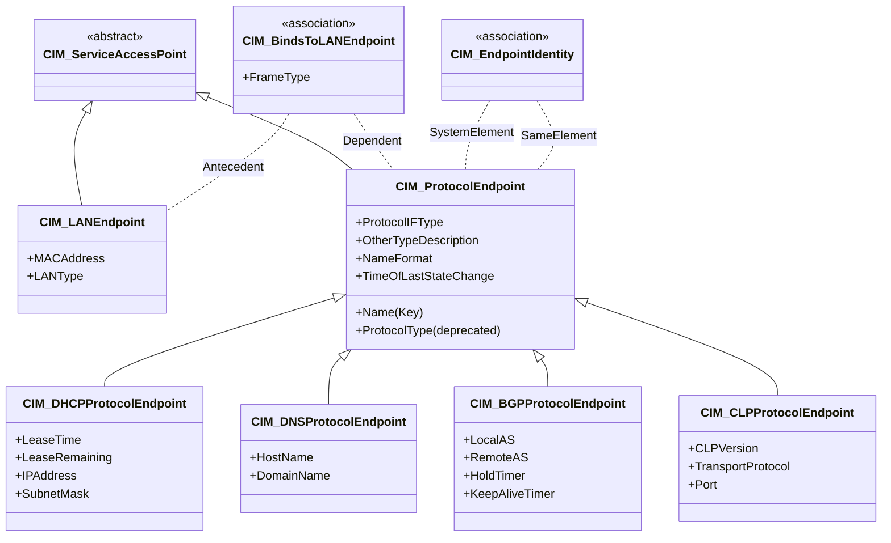

# Day 9：Network Schema — 網路管理模型

昨天我們完成了 System & Device Schema，從 `CIM_ComputerSystem` 出發，沿著繼承鏈一路走進了 `CIM_Processor`、`CIM_Sensor`、`CIM_OperatingSystem` 與 `CIM_Process`。今天我們進入一個全新領域——**Network Schema**，看看 CIM 如何為網路介面、協定端點與 IP 位址建立一套完整的管理模型。

## 網路管路面臨的核心挑戰

在談論 CIM 的網路模型之前，必須先理解它所解決的問題。一個典型的企業伺服器可能同時具備[^cim-protocolendpoint-mof]：

- 乙太網路介面（eth0、eth1）
- 每張介面上的 IP 位址（IPv4、IPv6）
- 執行中的服務端點（TCP、UDP）
- 路由協定端點（BGP、OSPF）
- DHCP、DNS 客戶端端點

傳統上，SNMP 透過 `ifTable` 與 `ipAddrTable` 來管理這些，但這兩張表是**扁平的、關聯性不足的**——你無法輕易從一個 IP 位址追溯到它所依賴的實體網路卡，也無法表達「一個實體連接埠可以綁定多個協定端點」這樣的關係。

CIM 的 Network Schema 透過三層抽象來解決這個問題：

1. **LANEndpoint** — 實體/鏈接層端點（乙太網路 MAC 位址）
2. **ProtocolEndpoint** — 協定層端點（IP、TCP、UDP、DHCP、BGP……）
3. **Association** — 將上述端點連接起來的關聯類別

## 三層端點的整體藍圖



這個設計的核心哲學是：**端點的抽象化與關聯可分離**。`CIM_ServiceAccessPoint`（三者共同的父類別）是一個抽象基底，代表「可提供網路服務的接入點」。`CIM_LANEndpoint` 與 `CIM_ProtocolEndpoint` 分別代表不同層級的接入點，而它們之間的依賴關係則由關聯類別（Association）獨立表達[^cim-protocolendpoint-mof]。

---

## 第一層：CIM_LANEndpoint — 鏈接層端點

`CIM_LANEndpoint` 代表一個**鏈接層（Layer 2）的網路接入點**，最典型的例子就是乙太網路介面的 MAC 位址[^cim-bindstolanendpoint]：

```mof
class CIM_LANEndpoint : CIM_ServiceAccessPoint {
    [Key] string Name;             // 名稱（如 "eth0"、"enp0s3"）
    string MACAddress;             // MAC 位址（如 "00:1A:2B:3C:4D:5E"）
    uint16 LANType;                // LAN 類型（Ethernet、TokenRing、FDDI...）
    string OtherTypeDescription;   // 當 LANType=Other 時的自訂描述
};
```

`LANType` 的列舉值與 IANA `ifType` MIB 同步——也就是說，它與 SNMP 的 `ifType` 使用同一套編號系統。這意味著 CIM 與 SNMP 在介面類型的分類上是**完全互通的**[^cim-lanendpoint-mof]。

## 第二層：CIM_ProtocolEndpoint — 協定層端點的根類別

`CIM_ProtocolEndpoint` 定義於 `CIM::Core::Service` UML 套件中，是**所有協定層端點（Layer 3+）的抽象根類別**[^cim-protocolendpoint-mof]。讓我們仔細拆解這個類別的設計：

```mof
class CIM_ProtocolEndpoint : CIM_ServiceAccessPoint {

    [Override ("OperationalStatus"),
     MappingStrings {"MIB.IETF|IF-MIB.ifOperStatus"}]
    uint16 OperationalStatus[];

    [Override ("EnabledState"),
     MappingStrings {"MIB.IETF|IF-MIB.ifAdminStatus"}]
    uint16 EnabledState;

    [Override ("TimeOfLastStateChange"),
     MappingStrings {"MIB.IETF|IF-MIB.ifLastChange"}]
    datetime TimeOfLastStateChange;

    [Key, Override ("Name"), MaxLen (256)]
    string Name;

    string NameFormat;  // 命名啟發式（如 "IPv4_eth0"）

    [Deprecated {"CIM_ProtocolEndpoint.ProtocolIFType"}]
    uint16 ProtocolType;

    uint16 ProtocolIFType;  // 與 IANA ifType MIB 同步
    string OtherTypeDescription;
};
```

### 與 IF-MIB 的對映：CIM 與 SNMP 的橋接

`CIM_ProtocolEndpoint` 上最值得關注的設計特徵是它與 **IETF IF-MIB（Interface MIB）** 的明確對映關係[^cim-protocolendpoint-mof]：

| CIM 屬性 | 對映的 IF-MIB 物件 | 語意 |
|---------|-------------------|------|
| `OperationalStatus[]` | `ifOperStatus` | 介面的操作狀態（up/down/testing…） |
| `EnabledState` | `ifAdminStatus` | 管理員設定的預期狀態（up/down） |
| `TimeOfLastStateChange` | `ifLastChange` | 上次狀態變更的時間戳 |
| `ProtocolIFType` | `ifType` | 介面類型（乙太網路、光纖通道…） |
| `Description` | `ifDescr` | 介面的文字描述 |

這代表了 CIM 設計中的一個重要取捨：**不重新發明輪子**。當 SNMP MIB 已經定義了一套成熟的管理物件時，CIM 的做法不是取代它，而是透過 `MappingStrings` 限定詞建立明確的對映關係，讓兩者可以互通。

### ProtocolIFType：超過 280 種預定義的網路類型

`ProtocolIFType` 是 CIM 中**列舉值最多的屬性之一**（與 IANA ifType MIB 同步，超過 280 個值）[^cim-protocolendpoint-mof]。從傳統的 `Ethernet CSMA/CD`（6）、`FDDI`（15）、`ATM`（37），到現代的 `Gigabit Ethernet`（117）、`IEEE 802.11`（71），再到協定層級的 `IPv4`（4096）、`BGP`（4098）、`TCP`（4100）、`UDP`（4099）——都在同一個列舉空間中。

之所以 IPv4 被分配到 4096（IANA Reserved 區段），是因為原始 IF-MIB 的 ifType 只涵蓋鏈接層與實體層類型，DMTF 在 4096 以上的範圍新增了協定層類型。

## 連接端點：CIM_BindsToLANEndpoint

有了 `CIM_LANEndpoint` 與 `CIM_ProtocolEndpoint`，CIM 需要一個機制來表達「哪個協定端點依賴於哪個 LAN 端點」。這就是 `CIM_BindsToLANEndpoint` 的任務[^cim-bindstolanendpoint]：

```mof
[Association, Version ("2.6.0"),
 UMLPackagePath ("CIM::Network::ProtocolEndpoints")]
class CIM_BindsToLANEndpoint : CIM_BindsTo {

    [Override ("Antecedent")]
    CIM_LANEndpoint REF Antecedent;
    // ↑ 基礎的 LANEndpoint（依賴方）

    [Override ("Dependent")]
    CIM_ServiceAccessPoint REF Dependent;
    // ↑ 依賴於 LANEndpoint 的 ServiceAccessPoint 或 ProtocolEndpoint

    [ValueMap {"0", "1", "2", "3", "4"},
     Values {"Unknown", "Ethernet", "802.2", "SNAP", "Raw802.3"}]
    uint16 FrameType;
    // ↑ 上層協定的封裝格式
};
```

這個關聯類別自身的屬性 `FrameType` 定義了上層協定的封裝格式——`Ethernet` 代表標準的 DIX Ethernet II 封裝，`802.2` 代表 IEEE 802.2 LLC 封裝，`SNAP` 代表 Subnetwork Access Protocol 封裝。這個設計讓同一個 LANEndpoint（如同一張網卡）可以同時支援多種封裝格式，而不需要為每種格式建立獨立的端點。

### 完整範例：一台伺服器的網路模型

結合 `CIM_ComputerSystem`（Day 8）、`CIM_BindsToLANEndpoint` 以及 `CIM_ProtocolEndpoint`，一台典型伺服器的網路架構在 CIM 中可以表達為：

```
ComputerSystem "web-01" (Dedicated=File Server)
 ├── NetworkPort "eth0" (Physical port on motherboard)
 │    └── LANEndpoint "eth0" (MACAddress=00:1A:2B:3C:4D:5E)
 │         ├── [BindsToLANEndpoint FrameType=Ethernet]
 │         │    └── ProtocolEndpoint "IPv4_eth0" (ProtocolIFType=IPv4, IP=192.168.1.10)
 │         │         ├── [EndpointForIPNetworkConnection]
 │         │         │    └── IPNetworkConnection "corp-net" (Subnet=255.255.255.0)
 │         │         ├── [BindsToLANEndpoint FrameType=Ethernet]
 │         │         │    └── ProtocolEndpoint "TCP_eth0" (ProtocolIFType=TCP)
 │         │         └── [BindsToLANEndpoint FrameType=Ethernet]
 │         │              └── ProtocolEndpoint "UDP_eth0" (ProtocolIFType=UDP)
 │         └── [BindsToLANEndpoint FrameType=802.2]
 │              └── ProtocolEndpoint "IPX_eth0" (ProtocolIFType=IPX)
```

這裡有幾個重要觀察：

1. **一張網卡可以綁定多個 LAN 端點**？不是——`LANEndpoint "eth0"` 是唯一的。但多個 `ProtocolEndpoint` 可以透過各自的 `BindsToLANEndpoint` 關聯，依賴於同一個 `LANEndpoint`。

2. **同一 LAN 端點可以有多種 FrameType**：IPv4 使用 Ethernet II 封裝，而 IPX 使用 802.2 LLC 封裝——這兩者可以在同一張實體網卡上共存，CIM 透過不同的 FrameType 值來區分。

3. **ProtocolEndpoint 的 Name 使用 NameFormat 啟發式確保唯一性**：如 `"IPv4_eth0"` 前綴類型後綴連接埠名稱。

## 一對多映射：CIM_EndpointIdentity

現實中還有一個常見場景：**同一個 IP 位址可以同時被視為不同類型的端點**。例如，一個 DHCP 客戶端端點與一個 IPv4 協定端點，它們實際上代表著同一個底層位址。CIM 透過 `CIM_EndpointIdentity` 關聯來表達這種等價關係[^cim-endpointidentity]：

```mof
[Association, Version ("2.6.0"),
 Description ("...表示兩個 ProtocolEndpoint
  代表同一個底層位址或協定特定 ID 的不同面向。")]
class CIM_EndpointIdentity : CIM_LogicalIdentity {
    CIM_ProtocolEndpoint REF SystemElement;
    CIM_ProtocolEndpoint REF SameElement;
};
```

例如：一個 `ProtocolEndpoint`（ProtocolIFType=IPv4, IP=192.168.1.10）可以與一個 `DHCPProtocolEndpoint`（LeaseTime=86400, IPAddress=192.168.1.10）透過 `CIM_EndpointIdentity` 建立等價關係，表示「這個 IP 位址是透過 DHCP 取得的」。

## 豐富的 ProtocolEndpoint 子類別

CIM 的 Network Schema 定義了大量 `CIM_ProtocolEndpoint` 的子類別，每個針對特定協定或服務[^cim-dhcpprotocolendpoint][^cim-dnsprotocolendpoint][^cim-bgpprotocolendpoint][^cim-clpprotocolendpoint]：

### DHCPProtocolEndpoint

```mof
class CIM_DHCPProtocolEndpoint : CIM_ProtocolEndpoint {
    uint32 LeaseTime;          // 租約時間（秒）
    uint32 LeaseRemaining;     // 剩餘租約時間（秒，Gauge）
    string IPAddress;          // 取得的 IP 位址
    string SubnetMask;         // 子網路遮罩
    string DHCPRequestedIP;    // 請求的 IP（Renewing/Rebinding 時）
    string DHCPServerIP;       // DHCP 伺服器 IP
};
```

`LeaseRemaining` 帶有 `[Gauge]` 限定詞，代表這是一個「目前值」——會隨著時間自動減少，而不是一個可設定的屬性。

### DNSProtocolEndpoint

```mof
class CIM_DNSProtocolEndpoint : CIM_ProtocolEndpoint {
    string HostName;           // 主機名稱
    string DomainName;         // 網域名稱
};
```

### BGPProtocolEndpoint

BGP（Border Gateway Protocol）端點是 Network Schema 中**最複雜的端點類型之一**，擁有超過 30 個屬性與關聯[^cim-bgpprotocolendpoint]：

```mof
class CIM_BGPProtocolEndpoint : CIM_ProtocolEndpoint {
    uint32 LocalAS;            // 本地自治系統編號
    uint32 RemoteAS;           // 遠端自治系統編號
    uint16 HoldTimer;          // 保持計時器（秒）
    uint16 KeepAliveTimer;     // 保持存活計時器（秒）
    boolean RouteRefresh;      // 是否允許路由重新整理
    string LocalIP;            // 本地 IP 位址
    string RemoteIP;           // 遠端 IP 位址
    // 還有數十個 BGP 特定的屬性…
};
```

### CLPProtocolEndpoint（Command Line Protocol）

`CLPProtocolEndpoint` 代表 SM CLP（Systems Management Command Line Protocol）端點，這是 ANSI INCITS 438-2008 標準定義的伺服器管理指令行協定——我們將在第 27 天討論 SMASH 時深入探討[^cim-clpprotocolendpoint]：

```mof
class CIM_CLPProtocolEndpoint : CIM_ProtocolEndpoint {
    uint16 CLPVersion;         // CLP 版本
    uint16 TransportProtocol;  // 傳輸協定（SSH、HTTPS…）
    uint32 Port;               // 連接埠號碼
    uint32 SessionIdleTime;    // 工作階段閒置逾時（秒）
};
```

## 從 LAN 到協定的完整路徑

總結 CIM Network Schema 的核心設計模式，一條完整的從實體網路卡到高階服務的路徑是：

```
ComputerSystem
 └── NetworkPort (Physical Package)
      └── CIM_PhysicalConnector (RJ45, SFP+...)
           └── LANEndpoint (MAC 位址)
                └── BindsToLANEndpoint (FrameType)
                     └── ProtocolEndpoint (IP 位址)
                          └── EndpointIdentity (DHCP 等價)
```

值得注意的是，`CIM_PhysicalConnector` 與 `CIM_NetworkPort` 屬於 **Physical Schema**（實體模型），而 `LANEndpoint` 與 `ProtocolEndpoint` 屬於 **Network Schema**（網路模型）——這兩個領域透過 `CIM_LogicalElement` 與 `CIM_PhysicalElement` 的繼承分支分隔，但它們透過 `CIM_ServiceAccessory` 關聯跨領域連接。

## 小結

今天我們深入了 CIM 的 Network Schema：

1. **三層端點抽象**：`CIM_ServiceAccessPoint` → `CIM_LANEndpoint`（鏈接層）→ `CIM_ProtocolEndpoint`（協定層），層層特化。
2. **關聯分離**：端點之間的依賴關係（`CIM_BindsToLANEndpoint`）與等價關係（`CIM_EndpointIdentity`）被獨立建模，而非嵌入端點類別中。
3. **與 SNMP 的橋接**：`ProtocolIFType`、`OperationalStatus`、`EnabledState` 等屬性都透過 `MappingStrings` 明確對映到 IETF IF-MIB，展現了 CIM 的務實取向。
4. **豐富的子類別體系**：從 DHCP、DNS 到 BGP、CLP，Network Schema 為大量網路協定提供了專用的管理端點類別。
5. **完整的端點路徑**：從實體連接埠 → MAC 位址 → IP 位址 → DHCP 租約，形成了一條可追蹤的完整鏈路。

明天（Day 10）我們將進入 **Application、Database & Metrics Schema**，探討 CIM 如何為應用程式、資料庫與效能指標建立管理模型。

## 參考資料

[^cim-protocolendpoint-mof]: DMTF. (2005). CIM_ProtocolEndpoint.mof (v2.15.0). CIM Schema 2.32.0. Retrieved 2026-10-03, from https://raw.githubusercontent.com/microsoft/omi/master/Unix/share/omischema/CIM-2.32.0/Core/CIM_ProtocolEndpoint.mof

[^cim-bindstolanendpoint]: DMTF. (2005). CIM_BindsToLANEndpoint.mof (v2.6.0). CIM Schema 2.32.0. Retrieved 2026-10-03, from https://raw.githubusercontent.com/microsoft/omi/master/Unix/share/omischema/CIM-2.32.0/Network/CIM_BindsToLANEndpoint.mof

[^cim-endpointidentity]: DMTF. (2005). CIM_EndpointIdentity.mof (v2.6.0). CIM Schema 2.32.0. Retrieved 2026-10-03, from https://raw.githubusercontent.com/microsoft/omi/master/Unix/share/omischema/CIM-2.32.0/Network/CIM_EndpointIdentity.mof

[^cim-dhcpprotocolendpoint]: DMTF. (2005). CIM_DHCPProtocolEndpoint.mof (v2.6.0). CIM Schema 2.32.0. Retrieved 2026-10-03, from https://raw.githubusercontent.com/microsoft/omi/master/Unix/share/omischema/CIM-2.32.0/Network/CIM_DHCPProtocolEndpoint.mof

[^cim-dnsprotocolendpoint]: DMTF. (2005). CIM_DNSProtocolEndpoint.mof (v2.6.0). CIM Schema 2.32.0. Retrieved 2026-10-03, from https://raw.githubusercontent.com/microsoft/omi/master/Unix/share/omischema/CIM-2.32.0/Network/CIM_DNSProtocolEndpoint.mof

[^cim-bgpprotocolendpoint]: DMTF. (2005). CIM_BGPProtocolEndpoint.mof (v2.6.0). CIM Schema 2.32.0. Retrieved 2026-10-03, from https://raw.githubusercontent.com/microsoft/omi/master/Unix/share/omischema/CIM-2.32.0/Network/CIM_BGPProtocolEndpoint.mof

[^cim-clpprotocolendpoint]: DMTF. (2005). CIM_CLPProtocolEndpoint.mof (v2.6.0). CIM Schema 2.32.0. Retrieved 2026-10-03, from https://raw.githubusercontent.com/microsoft/omi/master/Unix/share/omischema/CIM-2.32.0/Network/CIM_CLPProtocolEndpoint.mof

[^cim-lanendpoint-mof]: DMTF. (2005). CIM_LANEndpoint.mof (v2.6.0). CIM Schema 2.32.0. Retrieved 2026-10-03, from https://raw.githubusercontent.com/microsoft/omi/master/Unix/share/omischema/CIM-2.32.0/Core/CIM_LANEndpoint.mof