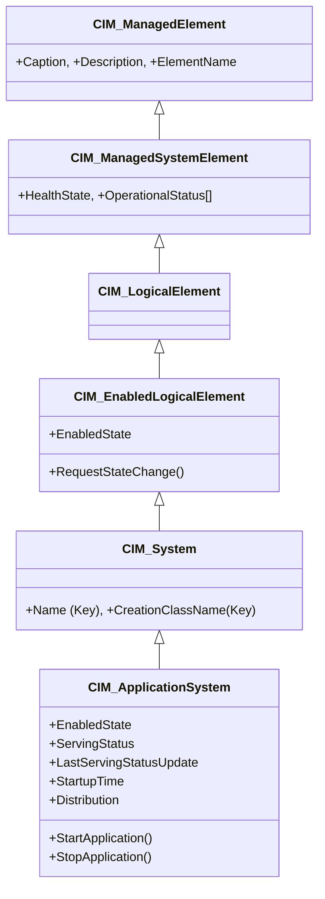
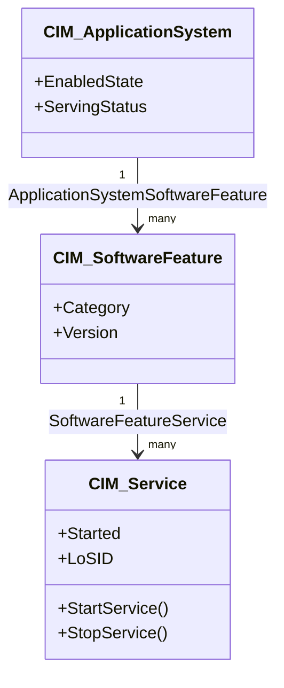
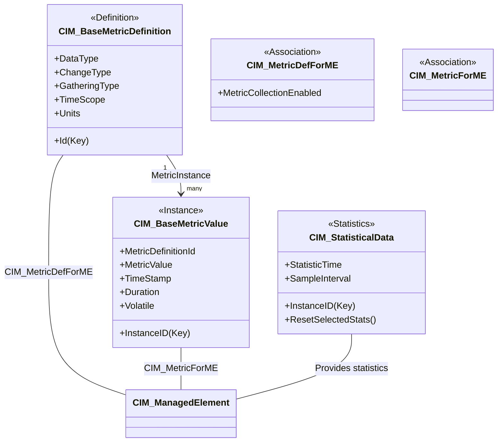

# Day 10：Application, Database & Metrics Schema — 應用、資料庫與計量模型

昨天我們深入探討了 Network Schema 中 `CIM_Endpoint`、`CIM_ProtocolEndpoint` 與 `CIM_NetworkInterface` 如何為網路管理建模，以及 `CIM_ComputerSystem` ↔ `NetworkInterface` ↔ `IPAddress` 的關聯範例。今天我們將視角從網路層拉回應用層，走進 **Application Schema**、**Database Schema** 與 **Metrics Schema** 三個領域模組，看看 CIM 如何對應用程式、資料庫系統，以及最關鍵的——「監控與計量」——進行建模。

## 第一站：Application Schema — 應用管理模型

在 CIM 中，**不存在**一個名為 `CIM_Application` 的類別。取而代之的是 **`CIM_ApplicationSystem`**，它定義於 `CIM::Application::DeploymentModel` 套件中[^cim-applicationsystem]。

### CIM_ApplicationSystem：應用程式的運行根節點

`CIM_ApplicationSystem` 繼承自 `CIM_System`（→ `CIM_EnabledLogicalElement` → `CIM_LogicalElement` → `CIM_ManagedSystemElement` → `CIM_ManagedElement`），其定義為：「支援特定業務功能、且可作為獨立單元管理的應用程式或軟體系統」[^cim-applicationsystem]。



`CIM_ApplicationSystem` 的核心角色有兩個：

1. **作為運行時資訊的入口點**——Schema 文件明確指出它是「存放執行期概覽資訊（如回應時間或系統狀態）的地方」[^cim-applicationsystem]
2. **提供整個應用程式層級的運行控制**（啟動/停止方法）

其關鍵屬性如下[^cim-applicationsystem]：

| 屬性 | 型別 | 說明 |
|------|------|------|
| **EnabledState** | `uint16` | 啟用狀態：Enabled(2)、Disabled(3)、ShuttingDown(4)、Starting(10) |
| **ServingStatus** | `uint16` | 服務狀態概覽（Serving=1、Not Serving=2）— 用於監控/SLA 報告 |
| **LastServingStatusUpdate** | `datetime` | ServingStatus 最後一次更新的時間 |
| **StartupTime** | `datetime` | 應用程式最後啟動的時間 |
| **Distribution** | `uint16` | 分散式(1) 或 本地(2) |

`ServingStatus` 的設計尤為重要——它不是 `EnabledState` 的簡單別名。一個應用程式可以是 **Enabled**（允許運作）但 **Not Serving**（因某種原因不再回應請求）。例如：一個資料庫可能已啟動（Enabled）但因複製延遲而暫時標記為 Not Serving。

`CIM_ApplicationSystem` 上定義了兩個方法：`StartApplication()` 與 `StopApplication()`，用於應用程式的啟動與停止控制。

直接已知的子類別包括 `CIM_DatabaseSystem`（我們即將討論）、`CIM_J2eeApplication` 與 `CIM_J2eeServer`[^cim-applicationsystem]。

### CIM_Service：管理服務的抽象化

`CIM_Service` 是 `CIM_EnabledLogicalElement` 的子類別，定義於 `CIM::Core::Service` 套件中（abstract, v2.45.0+）[^cim-service]。其定義為：「Service 是代表可管理功能可用性的 LogicalElement」，並說明「此功能可由單獨建模的實體（如 LogicalDevice 或 SoftwareFeature）提供」[^cim-service]。

```mof
[Abstract, Version ("2.45.0"),
 UMLPackagePath ("CIM::Core::Service"),
 Description ("一個 Service 代表可管理功能的可用性...")]
class CIM_Service : CIM_EnabledLogicalElement {

    [Key] string SystemCreationClassName;
    [Key] string SystemName;
    [Key] string CreationClassName;
    [Key, Override ("Name")] string Name;

    [Write] string PrimaryOwnerName;
    [Write] string PrimaryOwnerContact;
    string LoSID;    // ITIL Line of Service ID
    string LoSOrgID; // 對應的組織 ID

    boolean Started; // true=已啟動, false=已停止

    uint32 StartService();
    uint32 StopService();
};
```

這裡的 `LoSID` 與 `LoSOrgID` 是 CIM 與 **ITIL（資訊科技基礎架構庫）** 對齊的橋樑——它們允許管理平台將 CIM Service 關聯到 ITIL 的「服務線（Line of Service）」概念[^cim-service]。

`CIM_Service` 的直接已知子類別超過 **60 個**，包括 `CIM_MetricService`、`CIM_StatisticsService`、`CIM_DatabaseService`、`CIM_NetworkService`、`CIM_SNMPService`、`CIM_SecurityService`、`CIM_BIOSService`、`CIM_DiagnosticService`、`CIM_IndicationService` 等[^cim-service]。涵蓋了從計量管理到安全認證的各個領域。

值得注意的是，前述大綱中提到的 `CIM_ServiceLevel` 在目前的 CIM Schema 中**並不存在**。CIM 對「服務層級」的支援是透過 `CIM_Service` 上的 `LoSID`/`LoSOrgID` 屬性和 `CIM_ServiceLevel` 關聯類別（如 `CIM_ServiceAvailableInLevel` 等）來間接實現的。

### CIM_SoftwareFeature：應用功能的分解

`CIM_SoftwareFeature` 是 `CIM_LogicalElement` 的子類別（v2.9.0+），用於描述「產品或應用系統的特定功能或能力」[^cim-softwarefeature]。應用程式透過 `CIM_ApplicationSystemSoftwareFeature` 關聯分解為多個 SoftwareFeature。



---
## 第二站：Database Schema — 資料庫管理模型

CIM 的 Database Schema 涵蓋了從資料庫系統到 SQL 物件的完整管理模型。

### CIM_DatabaseSystem：資料庫系統層級

`CIM_DatabaseSystem` 是 `CIM_ApplicationSystem` 的子類別（v2.7.0+）[^cim-databasesystem]：

> *「一個資料庫環境由一個資料庫系統、一個或多個資料庫服務、以及一個或多個資料庫組成。每個可單獨管理的資料庫系統都應有本類別的一個實例。」* [^cim-databasesystem]

有趣的是，`CIM_DatabaseSystem` **沒有任何本地屬性**——它完全繼承自 `CIM_ApplicationSystem` 的屬性層次。這是一個 **標記類別（Marker Class）** 的設計模式：它存在的目的是作為資料庫管理層次的根節點，用於範疇化（scoping）資料庫相關的服務、統計資料和操作。

### CIM_DatabaseService：資料庫服務管理

`CIM_DatabaseService` 是 `CIM_Service` 的子類別，代表資料庫系統提供的服務[^cim-databaseservice]。它新增的屬性有 `StartupTime`（啟動時間）、`ConnectionLimit`（最大連線數）和 `OperationalStatus`（操作狀態）。

### CIM_CommonDatabase：資料庫實例

`CIM_CommonDatabase`（v2.7.0+）代表「一個相互關聯的資料集合，組織為一個或多個綱要（Schema），可容納一個或多個目錄」[^cim-commondatabase]：

| 屬性 | 型別 | 說明 |
|------|------|------|
| **DatabaseVersion** | `string` | 資料庫版本 |
| **LastBackup** | `datetime` | 最後一次備份時間 |
| **SizeAllocated** | `uint64` | 已配置儲存容量 |
| **SizeUnits** | `string` | 容量單位（如 "GB"） |
| **SizeUsed** | `uint64` | 已使用儲存容量 |
| **ConnectedClientCount** | `uint32` | 目前連線用戶數（Gauge） |

### CIM_SqlTable 與 CIM_SqlTrigger：SQL 物件層級

CIM Schema 甚至深入到**資料庫內部結構**的建模——`CIM_SqlTable` 與 `CIM_SqlTrigger` 都被標記為 **Experimental**（實驗中），定義於 `CIM::Database::Sql` 套件（v2.12.0+）[^cim-sqltable][^cim-sqltrigger]。

**CIM_SqlTable** 繼承自 `CIM_SqlObject`，其 MOF 定義中包含一份長達數頁的 SQL 標準描述，涵蓋了基本表、衍生表、暫態表、型別表、子表家族、超表等概念[^cim-sqltable]：

```mof
[Experimental, Version ("2.12.0"),
 UMLPackagePath ("CIM::Database::Sql")]
class CIM_SqlTable : CIM_SqlObject {
    [ValueMap {"2", "3", "4"},
     Values {"SYSTEM_GENERATE", "USER_GENERATED", "DERIVED_SELF_REF"}]
    uint16 ReferenceType;  // 自我引用欄位類型

    boolean insertable;    // 是否可 INSERT
    boolean updatable;     // 是否可 UPDATE
};
```

**CIM_SqlTrigger** 同樣繼承自 `CIM_SqlObject`，定義了觸發器的五個核心面向[^cim-sqltrigger]：

| 屬性 | 說明 |
|------|------|
| **ActionGranularityType** | STATEMENT(2) 或 ROW(3) 層級 |
| **ActionStatement** | 觸發的 SQL 陳述 |
| **ActionTime** | AFTER(2)、BEFORE(3) 或 INSTEADOF(4) |
| **EventType** | INSERT(2)、UPDATE(3) 或 DELETE(4) |
| **NewRow / OldRow** | 新舊轉換資料列 |
| **NewTable / OldTable** | 新舊轉換表名稱 |
| **WhenCondition** | 觸發的額外條件 |

這些 SQL 物件的 Experimental 狀態反映了 CIM Schema 對資料庫內部細節的一種「審慎嘗試」——定義了，但仍在觀察市場是否真正需要如此細粒度的管理模型。

---
## 第三站：Metrics Schema — 計量管理的核心

現在來到今天最重要的部分——**CIM Metrics Schema**。這是 CIM 中用於**定義、收集與查詢監控資料**的完整框架，也是實現「可管理性」從描述（Schema）到可觀測（Observability）的關鍵橋樑。

### 三大核心類別家族

Metrics Schema 圍繞三組核心類別建構，形成「定義 → 實例 → 統計」三層模型：



需要注意的是，前述大綱中提到的 `CIM_MetricValue` 與 `CIM_ThresholdSetting` 在實際 Schema 中分別對應為 **`CIM_BaseMetricValue`** 和 **不存在獨立類別**（臨界值功能透過其他機制實現）。

### CIM_BaseMetricDefinition：計量定義模板

`CIM_BaseMetricDefinition`（v2.22.0+）定義了一個計量的**中設（metadata）模板**[^cim-basemetricdefinition]：

```mof
[Abstract, Version ("2.22.0"),
 UMLPackagePath ("CIM::Metrics::BaseMetric")]
class CIM_BaseMetricDefinition : CIM_ManagedElement {
    [Key] string Id;              // 唯一識別符
    string Name;                  // 人類可讀的名稱

    uint16 DataType;              // boolean(1), datetime(3), real32(4),
                                   // string(10), uint32(12), uint64(13)...
    uint16 ChangeType;            // Counter(3), Gauge(4)
    uint16 GatheringType;         // OnChange(2), Periodic(3), OnRequest(4)
    uint16 TimeScope;             // Point(2), Interval(3), StartupInterval(4)
    string ProgrammaticUnits;     // 程式化單位（如 "ms", "bytes", "packets"）

    boolean IsContinuous;         // 是否連續值（vs 離散值）
    uint16 Calculable;            // Non-calculable(1), Summable(2), Non-summable(3)
    string BreakdownDimensions[]; // 用於細分查詢的維度（如 "TransactionName"）
};
```

這裡有三組最重要的設計決策：

1. **ChangeType: Counter vs Gauge**
   - **Counter(3)**：單調遞增的非負整數，達到最大值後繞回（wrap）——適用於位元組計數、錯誤計數等累積量
   - **Gauge(4)**：可增可減的整數或浮點數，被限制在最小/最大值範圍內——適用於溫度、負載百分比、連線數等瞬時量

   這個區分直接來自 SNMP 的 SMI 設計，體現了 CIM 對網路管理傳統的延續。

2. **GatheringType: 收集策略**
   - **OnChange(2)**：值在資源變化時立即更新（如已登入使用者計數）
   - **Periodic(3)**：以固定間隔更新，在間隔內視為不變
   - **OnRequest(4)**：僅在客戶端查詢時才決定值

3. **TimeScope: 時間範圍**
   - **Point(2)**：瞬時量測（如目前 CPU 使用率）
   - **Interval(3)**：區間量測（如過去 5 分鐘的平均回應時間）
   - **StartupInterval(4)**：自上次啟動以來的量測

`CIM_BaseMetricDefinition` 的子類別 `CIM_MetricDefinition` 新增了 `Validity` 屬性（At Start / In Middle / At Stop），用於與 UnitOfWork（工作單元）相關的計量。

### CIM_BaseMetricValue：計量實例數值

`CIM_BaseMetricValue`（v2.19.0+）是存儲實際量測值的類別[^cim-basemetricvalue]：

> *「每個 CIM_BaseMetricValue 物件代表一個計量的實例值。由於計量資訊的收集可能涉及大量資料，本類別可能有很多實例。」* [^cim-basemetricvalue]

```mof
[Abstract, Version ("2.19.0"),
 UMLPackagePath ("CIM::Metrics::BaseMetric")]
class CIM_BaseMetricValue : CIM_ManagedElement {
    [Key] string InstanceID;
    [Required] string MetricDefinitionId;  // 關聯到 CIM_BaseMetricDefinition.Id

    string MeasuredElementName;            // 被量測元素的名稱
    datetime TimeStamp;                    // 量測時間
    datetime Duration;                     // 量測有效期
    
    [Required] string MetricValue;         // 實際量測值（原始型別以字串儲存）

    string BreakdownDimension;             // 細分維度
    string BreakdownValue;                 // 細分值
    boolean Volatile;                      // true=快照（物件重用），false=歷史記錄
};
```

**Volatile 屬性的行為模式**是理解 Metrics Schema 實作方式的關鍵：
- **Volatile=true（快照模式）**：同一 `CIM_BaseMetricValue` 實例被重複使用，每次新取樣時更新 `MetricValue` 與 `TimeStamp`。節省儲存空間，但只保留最新值。
- **Volatile=false（歷史模式）**：每次取樣建立新實例，累積所有歷史資料。適合用於趨勢分析與事後稽核。

兩個子類別進一步擴展了數值表達：
- **`CIM_DiscreteMetricValue`**：新增 `DiscreteValue`（uint16）加上 `ValueMap`/`Values` 限定詞，用於離散列舉計量
- **`CIM_AggregationMetricValue`**：新增 `AggregationTimeStamp` 與 `AggregationDuration`，用於彙總值（如平均、總和、最大值）

### 關聯橋樑：誰對誰做了什麼測量？

計量定義與實例之間透過兩組關聯類別（Association Class）連接[^cim-metricforme][^cim-metricdefforme]：

| 關聯 | 連接對象 | 關鍵屬性 |
|------|---------|---------|
| **`CIM_MetricDefForME`** | `CIM_BaseMetricDefinition` ↔ `CIM_ManagedElement` | `MetricCollectionEnabled`（Enabled/Disabled）、`RecordedSince`（啟用時間） |
| **`CIM_MetricForME`** | `CIM_ManagedElement` ↔ `CIM_BaseMetricValue` | 純弱關聯，無額外屬性 |

這兩層關聯的設計目的是：**同一個被管理元素可以有多個計量定義（多種指標），每個定義又可以產生多個數值實例（時序資料）**，而 `MetricCollectionEnabled` 則提供了粒緻的啟用/禁用控制。

### CIM_StatisticalData：統計資料匯集

`CIM_StatisticalData`（v2.45.0+，abstract）是「任何任意統計資料集合的根類別，適用於一個或多個 ManagedElement」[^cim-statisticaldata]。它不同於 `CIM_BaseMetricValue` 的「單一數值/少量數值」定位——它是**針對一個對象的大量統計資料集合**。

```mof
[Abstract, Version ("2.45.0"),
 UMLPackagePath ("CIM::Core::Statistics")]
class CIM_StatisticalData : CIM_ManagedElement {
    [Key] string InstanceID;
    [Required, Override ("ElementName")] string ElementName;

    datetime StartStatisticTime;  // 首次量測時間（重置後更新）
    datetime StatisticTime;       // 最近一次量測時間
    datetime SampleInterval;      // 取樣間隔（0=不一致）

    datetime RateIntervalStartTime;
    datetime RateIntervalEndTime;

    uint32 ResetSelectedStats(SelectedStatistics[]);
};
```

其直接已知子類別多達 **31 個**，廣泛覆蓋各領域[^cim-statisticaldata]：

| 子類別 | 領域 |
|---------|------|
| `CIM_NetworkPortStatistics` | 網路埠統計（封送/組譯封包數、丟棄數等） |
| `CIM_TCPStatisticalData` | TCP 連線統計 |
| `CIM_BlockStorageStatisticalData` | 區塊儲存 I/O 統計 |
| `CIM_CommonDatabaseStatistics` | 資料庫統計（交易數、快取命中率等） |
| `CIM_DatabaseServiceStatistics` | 資料庫服務統計 |
| `CIM_DeviceErrorData` | 裝置錯誤計數 |
| `CIM_J2eeStatistic` | Java EE 應用統計 |
| `CIM_StatisticalRuntimeOverview` | 運行概覽統計 |

### CIM_MetricService：計量管理的 API

`CIM_MetricService`（v2.23.0+）是 `CIM_Service` 的子類別，提供管理計量的程式化介面[^cim-metricservice]：

| 方法 | 目的 |
|------|------|
| **ShowMetrics(Subject, Definition)** | 報告可用計量（元素→定義 或 定義→元素的雙向查詢） |
| **ShowMetricsByClass(Class, Definition)** | 同上，但針對某 CIM 類別的所有實例 |
| **ControlMetrics(Subject, Definition, Action)** | 啟用(2)、禁用(3)或重置(4)計量收集 |
| **ControlMetricsByClass(Class, Definition, Action)** | 同上，針對某類別的所有實例 |
| **GetMetricValues(Definition, Range, Count)** | 過濾查詢 `CIM_BaseMetricValue` 實例 |
| **ControlSampleTimes(StartTime, Interval, Restart)** | 控制週期性取樣的時間與間隔 |

其中 `GetMetricValues` 的簽章在 Microsoft HyperV 實作文件中有詳細記錄[^hyperv-getmetricvalues]：

```
uint32 GetMetricValues(
  [in]  CIM_BaseMetricDefinition REF Definition,   // 欲查詢的計量定義
  [in]  uint16                       Range,         // Minimum(2) 或 Maximum(3)
  [in]  uint16                       Count,         // 最大回傳筆數
  [out] CIM_BaseMetricValue      REF Values[]       // 結果陣列
);
```

它回傳 0（成功）、1（不支援）或 2（失敗）。

### 臨界值與警報機制

前述大綱中提到的 `CIM_ThresholdSetting` 在 CIM Schema 中**沒有對應的獨立類別**。臨界值（Threshold）功能在 CIM 中是透過以下方式實現的[^cim-dropthreshold][^cim-indicationservice]：

1. **`CIM_DropThresholdCalculationService`**（`CIM::Network::QoS`）— 用於 RED（Random Early Detection）佇列管理的臨界值計算，使用指數加權移動平均
2. **`CIM_BaseMetricDefinition` 上的 `AnalogTriggerValues` / `AnalogResetValues` 陣列**（在 `CIM_DiscreteMetricDefinition` 上）— 定義離散計量的觸發與重置閾值
3. **`CIM_IndicationService`**（`CIM::Event`）— 提供警報（Indication/Alert）的遞送與過濾機制，作為臨界值觸發後的通知通道

---
## 實例：監控應用回應時間的 CIM 模型

讓我們將上述三站串聯起來，建立一個完整的**應用程式回應時間監控**案例。

假設我們要監控一家電商應用的 `CIM_ApplicationSystem` 實例（名稱為 `"ecommerce-prod"`）的 HTTP 回應時間：

### 步驟 1：定義計量

建立一個 `CIM_BaseMetricDefinition` 實例：

```
Id: "ecommerce.responsetime"
Name: "HTTP Response Time"
DataType: uint32         // 毫秒
ChangeType: Gauge(4)    // 可增可減
GatheringType: Periodic(3)
TimeScope: Point(2)     // 瞬時量測
ProgrammaticUnits: "ms"
IsContinuous: true
```

透過 `CIM_MetricDefForME` 關聯將此定義連結到 `ecommerce-prod` 應用實例，並設置 `MetricCollectionEnabled=Enabled`。

### 步驟 2：收集數值

應用本身的儀器化程式（Instrumentation）定期取樣回應時間，並更新 `CIM_BaseMetricValue` 實例：

```
InstanceID: "ecommerce.responsetime.20261003.120000"
MetricDefinitionId: "ecommerce.responsetime"
MetricValue: "245"       // 245ms
TimeStamp: 2026-10-03T12:00:00
Volatile: true           // 快照模式（只保留最新值）
```

如果開啟歷史模式（Volatile=false），則每次取樣建立新實例，累積時序資料。

### 步驟 3：查詢與展示

管理應用透過 `CIM_MetricService.GetMetricValues()` 查詢最新值，或透過 `CIM_StatisticalRuntimeOverview` 取得過去 N 分鐘的統計摘要（平均、最大、最小）。

### 步驟 4：異常處理

若要設定臨界值（如「回應時間超過 2000ms 時發出警報」），可搭配 `CIM_IndicationService` 訂閱相關事件——當 `CIM_BaseMetricValue.MetricValue` 超出預期範圍時，`CIM_IndicationService` 遞送警報到管理者的目標端點。

```mermaid
flowchart LR
    subgraph Application
        A["CIM_ApplicationSystem<br/>ecommerce-prod"]
    end
    subgraph Metrics
        D["CIM_BaseMetricDefinition<br/>response-time-def"]
        V["CIM_BaseMetricValue<br/>response-time-value<br/>MetricValue='245ms'"]
        M["CIM_MetricService<br/>GetMetricValues()"]
    end
    subgraph Alerting
        I["CIM_IndicationService<br/>alert if >2000ms"]
    end
    A -- D .- "CIM_MetricDefForME" .- "MetricCollectionEnabled"
    A -- V .- "CIM_MetricForME"
    D -- V .- "CIM_MetricInstance"
    M -.-> V
    I -.-> V
```

---
## 小結

今天我們走過了三個看似獨立、實則緊密相連的 Schema 領域：

- **Application Schema** 以 `CIM_ApplicationSystem` 為應用管理的根節點，`CIM_Service` 與 `CIM_SoftwareFeature` 則提供了功能層的分解
- **Database Schema** 從 `CIM_DatabaseSystem`（標記根節點）延伸到 `CIM_SqlTable` 與 `CIM_SqlTrigger`（Experimental SQL 物件），展現了 CIM 向下深入的嘗試
- **Metrics Schema** 透過 `CIM_BaseMetricDefinition → CIM_BaseMetricValue → CIM_StatisticalData` 的三層模型，以及 `CIM_MetricService` 的 API 介面，為 CIM 提供了完整的「可觀測性（Observability）」框架——從定義指標、收集數值、到查詢統計與觸發警報

三者的共通主題是：**CIM 不只在描述靜態的管理對象，更在定義這些對象如何被監控與測量**。明天（Day 11）我們將進入第二階段的最後一天，探討 Event、Security、Policy 與 Physical Schema——以及如何用跨領域整合描述一台完整伺服器的 CIM 模型。

## 參考資料

[^cim-applicationsystem]: DMTF. (n.d.). CIM_ApplicationSystem Class (v2.55.0). Retrieved 2026-10-03, from https://schemas.dmtf.org/wbem/cim-html/2.55.0/CIM_ApplicationSystem.html

[^cim-service]: DMTF. (n.d.). CIM_Service Class (v2.55.0). Retrieved 2026-10-03, from https://schemas.dmtf.org/wbem/cim-html/2.55.0/CIM_Service.html

[^cim-softwarefeature]: DMTF. (n.d.). CIM_SoftwareFeature Class (v2.55.0). Retrieved 2026-10-03, from https://schemas.dmtf.org/wbem/cim-html/2.55.0/CIM_SoftwareFeature.html

[^cim-databasesystem]: DMTF. (n.d.). CIM_DatabaseSystem Class (v2.40.0). Retrieved 2026-10-03, from https://schemas.dmtf.org/wbem/cim-html/2.40.0/CIM_DatabaseSystem.html

[^cim-databaseservice]: DMTF. (n.d.). CIM_DatabaseService Class (v2.40.0). Retrieved 2026-10-03, from https://schemas.dmtf.org/wbem/cim-html/2.40.0/CIM_DatabaseService.html

[^cim-commondatabase]: DMTF. (n.d.). CIM_CommonDatabase Class (v2.40.0). Retrieved 2026-10-03, from https://schemas.dmtf.org/wbem/cim-html/2.40.0/CIM_CommonDatabase.html

[^cim-sqltable]: DMTF. (n.d.). CIM_SqlTable Class (v2.40.0). Retrieved 2026-10-03, from https://schemas.dmtf.org/wbem/cim-html/2.40.0/CIM_SqlTable.html

[^cim-sqltrigger]: DMTF. (n.d.). CIM_SqlTrigger Class (v2.40.0). Retrieved 2026-10-03, from https://schemas.dmtf.org/wbem/cim-html/2.40.0/CIM_SqlTrigger.html

[^cim-basemetricvalue]: DMTF. (n.d.). CIM_BaseMetricValue Class (v2.55.0). Retrieved 2026-10-03, from https://schemas.dmtf.org/wbem/cim-html/2.55.0/CIM_BaseMetricValue.html

[^cim-basemetricdefinition]: DMTF. (n.d.). CIM_BaseMetricDefinition Class (v2.55.0). Retrieved 2026-10-03, from https://schemas.dmtf.org/wbem/cim-html/2.55.0/CIM_BaseMetricDefinition.html

[^cim-statisticaldata]: DMTF. (n.d.). CIM_StatisticalData Class (v2.55.0). Retrieved 2026-10-03, from https://schemas.dmtf.org/wbem/cim-html/2.55.0/CIM_StatisticalData.html

[^cim-metricservice]: DMTF. (n.d.). CIM_MetricService Class (v2.55.0). Retrieved 2026-10-03, from https://schemas.dmtf.org/wbem/cim-html/2.55.0/CIM_MetricService.html

[^cim-metricforme]: DMTF. (n.d.). CIM_MetricForME Association (v2.55.0). Retrieved 2026-10-03, from https://schemas.dmtf.org/wbem/cim-html/2.55.0/CIM_MetricForME.html

[^cim-metricdefforme]: DMTF. (n.d.). CIM_MetricDefForME Association (v2.55.0). Retrieved 2026-10-03, from https://schemas.dmtf.org/wbem/cim-html/2.55.0/CIM_MetricDefForME.html

[^cim-dropthreshold]: DMTF. (n.d.). CIM_DropThresholdCalculationService Class (v2.55.0). Retrieved 2026-10-03, from https://schemas.dmtf.org/wbem/cim-html/2.55.0/CIM_DropThresholdCalculationService.html

[^cim-indicationservice]: DMTF. (n.d.). CIM_IndicationService Class (v2.55.0). Retrieved 2026-10-03, from https://schemas.dmtf.org/wbem/cim-html/2.55.0/CIM_IndicationService.html

[^hyperv-getmetricvalues]: Microsoft. (n.d.). CIM_MetricService — GetMetricValues (HyperV). Retrieved 2026-10-03, from https://learn.microsoft.com/en-us/windows/win32/hyperv_v2/cim-metricservice-getmetricvalues