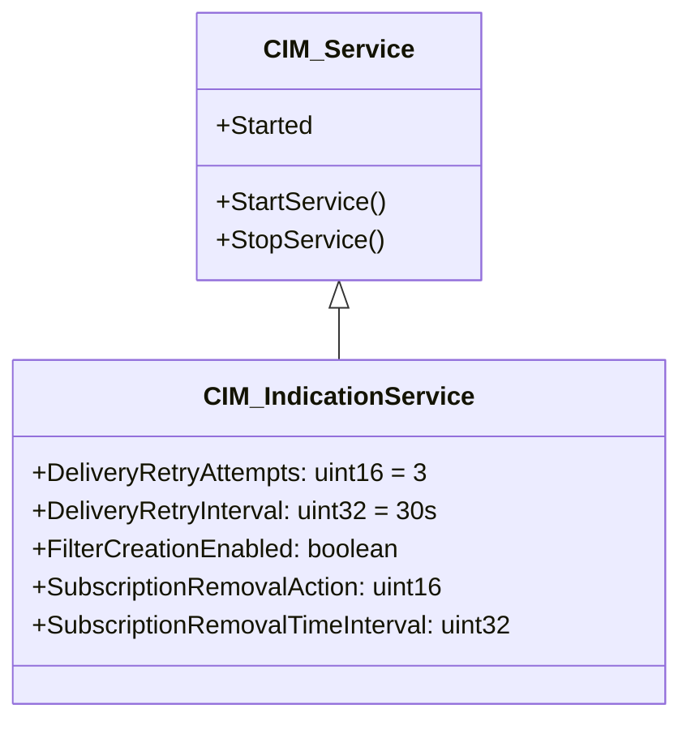
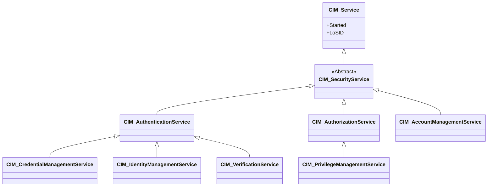
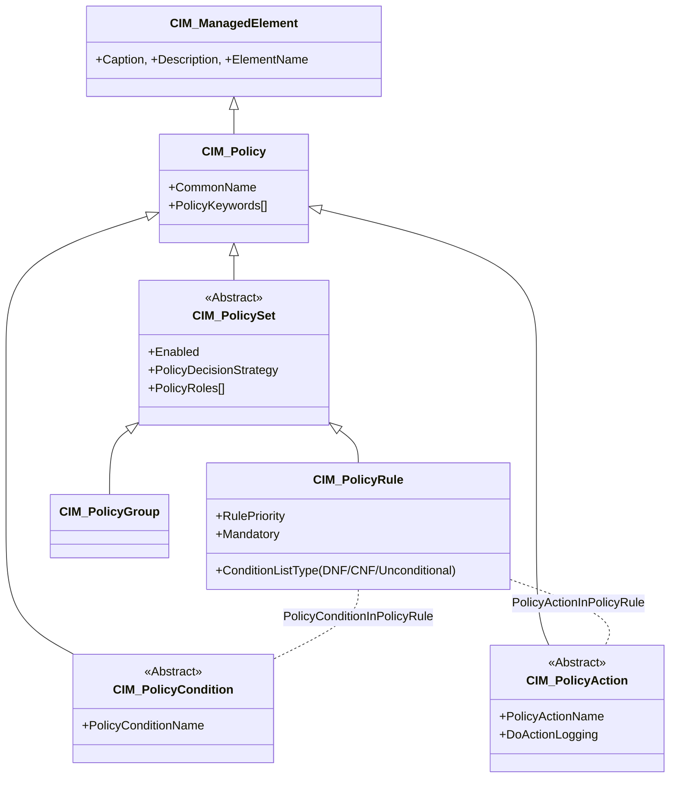
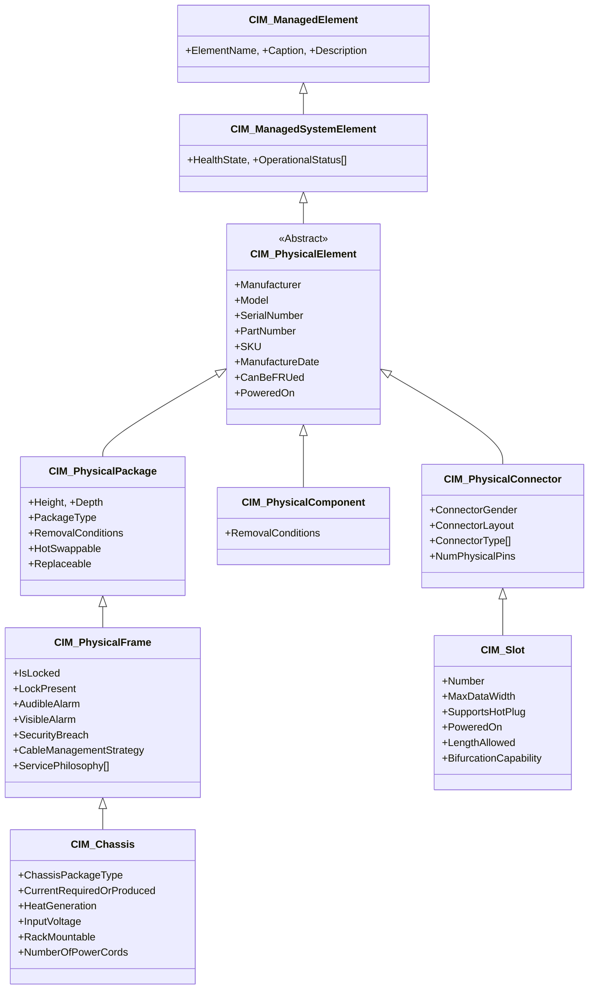
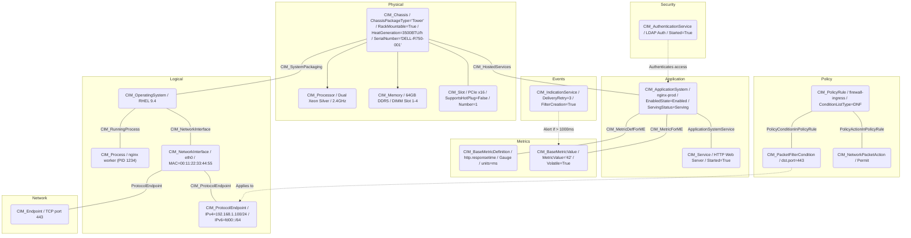

# Day 11：Event, Security, Policy & Physical Schema — 跨領域整合

昨天我們走過了 Application、Database 與 Metrics 三個 Schema 模組，看到了 CIM 如何從應用管理延伸到資料庫內部、再到可觀測性框架。如果說昨天是「縱向深入」，那麼今天的主題就是「橫向覆蓋」——我們將一口氣探索四個看似分散、但共同構成 CIM 完整管理畫面的 Schema 領域：**Event（事件）**、**Security（安全）**、**Policy（策略）** 與 **Physical（實體）**，並且在文章的最後，將它們整合為一台完整伺服器的 CIM 描述。

---

## 第一站：Event Schema — 事件與警報管理

CIM 的 Event Schema 提供了一個統一的事件架構，負責從事件發生到記錄、再到警報遞送的完整生命週期。

### 事件管理的三大角色

Event Schema 圍繞三個核心角色建構：

| 角色 | 類別 | 職責 |
|------|------|------|
| **事件產生者** | `CIM_ManagedElement`（任何可管理元素） | 產生事件資料 |
| **事件遞送服務** | `CIM_IndicationService`（`CIM::Event` 套件，v2.20.0+） | 負責將 Indication 遞送給註冊的 Handler[^cim-indicationservice] |
| **事件記錄** | 關聯類別（如 `CIM_EventLogRecord` 等） | 持久化事件記錄 |

### CIM_IndicationService：事件遞送引擎

`CIM_IndicationService` 是 CIM Object Manager 中負責遞送 Indication 給 Indication Handler 的服務[^cim-indicationservice]。Indication 是 CIM 中對「非同步事件通知」的稱呼——當被管理元素的狀態發生變化、計量超過臨界值、或安全事件發生時，Object Manager 產生 Indication 並透過此服務遞送。



`CIM_IndicationService` 的核心屬性定義了事件遞送的可靠性機制[^cim-indicationservice]：

- **DeliveryRetryAttempts**（預設 3 次）— 遞送失敗時的重試次數。0 表示僅嘗試一次，不重試。
- **DeliveryRetryInterval**（預設 30 秒）— 重試之間的最小時間間隔。
- **FilterCreationEnabled** — 控制用戶端是否可以自行建立 Indication Filter。若設為 false，用戶端只能訂閱既有的 Filter。
- **SubscriptionRemovalAction**（Remove / Disable / Ignore）— 當訂閱持續遞送失敗時（連續兩次失敗且超過逾時），系統採取的行動。
- **SubscriptionRemovalTimeInterval** — 觸發上述行動的最小時間閾值。

這套設計源自企業級管理系統的典型需求：並非所有事件都同等重要，而遞送的可靠性必須透過重試機制來保證。

### 警報（Alarm）與事件記錄

前述大綱中提到的 `CIM_AlarmSeverity` 與 `CIM_EventLog` 在目前 Schema（2.55.0）中，**警報嚴重度的概念**實際上是透過 `CIM_ManagedSystemElement` 上的 `HealthState` 與 `OperationalStatus` 屬性以及 `CIM_IndicationService` 的遞送過濾機制來實現的。CIM 對事件記錄的處理是將 `CIM_ManagedElement` 上的變更（屬性變更、狀態轉換）透過 `CIM_IndicationService` 遞送給記錄端點，由實作方自行決定如何使用這些事件。

原則上，CIM 的 Event Schema 設計哲學是：**定義遞送機制而非儲存格式**。它不強制規定事件記錄的儲存結構，而是確保任何被管理元素產生的 Indication 可以被可靠地遞送到需要它的消費者手中。

---

## 第二站：Security Schema — 安全管理模型

CIM 的安全模型以 `CIM_SecurityService` 為抽象基底，向下分支出三個具體的安全服務子類別，構成「認證 → 授權 → 帳戶管理」的完整鏈條。

### 安全服務的層級結構



### CIM_AuthenticationService：身份認證

`CIM_AuthenticationService`（`CIM::User::SecurityServices` 套件，v2.8.0+）代表「透過某種方式驗證使用者身份的服務」[^cim-authenticationservice]。其直接已知子類別有三個：

1. **`CIM_CredentialManagementService`** — 向使用者提供憑證（如密碼、金鑰、憑證書）
2. **`CIM_IdentityManagementService`** — 維護跨驗證 session 的持久性狀態資訊
3. **`CIM_VerificationService`** — 執行憑證有效性驗證與資源存取適當性檢查

CIM 文件特別強調[^cim-authenticationservice]：跨驗證的持久性狀態（如 session token 或快取憑證）由 `CIM_Identity` 類別的實例維護，而非由 `CIM_AuthenticationService` 本身。

### CIM_AuthorizationService：存取授權

`CIM_AuthorizationService` 在 `CIM_AuthenticationService` 建立的 Identity 基礎上，進一步判斷該 Identity 是否被允許存取特定資源[^cim-authorizationservice]。其唯一已知子類別是 `CIM_PrivilegeManagementService`，負責特權管理。

### 安全模型的重點

**前述大綱中提到的 `CIM_AccessControl` 在目前 Schema 中沒有獨立類別**。存取控制（Access Control）的功能是透過 `CIM_AuthorizationService` + `CIM_PrivilegeManagementService` 的組合來實現的。這種設計選擇反映了 CIM 對「將安全功能視為服務而非靜態規則」的建模哲學——安全是一系列可被管理、可被監控、可被啟動/停止的服務行為。

---

## 第三站：Policy Schema — 策略管理模型

在所有 CIM Schema 中，Policy Schema 可能是**語意最完整、結構最優雅**的一個。它將「If Condition then Action」的策略規則以完整的形式化模型呈現，支援巢狀規則、時效性、群組策略與決策策略。

### 策略類別層次



### CIM_PolicyRule：If-Then 的核心

`CIM_PolicyRule`（`CIM::Policy` 套件，v2.8.0+）是策略管理的核心類別，它的定義佔據了整整一頁的 Schema 文件[^cim-policyrule]。其本質是「If Condition then Action」語意的正式化模型：

```mof
[Version ("2.8.0"), UMLPackagePath ("CIM::Policy")]
class CIM_PolicyRule : CIM_PolicySet {
    [Key] string RulePriority;
    string ConditionListType;  // DNF(2), CNF(3), UnconditionalRule(4)
    boolean Mandatory;
};
```

**ConditionListType** 是理解 `CIM_PolicyRule` 的關鍵屬性，它定義了條件列表中多個 PolicyCondition 之間的邏輯組合方式[^cim-policyrule]：

- **DNF（Disjunctive Normal Form，析取範式）**：條件表示為 (C1 AND C2) OR (C3 AND C4) 的形式。條件按 GroupNumber 分組，同組內為 AND，跨組為 OR。
- **CNF（Conjunctive Normal Form，合取範式）**：條件表示為 (C1 OR C2) AND (C3 OR C4) 的形式。同組內為 OR，跨組為 AND。
- **UnconditionalRule**：無條件規則——沒有條件，永遠執行 Action。

**GroupNumber + ConditionNegated 的編碼機制**：

以 Schema 文件中的範例為[^cim-policyrule]：假設一個 PolicyRule 彙集了五個 PolicyCondition（C1～C5），它們在 `CIM_PolicyConditionInPolicyRule` 關聯中的設定為：

| Condition | GroupNumber | ConditionNegated |
|-----------|-------------|-----------------|
| C1 | 1 | FALSE |
| C2 | 1 | TRUE |
| C3 | 1 | FALSE |
| C4 | 2 | FALSE |
| C5 | 2 | FALSE |

- 若 `ConditionListType = DNF`：總體條件為 **(C1 AND (NOT C2) AND C3) OR (C4 AND C5)**
- 若 `ConditionListType = CNF`：總體條件為 **(C1 OR (NOT C2) OR C3) AND (C4 OR C5)**

這是一個極具彈性的設計——一套資料模型可以同時表達範式（Normal Form）的兩種標準形式。

### 條件與動作的子類別

`CIM_PolicyCondition` 的直接已知子類別包括[^cim-policycondition]：

- **`CIM_CompoundPolicyCondition`** — 複合條件，允許巢狀布林邏輯
- **`CIM_PacketFilterCondition`** — 網路封包過濾條件（防火牆規則的核心）
- **`CIM_PolicyTimePeriodCondition`** — 時效性條件（例如「僅在上班時間生效」）
- **`CIM_AuthenticationCondition`** — 認證相關條件
- **`CIM_QueryCondition`** — 查詢條件
- **`CIM_VendorPolicyCondition`** — 供應商擴展條件

`CIM_PolicyAction` 則對應以下子類別[^cim-policyaction]：

- **`CIM_CompoundPolicyAction`** — 複合動作（順序執行多個子動作）
- **`CIM_MethodAction`** — 調用某個 CIM 物件的方法
- **`CIM_NetworkPacketAction`** — 對網路封包的行動（允許/丟棄/修改）
- **`CIM_RejectConnectionAction`** — 拒絕連線
- **`CIM_VendorPolicyAction`** — 供應商擴展動作

### 策略的決策策略

`CIM_PolicySet` 上的 `PolicyDecisionStrategy` 屬性決定了規則的執行方式[^cim-policyset]：

- **First Matching（1）** — 執行第一條條件為真的規則。順序由 `PolicySetComponent.Priority` 決定。
- **All（2）** — 執行所有條件為真的規則，無論過程中是否有錯誤。

這種設計使 CIM 的策略模型足以表達從防火牆規則（First Matching）到組態管理（All）的各種應用場景。

---

## 第四站：Physical Schema — 實體管理模型

Physical Schema 是 CIM 中最「觸得到」的部分——它為伺服器、機殼、卡板、晶片、纜線等實體硬體元件建立了完整的管理模型。

### 實體類別的完整層次



### PhysicalElement：一切實體的中介

`CIM_PhysicalElement`（`CIM::Core::Physical` 套件，v2.10.0+，abstract）是 CIM 中定義「有實體形體」的類別的根節點[^cim-physicalelement]。其文件開宗明義：

> *「Subclasses of CIM_PhysicalElement define any component of a System that has a distinct physical identity. Instances of this class can be defined as an object that can be seen or touched. All Processes, Files, and LogicalDevices are considered not to be Physical Elements.」*[^cim-physicalelement]

翻譯：**PhysicalElement 的子類別定義任何具有明確物理身份的系統元件。可被看到或碰觸到的物件才屬此類。所有 Process、File 和 LogicalDevice 都不被視為 PhysicalElement。**

其關鍵屬性包括 `Manufacturer`、`Model`、`SerialNumber`、`PartNumber`、`SKU`（庫存單元）、`ManufactureDate`、`CanBeFRUed`（是否可作為 FRU 更換）與 `PoweredOn`。這些屬性讓 PhysicalElement 成為**資產管理（Asset Management）**與**庫存管理（Inventory Management）**的核心資料節點。

### PhysicalPackage：容納其他元件

`CIM_PhysicalPackage`（`CIM::Physical::Package` 套件，v2.18.0+）代表「包含或承載其他元件的 PhysicalElement」[^cim-physicalpackage]。典型的例子包括 Rack 外殼和介面卡。

其 `PackageType` 屬性是 CIM 中最豐富的列舉之一，收錄了從 `Rack`（2）到 `Blade`（16）、`Blade Expansion`（17）的 18 種值[^cim-physicalpackage]：

| 值 | 類型 | 說明 |
|----|------|------|
| 2 | Rack | 機架 |
| 3 | Chassis/Frame | 機殼/框架 |
| 4 | Cross Connect/Backplane | 跨連接/背板 |
| 5 | Container/Frame Slot | 容器/框架插槽 |
| 8 | Sensor | 感測器 |
| 9 | Module/Card | 模組/卡板 |
| 13 | Memory | 記憶體 |
| 16 | Blade | 刀鋒型伺服器 |

### PhysicalFrame：框架的通用屬性

`CIM_PhysicalFrame`（v2.7.0+）是 Rack 和 Chassis 的共同超類別[^cim-physicalframe]，新增了機櫃與框架層級的管理屬性：

- **`IsLocked` / `LockPresent`** — 鎖定狀態與鎖定裝置是否存在
- **`AudibleAlarm` / `VisibleAlarm`** — 聲光警報
- **`SecurityBreach`** — 實體入侵狀態：`No Breach`（3）、`Breach Attempted`（4）、`Breach Successful`（5）
- **`ServicePhilosophy[]`** — 服務方式的陣列描述（Service From Top/Front/Back/Side、Sliding Trays、Removable Sides、Moveable）
- **`CableManagementStrategy`** — 纜線管理策略的自由文字描述

### Chassis：機殼的豐富細節

`CIM_Chassis`（v2.47.0+）是 PhysicalFrame 的子類別，其 `ChassisPackageType` 屬性提供了 CIM 中最詳盡的硬體類型列舉之一，共 30+ 種值[^cim-chassis]：

```mof
[ValueMap ("0, 1, 2, 3, 4, 5, 6, 7, 8, 9, 10, 11, 12, ..."),
 Values ("Unknown, Other, SMBIOS Reserved, Desktop, Low Profile Desktop, Pizza Box, Mini Tower, Tower, ...")]
uint16 ChassisPackageType;
```

其中值得注意的包括：`Desktop`（3）、`Pizza Box`（5）、`Mini Tower`（6）、`Tower`（7）、`Notebook`（10）、`Blade Enclosure`（28）、`Tablet`（29）、`Convertible`（30）、`Detachable`（31）、`IoT Gateway`（32）、`Embedded PC`（33）、`Mini PC`（34）、`Stick PC`（35）。

Chassis 還包含了**電力與散熱管理**的屬性[^cim-chassis]：`InputVoltage`（輸入電壓, mV）、`CurrentRequiredOrProduced`（電流, Amps at 120V）、`HeatGeneration`（熱量, BTU/hour）、`NumberOfPowerCords`（電源線數量）、`RackMountable`（是否可裝 rack）。

### PhysicalConnector 與 Slot：連接與插槽

`CIM_PhysicalConnector`（`CIM::Physical::Package` 套件，v2.19.0+）代表用於連接其他實體元件的 PhysicalElement[^cim-physicalconnector]。`CIM_Slot` 是其唯一的直接已知子類別。

`CIM_Slot`（v2.55.0+）代表「可插入 Package 的 Connector」[^cim-slot]：

| 屬性 | 說明 |
|------|------|
| **Number** | 插槽編號（可對應系統插槽表格的索引） |
| **MaxDataWidth** | 最大匯流排寬度（bits），可為 0（未知）、1（其他）、8、16、32、64、128 |
| **MaxLinkWidth** | 切換式匯流排的最大連結寬度（PCIe 通道數），如 x1、x4、x8、x16、x32 |
| **SupportsHotPlug** | 是否支援熱插拔 |
| **PoweredOn** | 是否目前供電中 |
| **LengthAllowed / HeightAllowed** | 可插入的最大卡板物理尺寸 |
| **BifurcationCapability** | 是否支援分叉（bifurcation，如 PCIe x16 拆分為 x8+x8） |
| **ThermalRating** | 最大散熱量（mW） |

`CIM_PhysicalComponent` 則代表不可再分解的底層元件（如 Chip、PhysicalMedia）[^cim-physicalcomponent]，其 `RemovalConditions` 屬性區分了「未知」、「不可移除」（2）、「斷電時可移除」（3）、「運作中可移除」（4）四種移除條件。

---

## 跨領域整合：一台伺服器的完整 CIM 描述

現在，讓我們將過去十天學到的所有 Schema 知識匯聚為一個完整的案例——**以 CIM 模型描述一台實際的伺服器**。

假設我們有一台 Dell PowerEdge R750 機架伺服器（以下簡稱 `"r750-prod-01"`），部署在資料中心。它的 CIM 描述跨越了多個 Schema 領域：



上圖中的所有元素共同構成了一台伺服器的完整 CIM 描述。以下是按 Schema 維度的摘要：

| Schema 領域 | 使用的類別 | 描述 |
|-------------|-----------|------|
| **Physical** | `CIM_Chassis`, `CIM_Processor`, `CIM_Memory`, `CIM_Slot` | 硬體資產：型號、序號、插槽配置、散熱 |
| **System & Device** | `CIM_ComputerSystem`, `CIM_OperatingSystem`, `CIM_Process` | 邏輯系統：作業系統、執行中的行程 |
| **Network** | `CIM_NetworkInterface`, `CIM_ProtocolEndpoint`, `CIM_Endpoint` | 網路配置：IPv4/IPv6、TCP 端點 |
| **Application** | `CIM_ApplicationSystem`, `CIM_Service` | 應用服務：nginx、Serving 狀態 |
| **Metrics** | `CIM_BaseMetricDefinition`, `CIM_BaseMetricValue` | 計量定義與收集：回應時間監控 |
| **Event** | `CIM_IndicationService` | 事件遞送：超時警報遞送 |
| **Security** | `CIM_AuthenticationService` | 安全認證：LDAP 整合 |
| **Policy** | `CIM_PolicyRule`, `CIM_PacketFilterCondition`, `CIM_NetworkPacketAction` | 策略規則：防火牆允許 HTTPS 流量 |

這個案例展示了 CIM 的核心優勢——**一個統一的資訊模型**，從最底層的硬體資產管理，到邏輯作業系統、網路協定、應用服務、監控計量、安全認證，再到策略規則，**所有資訊都共享同一套建模語言與查詢機制**。不需要不同的管理平台用不同的資料格式來描述同一台伺服器——CIM 提供了這個「單一事實來源（Single Source of Truth）」。

---

## 小結

今天我們完成了 CIM 第二階段的最後一站。回顧過去五天（Days 7-11），我們從 Core Schema 的共同 DNA 出發，一路深入 System & Device、Network、Application/Database/Metrics，到今天橫跨 Event、Security、Policy 與 Physical 四個領域。每一站都揭示了 CIM 的一個側面：

- **Core Schema** 提供所有管理物件的共同語意
- **System & Device Schema** 管理電腦系統與其硬體元件
- **Network Schema** 為網路管理建模
- **Application/Database Schema** 延伸到應用層與資料庫
- **Metrics Schema** 提供了可觀測性框架
- **Event Schema** 處理非同步事件遞送
- **Security Schema** 管理認證與授權
- **Policy Schema** 以形式化模型表達 If-Then 規則
- **Physical Schema** 為硬體資產管理奠定基礎

明天起（Day 12），我們將進入第三階段——**Metamodel 與 MOF**，探討 CIM 的「模型的模型」以及 Managed Object Format 的具體語法，從而在源代碼層面理解 CIM Schema 的構成。

## 參考資料

[^cim-indicationservice]: DMTF. (n.d.). CIM_IndicationService Class (v2.55.0). Retrieved 2026-10-03, from https://schemas.dmtf.org/wbem/cim-html/2.55.0/CIM_IndicationService.html

[^cim-authenticationservice]: DMTF. (n.d.). CIM_AuthenticationService Class (v2.55.0). Retrieved 2026-10-03, from https://schemas.dmtf.org/wbem/cim-html/2.55.0/CIM_AuthenticationService.html

[^cim-authorizationservice]: DMTF. (n.d.). CIM_AuthorizationService Class (v2.55.0). Retrieved 2026-10-03, from https://schemas.dmtf.org/wbem/cim-html/2.55.0/CIM_AuthorizationService.html

[^cim-securityservice]: DMTF. (n.d.). CIM_SecurityService Class (v2.55.0). Retrieved 2026-10-03, from https://schemas.dmtf.org/wbem/cim-html/2.55.0/CIM_SecurityService.html

[^cim-policyrule]: DMTF. (n.d.). CIM_PolicyRule Class (v2.55.0). Retrieved 2026-10-03, from https://schemas.dmtf.org/wbem/cim-html/2.55.0/CIM_PolicyRule.html

[^cim-policyset]: DMTF. (n.d.). CIM_PolicySet Class (v2.55.0). Retrieved 2026-10-03, from https://schemas.dmtf.org/wbem/cim-html/2.55.0/CIM_PolicySet.html

[^cim-policycondition]: DMTF. (n.d.). CIM_PolicyCondition Class (v2.55.0). Retrieved 2026-10-03, from https://schemas.dmtf.org/wbem/cim-html/2.55.0/CIM_PolicyCondition.html

[^cim-policyaction]: DMTF. (n.d.). CIM_PolicyAction Class (v2.55.0). Retrieved 2026-10-03, from https://schemas.dmtf.org/wbem/cim-html/2.55.0/CIM_PolicyAction.html

[^cim-physicalelement]: DMTF. (n.d.). CIM_PhysicalElement Class (v2.55.0). Retrieved 2026-10-03, from https://schemas.dmtf.org/wbem/cim-html/2.55.0/CIM_PhysicalElement.html

[^cim-physicalpackage]: DMTF. (n.d.). CIM_PhysicalPackage Class (v2.55.0). Retrieved 2026-10-03, from https://schemas.dmtf.org/wbem/cim-html/2.55.0/CIM_PhysicalPackage.html

[^cim-physicalframe]: DMTF. (n.d.). CIM_PhysicalFrame Class (v2.55.0). Retrieved 2026-10-03, from https://schemas.dmtf.org/wbem/cim-html/2.55.0/CIM_PhysicalFrame.html

[^cim-chassis]: DMTF. (n.d.). CIM_Chassis Class (v2.55.0). Retrieved 2026-10-03, from https://schemas.dmtf.org/wbem/cim-html/2.55.0/CIM_Chassis.html

[^cim-slot]: DMTF. (n.d.). CIM_Slot Class (v2.55.0). Retrieved 2026-10-03, from https://schemas.dmtf.org/wbem/cim-html/2.55.0/CIM_Slot.html

[^cim-physicalconnector]: DMTF. (n.d.). CIM_PhysicalConnector Class (v2.55.0). Retrieved 2026-10-03, from https://schemas.dmtf.org/wbem/cim-html/2.55.0/CIM_PhysicalConnector.html

[^cim-physicalcomponent]: DMTF. (n.d.). CIM_PhysicalComponent Class (v2.55.0). Retrieved 2026-10-03, from https://schemas.dmtf.org/wbem/cim-html/2.55.0/CIM_PhysicalComponent.html