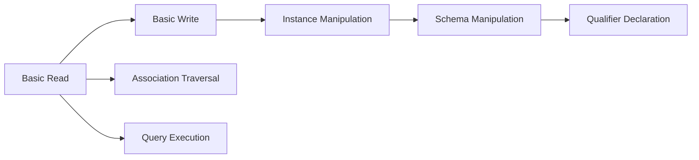

# Day 18：CIM-XML — HTTP + XML 的經典組合

昨天我們建立了 WBEM 的宏觀視野，了解了三種通訊協定（CIM-XML、WS-Management、CIM-RS）的定位與取捨。今天，我們將深入其中最經典、最成熟的一支——**CIM-XML**。

CIM-XML 是 WBEM 家族中年紀最大的成員。它的第一個版本在 **1999 年**由 DMTF 發佈，恰逢 XML 1.0 規格（1998 年）剛剛成為 W3C 建議標準的時代。CIM-XML 選擇了當時最先進的技術組合：**HTTP 作為傳輸協定、XML 作為資料編碼格式**——這個組合在當時被視為管理標準的一大創新[^dmtf-wbem]。

## 雙重規格：DSP0200 與 DSP0201

CIM-XML 並非單一文檔，而是由兩份緊密耦合的規格共同定義[^dmtf-cim-page]：

| 文件編號 | 名稱 | 最新版本 | 發佈日期 | 職責 |
|---------|------|---------|---------|------|
| **DSP0200** | CIM Operations over HTTP | 1.4.0 | 2013-08 | 定義 CIM 訊息如何在 HTTP 上傳輸 |
| **DSP0201** | Representation of CIM in XML | 2.4.0 | 2013-08 | 定義 CIM 物件的 XML 編碼語法 |

為什麼需要兩份規格？因為 DMTF 的信條之一是**關注點分離**（Separation of Concerns）。DSP0200 關注的是「傳輸方式」——如何使用 HTTP 方法、標頭、URI 來傳送 CIM 操作；DSP0201 關注的是「編碼方式」——CIM 類別、實例、屬性、關聯如何以 XML 元素的形式表達。理論上，你可以換掉 XML 改用 JSON 來表達 CIM 物件（DSP0211 正是這麼做的），而仍然沿用 DSP0200 的 HTTP 傳輸機制。

### DSP0200：CIM Operations over HTTP

DSP0200 定義了所有 CIM 操作在 HTTP 上的傳輸規則。其訊息結構分為兩大類別[^dsp0200-html]：

#### 類別一：CIM Operation Messages（RPC 風格）

這些是傳統的「請求—回應」型操作，用於查詢與修改 CIM 物件：

| 子元素 | 用途 |
|--------|------|
| `<SIMPLEREQ>` | 單一操作請求（最常見） |
| `<SIMPLERSP>` | 單一操作回應 |
| `<MULTIREQ>` | 批次操作請求（多個方法一次送出） |
| `<MULTIRSP>` | 批次操作回應 |

#### 類別二：CIM Export Messages（事件/通知）

| 子元素 | 用途 |
|--------|------|
| `<SIMPLEEXPREQ>` | 單一匯出請求（事件通知） |
| `<SIMPLEEXPRSP>` | 單一匯出回應 |
| `<MULTIEXPREQ>` | 批次匯出請求 |
| `<MULTIEXPRSP>` | 批次匯出回應 |

Export Messages 是 CIM 事件通知機制的基礎。當伺服器上的某個管理物件狀態發生變化（例如硬碟溫度超出閾值），伺服器可以透過 Export 訊息主動通知註冊的監聽器（Listener）。

#### 兩種方法類型

CIM-XML 區分了兩種方法（Method）類型[^pywbem-concepts]：

| 類型 | 目標 | 範例 | XML 元素 |
|------|------|------|---------|
| **Intrinsic Methods**（本質方法） | CIM Namespace（命名空間） | `GetClass`、`GetInstance`、`EnumerateInstances` | `<IMETHODCALL>` / `<IMETHODRESPONSE>` |
| **Extrinsic Methods**（外延方法） | CIM Class 或 Instance（類別/實例） | Schema 中自訂的方法 | `<METHODCALL>` / `<METHODRESPONSE>` |

Intrinsic Methods 是 CIM-XML 預先定義的標準操作——它們是 WBEM 用戶端與伺服器之間最基本的溝通語言。Extrinsic Methods 則由 Schema 自行定義，例如一個 `CIM_ComputerSystem` 類別可以定義一個 `StartDiagnostic()` 方法。

### DSP0201：Representation of CIM in XML

DSP0201 定義了 CIM 物件在 XML 中的具體編碼方式。它使用一份 **DTD（Document Type Definition）** 來規範 XML 文件結構（DSP0203）[^dmtf-cim-page]。

#### 根結構

```xml
<CIM CIMVERSION="2.0" DTDVERSION="2.0">
  <MESSAGE ID="req-001" PROTOCOLVERSION="1.0">
    ...訊息內容...
  </MESSAGE>
</CIM>
```

| 屬性 | 說明 |
|------|------|
| `CIMVERSION` | CIM Schema 版本（如 `"2.0"`） |
| `DTDVERSION` | DTD 版本（如 `"2.0"`） |
| `ID` | 唯一識別碼，由客戶端產生，伺服端回應時原樣回覆 |
| `PROTOCOLVERSION` | HTTP 映射協定版本（至少 `"1.0"`） |

#### 核心定位元素

| XML 元素 | 對應的 CIM 概念 | URI 路徑範例 |
|---------|----------------|-------------|
| `<LOCALNAMESPACEPATH>` | 命名空間路徑 | `root/cimv2` |
| `<LOCALCLASSPATH>` | 類別路徑 | `root/cimv2:CIM_ComputerSystem` |
| `<LOCALINSTANCEPATH>` | 實例路徑 | `root/cimv2:CIM_ComputerSystem.Name="svr-01"` |

這些路徑的編碼規則由 **DSP0207（WBEM URI Mapping）** 定義[^dmtf-wbem]：命名空間以 `/` 分隔，類別以 `:` 附加，實例則以 `.` 接上 `key=value` 的鍵值配對。

---

## 關鍵 Intrinsic Methods 解析

CIM-XML 定義了多達 20 多種 Intrinsic Methods。以下是最核心的操作[^pywbem-operations]：

### 讀取操作（Basic Read）

這些是所有操作的基礎，**不依賴任何其他功能群組**：

**GetClass** — 查詢一個類別的定義（屬性清單、方法、關聯）：

```xml
<IMETHODCALL NAME="GetClass">
  <LOCALNAMESPACEPATH>
    <NAMESPACE NAME="root"/>
    <NAMESPACE NAME="cimv2"/>
  </LOCALNAMESPACEPATH>
  <IPARAMVALUE NAME="ClassName">
    <CLASSNAME NAME="CIM_ComputerSystem"/>
  </IPARAMVALUE>
  <IPARAMVALUE NAME="LocalOnly">
    <VALUE>FALSE</VALUE>
  </IPARAMVALUE>
</IMETHODCALL>
```

**GetInstance** — 查詢一個特定實例的內容：

```xml
<IMETHODCALL NAME="GetInstance">
  <LOCALNAMESPACEPATH>
    <NAMESPACE NAME="root"/>
    <NAMESPACE NAME="cimv2"/>
  </LOCALNAMESPACEPATH>
  <IPARAMVALUE NAME="InstanceName">
    <INSTANCENAME CLASSNAME="CIM_ComputerSystem">
      <KEYBINDING NAME="Name"><KEYVALUE>svr-01</KEYVALUE></KEYBINDING>
    </INSTANCENAME>
  </IPARAMVALUE>
  <IPARAMVALUE NAME="LocalOnly">
    <VALUE>FALSE</VALUE>
  </IPARAMVALUE>
</IMETHODCALL>
```

**EnumerateInstances** — 列舉某個類別的所有實例：

```xml
<IMETHODCALL NAME="EnumerateInstances">
  <LOCALNAMESPACEPATH>
    <NAMESPACE NAME="root"/>
    <NAMESPACE NAME="cimv2"/>
  </LOCALNAMESPACEPATH>
  <IPARAMVALUE NAME="ClassName">
    <CLASSNAME NAME="CIM_LogicalDisk"/>
  </IPARAMVALUE>
  <IPARAMVALUE NAME="DeepInheritance">
    <VALUE>TRUE</VALUE>
  </IPARAMVALUE>
</IMETHODCALL>
```

### 寫入操作（Basic Write & Instance Manipulation）

這些操作依賴於 Basic Read，分別構成更高層次的功能群組：

| 操作 | 說明 | 依賴 |
|------|------|------|
| **SetProperty** | 修改單一屬性值 | Basic Read |
| **CreateInstance** | 建立一個新實例 | Basic Write |
| **ModifyInstance** | 修改既有實例的屬性 | Basic Write |
| **DeleteInstance** | 刪除一個實例 | Basic Write |

### 關聯遍歷（Association Traversal）

這是 CIM 相較於 SNMP 最重要的優勢之一——能夠直接沿著關聯查詢物件：

| 操作 | 說明 |
|------|------|
| **Associators** | 列舉與某個物件相關聯的物件 |
| **AssociatorNames** | 僅列舉關聯物件的名稱（節省頻寬） |
| **References** | 列舉指向某個物件的關聯 |
| **ReferenceNames** | 僅列舉關聯名稱 |

這些操作的參數允許透過 `AssocClass`、`ResultClass`、`Role` 等參數進行過濾，實現精準的關聯查詢。

---

## HTTP 傳輸機制

CIM-XML 使用 **HTTP POST** 作為唯一的請求方法。這與 RESTful 設計不同——CIM-XML 不區分 GET/POST/PUT/DELETE，而是將所有語意放在 XML 酬載中，由 `CIMMethod` 標頭指明[^dsp0200-html]。

### 關鍵 HTTP 標頭

| 標頭 | 適用範圍 | 說明 |
|------|---------|------|
| **CIMOperation** | 請求與回應（必備） | `MethodCall`（請求）或 `MethodResponse`（回應） |
| **CIMMethod** | 簡單操作請求 | 方法名稱，如 `GetInstance`、`EnumerateInstances` |
| **CIMObject** | 簡單操作請求 | 目標物件路徑（URI 編碼），如 `root/cimv2` |
| **CIMBatch** | 批次操作 | 標記此訊息為批次操作 |
| **CIMProtocolVersion** | 任意（選擇性） | 通訊協定版本，如 `1.0` |
| **CIMError** | 錯誤回應 | 診斷資訊，如 `unsupported-protocol-version`、`header-mismatch` |

### 完整請求/回應範例

以下是一個完整的 CIM-XML 請求與對應的回應：

**請求**：查詢 `CIM_ComputerSystem` 中名為 `svr-01` 的實例

```http
POST /cimom HTTP/1.1
HOST: wbem-server.example.com
Content-Type: application/xml; charset="utf-8"
Content-Length: 512
CIMOperation: MethodCall
CIMMethod: GetInstance
CIMObject: root/cimv2

<?xml version="1.0" encoding="utf-8"?>
<CIM CIMVERSION="2.0" DTDVERSION="2.0">
  <MESSAGE ID="req-001" PROTOCOLVERSION="1.0">
    <SIMPLEREQ>
      <IMETHODCALL NAME="GetInstance">
        <LOCALNAMESPACEPATH>
          <NAMESPACE NAME="root"/>
          <NAMESPACE NAME="cimv2"/>
        </LOCALNAMESPACEPATH>
        <IPARAMVALUE NAME="InstanceName">
          <INSTANCENAME CLASSNAME="CIM_ComputerSystem">
            <KEYBINDING NAME="Name">
              <KEYVALUE>svr-01</KEYVALUE>
            </KEYBINDING>
          </INSTANCENAME>
        </IPARAMVALUE>
        <IPARAMVALUE NAME="LocalOnly">
          <VALUE>FALSE</VALUE>
        </IPARAMVALUE>
      </IMETHODCALL>
    </SIMPLEREQ>
  </MESSAGE>
</CIM>
```

**回應**：

```http
HTTP/1.1 200 OK
Content-Type: application/xml; charset="utf-8"
Content-Length: 768
CIMOperation: MethodResponse

<?xml version="1.0" encoding="utf-8"?>
<CIM CIMVERSION="2.0" DTDVERSION="2.0">
  <MESSAGE ID="req-001" PROTOCOLVERSION="1.0">
    <SIMPLERSP>
      <IMETHODRESPONSE NAME="GetInstance">
        <IRETURNVALUE>
          <INSTANCE CLASSNAME="CIM_ComputerSystem">
            <PROPERTY NAME="ElementName">
              <VALUE>Production Web Server 01</VALUE>
            </PROPERTY>
            <PROPERTY NAME="OperationalStatus">
              <VALUE>2</VALUE>
            </PROPERTY>
            <PROPERTY.ARRAY NAME="ResetCount">
              <VALUE>12</VALUE>
            </PROPERTY.ARRAY>
          </INSTANCE>
        </IRETURNVALUE>
      </IMETHODRESPONSE>
    </SIMPLERSP>
  </MESSAGE>
</CIM>
```

注意回應中 `ID` 的值與請求完全相同——這是追蹤請求-回應配對的關鍵機制。

---

## 錯誤處理

CIM-XML 的錯誤分為兩個層次[^pywbem-status]：

### CIM 層級錯誤（正常 HTTP 200 回應內）

```xml
<IMETHODRESPONSE NAME="GetInstance">
  <ERROR CODE="6"
         DESCRIPTION="Instance of CIM_ComputerSystem not found"/>
</IMETHODRESPONSE>
```

### 重要錯誤碼

| 編號 | 符號名稱 | 說明 |
|------|---------|------|
| 1 | CIM_ERR_FAILED | 一般性錯誤 |
| 2 | CIM_ERR_ACCESS_DENIED | 存取被拒 |
| 3 | CIM_ERR_INVALID_NAMESPACE | 命名空間不存在 |
| 4 | CIM_ERR_INVALID_PARAMETER | 參數無效 |
| 5 | CIM_ERR_INVALID_CLASS | 類別不存在 |
| 6 | CIM_ERR_NOT_FOUND | 找不到物件 |
| 11 | CIM_ERR_ALREADY_EXISTS | 物件已存在 |
| 13 | CIM_ERR_TYPE_MISMATCH | 型別不符 |

### HTTP 層級錯誤

當 CIM 層級無法處理請求時（例如標頭格式錯誤），伺服器回傳標準 HTTP 狀態碼加上 `CIMError` 標頭：

| HTTP 狀態 | 典型原因 |
|-----------|---------|
| 400 Bad Request | 缺少或無效的 CIM 標頭（如 `header-mismatch`） |
| 501 Not Implemented | 不支援的協定版本或批次操作 |

---

## 功能群組與相依性

CIM-XML 將所有操作組織為層級式的功能群組（Functional Profiles），定義了操作間的依賴關係[^dsp0200-html]：



| 功能群組 | 包含操作 |
|---------|---------|
| **Basic Read** | GetClass、EnumerateClasses、EnumerateClassNames、GetInstance、EnumerateInstances、EnumerateInstanceNames、GetProperty |
| **Basic Write** | SetProperty |
| **Instance Manipulation** | CreateInstance、ModifyInstance、DeleteInstance |
| **Schema Manipulation** | CreateClass、ModifyClass、DeleteClass |
| **Association Traversal** | Associators、AssociatorNames、References、ReferenceNames |
| **Query Execution** | ExecQuery |

這種層級設計意味著一個最小實作可以只支援 Basic Read 而仍然符合標準——許多輕量級 WBEM 用戶端正是不需要寫入能力的。

---

## 小結

1. **CIM-XML 由雙重規格構成**：DSP0200 定義 HTTP 傳輸，DSP0201 定義 XML 編碼，兩者關注點分離。
2. **訊息分為兩大類別**：Operation Messages（RPC 請求/回應）與 Export Messages（事件通知）。
3. **Intrinsic Methods 是 CIM-XML 的心臟**：從 `GetClass` 到 `Associators`，超過 20 種標準操作涵蓋了讀取、寫入、關聯遍歷、查詢等場景。
4. **HTTP POST 為唯一傳輸方式**：所有語意都在 XML 酬載中，`CIMMethod` 與 `CIMObject` 標頭用於路由。
5. **功能群組層級分明**：Basic Read → Basic Write → Instance Manipulation → Schema Manipulation，層層依賴。

明天，我們將繼續深入第四階段的第二站——**WS-Management**，看看企業級 SOAP 管理如何將 CIM 帶入 ISO 國際標準的殿堂。

[^dmtf-cim-page]: Distributed Management Task Force. (n.d.). CIM Home. Retrieved 2026-10-03, from https://www.dmtf.org/standards/cim
[^dmtf-wbem]: Distributed Management Task Force. (n.d.). WBEM Standards — Web-Based Enterprise Management. Retrieved 2026-10-03, from https://www.dmtf.org/standards/wbem
[^dsp0200-html]: Distributed Management Task Force. (2007). DSP0200 — CIM Operations over HTTP v1.2.0 (HTML). Retrieved 2026-10-03, from https://www.dmtf.org/sites/default/files/standards/documents/DSP200.html
[^pywbem-concepts]: pywbem. (n.d.). Core Concepts — pywbem Documentation. Retrieved 2026-10-03, from https://pywbem.readthedocs.io/en/latest/concepts.html
[^pywbem-operations]: pywbem. (n.d.). CIM Operations — pywbem Documentation. Retrieved 2026-10-03, from https://pywbem.readthedocs.io/en/latest/client/operations.html
[^pywbem-status]: pywbem. (n.d.). CIM Status Codes — pywbem Documentation. Retrieved 2026-10-03, from https://pywbem.readthedocs.io/en/latest/client/status.html