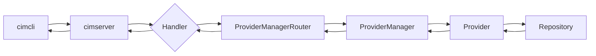
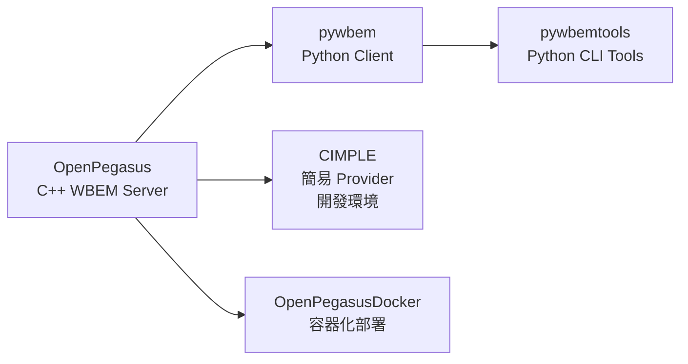

# Day 22：OpenPegasus — 最完整的 Open Source CIM 實作

昨天我們探討了 Management Profiles 如何為特定管理場景裁剪 CIM 模型，並看到 CIM 從「通用模型」到「專用子集」的轉化過程。今天——第五階段的第二篇——我們將從規格文件走進真實的原始碼，認識 CIM/WBEM 生態系中最完整的開源實作：**OpenPegasus**。

如果說 pywbem（Day 23 的主題）是 CIM 生態系中的「Python 輕量級客戶端」，那 OpenPegasus 就是 CIM 生態系中的**旗艦級實作**——它包含完整的 CIM/WBEM 伺服器、物件管理器、Provider 框架、MOF 編譯器、多種查詢語言，以及豐富的命令列工具群[^openpegasus-github]。

## 歷史：從 CVS 到 GitHub 的開源旅程

OpenPegasus 的故事始於 2000 年代初期，由 **The Open Group** 主導開發，參與的企業包括 IBM、HP、BMC Software、EMC、Intel、Microsoft、Novell、Symantec、Tivoli Systems、VERITAS 等——幾乎囊括了當時企業管理領域的所有重要廠商[^openpegasus-readme]。

這是一個由大型企業共同投資、跨公司協作的標準實作專案，目標是提供一套完整的、可商業部署的 CIM/WBEM 參考實作[^openpegasus-license]。

原始程式碼存放在 Open Group 的 **CVS** 版本控制系統中。隨著 CVS 的逐漸淘汰，專案於版本 **2.14.1** 之後移師至 **GitHub**[^openpegasus-github]。截至 2026 年，GitHub 上的最新版本為 **2.14.4**（2023-08-22 發佈）[^openpegasus-changelog]。

專案目前處於 **life support（生命維持）** 模式——團隊不再計劃新增重大功能，但持續更新以適應新的編譯器版本、OpenSSL 更新（1.1.x 支援），並修復已回報的問題[^openpegasus-readme]。GitHub Actions 在每次推送時於 Linux 與 Windows 平台上自動執行測試。

## 整體架構

OpenPegasus 的核心原始碼位於原始碼樹的 `pegasus/src/Pegasus/` 目錄下，由以下主要子系統構成[^openpegasus-source]：

| 子系統 | 目錄 | 功能 |
|--------|------|------|
| **Server** | `Server/cimserver` | CIM/WBEM 伺服器核心——請求調度、連線管理 |
| **Provider** | `Provider/` | Provider 介面框架——C++ 抽象類別與 CMPI C 語言介面 |
| **ProviderManager** | `ProviderManager2/` | Provider 生命週期管理（載入、卸載、行程外執行） |
| **Repository** | `Repository/` | CIM 儲存庫——CIM 類別與實例的持久化儲存（支援 XML 與二進位格式） |
| **Client** | `Client/` | C++ 客戶端基礎設施，用於撰寫 WBEM 客戶端應用 |
| **Compiler** | `Compiler/` | MOF 編譯器（將 MOF 原始檔編譯為 C++ 程式碼） |
| **Handler** | `Handler/` | CIM 操作請求的處理器 |
| **Security** | `Security/` | SSL、認證、授權相關功能 |
| **CQL / WQL / FQL** | `CQL/`, `WQL/`, `FQL/` | 三種查詢語言的解析器與執行器 |
| **ExportServer** | `ExportServer/` | 遠端 CIMOM Handle 伺服器 |
| **WsmServer** | `WsmServer/` | WBEM-SOAP 伺服器 |
| **WebServer** | `WebServer/` | 內建的 WEB 管理介面 |
| **IndicationService** | `IndicationService/` | 非同步事件/指示的傳遞服務 |

### 請求處理流程

當一個 WBEM 客戶端（如 `cimcli`）發送請求時，OpenPegasus 的內部處理流程如下：



1. 客戶端以 CIM-XML 或 CIM-SOAP 格式發送請求
2. `cimserver` 接收請求，經 **Handler** 層解析
3. **ProviderManagerRouter** 根據請求的類別路由到適當的 ProviderManager
4. ProviderManager 載入對應的 Provider（C++ 原生或 CMPI 插件）
5. Provider 與 **Repository** 互動，執行 CRUD 操作或自訂方法
6. 結果沿相同路徑返回客戶端

### 查詢語言

OpenPegasus 支援三種查詢語言[^openpegasus-config]：

| 語言 | 全名 | 狀態 | 說明 |
|------|------|------|------|
| **WQL** | WBEM Query Language | 穩定（Legacy） | 最早期、最成熟的查詢語法 |
| **CQL** | CIM Query Language | Experimental | 基於物件導向的查詢語言 |
| **FQL** | Filter Query Language | 穩定 | 用於 Profile 的過濾查詢 |

## CLI 工具：管理 OpenPegasus 的武器庫

OpenPegasus 提供了豐富的命令列工具，全部編譯在 `$PEGASUS_HOME/bin/` 下[^openpegasus-utils]。

### cimcli：主要的 WBEM 客戶端

`cimcli` 是 OpenPegasus 最重要的命令列工具，用於向執行中的 WBEM 伺服器發送 CIM 操作[^openpegasus-cli]：

```bash
# 列舉所有 CIM_ComputerSystem 實例
cimcli enumerate CIM_ComputerSystem

# 獲取特定實例
cimcli get CIM_ComputerSystem svr-01

# 修改屬性
cimcli set CIM_ComputerSystem svr-01 Description="Updated server"

# 建立新實例
cimcli create CIM_ComputerSystem Name=svr-02 ElementName="Backup"

# 刪除實例
cimcli delete CIM_ComputerSystem svr-02

# 呼叫方法
cimcli invoke CIM_ComputerSystem svr-01 Reboot ForceReboot=true

# 啟用/停用伺服器統計
cimcli son    # 啟用統計（Statistics ON）
cimcli soff   # 停用統計
```

### cimconfig：執行期設定管理員

`cimconfig` 用於管理 OpenPegasus 伺服器的執行期設定參數[^openpegasus-config]：

```bash
# 列出所有設定
cimconfig -l

# 取得設定值
cimconfig -g traceLevel

# 動態設定（目前執行中伺服器）
cimconfig -s traceLevel=5 -c

# 設定下次伺服器啟動生效
cimconfig -s daemon=false -p

# 重設為預設值
cimconfig -u traceLevel -c

# 查詢設定說明
cimconfig -H All
```

設定分為 **Current（動態）** 與 **Planned（靜態）** 兩種模式：
- **Current**（`-c`）：立即應用於執行中伺服器，但伺服器重啟後失效
- **Planned**（`-p`）：寫入 CIM Repository，下次伺服器啟動時生效

可設定的參數包括但不限於：`traceLevel`、`traceComponents`、`enableHttpConnection`、`httpPort`/`httpsPort`、`enableAuthentication`、`forceProviderProcesses`、`daemon`、`repositoryDir`、`logLevel`、`sslCertificateFilePath` 等。

### cimsub：事件訂閱管理

`cimsub` 用於管理 CIM 事件訂閱——建立、修改或刪除 Indication Filter、Listener Destination 與 Subscription 實例[^openpegasus-utils]：

```bash
# 建立一個偵聽目的地
cimsub add_listener http://listener-host:5999/cimlistener

# 建立一個事件過濾器
cimsub add_filter "CIM_AlarmIndication" severity>=3

# 建立訂閱
cimsub subscribe filter1 listener1
```

### 其他工具

| 工具 | 功能 |
|------|------|
| **cimauth** | 使用者授權管理 |
| **cimcrl** | 憑證撤銷清單（CRL）管理 |
| **cimtrust** | SSL 信任儲存管理 |
| **cimprovider** | Provider 模組管理（啟用/停用/移除/列出） |
| **cimuser** | 使用者管理（未編譯 PAM 認證時使用） |
| **cimperf** | 效能統計顯示 |
| **cimmof** | 以 WBEM 客戶端模式編譯 MOF（透過伺服器操作） |
| **cimmofl** | 離線編譯 MOF（直接寫入 Repository） |
| **cimreparchive** | Repository 歸檔工具 |

## CMPI：C 語言的 Provider 開發介面

OpenPegasus 支援兩種 Provider 開發方式[^openpegasus-cmpi]：

### 1. C++ 原生 Provider API

開發者繼承以下抽象類別：

| 抽象類別 | 用途 |
|----------|------|
| `CIMInstanceProvider` | 提供 CIM 實例的 CRUD 操作 |
| `CIMMethodProvider` | 提供 CIM 自訂方法的實作 |
| `CIMIndicationProvider` | 提供非同步事件指示 |

### 2. CMPI（Common Management Programming Interface）

CMPI 是 DMTF 標準化的 **C 語言 Provider 介面**，讓 Provider 可以用 C 而非 C++ 實作[^dmtf-cmpi]：

```c
// CMPI Provider 的 MOF 註冊範例
instance of PG_ProviderModule {
   Name = "MyProviderModule";
   Location = "cmpiMyProvider";
   InterfaceType = "CMPI";
   InterfaceVersion = "0.86.0";
};
```

CMPI 的特點：
- 使用簡單的巨集與函數表，C 語言層級提供執行緒、Mutex、條件變數等 API（無需外部 pthread 依賴）
- 在 Linux 上預設啟用（`PEGASUS_ENABLE_CMPI_PROVIDER_MANAGER=1`）
- 適合需要直接與底層硬體或作業系統 API 互動的場景

## 編譯與部署實戰指南

### 環境變數設定

編譯 OpenPegasus 需要三個必備環境變數[^openpegasus-build]：

```bash
export PEGASUS_ROOT=/path/to/pegasus       # 原始碼根目錄
export PEGASUS_HOME=/path/to/build_output   # 建置輸出目錄
export PEGASUS_PLATFORM=LINUX_X86_64_GNU    # 目標平台
```

### 完整建置與測試

```bash
# 進入原始碼目錄
cd $PEGASUS_ROOT

# 完整建置 + 儲存庫建立 + 測試
make world

# 或僅建置（不含測試）
make

# 僅建立 CIM Repository
make repository
```

`make world` 執行完整循環：
1. 編譯 OpenPegasus 與測試工具
2. 建立執行環境：建立類別儲存庫、產生 SSL 憑證與金鑰、安裝測試 Provider
3. 執行完整測試套件

### 可選建置選項

| 環境變數 | 功能 |
|----------|------|
| `PEGASUS_ENABLE_SSL` | 啟用 SSL 支援 |
| `PEGASUS_ENABLE_CMPI_PROVIDER_MANAGER` | 啟用 CMPI Provider Manager |
| `PEGASUS_DEBUG` | 除錯模式建置 |
| `PEGASUS_ENABLE_PROVIDER_USER_CONTEXT` | Provider 使用者上下文 |
| `PEGASUS_ENABLE_AUDIT_LOG` | 稽核日誌 |
| `PEGASUS_ENABLE_CQL` | CIM Query Language |
| `PEGASUS_ENABLE_OOP` | 行程外（Out-of-Process）Provider |

### Docker 部署

OpenPegasus 提供 Docker 建置工具（**OpenPegasusDocker**）[^openpegasus-docker]：

```bash
git clone https://github.com/OpenPegasus/OpenPegasusDocker.git
cd OpenPegasusDocker

# 建置 Ubuntu 基礎的建置映像
make build

# 在容器內建置與測試
make run-build-container BUILD_STARTUP_MODE=auto

# 啟動伺服器執行容器
make run-server-image
```

伺服器預設監聽連接埠：**15988**（HTTP）與 **15989**（HTTPS）[^openpegasus-running]。

### 啟動與停止伺服器

```bash
# 背景服務模式啟動
cimserver

# 啟動並設定執行期參數
cimserver traceLevel=2 traceComponents=XMLIO

# 停止伺服器
cimserver -s

# 檢查伺服器狀態
cimserver --status
```

## 與其他 CIM 專案的關係

OpenPegasus 並非 CIM 生態系的孤島。它與其他專案的關係如下：



- **pywbem** / **pywbemtools** — 以 Python 實作的 CIM/WBEM 客戶端與指示偵聽器。OpenPegasus 是其開發團隊的重要測試平台。由相同團隊維護，是目前較活躍的專案[^openpegasus-readme]。
- **CIMPLE** — 簡化 OpenPegasus Provider 開發的環境，正被整合進 OpenPegasus 原始碼樹中。
- **OpenPegasusDocker** — 容器化建置與部署工具的獨立 GitHub 專案。

## 小結

1. **OpenPegasus 是 DMTF CIM/WBEM 標準的旗艦級開源實作**，由 IBM、HP、BMC 等多家企業共同開發，覆蓋伺服器、Provider、Repository、MOF Compiler 等完整子系統。
2. **架構上採用模組化的請求處理管線**：Client → Handler → ProviderManagerRouter → ProviderManager → Provider → Repository，各層級鬆散耦合。
3. **CLI 工具群**（cimcli、cimconfig、cimsub 等）提供了管理 CIM 執行環境的完整命令列能力，從查詢物件、設定參數到管理訂閱一應俱全。
4. **Provider 開發支援 C++ 原生 API 與 CMPI C 語言介面**兩種方式，後者適合需要底層硬體互動的場景。
5. **編譯與部署相對直接**：設定三個環境變數後，`make world` 即可完成完整建置與測試；Docker 選項進一步降低了部署門檻。
6. 雖然 OpenPegasus 目前已進入 **life support 模式**，但作為 CIM 標準最重要的參考實作，其架構設計與原始碼對於理解 CIM/WBEM 的運作原理仍有極高價值。

明天我們將探索 CIM 生態系中的另一個重要成員——**pywbem**，看看 Python 如何讓我們更輕巧地與 CIM 世界互動。

[^openpegasus-github]: OpenPegasus. (n.d.). OpenPegasus — CIM/WBEM Implementation. GitHub. Retrieved 2026-10-03, from https://github.com/OpenPegasus/OpenPegasus
[^openpegasus-readme]: OpenPegasus. (n.d.). OpenPegasus README. GitHub. Retrieved 2026-10-03, from https://github.com/OpenPegasus/OpenPegasus#readme
[^openpegasus-license]: OpenPegasus. (n.d.). OpenPegasus License (MIT with Copyrights). GitHub. Retrieved 2026-10-03, from https://github.com/OpenPegasus/OpenPegasus#openpegasus-license
[^openpegasus-changelog]: OpenPegasus. (2023, August). OpenPegasus Changes (docs/changes.md). GitHub. Retrieved 2026-10-03, from https://github.com/OpenPegasus/OpenPegasus/blob/main/docs/changes.md
[^openpegasus-source]: OpenPegasus. (n.d.). Source code directory structure (pegasus/src/Pegasus/). GitHub. Retrieved 2026-10-03, from https://github.com/OpenPegasus/OpenPegasus/tree/main/pegasus/src/Pegasus
[^openpegasus-config]: OpenPegasus. (n.d.). Running and Configuring OpenPegasus (docs/RunningOpenPegasusReadme.md). GitHub. Retrieved 2026-10-03, from https://github.com/OpenPegasus/OpenPegasus/blob/main/docs/RunningOpenPegasusReadme.md
[^openpegasus-cli]: OpenPegasus. (n.d.). CLI Clients (pegasus/src/Clients/). GitHub. Retrieved 2026-10-03, from https://github.com/OpenPegasus/OpenPegasus/tree/main/pegasus/src/Clients
[^openpegasus-utils]: OpenPegasus. (n.d.). OpenPegasus Command Line Utilities. GitHub. Retrieved 2026-10-03, from https://github.com/OpenPegasus/OpenPegasus/blob/main/docs/RunningOpenPegasusReadme.md#openpegasus-command-line-utilities
[^openpegasus-build]: OpenPegasus. (n.d.). Building OpenPegasus (docs/BuildingOpenPegasusReadme.md). GitHub. Retrieved 2026-10-03, from https://github.com/OpenPegasus/OpenPegasus/blob/main/docs/BuildingOpenPegasusReadme.md
[^openpegasus-docker]: OpenPegasus. (n.d.). OpenPegasusDocker. GitHub. Retrieved 2026-10-03, from https://github.com/OpenPegasus/OpenPegasusDocker
[^openpegasus-running]: OpenPegasus. (n.d.). Running OpenPegasus. GitHub. Retrieved 2026-10-03, from https://github.com/OpenPegasus/OpenPegasus/blob/main/docs/RunningOpenPegasusReadme.md
[^openpegasus-cmpi]: OpenPegasus. (n.d.). CMPI Provider Interface (pegasus/readme.cmpi). GitHub. Retrieved 2026-10-03, from https://github.com/OpenPegasus/OpenPegasus/blob/main/pegasus/readme.cmpi
[^dmtf-cmpi]: Distributed Management Task Force. (n.d.). CMPI — Common Management Programming Interface. Retrieved 2026-10-03, from https://www.dmtf.org/standards/cmpi