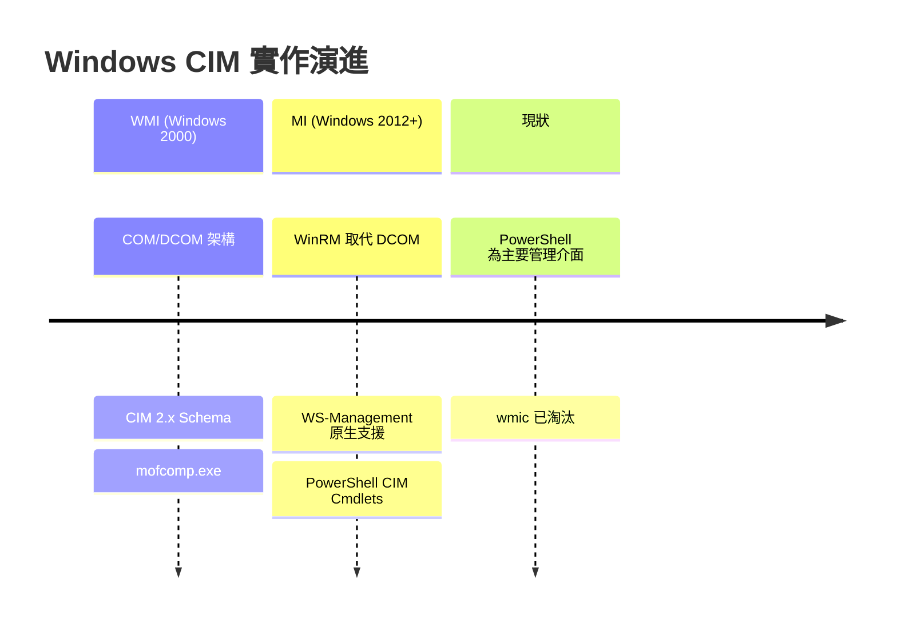
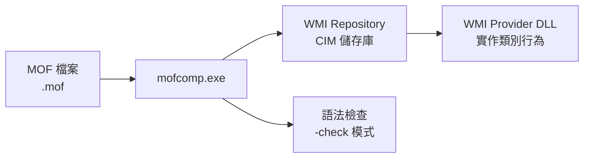

# Day 24：CIM 在 Windows 的實作：WMI 與 MI

昨天我們認識了 pywbem——Python 生態系中操作 CIM 的輕量級客戶端工具，看到了它如何靈活查詢 WBEM 伺服器。今天——第五階段的第四篇——我們將走進 Windows 的世界，看看微軟如何在 Windows 中實現 DMTF CIM 標準：從經典的 **WMI（Windows Management Instrumentation）** 到現代的 **MI（Management Infrastructure）**。

你可能每天都在使用 Windows 工作，卻從未意識到 CIM 一直潛藏在你的系統管理工具背後——無論是 `wmic` 指令、PowerShell 的 `Get-CimInstance`，還是工作管理員所顯示的資訊，底層都是 CIM 模型在支撐[^wmi-about]。

## 從 WMI 到 MI：三代的演進

CIM 在 Windows 上的實作經歷了三代演進，每一代都更緊密地貼近 DMTF 標準[^wmi-start][^mi-why]：



### WMI（Windows 2000）

**Windows Management Instrumentation（WMI）** 首次隨 **Windows 2000** 問世，是微軟對 DMTF **Web-Based Enterprise Management（WBEM）** 與 **CIM** 標準的完整實作[^wmi-about]。它的核心設計圍繞三點：

1. **以 CIM 為資料模型**— 管理資訊以物件導向的 CIM 類別（Class）來組織，而非 SNMP 的扁平 MIB 表格
2. **COM/DCOM 為通訊層**— 使用微軟的元件物件模型進行本機與遠端通訊
3. **MOF 為 Schema 語言**— 使用 DMTF 標準的 Managed Object Format 定義管理類別

WMI 將 CIM 類別劃分為三個層次[^wmi-cim]：

| 層次 | 前綴 | 說明 | 範例 |
|------|------|------|------|
| **Core（核心）** | `__` | 跨所有管理領域的基礎類別 | `__Parameters`、`__SystemSecurity` |
| **Common（通用）** | `CIM_` | 技術中立的管理領域類別 | `CIM_UnitaryComputerSystem` |
| **Extended（延伸）** | `Win32_` | Windows 平台特有的實作 | `Win32_ComputerSystem`（繼承 `CIM_UnitaryComputerSystem`）|

**WMI 目前僅支援 CIM 2.x 版的 Schema**[^wmi-cim]。

### MI（Windows Server 2012+）

**Windows Management Infrastructure（MI）** 於 **Windows 8** 與 **Windows Server 2012** 引入，是 WMI 的次世代版本[^mi-why]。MI 完全向後相容——基於 MI 的 Provider 仍可被舊的 WMI 腳本存取——同時引入了多項重大改善：

- **WinRM（WS-Management）取代 DCOM** — 使用 SOAP 通訊協定（DSP0226 WS-Management）進行機器間管理，而非 DCOM
- **標準化錯誤與事件** — 與 DMTF 標準一致，使用 `CIM_Error` 與 `CIM_Indication` 類別
- **消除 COM 複雜性** — 提供原生 Provider API、原生 Client API 與 .NET API，不再需要複雜的 COM 程式開發
- **CIM 基礎的 PowerShell Cmdlets** — 引入 `Get-CimInstance` 等新一代管理指令

### wmic 的退役

**WMIC（Windows Management Instrumentation Command-line）** 是一個命令列公用程式，提供精簡的 WMI 查詢語法[^wmic-intro]。它提供了友善的 **Alias（別名）** 系統——例如 `os` 對應 `Win32_OperatingSystem`、`process` 對應 `Win32_Process`。

然而，WMIC 已於 **Windows 10 21H1** 起標記為過時，並自 **Windows 11 24H2**（2026 年 8 月）起預設不再安裝[^wmic-deprecated]：

```cmd
# 舊的 wmic 語法（已淘汰）
wmic os list brief
wmic process get name

# 替代：PowerShell CIM Cmdlets
powershell -Command "Get-CimInstance -ClassName Win32_OperatingSystem"
```

WMIC 的退役意味著 Windows 管理已完全轉向 PowerShell 生態系，但 WMI 本身——以及其底層的 CIM 模型——仍然完整支援[^wmic-deprecated]。

## mofcomp.exe：Windows 的 MOF 編譯器

`mofcomp.exe` 是 Windows 隨附的 MOF 編譯器，位於 `%Windir%\System32\wbem\mofcomp.exe`。它的角色是將 MOF 檔案編譯到 **WMI Repository（CIM 儲存庫）** 中，使系統能夠識別新的管理類別與實例[^mofcomp-docs]：



### 使用語法

```cmd
rem 基本編譯
mofcomp MySchema.mof

rem 只檢查語法，不修改儲存庫
mofcomp MySchema.mof -check

rem 指定命名空間（預設 root\default）
mofcomp MySchema.mof -N:root\cimv2

rem 自動復原註冊（pragma autorecover 需在 MOF 中聲明）
mofcomp MySchema.mof -autorecover

rem 建立二進位 MOF（用於 WDM 驅動程式）
mofcomp MySchema.mof -B:output.bin
```

### 重要的編譯開關

| 開關 | 用途 |
|------|------|
| `-check` | 僅語法檢查，不連線 WMI |
| `-N:<namespace>` | 指定編譯到的命名空間（預設 `root\default`） |
| `-class:createonly` | 不修改既有類別 |
| `-class:forceupdate` | 強制更新類別，解決衝突 |
| `-class:safeupdate` | 允許更新，不影響子類別 |
| `-instance:createonly` | 不修改既有實例 |
| `-B:<filename>` | 建立二進位 MOF，不修改儲存庫 |
| `-autorecover` | 註冊 MOF 檔案，儲存庫重建時自動重新編譯 |

### MOF 檔案的位置與管理

所有 Windows 隨附的 MOF 檔案位於 `%SystemRoot%\System32\WBEM\`，由以下組成[^wmi-architecture]：

- **`CIMWin32.mof`** — 最重要的 MOF 檔案，定義 CIM 基礎類別與 Win32 延伸類別，編譯到 `Root\CIMV2` 命名空間
- **`CIMWin32.dll`** — 對應的 Provider DLL，實作類別的資料擷取邏輯（透過 Windows API 與 Registry）
- **`.mof` + `.dll` 成對** — 每個 WMI Provider 由一個 MOF 定義（資料模型）與一個 DLL 檔案（執行時期程式碼）組成

WMI Repository 的註冊路徑為 `HKEY_LOCAL_MACHINE\SOFTWARE\Microsoft\WBEM\CIMOM\`[^wmi-architecture]。

Repository 可以透過 `winmgmt.exe` 工具進行管理[^winmgmt-docs]：

```cmd
rem 備份儲存庫
winmgmt /backup

rem 驗證儲存庫完整性
winmgmt /verifyrepository

rem 修復儲存庫
winmgmt /salvagerepository

rem 重建儲存庫（會重新編譯所有 autorecover MOF）
winmgmt /resetrepository
```

## PowerShell 透過 WMI 查詢 CIM 物件

PowerShell 提供兩代 CIM 相關指令[^powershell-wmi]：

### 第一代：WMI Cmdlets（PowerShell 2.0，已棄用）

```powershell
# 舊的 WMI 指令（PowerShell 6+ 已移除）
Get-WmiObject -Class Win32_OperatingSystem
Invoke-WmiMethod -Class Win32_Service ...
```

### 第二代：CIM Cmdlets（PowerShell 3.0+，現行標準）

自 PowerShell 3.0 起，引入了 `CimCmdlets` 模組，這些指令直接引用 CIM 命名[^powershell-wmi]：

```powershell
# 查詢 BIOS 資訊
Get-CimInstance -ClassName Win32_BIOS

# WQL 查詢語法
Get-CimInstance -Query 'Select * from Win32_BIOS'

# 檢視 CIM 類別定義——查看繼承鏈
Get-CimClass -ClassName Win32_Process

# 遙距查詢（使用 WS-Management over WinRM）
$Session = New-CimSession -ComputerName dc01 -Credential (Get-Credential)
Get-CimInstance -CimSession $Session -ClassName Win32_ComputerSystem
```

CIM Cmdlets 的名稱雖然是「CIM」而非「WMI」，但它們仍然透過 WMI 底層取得資料——只是通訊協定從 DCOM 改為 WS-Management（Microsoft 的 WS-Management 實作即 **WinRM**）。正如微軟的說明：「不要困惑於『我用 CIM Cmdlets 查詢 WMI』這樣的說法——CIM Cmdlets 是存取 WMI 的新工具，WMI 仍是底層技術」[^powershell-wmi]。

### 執行個體物件的 CIM 繼承鏈

當 PowerShell 回傳一個管理物件時，它的 `__DERIVATION` 屬性揭示了完整的 CIM 繼承鏈[^wmi-classes]：

```powershell
PS> $proc = Get-CimInstance -ClassName Win32_Process -First 1
PS> $proc.__CLASS
Win32_Process
PS> $proc.__SUPERCLASS
CIM_Process
PS> $proc.__DYNASTY
CIM_ManagedSystemElement
PS> $proc.__DERIVATION
CIM_Process  CIM_LogicalElement  CIM_ManagedSystemElement
```

也就是說，一個正在執行的 process 物件，其 CIM 類別層次為：

```
Win32_Process → CIM_Process → CIM_LogicalElement → CIM_ManagedSystemElement
```

## 實例：wmic 與 CIM 的對應關係

WMIC 的 **Alias（別名）** 系統是理解 CIM 對應關係的最佳入門[^wmic-aliases]：

| wmic 別名 | CIM / WMI 類別 | 繼承父類別 |
|-----------|----------------|-----------|
| `os` | `Win32_OperatingSystem` | `CIM_OperatingSystem` |
| `process` | `Win32_Process` | `CIM_Process` |
| `service` | `Win32_Service` | `CIM_Service` |
| `cpu` | `Win32_Processor` | `CIM_Processor` |
| `memory` | `Win32_PhysicalMemory` | `CIM_PhysicalMemory` |
| `disk` | `Win32_LogicalDisk` | `CIM_LogicalDisk` |
| `bios` | `Win32_BIOS` | `CIM_BIOSElement` |
| `system` | `Win32_ComputerSystem` | `CIM_UnitaryComputerSystem` |

每一個 `Win32_` 前綴的類別都是對應 `CIM_` 類別的 **Windows 平台延伸**。例如 `Win32_ComputerSystem` 繼承自 `CIM_UnitaryComputerSystem`，後者又繼承自 `CIM_ComputerSystem` → `CIM_System` → `CIM_ManagedSystemElement`[^win32-computersystem]。

### 完整範例：用 PowerShell 追蹤 CIM 繼承鏈

以下是一個完整的 PowerShell 對話，展示如何從一個管理物件回溯其完整的 CIM 類別繼承鏈[^wmi-classes]：

```powershell
# 步驟 1：取得電腦系統資訊
$cs = Get-CimInstance -ClassName Win32_ComputerSystem
Write-Host "系統名稱: $($cs.Name)"

# 步驟 2：查閱 CIM 類別定義
$csClass = Get-CimClass -ClassName Win32_ComputerSystem

Write-Host "=== CIM 類別繼承鏈 ==="
Write-Host "類別: $($csClass.Name)"
Write-Host "父類別: $($csClass.SuperClassName)"
Write-Host "王朝: $($csClass.Dynasty)"
Write-Host "衍生鏈: $($csClass.Derivation -join ' → ')"

# 步驟 3：列舉類別的性質
Write-Host "`n=== 基礎 CIM 性質（繼承自 CIM_UnitaryComputerSystem） ==="
foreach ($prop in $csClass.Properties) {
    if ($prop.OriginClass -eq "CIM_UnitaryComputerSystem") {
        Write-Host "  $($prop.Name): $($prop.Type)"
    }
}

# 步驟 4：取得 Windows 延伸性質
Write-Host "`n=== Win32 延伸性質 ==="
foreach ($prop in $csClass.Properties) {
    if ($prop.OriginClass -eq "Win32_ComputerSystem") {
        Write-Host "  $($prop.Name): $($prop.Type)"
    }
}
```

輸出結果範例：

```
系統名稱: WS-001
=== CIM 類別繼承鏈 ===
類別: Win32_ComputerSystem
父類別: CIM_UnitaryComputerSystem
王朝: CIM_ManagedSystemElement
衍生鏈: CIM_ManagedSystemElement → CIM_System → CIM_ComputerSystem → CIM_UnitaryComputerSystem → Win32_ComputerSystem

=== 基礎 CIM 性質（繼承自 CIM_UnitaryComputerSystem）===
  Name: string
  Caption: string
  Description: string
  InstallDate: datetime
  Status: string

=== Win32 延伸性質 ===
  Manufacturer: string
  Model: string
  TotalPhysicalMemory: uint64
  NumberOfProcessors: uint16
  NumberOfLogicalProcessors: uint16
  DNSHostName: string
  Domain: string
  SystemType: string
```

這個範例清楚地展示了 CIM 三層模型的運作方式：`CIM_ManagedSystemElement` 定義了最基礎的 `Name` 與 `Status`；`CIM_ComputerSystem` 與 `CIM_UnitaryComputerSystem` 增加了 `Caption`、`Description` 等通用系統屬性；而 `Win32_ComputerSystem` 則加入 `Manufacturer`、`TotalPhysicalMemory` 等 Windows 平台特有的屬性[^win32-computersystem]。

## WMI 架構總覽

以下是 WMI 的完整架構圖，展示了 MOF 檔案、mofcomp.exe、WMI Repository、Provider DLL、與管理應用之間的協作關係[^wmi-architecture]：

```mermaid
flowchart TB
    subgraph Schema層
        MOF[MOF 檔案<br/>CIMWin32.mof<br/>DMTF CIM Schema]
    end
    subgraph 編譯層
        MOFCOMP[mofcomp.exe]
    end
    subgraph 核心層
        REPO[WMI Repository<br/>CIM 儲存庫]
        CIMOM[CIM Object Manager<br/>winmgmt.exe]
    end
    subgraph 提供者層
        DLL[Provider DLL<br/>CIMWin32.dll]
    end
    subgraph 用戶端層
        PS[PowerShell CIM Cmdlets]
        WMIC[wmic]
        APP[管理應用程式]
    end

    MOF --> MOFCOMP --> REPO
    REPO --> CIMOM
    CIMOM --> DLL --> Windows API
    PS --> CIMOM
    WMIC --> CIMOM
    APP --> CIMOM
```

## 小結

1. **WMI（Windows 2000）** 是微軟對 DMTF CIM/WBEM 標準的完整實作，以 COM/DCOM 為通訊層、CIM 2.x 為資料模型。**MI（Windows Server 2012+）** 是其現代化版本，以 WinRM（WS-Management）取代 DCOM。
2. **`mofcomp.exe`** 是 Windows 的 MOF 編譯器，將 MOF 檔案編譯到 WMI Repository。MOF + Provider DLL 構成完整的 WMI Provider。
3. **PowerShell 的 CIM Cmdlets**（`Get-CimInstance`、`Get-CimClass` 等）是管理 WMI 的現代標準方式，底層使用 WS-Management 通訊。
4. wmic 的 Alias 系統直觀展示了 CIM 類別對應關係（如 `os` → `Win32_OperatingSystem` → `CIM_OperatingSystem`）。
5. 每個 Windows 管理物件的 `__DERIVATION` 屬性揭示了其完整的 CIM 繼承鏈，是理解三層模型（Core → Common → Extended）的最佳窗口。

明天——第五階段的最後一篇——我們將跨出 Windows，探索 **CIM 在 Linux 與 Solaris 的實作**，看看開源社群如何實現這個管理模型。

[^wmi-about]: Microsoft. (2026). About WMI — Windows Management Instrumentation. Retrieved 2026-10-03, from https://learn.microsoft.com/en-us/windows/win32/wmisdk/about-wmi
[^wmi-start]: Microsoft. (2026). WMI Start Page. Retrieved 2026-10-03, from https://learn.microsoft.com/en-us/windows/win32/wmisdk/wmi-start-page
[^mi-why]: Microsoft. (2022). Why Use MI? — Windows Management Infrastructure. Retrieved 2026-10-03, from https://learn.microsoft.com/en-us/previous-versions/windows/desktop/wmi_v2/why-use-mi-
[^wmi-cim]: Microsoft. (2026). Common Information Model — WMI. Retrieved 2026-10-03, from https://learn.microsoft.com/en-us/windows/win32/wmisdk/common-information-model
[^mofcomp-docs]: Microsoft. (2026). MOF Compiler (mofcomp.exe). Retrieved 2026-10-03, from https://learn.microsoft.com/en-us/windows/win32/wmisdk/mofcomp
[^wmi-architecture]: Wikipedia. (2026). Windows Management Instrumentation — Architecture. Retrieved 2026-10-03, from https://en.wikipedia.org/wiki/Windows_Management_Instrumentation
[^powershell-wmi]: Microsoft. (2026). PowerShell 101: Working with WMI. Retrieved 2026-10-03, from https://learn.microsoft.com/en-us/powershell/scripting/learn/ps101/07-working-with-wmi
[^wmic-intro]: Microsoft. (2026). WMIC — Windows Management Instrumentation Command-line. Retrieved 2026-10-03, from https://learn.microsoft.com/en-us/windows/win32/wmisdk/wmic
[^wmic-deprecated]: Microsoft. (2026). WMIC Deprecation and Removal. Retrieved 2026-10-03, from https://learn.microsoft.com/en-us/windows/whats-new/removed-dad4
[^wmi-classes]: Microsoft. (2026). WMI Classes — CIM Class System Properties. Retrieved 2026-10-03, from https://learn.microsoft.com/en-us/windows/win32/wmisdk/wmi-classes
[^win32-computersystem]: Microsoft. (2021). Win32_ComputerSystem Class — CIMWin32 Provider. Retrieved 2026-10-03, from https://learn.microsoft.com/en-us/windows/desktop/CIMWin32Prov/win32-computersystem
[^winmgmt-docs]: Microsoft. (2026). winmgmt — WMI Repository Management. Retrieved 2026-10-03, from https://learn.microsoft.com/en-us/windows/win32/wmisdk/winmgmt
[^wmic-aliases]: Microsoft. (2026). WMIC Aliases Reference. Retrieved 2026-10-03, from https://learn.microsoft.com/en-us/windows/win32/wmisdk/wmic