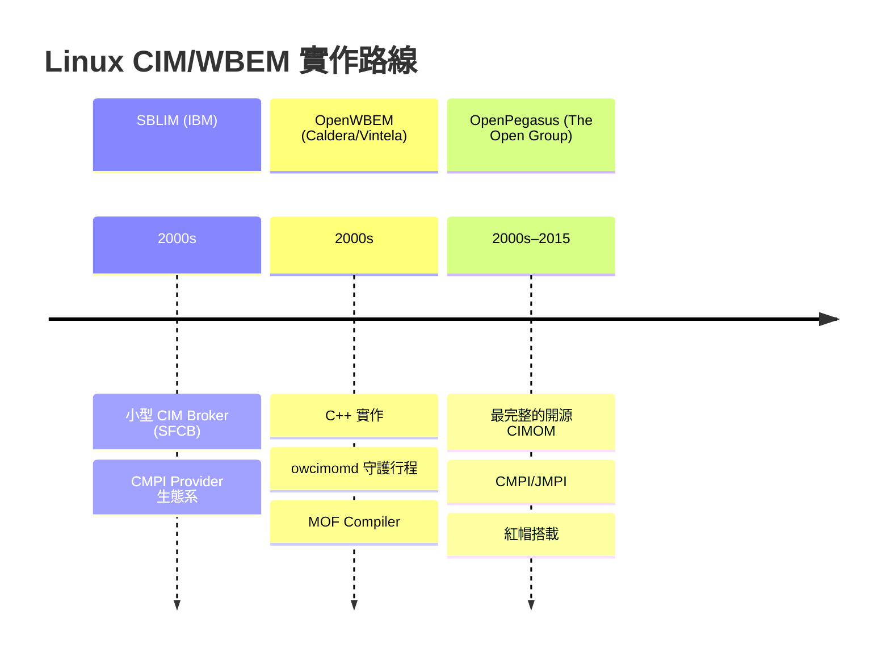
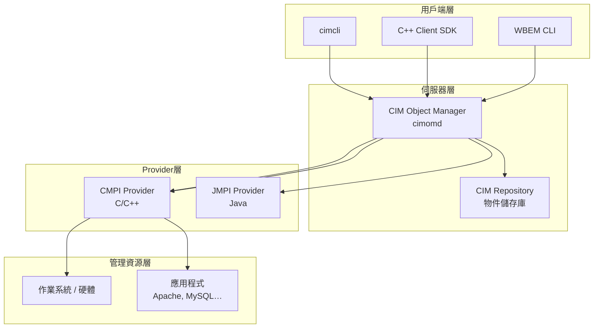
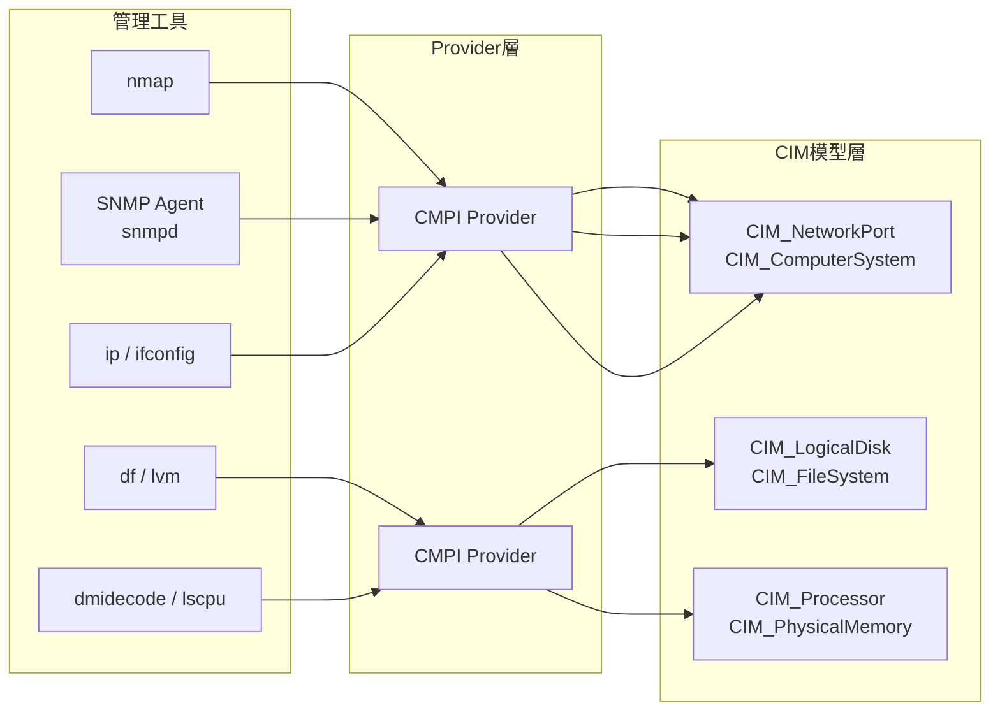

# Day 25：CIM 在 Linux 與 Solaris 的實作

昨天我們深入了 Windows 的 WMI 與 MI——CIM 在微軟生態系的完整實作——看到了 `mofcomp.exe`、PowerShell CIM Cmdlets、以及 `Win32_` 類別如何繼承 `CIM_` 基礎類別。今天——第五階段的最後一篇——我們將跨入開源領域，看看 **Linux 與 Solaris** 這兩個 UNIX 大家族如何實現 CIM/WBEM 標準。

你可能很少聽聞「Linux 上的 WBEM 伺服器」——但事實上，從 Red Hat Enterprise Linux 到 SUSE Linux Enterprise Server，從 Solaris 10 到 Ubuntu，CIM 的管理架構早已嵌入在這些作業系統的深層。只是它從未像 Windows WMI 那樣廣為人知[^wbem-wikipedia]。

## 三條路線：Linux 上的 CIM/WBEM 實作

CIM/WBEM 在 Linux 上並非由單一實作壟斷，而是形成了三條並行的技術路線——每一條都由不同的組織主導，有著不同的設計哲學與目標場景[^cim-wikipedia]：



### SBLIM：IBM 的輕量級路線

**SBLIM（Standards Based Linux Instrumentation for Manageability）**，發音為「sublime」，是 IBM 發起的開源專案，旨在為 Linux 帶來 WBEM 管理能力[^sblim-intro]。其核心理念是輕量——不追求完整企業級實作，而是提供夠用的小型元件。

SBLIM 專案託管於 SourceForge，採用 Common Public License 1.0 與 Eclipse Public License，最後更新約在 2015 年[^sblim-sourceforge]。

| 元件 | 說明 |
|------|------|
| **SFCB（Small Footprint CIM Broker）** | 輕量級 CIM Object Manager，Ubuntu 曾隨附 | 
| **SFCC（Small Footprint CIM Client）** | C 語言的輕量級 WBEM 客戶端函式庫 |
| **CIM Client for Java（JSR-48 API）** | 遵循 JSR-48（WBEM Services Specification）的 Java 客戶端 |
| **CMPI Providers 集合** | 為 Linux 子系統（DNS、Samba、DHCP、Router 等）撰寫的 Provider |
| **wbemcli** | WBEM 命令列介面工具 |
| **mofc** | MOF Compiler，編譯 MOF 至 CIM Repository |
| **ECUTE** | Extensible CIM UML Tooling Environment，CIM 建模工具[^sblim-components] |

SBLIM 的 CMPI（Common Manageability Programming Interface）Provider 架構是其實作的核心。IBM 曾將 CMPI 提交至 The Open Group 作為正式標準（v2.1，2016 年 2 月）[^cmpi-wikipedia]，使得基於 CMPI 撰寫的 Provider 可同時在不同的 WBEM 伺服器（SFCB、OpenPegasus、OMI）上運作——這與 Windows 的 Provider DLL 架構形成有趣的對比：Windows 要求 Provider 以 DLL 存在且綁定於 WMI Repository，而 CMPI 則定義了中立的程式介面。

### OpenWBEM：Caldera 的 C++ 實作

**OpenWBEM** 最初由 **Caldera International** 開發，後期由 **Vintela** 維護，以 BSD 授權釋出。其核心是 **CIMOM（CIM Object Manager）** 守護行程 `owcimomd`，以 C++ 撰寫[^openwbem-readme]。

OpenWBEM 的特色在於它是一個完整自足的 WBEM 伺服器，具備以下能力[^openwbem-faq]：

- **HTTP/HTTPS 通訊**：支援 CIM-XML over HTTP 與 HTTPS（OpenSSL）
- **多種認證機制**：PAM（系統使用者）、SIMPLE（文字檔）、Digest（RFC 2617 MD5）與 OWLocal
- **WQL Level 2**：完整支援 WBEM Query Language 第 2 級
- **Indications**：事件通知與監聽器支援
- **ACL（存取控制清單）**：以 Namespace 為粒度的權限控制
- **Privilege Separation**：Provider 與伺服器程式分離，降低安全風險
- **MOF Compiler（owmofc）**：自家的 MOF 編譯器

| 資訊 | 值 |
|------|-----|
| **最新版本** | 4.0.5 |
| **授權** | BSD-style |
| **主要語言** | C++ |
| **主要發行版** | SUSE Linux Enterprise Server 9 |
| **當前狀態** | 休眠（原始碼存檔於 GitHub）[^openwbem-github] |

OpenWBEM 的歷史意義在於它是 **第一個在 Linux 上實現完整 CIMOM 的開源專案**——早於 OpenPegasus，且被 Novell 的 SUSE Linux Enterprise Server 9 選為平台管理基礎設施的核心元件[^openwbem-novell]。

### OpenPegasus：最成熟的旗艦實作

**OpenPegasus** 是由 **The Open Group** 管理的 CIM/WBEM 開源實作，以 C++ 撰寫。它由 IBM、HP、微軟等多家廠商共同貢獻，是三者中**功能最完整、文件最完善、移植範圍最廣**的實作[^pegasus-arch]。

| 面向 | 說明 |
|------|------|
| **支援平台** | Linux、UNIX、OpenVMS、Windows |
| **主要發行版** | Red Hat Enterprise Linux 隨附，Fedora 曾收錄 |
| **通訊協定** | CIM-XML over HTTP/HTTPS + 自訂二進位協定 |
| **Provider 介面** | CMPI（C）、JMPI（Java）、C++ Provider |
| **版本** | 最新 2.14.1（2015 年 3 月） |
| **授權** | MIT 授權（透過 The Open Group） |
| **當前狀態** | 休眠，GitHub 唯讀[^pegasus-github] |

OpenPegasus 最具特色的功能是其**二進位協定**（`application/x-openpegasus`）：用戶端可以傳送二進位訊息而非 XML，部分操作因此提速達 **4 倍**——這在管理大量伺服器的場景下尤為重要[^pegasus-binary]。

OpenPegasus 的架構由以下層次構成[^pegasus-arch]：



## Solaris WBEM Services：Java 為核心的實作

不同於 Linux 三條路線都以 C/C++ 為主力，Sun Microsystems 在 **Solaris** 上選擇了一條截然不同的路徑——以 **Java** 為核心建構 WBEM/CIM 實作[^solaris-wbem]：

| 層次 | 元件 |
|------|------|
| **應用層** | `mofcomp`（MOF 編譯器）、`wbemadmin`（存取控管 GUI）、`smc`（Solaris Management Console） |
| **管理層** | CIM Object Manager（Java）、CIMOM Repository、Java Client API（`javax.wbem.cim`、`javax.wbem.client`） |
| **Provider 層** | Solaris Platform Providers、Solaris Platform Schema |

Solaris WBEM Services 的 MOF 檔案全部集中於 **`/usr/sadm/mof/`** 目錄下，涵蓋了從 Core 到 Solaris 平台專屬延伸的完整 Schema[^solaris-mof-files]：

| MOF 檔案 | 涵蓋領域 |
|----------|---------|
| `CIM_Core.mof` | DMTF 標準 Core Schema |
| `Solaris_Core.mof` | Solaris 平台核心類別（`Solaris_ComputerSystem` 等） |
| `Solaris_System.mof` | OS、行程、CPU 資訊、磁碟 I/O |
| `Solaris_Device.mof` | 處理器、序列埠、印表機、時間設定 |
| `Solaris_DMGT1.0.mof` | 磁碟、磁碟分割、裝置管理 |
| `Solaris_Network.mof` | 網路網域、IP 子網路、命名服務（NIS、NIS+、LDAP、DNS） |
| `Solaris_Application.mof` | 軟體套件與修補程式 |
| `Solaris_Project.mof` | Solaris 專案資料庫 |
| `Solaris_Users.mof` | 使用者帳號、群組、電子郵件別名 |
| `Solaris_VM2.0.mof` | 儲存裝置、Volume、RAID、Mirror |
| `Solaris_Acl.mof` | WBEM 存取控制清單安全類別 |
| `Solaris_Event.mof` | Solaris 專屬的 Indication Handler |
| `Solaris_Performance.mof` | 依使用者/專案計算的資源計量[^solaris-schema] |

Solaris 的 CIMOM 以 `/etc/init.d/init.wbem` 管理生命週期，從 `/etc/rc2.d/S90wbem` 自動啟動。管理工具包括[^solaris-tools]：

```bash
# 啟動 / 停止 / 狀態查詢
# /etc/init.d/init.wbem start
# /etc/init.d/init.wbem stop
# /etc/init.d/init.wbem status

# MOF 編譯（將 MOF 轉為 Java 類別並註冊至 CIMOM Repository）
# mofcomp Solaris_Schema.mof

# WBEM User Manager（GUI 管理 ACL）
# wbemadmin
```

Solaris 將 CIM/WBEM 實作在 Java 上的選擇，讓它具備了優異的可移植性與物件導向表達力——但也使其脫離了其他 Linux 實作的 C/C++ 生態系，形成了一個獨立的技術分支。

## 與 nmap、SNMP 工具的整合

CIM/WBEM 的架構並未止步於靜態的管理模型——透過 Provider 機制，它可以與現有的 Linux 管理工具深度整合[^cim-mapping]。

### Provider 的抽象化能力

無論是 SBLIM、OpenWBEM 還是 OpenPegasus，核心的整合模式是相同的：**Provider 作為「包裝層」，將既有工具的管理資料轉化為 CIM 物件**[^cmpi-wikipedia]。



具體的整合路徑如下：

1. **nmap 的 CIM 化**：撰寫一個 CMPI Provider，在內部呼叫 `nmap -oX <target>`（XML 輸出模式），解析 XML 結果，並將發現的主機映射為 `CIM_ComputerSystem` 實例、開放的連接埠映射為 `CIM_NetworkPort` 實例（屬性包含 `PortNumber`、`Speed`、`PermanentAddress`、`NetworkAddresses`）[^cim-networkport]

2. **SNMP 的 CIM 化**：CIM Schema 早已定義了 `CIM_SNMPService` 類別（代表 SNMP Agent，包含 Community String 與 UDP Endpoint 屬性），可透過 Provider 將 SNMP 的 MIB 資料對映至 CIM 物件階層——例如擷取 `IF-MIB::ifTable` 的資料並建立對應的 `CIM_NetworkInterface` 實例[^cim-snmpservice]

3. **Linux 系統資源的 CIM 化**：`CIM_Processor`、`CIM_PhysicalMemory`、`CIM_OperatingSystem`、`CIM_Process` 等標準類別可透過 Provider 包裝 `dmidecode`、`lscpu`、`/proc/cpuinfo`、`/proc/meminfo` 等傳統 Linux 資訊來源，使其統一以 CIM 物件的形式對外呈現[^cim-processor]

### OMI 的 Provider 範例

**OMI（Open Management Infrastructure）**——微軟與 The Open Group 合作的 C 語言 WBEM 實作（原名 NanoWBEM）——提供了一系列真實的 Provider 範例，展示如何包裝既有工具[^omi-github]：

| Provider | 包裝的目標 |
|----------|-----------|
| **MySQL Provider** | `mysqladmin` 與 MySQL C API，監控 MySQL 資料庫 |
| **Apache Provider** | Apache HTTPD 的狀態頁面與 mod_status |
| **Docker Provider** | Docker Engine API，管理容器生命週期 |
| **Python Script Provider** | 通用腳本式 Provider，可包裝任何命令列工具 |

這些 Provider 證明了一個關鍵事實：**CIM/WBEM 不需要管理目標原生支援 CIM**——只需一個 Provider 作為適配器（Adapter），就能將任何既有工具的管理資料轉化為標準的 CIM 物件模型[^omi-providers]。

## CIM 向 SNMP MIB 的對映機制

CIM 與 SNMP 的關係是「競爭與共存」的典型——CIM 的物件導向模型與 SNMP 的扁平 MIB 表格代表兩種不同的管理資訊哲學。但 DMTF 從未試圖讓 CIM 完全取代 SNMP，而是定義了 **CIM 向 SNMP 的對映方法**，使兩者可以互通[^dsp0004]。

### 對映原則

根據 **DSP0004（CIM Infrastructure Specification）**，CIM Infrastructure Specification 定義了 CIM 的架構、概念，以及「將 CIM 對映至其他資訊模型（如 SNMP）」的方法論[^dsp0004-wikipedia]：

| CIM 構成 | SNMP MIB 對映 |
|----------|---------------|
| **CIM Class（含 Property）** | MIB Object Type（含 SYNTAX 定義） |
| **CIM Association** | MIB Table Entry + INDEX |
| **CIM Method** | SNMP Set 操作 |
| **CIM Indication（Event）** | SNMP Trap / Notification |
| **CIM Property type** | SNMP SYNTAX（INTEGER、OCTET STRING、OBJECT IDENTIFIER 等） |

**關鍵的語意差異**：CIM 的 Association 可以表達多重關聯、繼承與聚合——這些在 SNMP MIB 中只能透過 Table 的 INDEX 鏈與 Row Status 間接模擬。這也是為什麼 CIM 文件將自己定位為「管理資訊模型」（Information Model），而 SNMP MIB 則是「管理資料模型」（Data Model）——兩者的抽象層次不同[^rfc3444]。

### DSP0002 與歷史脈絡

**DSP0002（DMI to SNMP Mapping Standard）** 是 DMTF 最早的管理模型對映標準，但它是為 **DMI（Desktop Management Interface）**——CIM 的前身——所設計的[^dsp0002]。DMI 是 DMTF 在 1990 年代中期的第一個管理框架，CIM 後來取代了它。

DMTF 並未發布一個單獨的「CIM to SNMP Mapping」標準文件。取而代之的是，DSP0004 將對映能力定義為 CIM Infrastructure 的一部分，而 **Managed Object Format（MOF，DSP0221）** 則提供了具體的語法機制[^dsp0221]。同時，DMTF 也發布了一系列其他協定的對映標準——例如 **DSP0100（CIM to LDAP Directory Mapping）** 與 **DSP0216（SM CLP to CIM）**[^dmtf-dsp-list]——展示了同樣的方法論可以被擴展到任何管理協定。

### 實際的整合場景

在真實的 IT 環境中，CIM 與 SNMP 的整合通常透過以下三種模式實現：

1. **Provider 橋接模式**：CIM Provider 內部使用 SNMP GET/GETNEXT/WALK 與既有 SNMP Agent 通訊，將資料轉化為 CIM 物件——這是 OpenPegasus CMPI Provider 的典型應用場景
2. **協定閘道模式**：一個專用的閘道（Gateway）同時暴露 CIM-XML/WS-Management 與 SNMP 兩套協定，在內部進行物件模型與資料模型的雙向對映
3. **混合管理模式**：管理平臺（如基於 pywbem 或 OpenPegasus 的管理系統）同時透過 CIM 查詢 WBEM 伺服器與 SNMP 查詢傳統 Agent，在應用層進行資料融合[^cim-snmpservice]

## 開源工具的當前狀態

回顧這三條 Linux 路線與 Solaris 實作，一個現實的現狀是：**傳統的 C/C++ CIMOM 專案已全面休眠**——SBLIM 最後更新於 2015 年，OpenPegasus 2.14.1 也是 2015 年，OpenWBEM 則更早。Solaris WBEM Services 隨著 Oracle 終止 Solaris 的活躍發展而不再更新。

然而，這並不代表 CIM/WBEM 已死亡。新一代實作正在承接旗艦角色：

- **pywbem 1.9.1（2026-08-31）**——純 Python 的 WBEM 客戶端，活躍維護中，是當前最易入手、最適合自動化整合的選擇[^pywbem-readme]
- **OMI（Open Management Infrastructure）**——微軟開源的 C 語言 WBEM 實作，支援 CMPI Provider，可在現代 Linux 發行版上編譯
- **CIM Schema 持續更新**——v2.56.0（2026 年 1 月）仍由 DMTF 定期發布，代表標準本身並未停滯

## 小結

1. **Linux 三條路線**：SBLIM（IBM 輕量級，含 SFCB/SFCC 與 CMPI Provider 生態系）、OpenWBEM（Caldera 的 C++ CIMOM，被 SUSE Linux Enterprise 採用）、OpenPegasus（The Open Group 的旗艦實作，功能最完整，被 RHEL 隨附）。
2. **Solaris 獨特的 Java 路徑**：Solaris WBEM Services 以 Java 為核心，將 CIMOM、Provider 與工具（`mofcomp`、`wbemadmin`）全面建構在 Java 生態之上，MOF 檔案集中於 `/usr/sadm/mof/`。
3. **整合能力**：CIM/WBEM 的 Provider 架構可以包裝任何既有工具（nmap、SNMP Agent、`dmidecode` 等），將其管理資料轉化為標準 CIM 物件。OMI 的 MySQL/Apache/Docker Provider 證明了此模式的可行性。
4. **CIM ↔ SNMP 對映**：DSP0004 定義了 CIM 向 SNMP MIB 對映的方法論——Class → Object Type、Association → Table、Method → Set、Indication → Trap。兩者的本質差異在於 CIM 是「資訊模型」而 SNMP MIB 是「資料模型」[^rfc3444]。
5. **當前世代的轉移**：傳統 C/C++ CIMOM 全面休眠，但 pywbem、OMI 與持續更新的 CIM Schema 確保了 CIM 標準的生命力。CIM 從厚重的企業管理框架演變為輕量的模型化資料標準——其物件導向的管理模型思想，比具體的伺服器實作更長壽。

明天——第六階段的開始——我們將從具體實作層面拉升到應用場景，探索 CIM 在 **DASH（Desktop and mobile Architecture for System Hardware）** 中的角色，看看桌面管理與行動裝置管理如何受益於這個標準。

[^sblim-intro]: SourceForge. (2022). SBLIM — Standards Based Linux Instrumentation for Manageability. Retrieved 2026-10-03, from https://sourceforge.net/projects/sblim/
[^sblim-sourceforge]: SourceForge. (2022). SBLIM — Files & Components. Retrieved 2026-10-03, from https://web.archive.org/web/20220121093026/https://sourceforge.net/projects/sblim/files/
[^sblim-components]: Wikipedia. (2026). Standards Based Linux Instrumentation for Manageability. Retrieved 2026-10-03, from https://en.wikipedia.org/wiki/Standards_Based_Linux_Instrumentation_for_Manageability
[^wbem-wikipedia]: Wikipedia. (2026). Web-Based Enterprise Management. Retrieved 2026-10-03, from https://en.wikipedia.org/wiki/Web-Based_Enterprise_Management
[^cim-wikipedia]: Wikipedia. (2026). Common Information Model (computing). Retrieved 2026-10-03, from https://en.wikipedia.org/wiki/Common_Information_Model_(computing)
[^cmpi-wikipedia]: Wikipedia. (2026). Common Manageability Programming Interface. Retrieved 2026-10-03, from https://en.wikipedia.org/wiki/Common_Manageability_Programming_Interface
[^openwbem-readme]: kkaempf. (n.d.). OpenWBEM — README. GitHub. Retrieved 2026-10-03, from https://github.com/kkaempf/openwbem
[^openwbem-faq]: kkaempf. (n.d.). OpenWBEM FAQ. GitHub. Retrieved 2026-10-03, from https://github.com/kkaempf/openwbem/blob/main/doc/openwbem-faq.html
[^openwbem-github]: kkaempf. (n.d.). OpenWBEM — Source Code Repository. GitHub. Retrieved 2026-10-03, from https://github.com/kkaempf/openwbem
[^openwbem-novell]: Novell. (2004). Novell Supports OpenWBEM for Linux Management. Retrieved 2026-10-03, from https://github.com/kkaempf/openwbem/blob/main/doc/Novell_supports_OpenWBEM.html
[^pegasus-arch]: The Open Group. (n.d.). OpenPegasus Architecture Overview. Retrieved 2026-10-03, from https://web.archive.org/web/20220119104111/https://collaboration.opengroup.org/pegasus/
[^pegasus-github]: jonromanovmoore. (n.d.). OpenPegasus — Source Code. GitHub. Retrieved 2026-10-03, from https://github.com/jonromanovmoore/openpegasus
[^pegasus-binary]: The Open Group. (n.d.). OpenPegasus Binary Protocol. Retrieved 2026-10-03, from https://github.com/kkaempf/openwbem/blob/main/doc/OpenWBEM_Binary_Compatibility.html
[^solaris-wbem]: Oracle. (2012). Solaris WBEM Developer's Guide — About Solaris WBEM Services. Retrieved 2026-10-03, from https://docs.oracle.com/cd/E19253-01/817-0366/chap-ov-23345/index.html
[^solaris-mof-files]: Oracle. (2012). Solaris WBEM Developer's Guide — Solaris Platform Schema. Retrieved 2026-10-03, from https://docs.oracle.com/cd/E19253-01/817-0366/appschema-10/index.html
[^solaris-schema]: Oracle. (2012). Solaris WBEM Developer's Guide — Schema Files List. Retrieved 2026-10-03, from https://docs.oracle.com/cd/E19253-01/817-0366/appschema-10/index.html
[^solaris-tools]: Oracle. (2012). Solaris WBEM Developer's Guide — MOF Compiler & init.wbem. Retrieved 2026-10-03, from https://docs.oracle.com/cd/E19253-01/817-0366/auto20/index.html
[^cim-mapping]: DMTF. (n.d.). DSP0004 — CIM Infrastructure Specification. Retrieved 2026-10-03, from https://www.dmtf.org/dsp/DSP0004
[^cim-networkport]: DMTF. (2026). CIM Schema v2.56.0 — CIM_NetworkPort Class. Retrieved 2026-10-03, from https://schemas.dmtf.org/wbem/cim-html/2.55.0/CIM_NetworkPort.html
[^cim-snmpservice]: DMTF. (2026). CIM Schema v2.56.0 — CIM_SNMPService Class. Retrieved 2026-10-03, from https://schemas.dmtf.org/wbem/cim-html/2.55.0/CIM_SNMPService.html
[^cim-processor]: DMTF. (2026). CIM Schema v2.56.0 — CIM_Processor Class. Retrieved 2026-10-03, from https://schemas.dmtf.org/wbem/cim-html/2.55.0/CIM_Processor.html
[^omi-github]: Microsoft. (n.d.). Open Management Infrastructure — Providers. GitHub. Retrieved 2026-10-03, from https://github.com/Microsoft/omi
[^omi-providers]: The Open Group. (n.d.). OMI Provider Developer Guide. Retrieved 2026-10-03, from https://github.com/Microsoft/omi
[^dsp0004-wikipedia]: DMTF. (n.d.). DSP0004 — CIM Infrastructure Specification (via Wikipedia). Retrieved 2026-10-03, from https://en.wikipedia.org/wiki/Common_Information_Model_(computing)
[^dsp0221]: DMTF. (2015). DSP0221 — Managed Object Format (MOF) Specification v3.0.0. Retrieved 2026-10-03, from https://www.dmtf.org/dsp/DSP0221
[^dsp0002]: DMTF. (n.d.). DSP0002 — DMI to SNMP Mapping Standard. Retrieved 2026-10-03, from https://www.dmtf.org/dsp/DSP0002
[^dmtf-dsp-list]: DMTF. (n.d.). DMTF Standards — All Documents. Retrieved 2026-10-03, from https://www.dmtf.org/dsp/all
[^rfc3444]: Watson, B. & Taylor, D. (2003). RFC 3444 — Information Model vs Data Model. IETF. Retrieved 2026-10-03, from https://datatracker.ietf.org/doc/rfc3444/
[^pywbem-readme]: pywbem. (2026). pywbem — Python WBEM Client Library. Retrieved 2026-10-03, from https://github.com/pywbem/pywbem