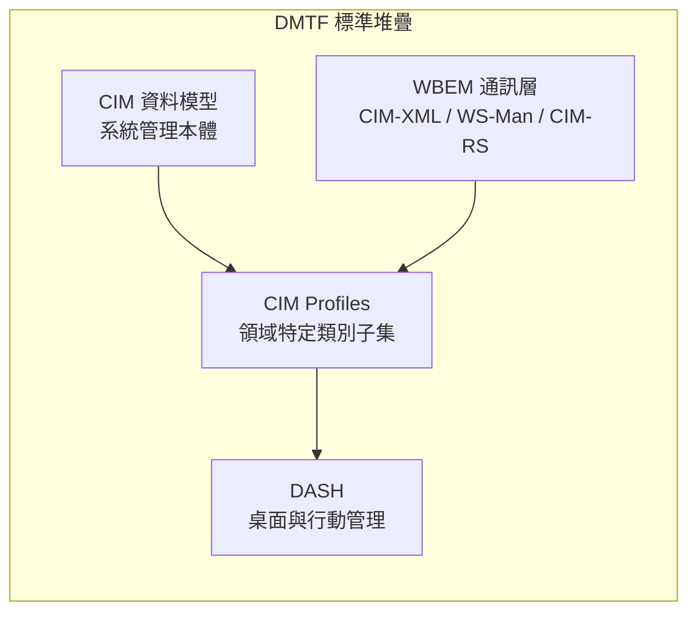
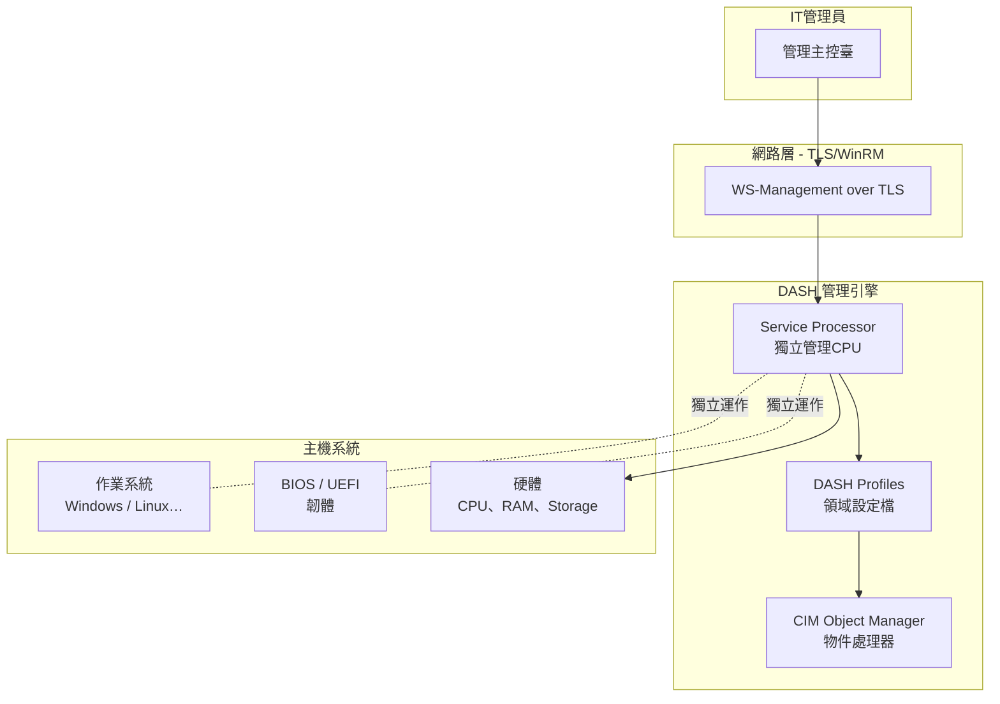
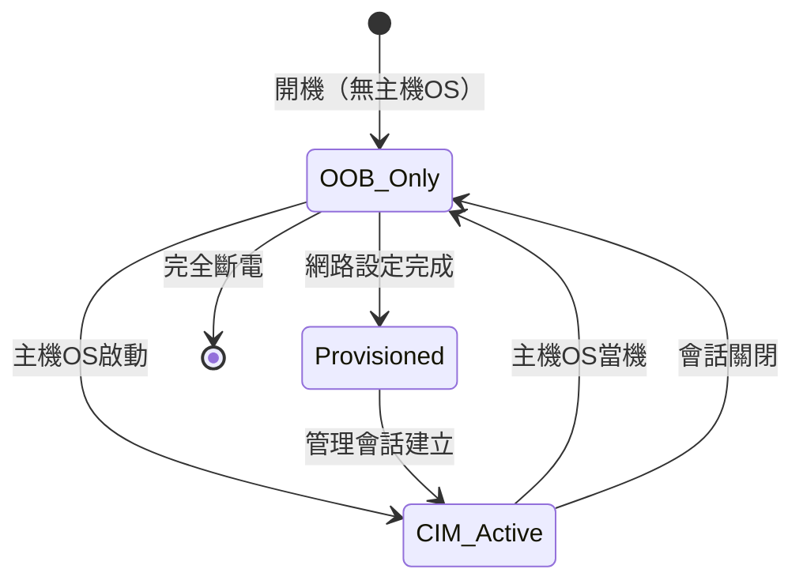

# Day 26：DASH — 桌管與行動裝置管理的 CIM 應用

昨天我們告別了第五階段，完成了從 OpenPegasus、pywbem 到 Windows WMI 與 Linux/Solaris 實作的全面巡禮。今天——第六階段的第一篇——我們將視角從「個別平台上的實作」拉高到「應用場景」，看看 DMTF 如何利用 CIM 與 WBEM 堆疊，為**桌面與行動裝置的管理**打造了一個完整的標準架構：**DASH（Desktop and mobile Architecture for System Hardware）**。

如果你曾經使用過 Intel vPro 平台遠端管理一台商用筆記型電腦，或者透過 Dell iDRAC 或 HP iLO 控制遠端系統——那麼你已經在不知不覺中使用了 DASH 技術[^dash-overview]。

## DASH 的基本定位

### 什麼是 DASH？

DASH 是一套由 DMTF 制定的標準套件，目標是為**桌面電腦（Desktop）與行動裝置（Mobile Client）** 提供基於網頁服務（Web Services）的管理能力[^dash-dmtf]：

| 面向 | 說明 |
|------|------|
| **管理範圍** | 桌面 PC、筆記型電腦、工作站、精簡型用戶端 |
| **管理方式** | 頻外（Out-of-Band, OOB）管理 — 不依賴主機 OS |
| **底層協定** | WS-Management（DSP0226）— SOAP 為基礎 |
| **資料模型** | CIM — 所有管理資源以 CIM 類別呈現 |
| **狀態** | 活躍標準 — DSP0232 v1.5.0 於 2026 年 4 月發佈[^dsp0232] |

DASH 的核心價值一句話概括：**讓 IT 管理人員能夠透過標準化的方式，遠端管理一台桌面或筆記型電腦——無論它的作業系統正在執行、當機、還是根本尚未安裝。**

### CIM 在 DASH 中的角色

DASH 並不是從零發明一套管理模型——它完全建構在 **CIM 之上**[^dash-white-paper]。如同我們在這系列前面幾週所學到的，CIM 提供了一個完整的物件導向管理模型，而 DASH 就是將這個模型「裁剪」為桌面與行動裝置這個特定場景：



具體來說，DASH 從完整的 CIM Schema（數百個類別）中選取與桌面/行動平台管理相關的類別，組成 **DASH Profiles**，並透過 **WS-Management** 協定進行操作[^dash-white-paper]。

## DASH 的架構與組成

### 四層堆疊

DASH 的技術架構由四個層次構成[^wsman-spec]：

| 層次 | 說明 | DMTF 規範 |
|------|------|-----------|
| **Transport（傳輸層）** | HTTP/HTTPS 承載 SOAP 訊息 | HTTP 1.1 + TLS 1.2+ |
| **Protocol（協定層）** | WS-Management 定義的管理操作（Get、Put、Create、Delete、Enumerate、Subscribe、Execute） | DSP0226 |
| **Binding（綁定層）** | WS-Management CIM Binding — 將 CIM 類別操作對映至 WS-Management 的 SOAP 方法 | DSP0227 |
| **Profiles（設定檔層）** | 領域特定的 CIM 類別子集，定義可操作的屬性與方法 | ~38 個 DSP 設定檔 |

### 38 個 CIM Profiles 的分類

DASH 定義了約 **38 個** CIM Profiles，覆蓋桌面與行動裝置管理的各個面向[^dash-profiles]：

**核心與基礎（Mandatory）**
| DSP | 名稱 | 版本 | 日期 |
|-----|------|------|------|
| **DSP1058** | **Base Desktop and Mobile Profile**（所有 DASH 實作必須實作） | 1.0.1 | 2010-09-15 |
| DSP1034 | Simple Identity Management Profile（身分鑑別） | 1.1.0 | 2012-12-13 |
| DSP1039 | Role Based Authorization Profile（角色授權） | 1.0.0 | 2008-10-31 |

**硬體與資產管理**
| DSP | 名稱 |
|-----|------|
| DSP1011 | Physical Asset Profile（硬體資產資訊） |
| DSP1022 | CPU Profile（處理器資訊） |
| DSP1026 | System Memory Profile（記憶體模組） |
| DSP1075 | PCI Device Profile（PCI 裝置） |
| DSP1030 | Battery Profile（電池狀態） |
| DSP1052 | Computer System Profile（系統識別與狀態） |
| DSP1108 | Physical Computer System View Profile（實體系統視圖） |

**感測器與環境（Sensors Profile 仍持續更新）**
| DSP | 名稱 | 最新版本 |
|-----|------|----------|
| **DSP1009** | **Sensors Profile**（溫度、電壓、轉速感測器） | **v1.2.0（2024-01-04）** |

**電源管理**
| DSP | 名稱 |
|-----|------|
| DSP1027 | Power State Management Profile（電源狀態：開機、關機、重啟、休眠） |
| DSP1015 | Power Supply Profile（電源供應單元） |
| DSP1013 | Fan Profile（散熱風扇） |
| DSP1085 | Power Utilization Management Profile（電力使用管理） |

**開機與韌體**
| DSP | 名稱 |
|-----|------|
| DSP1012 | Boot Control Profile（開機順序、下次開機裝置） |
| DSP1061 | BIOS Management Profile（BIOS 設定管理） |
| DSP1023 | Software Inventory Profile（軟體庫存） |
| DSP1025 | Software Update Profile（更新套用） |

**遠端控制（Redirection）**
| DSP | 名稱 |
|-----|------|
| DSP1076 | KVM Redirection Profile（鍵盤/滑鼠/螢幕重新導向） |
| DSP1086 | Media Redirection Profile（ISO 映像重新導向） |
| DSP1077 | USB Redirection Profile（USB 重新導向） |
| DSP1024 | Text Console Redirection Profile（文字主控臺重新導向） |

**網路**
| DSP | 名稱 |
|-----|------|
| DSP1035 | Host LAN Network Port Profile（主機 LAN 連接埠） |
| DSP1014 | Ethernet Port Profile（乙太網路埠） |
| DSP1036 | IP Interface Profile（IP 介面設定） |
| DSP1037 | DHCP Client Profile（DHCP 用戶端設定） |
| DSP1038 | DNS Client Profile（DNS 用戶端設定） |
| DSP1116 | IP Configuration Profile（IP 設定） |

**其他**
| DSP | 名稱 |
|-----|------|
| DSP1018 | Service Processor Profile（服務處理器/BMC） |
| DSP1040 | Platform Watchdog Profile（看門狗計時器） |
| DSP1029 | OS Status Profile（作業系統狀態） |
| DSP1054 | Indication Profile（事件通知） |
| DSP1010 | Record Log Profile（記錄日誌） |
| DSP1074 | Indicator LED Profile（指示燈 LED） |
| DSP1070 | Opaque Management Data Profile（不透明管理資料） |
| DSP1017 | SSH Service Profile |
| DSP1016 | Telnet Service Profile |

### DSP0232：DASH 的實作藍圖

**DSP0232（DASH Implementation Requirements Specification）** 是最重要的文件——它將上述 38 個設定檔組織為一個可驗證的標準[^dsp0232]：

| 角色 | 內容 |
|------|------|
| **定義必備設定檔** | 哪些設定檔對 DASH 實作是強制性的（Mandatory）與選擇性的（Optional） |
| **指定合規等級** | 定義不同合規層次（Core、Standard、Advanced 等） |
| **安全要求** | 認證（TLS 用戶端/伺服器憑證）、授權（RBAC）、加密 |
| **Profile Registration** | 裝置如何公告其支援的設定檔 |
| **版本規範** | 版本 1.5.0（2026-04-11），仍在持續演進 |

值得注意的是，DSP0232 的最新版本 v1.5.0 僅發布於 **2026 年 4 月**——這意味著 DASH 不是一個「已完成的標準」，而是一個仍在**持續活躍發展**的標準[^dash-year-review]。

## 頻外管理（Out-of-Band）通訊

### 什麼是頻外管理？

DASH 最關鍵的能力是**頻外管理（Out-of-Band, OOB）**[^dash-white-paper]：透過一個獨立於主機 CPU、記憶體與作業系統的**服務處理器（Service Processor）** 來執行管理操作。



這樣的設計帶來了幾個關鍵特性[^dash-oob]：

**獨立於主機狀態：**
| 主機狀態 | 是否可以管理？ |
|----------|:-------------:|
| 正常執行（OS Running） | ✅ |
| 作業系統當機（OS Hung/Crashed） | ✅ |
| 休眠／睡眠（Sleep/Hibernate） | ✅ |
| 關機（Powered Off，Wake-on-LAN 模式） | ✅（遠端喚醒） |
| 尚未安裝 OS（裸機） | ✅（遠端安裝） |

**DASH 頻外的四大操作類別：**

1. **遠端控制（Remote Console）** — KVM 重新導向（看見並控制遠端螢幕、鍵盤、滑鼠）、文字主控臺重新導向、USB 裝置重新導向、媒體重新導向（掛載遠端 ISO 映像）
2. **電源管理（Power Management）** — 遠端開機、關機、重啟、強制電源循環（Power Cycle）
3. **開機與韌體管理（Boot & Firmware）** — 變更開機順序、設定下次開機裝置、遠端更新/設定 BIOS/UEFI
4. **監控與事件（Monitoring & Events）** — 硬體感測器讀取（溫度、電壓、風扇轉速）、系統事件記錄、硬體資產清查

### 服務處理器 Profile（DSP1018）

服務處理器（Service Processor）是 DASH 頻外管理的核心硬體元件。在 Intel vPro 平台上，它對應的是 **Intel Management Engine（ME）**；在 Dell 系統上，對應的是 **iDRAC（Integrated Dell Remote Access Controller）**[^dsp1018]。

CIM 中由 `CIM_ServiceProcessor` 類別（定義於 DSP1018）來建模這個元件，其屬性包括：

| 屬性 | 說明 | CIM 資料型別 |
|------|------|-------------|
| `ServiceProcessorType` | 處理器類型（Intel ME、Dell iDRAC、HP iLO 等） | 字串列舉 |
| `FirmwareVersion` | 服務處理器韌體版本 | 字串 |
| `SupportedProfiles` | 支援的 DASH Profile 清單 | ProfileReference 陣列 |
| `PrimaryNetworkInterface` | 管理網路介面（通常與主機 LAN 分離） | Reference |

## 三種通訊模式

DASH 的裝置可以處於三種不同的通訊狀態[^dash-arch]：



| 模式 | 說明 | WS-Management 會話 |
|------|------|:------------------:|
| **OOB Only** | 服務處理器已啟動，管理介面可存取，主機尚未啟動 | 可建立管理者會話 |
| **Provisioning** | 網路設定（DHCP/DNS/IP）已就緒 | 可在管理子網路中發現 |
| **CIM Active** | CIM Object Manager 正在執行，管理操作可正常執行 | 完整管理能力 |

## WS-Management over TLS 的實作

DASH 所有的管理通訊都透過 WS-Management over TLS 來保護[^wsman-spec]：

### 傳輸層安全

```
管理主控臺                          DASH 裝置（服務處理器）
    │                                    │
    │ 1. TCP 連線（Port 443）             │
    │──────────────────────────────────>│
    │ 2. TLS 交握（雙方憑證驗證）          │
    │<──────────────────────────────────>│
    │ 3. WS-Management 身分鑑別            │
    │   <Envelope>                        │
    │     <Header>                        │
    │       <Security wsu:Id="..." />     │
    │       - 使用者名稱 / 數位憑證       │
    │     </Header>                       │
    │     <Body>                          │
    │       <Authenticate />              │
    │     </Body>                         │
    │   </Envelope>                       │
    │──────────────────────────────────>│
    │ 4. RBAC 授權檢查                     │
    │ 5. CIM 操作（Get/Put/Execute...）    │
    │<──────────────────────────────────>│
```

### 安全架構的三層防護

| 層次 | 機制 | 規範 |
|------|------|------|
| **傳輸層** | TLS 1.2+（伺服器憑證、可選用戶端憑證） | RFC 8446 |
| **認證層** | Simple Identity Management Profile（DSP1034）：支援使用者名稱/密碼、數位憑證、Kerberos 等機制 | DSP0232 §5 |
| **授權層** | Role Based Authorization Profile（DSP1039）：定義管理員、操作員、檢視者等角色及其權限 | DSP0232 §6 |

### 授權模型

DSP1039 定義了三種標準角色[^dsp1039]：

| 角色 | 權限 | 範例操作 |
|------|------|----------|
| **Administrator** | 所有操作（包括設定與安全配置） | Create/Delete 物件、修改安全設定 |
| **Operator** | 日常管理操作，但不含安全設定變更 | Put（修改屬性）、Execute（執行方法） |
| **Viewer** | 唯獨讀取權限 | Get、Enumerate |

## 現實世界的實作與產品

### 主要 OEM 的 DASH 支援

截至 2026 年，已有超過 **900 個產品** 通過 DASH 符合性測試[^dash-cert]：

| 廠商 | 已認證產品數 | 技術平台 |
|------|:-----------:|----------|
| **Dell Technologies** | 498 | iDRAC（Integrated Dell Remote Access Controller） |
| **HP, Inc.** | 243 | iLO（Integrated Lights-Out） |
| **Lenovo** | 102 | 聯想 ThinkSystem BMC |
| **AMD** | 13 | Ryzen Pro 平台管理引擎 |
| **Intel Corporation** | 4 | vPro / Active Management Technology（AMT） |
| **Fujitsu** | 1 | FUJITSU Server iRMC |
| **VAIO Corporation** | 1 | VAIO 管理控制介面 |
| **Positivo / NCS / Daten** | 7 | 巴西市場商用機型 |

值得注意的是，DASH 的符合性測試仍然活躍——僅 2024 年就有 **82 個產品** 通過 DASH CTS 2024 測試，2025 年則有 **48 個產品** 通過 DASH CTS 2025 測試[^dash-cert]。

### 代表性實作：Intel vPro 與 AMT

Intel vPro 是最廣為人知的 DASH 實作[^intel-vpro]。自 2009 年起，Intel 在 Business PC 平台上整合了 **Active Management Technology（AMT）**，其核心特性包括：

| vPro/AMT 功能 | 對應的 DASH Profile |
|---------------|:------------------:|
| 遠端桌面控制（KVM） | DSP1076 KVM Redirection Profile |
| 遠端電源管理 | DSP1027 Power State Management Profile |
| 遠端開機裝置設定 | DSP1012 Boot Control Profile |
| 硬體感測器監控 | DSP1009 Sensors Profile |
| 硬體資產清查 | DSP1011 Physical Asset Profile |
| 系統事件記錄 | DSP1010 Record Log Profile |
| 遠端 BIOS 設定 | DSP1061 BIOS Management Profile |
| 作業系統狀態查詢 | DSP1029 OS Status Profile |

Intel 在 DASH 生態系中扮演了重要角色——不僅貢獻了 vPro/AMT 實作，Jeff Leung（Intel）也是 DMTF CPPSWG（CIM Profiles for Platforms and Services Working Group）的共同主席[^dash-dmtf]。

### Dell iDRAC 與 psDcim

Dell 的 iDRAC（Integrated Dell Remote Access Controller）是另一個廣泛部署的 DASH 實作。Dell 甚至開源了 **psDcim**——一組 PowerShell 的 WS-Management Cmdlets，讓 IT 管理人員可以直接從指令列使用 WS-Management 控制 iDRAC[^psdcim]：

```powershell
# 使用 psDcim 查詢 Dell 伺服器的 DASH 管理資源
Import-Module psDcim

# 建立 WS-Management 連線
$session = New-PSDRS -Address "idrac-ip" -Username "admin" -Password "****"

# 查詢 DASH Base Profile 支援的類別
$managedElements = Get-DRS -Session $session -CimClass "CIM_ManagedElement"

# 取得系統資訊（對應 CIM_ComputerSystem）
$system = Get-DRS -Session $session -CimClass "CIM_ComputerSystem"
```

### DASH Conformance Test Suite（CTS）

DMTF 提供了一套 **DASH Conformance Test Suite（CTS）**，讓廠商可以自行驗證其實作是否符合標準[^dash-cts]：

| CTS 版本 | 年份 | 提交產品數 |
|----------|:----:|:----------:|
| DASH CTS 1.0 | 2009–2015 | 109 |
| DASH CTS 2016–2018 | 2016–2018 | ~50 |
| DASH CTS 2022.1/2022.2 | 2022 | ~30 |
| DASH CTS 2023 | 2023 | 22 |
| DASH CTS 2024 | 2024 | 82 |
| DASH CTS 2025 | 2025 | 48（截至更新） |

廠商使用 CTS 進行自我測試，然後將**數位簽署的結果**提交給第三方管理員驗證——驗證通過後，產品被列入 DMTF Certification Registry。這個機制確保了**跨廠商的互通性**：一台 Dell 的管理主控臺可以透過標準的 WS-Management 控制一台 HP 或 Lenovo 的裝置，無需使用廠商專屬的 API[^dash-cert]。

## DASH 與相關標準的比較

### DASH vs. SMASH

這組比較尤為重要，因為 DASH 與 SMASH 是姊妹標準——我們將在明天詳細討論 SMASH。關鍵差異如下[^smash-overview]：

| 面向 | DASH | SMASH |
|------|------|-------|
| **目標平台** | 桌面 PC、筆記型電腦、行動裝置 | 伺服器（機架、刀鋒、直立） |
| **通訊協定** | WS-Management（SOAP over HTTP/HTTPS） | WS-Management + **SM CLP（命令列協定）** |
| **基礎 Profile** | DSP1058（Base Desktop and Mobile Profile） | DSP1004（Base Server Profile） |
| **CLP 支援** | 無 | 有（SM CLP，ISO/IEC 13187:2011） |
| **架構白皮書** | DSP2014 | DSP2001 |
| **共同點** | CIM 資料模型、WS-Management 通訊、Profiles 架構、同一個工作群組（CPPSWG） | 同上 |

### DASH vs. IPMI

DASH 與 IPMI（Intelligent Platform Management Interface）之間有著微妙的關係[^ipmi-dash]：

| 面向 | DASH | IPMI |
|------|------|------|
| **標準化組織** | DMTF | Intel 主導 → IPMI Forum → 現已移交給 DMTF |
| **誕生年份** | 2006–2007 初版 | 1998（IPMI v1.0） |
| **協定特性** | SOAP/XML over HTTP/HTTPS | 二進位指令集 over RMCP（UDP 623） |
| **資料模型** | CIM（物件導向、以類別為基礎） | IPMI SDR/FRU（以感測器記錄為基礎） |
| **管理範圍** | 頻外 + 頻內（In-Band） | 主要為頻外 |
| **現代性** | 新開發建議採用 DASH | 被視為「舊版」介面 |

DMTF 在 2023 年年報中明確指出，新開發的 **MMBI（Modern Management Bus Interface）** 標準「取代了像 IPMI KCS 這樣的舊版介面」[^dash-year-review]。這意味著 DMTF 正在逐步以 DASH/SMASH/MMBI 等新標準取代 IPMI。

### DASH vs. Redfish

Redfish 是由 DMTF 開發的另一個現代管理標準，但定位與 DASH 不同：

| 面向 | DASH | Redfish |
|------|------|---------|
| **目標** | 桌面與行動裝置 | 資料中心伺服器與儲存 |
| **協定** | WS-Management（SOAP） | RESTful API（JSON over HTTPS） |
| **資料模型** | CIM | Schema.org 風格的簡單模型 |
| **標準化** | DSP0232 | DSP8010–DSP8030 |
| **生態系** | Intel vPro、Dell iDRAC、HP iLO | 超微、HPE、Dell 新世代伺服器 |

更精確地說，DASH 聚焦於用戶端端點（Client）的頻外管理，而 Redfish 則是現代伺服器管理的 RESTful 標準。兩者共享 CIM 作為資料模型的 DNA，但面向不同的應用場景。

## 實例：一台筆記型電腦的 DASH 管理會話

以下展示一個真實的 DASH 管理場景：IT 管理員遠端管理一台遺失的企業筆記型電腦。

### 步驟 1：發現與認證

管理主控臺透過子網路探測（Probe）發現支援 WS-Management 的 DASH 裝置，然後建立 TLS 連線並進行身份鑑別[^wsman-example]：

```xml
<!-- 簡化後的 WS-Management 身分鑑別請求 -->
<soap:Envelope xmlns:soap="http://schemas.xmlsoap.org/soap/envelope/">
  <soap:Header>
    <wsman:Security xmlns:wsman="http://schemas.dmtf.org/wbem/wsman/1"
                    wsu:Id="auth">
      <wsman:UsernameToken>
        <wsman:Username>admin</wsman:Username>
        <wsman:Password>****</wsman:Password>
      </wsman:UsernameToken>
    </wsman:Security>
  </soap:Header>
  <soap:Body>
    <wsman:Authenticate />
  </soap:Body>
</soap:Envelope>
```

### 步驟 2：查詢系統狀態

使用 WS-Management Enumerate 操作列舉所有 `CIM_ComputerSystem` 實例[^cim-computersystem]：

```xml
<soap:Envelope ...>
  <soap:Header>
    <wsman:Action>http://schemas.dmtf.org/wbem/wsman/1/enumerate</wsman:Action>
  </soap:Header>
  <soap:Body>
    <wsman:Enumerate>
      <cim:CIM_ComputerSystem />
    </wsman:Enumerate>
  </soap:Body>
</soap:Envelope>
```

### 步驟 3：遠端電源關閉

獲取 `CIM_PowerState` 實例並執行 `RequestPowerStateChange` 方法[^cim-powerstate]：

```xml
<soap:Envelope ...>
  <soap:Header>
    <wsman:Action>http://schemas.dmtf.org/wbem/wsman/1/execute</wsman:Action>
  </soap:Header>
  <soap:Body>
    <wsman:Execute>
      <cim:CIM_PowerState>
        <cim:InstanceID>powerstate-001</cim:InstanceID>
        <cim:RequestedPowerState>8</cim:RequestedPowerState>
        <!-- 8 = Power Off (Hard Graceful Shutdown) -->
      </cim:CIM_PowerState>
    </wsman:Execute>
  </soap:Body>
</soap:Envelope>
```

這個過程說明了 CIM 模型如何與 WS-Management 協定協作：管理員的操作對象是 CIM 類別（`CIM_ComputerSystem`、`CIM_PowerState`），而操作本身（Enumerate、Execute）則由 WS-Management 定義。

## 小結

| 面向 | 總結 |
|------|------|
| **DASH 的本質** | 基於 CIM 的桌面與行動裝置管理標準，使用 WS-Management over TLS 進行頻外通訊 |
| **核心架構** | ~38 個 CIM Profiles，由 DSP0232 組織為可驗證的標準套件 |
| **頻外能力** | 可管理完全斷電或 OS 當機的裝置——獨立於主機 CPU/OS |
| **安全模型** | TLS + 身分鑑別（DSP1034）+ 角色授權（DSP1039）的三層保護 |
| **現實影響** | Intel vPro/AMT、Dell iDRAC、HP iLO、Lenovo ThinkSystem — 累計超過 900 個認證產品 |
| **標準狀態** | **活躍**— CTS 2025 持續更新，DSP0232 v1.5.0 於 2026 年 4 月發佈 |
| **與 CIM 的關係** | DASH 是 CIM 在用戶端管理場景的具體應用——所有管理資源皆以 CIM 類別建模 |

明天，我們將繼續第六階段，探索 CIM 在**資料中心伺服器管理**的應用——**SMASH（Systems Management Architecture for Server Hardware）**——看看 DASH 的「老大哥」如何在機房規模下管理成千台伺服器。

[^dash-overview]: DMTF. (n.d.). DASH Overview. Retrieved 2026-10-03, from https://www.dmtf.org/standards/dash
[^dash-dmtf]: DMTF. (n.d.). DASH — Desktop and mobile Architecture for System Hardware. Retrieved 2026-10-03, from https://www.dmtf.org/standards/dash
[^dsp0232]: DMTF. (2026). DSP0232 — DASH Implementation Requirements Specification v1.5.0. Retrieved 2026-10-03, from https://www.dmtf.org/standards/dash
[^dash-white-paper]: DMTF. (2007). DSP2014 — Systems Management Architecture for Mobile and Desktop Hardware White Paper v1.1.0. Retrieved 2026-10-03, from https://www.dmtf.org/standards/dash
[^wsman-spec]: DMTF. (2014). DSP0226 — Web Services for Management (WS-Management) Specification v1.2.0. Retrieved 2026-10-03, from https://www.dmtf.org/standards/wsman
[^dash-profiles]: DMTF. (n.d.). DASH Standards Documents List (Profiles). Retrieved 2026-10-03, from https://www.dmtf.org/standards/dash
[^dash-oob]: DMTF. (2007). DASH Technology Note — DASH Delivers Multi-Vendor Management for Desktop and Mobile Systems v1.0.0. Retrieved 2026-10-03, from https://www.dmtf.org/standards/dash
[^dsp1018]: DMTF. (2013). DSP1018 — Service Processor Profile v1.1.1. Retrieved 2026-10-03, from https://www.dmtf.org/standards/dash
[^dash-arch]: DMTF. (2007). DSP2014 — Systems Management Architecture for Mobile and Desktop Hardware v1.1.0. Retrieved 2026-10-03, from https://www.dmtf.org/standards/dash
[^dsp1039]: DMTF. (2008). DSP1039 — Role Based Authorization Profile v1.0.0. Retrieved 2026-10-03, from https://www.dmtf.org/standards/dash
[^dash-cert]: DMTF. (n.d.). DMTF Certification Registry. Retrieved 2026-10-03, from https://registry.dmtf.org/
[^intel-vpro]: Intel Corporation. (n.d.). Intel vPro Platform — Active Management Technology (AMT). Retrieved 2026-10-03, from https://www.intel.com/content/www/us/en/vpro/vpro-technology.html
[^psdcim]: DMTF. (n.d.). psDcim — PowerShell WS-Management Cmdlets for iDRAC. Retrieved 2026-10-03, from https://www.dmtf.org/content/psdcim-powershell-ws-man-cmdlets-idrac
[^dash-cts]: DMTF. (2025). DASH Conformance Test Suite Continues Momentum. Retrieved 2026-10-03, from https://www.dmtf.org/content/dmtfs-dash-conformance-test-suite-continues-momentum
[^smash-overview]: DMTF. (n.d.). SMASH — Systems Management Architecture for Server Hardware. Retrieved 2026-10-03, from https://www.dmtf.org/standards/smash
[^ipmi-dash]: DMTF. (2023). ICYMI: 2023 Year-in-Review. Retrieved 2026-10-03, from https://www.dmtf.org/content/icymi-2023-year-review
[^dash-year-review]: DMTF. (2023). ICYMI: 2023 Year-in-Review. Retrieved 2026-10-03, from https://www.dmtf.org/content/icymi-2023-year-review
[^wsman-example]: DMTF. (2010). WS-Management CIM Binding Specification DSP0227 v1.2.0. Retrieved 2026-10-03, from https://www.dmtf.org/standards/wsman
[^cim-computersystem]: DMTF. (2026). CIM Schema v2.56.0 — CIM_ComputerSystem class definition. Retrieved 2026-10-03, from https://www.dmtf.org/schema/cim
[^cim-powerstate]: DMTF. (2016). DSP1027 — Power State Management Profile v2.0.1. Retrieved 2026-10-03, from https://www.dmtf.org/standards/dash