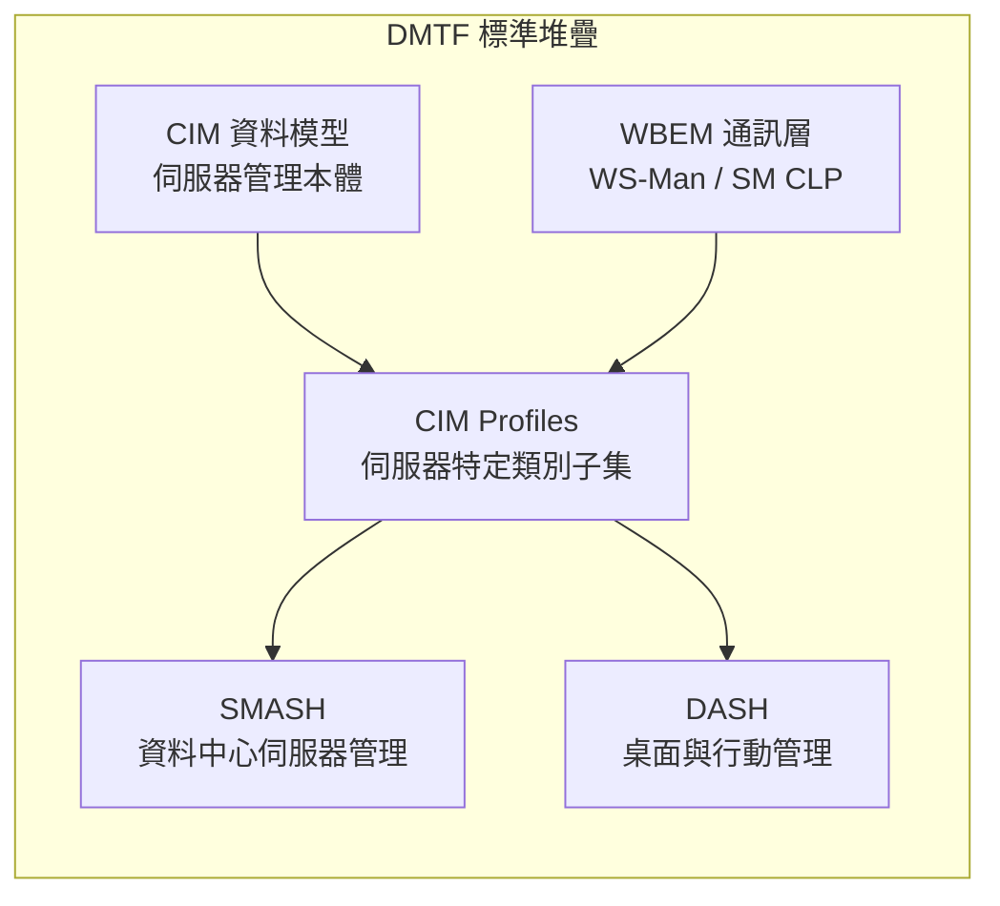
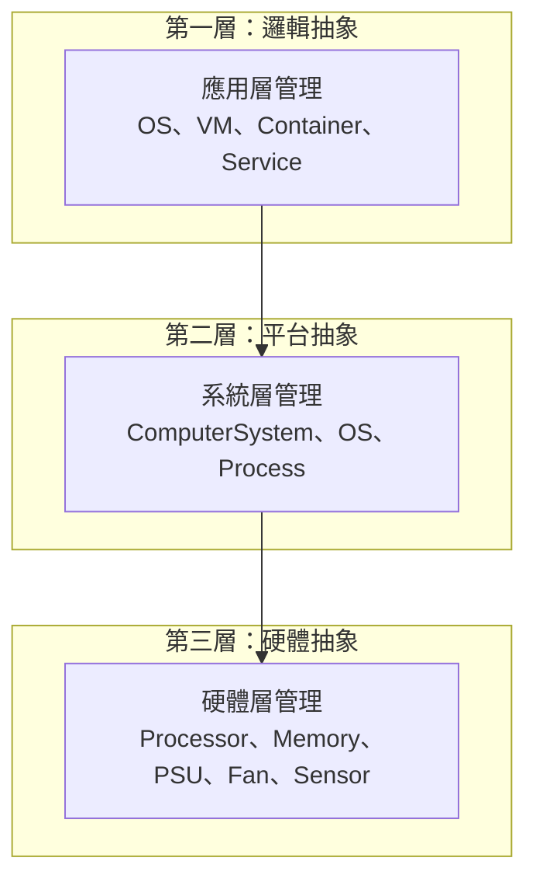

# Day 27：SMASH — 資料中心伺服器管理的 CIM 應用

昨天我們探索了 DASH——CIM 在桌面與行動裝置管理領域的應用。今天，我們將視角從用戶端轉向資料中心，看 DASH 的「老大哥」：**SMASH（Systems Management Architecture for Server Hardware）**——DMTF 為資料中心伺服器管理打造的完整標準架構。

如果你曾經使用過 Dell iDRAC、HP iLO 或 Cisco UCS 的管理介面來遠端管理一台機架伺服器——無論是查詢硬體資產、更新韌體、還是強制電源重啟——那你實際上已經觸及了 SMASH 的技術內核[^smash-overview]。

## SMASH 的基本定位

### 什麼是 SMASH？

SMASH 是一套由 DMTF 制定的標準套件，目標是為**資料中心伺服器**提供以標準化、廠商中立的方式進行遠端管理的整體架構[^smash-dmtf]：

| 面向 | 說明 |
|------|------|
| **管理範圍** | 機架伺服器（Rack）、刀鋒伺服器（Blade）、直立伺服器（Tower） |
| **管理方式** | 頻外（Out-of-Band）+ 頻內（In-Band）— 獨立於主機 OS 或透過 OS 驅動 |
| **兩大方塊協定** | WS-Management（SOAP 網頁服務，與 DASH 共用） + **SM CLP（命令列協定）** |
| **資料模型** | CIM — 所有管理資源以 CIM 類別呈現 |
| **標準化地位** | SM CLP 獲 ISO/IEC 13187:2011 及 ANSI INCITS 438-2008 採用[^iso-13187] |

SMASH 的核心價值一句話概括：**讓資料中心管理人員能夠以標準化的命令列或網頁服務介面，管理來自不同廠商的伺服器——無論伺服器執行什麼作業系統、是否開機、甚至是否有作業系統存在**[^smash-whitepaper]。

### CIM 在 SMASH 中的角色

與 DASH 完全一致——SMASH 的管理模型完全建構在 CIM 之上。SMASH 從完整的 CIM Schema 中選取與伺服器管理相關的類別，組成 **SMASH Profiles**，並透過 **WS-Management** 或 **SM CLP** 進行操作[^smash-cim]：



## SM CLP：伺服器管理的命令列標準

SMASH 最獨特之處——也使其與 DASH 最大不同的——是 **SM CLP（Server Management Command Line Protocol）**。這是一個專為伺服器管理設計的命令列協定，已獲 ISO/IEC 13187:2011 與 ANSI INCITS 438-2008 認可為國際標準[^incits-438]。

### 設計哲學

SM CLP 的設計反映了資料中心管理的實際需求：管理員需要一種**快速、可靠、可腳本化的方式**，在成千台伺服器上執行一致的管理操作，而不必每一次都啟動一個完整的 GUI 或 Web 介面[^sm-clp-intro]。

### Verb-Noun 語法

SM CLP 採用**動詞（Verb）— 目標（Target/Noun）** 的語法結構，與 IPMItool 或 Cisco IOS 的命令風格一致[^dsp0214]：

```
<verb> <target> [options] [arguments]
```

| 標準動詞 | 分類 | 說明 |
|----------|------|------|
| `cd` | 導航 | 變更目前管理上下文／目錄 |
| `show` | 查詢 | 顯示管理元素的屬性 |
| `set` | 修改 | 設定或修改管理元素的屬性 |
| `create` | 建立 | 建立新的管理元素實例 |
| `delete` | 刪除 | 移除管理元素實例 |
| `start` | 狀態控制 | 啟動管理元素（如開機） |
| `stop` | 狀態控制 | 停止管理元素（如關機） |
| `reset` | 狀態控制 | 重置管理元素 |
| `load` | 資料傳輸 | 載入資料或設定至管理元素 |
| `dump` | 資料傳輸 | 傾印管理元素的診斷資訊 |
| `help` | 資訊 | 顯示命令說明 |
| `version` | 資訊 | 顯示 CLP 版本資訊 |
| `exit` | 會話控制 | 結束 CLP 會話 |
| `oemverb` | 延伸 | 廠商自訂動詞 |

### UFIP 與 UFCT：CIM 的路徑化定址

SM CLP 如何定位 CIM 模型中的一個物件？答案是一組稱為 **UFIP（User Friendly Instance Path）** 與 **UFCT（User Friendly Class Tag）** 的定位系統[^dsp0224]：

UFIP 值必須符合正規表達式 `(/([a-z]+[0-9]*)+`，例如：

| UFIP 範例 | 對應 CIM 類別 |
|-----------|---------------|
| `/sys1` | `CIM_ComputerSystem` 的某個實例 |
| `/sys1/cpu2` | 該系統的第二個處理器 |
| `/chassis1/fan3` | 第一個機殼的第三個風扇 |
| `/chassis1/psu1` | 第一個機殼的第一個電源供應單元 |

UFCT 則是類別的小寫名稱，如 `computersystem`、`processor`、`fan`、`powersupply`。

### 實際範例：SM CLP 管理會話

以下是一位管理員透過 SSH 連線到伺服器的 SM CLP 服務——檢查系統狀態、重新開機——的完整會話[^sm-clp-example]：

```
clp> show /sys1
UFIT:         computersystem1
UFIP:         /sys1
Name:         Dell PowerEdge R750
Vendor:       Dell Technologies
Model:        PowerEdge R750
SerialNumber: ABC1234567
CPUs:         2
Memory:       131072 MB
PowerState:   2 (On)

clp> show /sys1/cpu1
UFIT:         processor1
UFIP:         /sys1/cpu1
Name:         Intel Xeon Gold 6427L
Cores:        24
Threads:      48
Speed:        2.8 GHz
Temperature:  52 °C

clp> show /chassis1/fan3
UFIT:         fan3
UFIP:         /chassis1/fan3
Name:         Fan 3 (Rear)
Speed:        7200 RPM
SpeedTarget:  7200 RPM
Status:       1 (Normal)

clp> reset /sys1 -examine
EXAMINE: This would reset system /sys1 (PowerCycle).
  All running processes will be terminated.
  This operation cannot be undone.
  Use 'reset /sys1' without -examine to execute.

clp> reset /sys1
Status: COMMAND COMPLETED
Timestamp: 20261003T143500.000000+0000
```

### DSP0224：回饋的 XML 結構

SM CLP 的回饋可用四種格式輸出：文字（預設）、XML（clpxml）、表格（table）與 CSV。當使用 `-format clpxml` 時，回饋遵循 **DSP0224（SM CLP Command Response XML Schema）**[^dsp0224-schema]：

```xml
<response>
  <command>
    <inputline>show /sys1/cpu1</inputline>
  </command>
  <cmdstat>
    <status>0</status>
    <status_tag>COMMAND COMPLETED</status_tag>
  </cmdstat>
  <show>
    <target>
      <instance>
        <ufit ufct="processor" instance="1">processor1</ufit>
        <ufip>/sys1/cpu1</ufip>
        <properties>
          <property>
            <name>Cores</name>
            <value><val>24</val></value>
            <type>uint32</type>
          </property>
          <property>
            <name>Speed</name>
            <value><val>2800</val></value>
            <units>MHz</units>
          </property>
        </properties>
      </instance>
    </target>
  </show>
</response>
```

## SMASH 的 Profile 架構

與 DASH 的 38 個 Profile 對應，SMASH 也定義了一套完整的 Profile 集合。以下依功能領域分組[^smash-profiles]：

### 核心 SMASH 專屬 Profiles

| DSP | 名稱 | 版本 |
|-----|------|------|
| **DSP1004** | **Base Server Profile**（所有 SMASH 實作必須實作） | 1.0.1 |
| DSP1005 | CLP Service Profile（SM CLP 服務設定） | 1.0.1 |
| DSP1006 | SMASH Collections Profile（管理元素集合） | 1.0.0 |
| DSP1007 | SM CLP Admin Domain Profile（管理網域） | 1.0.0 |
| DSP1008 | Modular Systems Profile（刀鋒機箱與模組化系統） | 1.0.0 |

### 硬體拓撲與資產管理

| DSP | 名稱 |
|-----|------|
| DSP1052 | Computer System Profile |
| DSP1108 | Physical Computer System View Profile |
| DSP1019 | Device Tray Profile（刀鋒機匣） |
| DSP1020 | Pass-Through Module Profile |
| DSP1021 | Shared Device Management Profile |
| DSP1011 | Physical Asset Profile |
| DSP1022 | CPU Profile |
| DSP1026 | System Memory Profile |
| DSP1075 | PCI Device Profile |

### 電源、散熱與感測器

| DSP | 名稱 |
|-----|------|
| DSP1027 | Power State Management Profile |
| DSP1015 | Power Supply Profile |
| DSP1085 | Power Utilization Management Profile |
| DSP1013 | Fan Profile |
| DSP1009 | Sensors Profile |
| DSP1040 | Platform Watchdog Profile |
| DSP1074 | Indicator LED Profile |

值得特別注意的是 **Power State Management Profile（DSP1027）**——SMASH 的版本為 **v2.0.1（2016-08）**，比 DASH 的對應版本更晚且定義了更完整的伺服器電源狀態模型，包括 Soft Shutdown、Hard Power Off、Power Cycle、Sleep/Wake 等多種模式[^dsp1027]。

### 開機與韌體

| DSP | 名稱 |
|-----|------|
| DSP1012 | Boot Control Profile |
| DSP1061 | BIOS Management Profile |
| DSP1023 | Software Inventory Profile |
| DSP1025 | Software Update Profile |
| DSP1067 | Software ID Tag Profile |

### 遠端控制與安全

| DSP | 名稱 |
|-----|------|
| DSP1076 | KVM Redirection Profile |
| DSP1086 | Media Redirection Profile |
| DSP1024 | Text Console Redirection Profile |
| DSP1034 | Simple Identity Management Profile |
| DSP1039 | Role Based Authorization Profile |
| DSP1016 | Telnet Service Profile |
| DSP1017 | SSH Service Profile |

## SMASH 與 DASH 的比較

| 面向 | DASH | SMASH |
|------|------|-------|
| **全名** | Desktop and mobile Architecture for System **Hardware** | Systems Management Architecture for **Server** Hardware |
| **目標平台** | 桌面 PC、筆記型電腦、行動裝置 | 機架伺服器、刀鋒伺服器、直立伺服器 |
| **開端年份** | ~2005–2006 | ~2007 |
| **CLP 支援** | 無 | 有（SM CLP，ISO/IEC 13187:2011） |
| **核心 Profile** | DSP1058（Base Desktop and Mobile Profile） | DSP1004（Base Server Profile） |
| **電源 Profile 版本** | DSP1027 v1.0.0 | DSP1027 v2.0.1（更豐富的伺服器電源模型） |
| **白皮書** | DSP2014 | DSP2001 |
| **共同基礎** | CIM + WS-Management + Profiles 架構 + 同一個工作群組（CIM Forum） |

## 現實世界的實作

### Oracle ILOM（Integrated Lights Out Manager）

Oracle 在 Sun 伺服器（x86 與 SPARC）的 ILOM 韌體中支援以下 SMASH Profiles[^oracle-ilom]：

| Profile | 說明 |
|---------|------|
| DSP1004 | Base Server Profile |
| DSP1018 | Service Processor Profile |
| DSP1011 | Physical Asset Profile |
| DSP1009 | Sensors Profile（溫度、電壓、風扇） |
| DSP1022 | CPU Profile |
| DSP1026 | System Memory Profile |
| DSP1074 | Indicator LED Profile |
| DSP1010 | Record Log Profile |

Oracle 的 CIM 類別以 `Oracle_`（原 `Sun_`）為前綴，作為 CIM 基礎類別的平台專屬延伸。CIM 物件的完整清單可透過 WS-Management 的 `Enumerate` 操作查詢[^oracle-smash]。

### Cisco UCS（Unified Computing System）

Cisco 為其 UCS 伺服器系列發布了一份 **Cisco UCS SMASH Reference Guide**，記錄了支援的 SMASH Profiles 與 CIM 類別[^cisco-ucs]。管理員可透過 **Cisco UCS Manager** 使用 WS-Management 或 SM CLP 管理 UCS 伺服器。

### VMware vSphere / ESXi

VMware 的 vSphere ESXi 7.0 支援 **SMASH 1.0.0**[^vmware-smash]。VMware 提供了一份 **CIM SMASH/Server Management API Programming Guide**，讓開發者可以基於 SMASH 開發管理應用程式。VMware 的 CIM API 支援 WS-Management 與 SM CLP 兩種協定。

### HP ProLiant / iLO 與 Dell PowerEdge / iDRAC

HP 與 Dell 均為 SMASH 2.0 初期的支持者[^smash-2.0-announce]。HP 的 iLO（Integrated Lights-Out）與 Dell 的 iDRAC（Integrated Dell Remote Access Controller）在 WS-Management 層面上與 SMASH 相容（Dell 的 iDRAC 同時支援 DASH 與 SMASH 的 Profile 子集）。

### Broadcom TruManage

Broadcom 透過在其乙太網路控制器中嵌入 WS-Management 功能來支援 SMASH——這意味著伺服器即使在不啟用專屬 BMC 的情況下，也可具備基本的 SMASH 管理能力[^broadcom-wsman]。

## 大規模資料中心的 CIM 實踐

### 標準化管理流程

SMASH 最重要的實戰價值在於**大規模管理的一致性**[^datacenter-cim]。假設一個資料中心同時有 Dell、HP 與 Cisco 的伺服器——沒有 SMASH 時，需要三種不同的管理工具與三種不同的命令語法。有了 SMASH：

```bash
# SMASH 下：所有伺服器的管理指令語法一致
#
# 查詢所有伺服器的 CPU 溫度（無論 Dell/HP/Cisco）
for server in $(cat datacenter-hosts.txt); do
    clp --host $server "show /sys1/cpu1" \
        | grep "Temperature"
done

# 批次執行韌體版本清查
for server in $(cat datacenter-hosts.txt); do
    clp --host $server "show /sys1" \
        | grep "FirmwareVersion"
done
```

### CIM 對映的三層抽象

資料中心規模的 CIM 實踐，通常將管理物件抽象為三個層次[^cim-mapping-datacenter]：



透過 CIM 的繼承機制，廠商可以直接從標準 CIM 類別延伸出自己的平臺專屬類別：Dell 的 `Dell_ComputerSystem`、HP 的 `HP_ComputerSystem`、Oracle 的 `Oracle_ComputerSystem`——都繼承自同一個 `CIM_ComputerSystem`。管理員的操作對象是基礎類別，操作結果在不同廠商之間保持一致[^cim-inheritance]。

### 與 IPMI 的比較與過渡

SMASH 與 IPMI（Intelligent Platform Management Interface）的關係值得釐清[^ipmi-history]：

| 面向 | SMASH | IPMI |
|------|-------|------|
| **標準化組織** | DMTF（CIM Forum） | Intel → IPMI Forum → DMTF（2023 年移交） |
| **誕生** | 2007（SM CLP 於 2006） | 1998（IPMI v1.0） |
| **協定** | SM CLP + WS-Management（SOAP/XML） | 二進位指令集 over RMCP（UDP 623） |
| **資料模型** | CIM（數百個物件導向類別） | SDR/FRU（以感測器記錄為基礎的簡單模型） |
| **現代性** | 活躍發展 | 淡出（DMTF 在 2023 年年報中明確指出由 MMBI 取代舊版 IPMI KCS 等介面）[^dmtf-2023-review] |

SMASH 並非 IPMI 的直接替代品——它們在許多場景下並存。但從標準化趨勢看，新開發的管理解決方案應優先採用 SMASH/DASH/Redfish 等 DMTF 現代標準。

## 小結

| 面向 | 總結 |
|------|------|
| **SMASH 的本質** | 基於 CIM 的資料中心伺服器管理標準，提供 WS-Management（網頁服務）與 SM CLP（命令列）兩種管理協定 |
| **SM CLP 的獨特價值** | ISO/IEC 13187:2011 認證的標準命令列協定——以 Verb-Noun 語法操作 CIM 物件，可腳本化、可批次化 |
| **核心架構** | 以 Base Server Profile（DSP1004）為核心，搭配約 30+ 個 SMASH Profiles 涵蓋拓撲、電源、散熱、開機、韌體、安全等面向 |
| **現實影響** | Oracle ILOM、Cisco UCS、VMware ESXi、HP iLO、Dell iDRAC——五大主要伺服器平台均有 SMASH 實作 |
| **與 DASH 的關係** | 姊妹標準——共用 CIM 模型與 WS-Management 協定，DASH 聚焦用戶端，SMASH 聚焦伺服器 |
| **標準狀態** | SM CLP 已獲 ISO 與 ANSI 認可，SMASH Implementation Requirements（DSP0217）v2.1.0 仍為現行版本 |

明天，我們將繼續第六階段，探索 CIM 在**企業儲存管理**的應用——**SMI-S（SNIA Storage Management Initiative - Specification）**——看看儲存廠商如 EMC、NetApp 如何利用 CIM 統一儲存網路的管理模型。

[^smash-overview]: DMTF. (n.d.). SMASH — Systems Management Architecture for Server Hardware. Retrieved 2026-10-03, from https://www.dmtf.org/standards/smash
[^smash-dmtf]: DMTF. (n.d.). SMASH Overview. Retrieved 2026-10-03, from https://www.dmtf.org/standards/smash
[^iso-13187]: ISO. (2011). ISO/IEC 13187:2011 — Information Technology — Server Management Command Line Protocol (SM CLP) Specification. Retrieved 2026-10-03, from https://www.iso.org/standard/53458.html
[^smash-whitepaper]: DMTF. (2007). DSP2001 — System Management Architecture for Server Hardware Whitepaper v2.0.0. Retrieved 2026-10-03, from https://www.dmtf.org/standards/smash
[^smash-cim]: DMTF. (n.d.). SMASH Technical Overview (CIM in SMASH). Retrieved 2026-10-03, from https://www.dmtf.org/standards/smash
[^incits-438]: ANSI. (2008). ANSI INCITS 438-2008 — Server Management Command Line Protocol (SM CLP). Retrieved 2026-10-03, from https://webstore.ansi.org/standards/incits/ansiincits4382008
[^sm-clp-intro]: DMTF. (2006). DSP0214 — Server Management Command Line Protocol Specification v1.0.2. Retrieved 2026-10-03, from https://www.dmtf.org/dsp/DSP0214
[^dsp0214]: DMTF. (2006). DSP0214 — SM CLP Specification v1.0.2 (Verb-Noun syntax definition). Retrieved 2026-10-03, from https://www.dmtf.org/dsp/DSP0214
[^dsp0224]: DMTF. (2006). DSP0224 — SM CLP Command Response XML Schema v1.0.0. Retrieved 2026-10-03, from https://schemas.dmtf.org/smash/commandresponse/1.0.0/dsp0224.xsd
[^dsp0224-schema]: DMTF. (2006). DSP0224 — SM CLP Command Response XML Schema v1.0.0 (Status codes, error types, UFIP/UFCT definitions). Retrieved 2026-10-03, from https://schemas.dmtf.org/smash/commandresponse/1.0.0/dsp0224.xsd
[^sm-clp-example]: DMTF. (2006). DSP0214 — SM CLP Specification v1.0.2 (Command examples section). Retrieved 2026-10-03, from https://www.dmtf.org/dsp/DSP0214
[^smash-profiles]: DMTF. (n.d.). DMTF Management Profiles (SMASH Profiles List). Retrieved 2026-10-03, from https://www.dmtf.org/standards/profiles
[^dsp1027]: DMTF. (2016). DSP1027 — Power State Management Profile v2.0.1. Retrieved 2026-10-03, from https://www.dmtf.org/standards/profiles
[^oracle-ilom]: Oracle. (n.d.). Oracle ILOM SMASH Profile Support — Sun Server Platform Management. Retrieved 2026-10-03, from https://docs.oracle.com/cd/E24707_01/html/E24528/z40003481394725.html
[^oracle-smash]: Oracle. (n.d.). Oracle ILOM CIM/SMASH Overview Documentation. Retrieved 2026-10-03, from https://docs.oracle.com/cd/E19860-01/E21549/z40003481018446.html
[^cisco-ucs]: Cisco. (n.d.). Cisco UCS SMASH Reference Guide — Supported Profiles and CIM Classes. Retrieved 2026-10-03, from https://www.cisco.com/c/en/us/td/docs/unified_computing/ucs/sw/utilities/smash/reference/guide/ucs_smash_reference/Introduction.pdf
[^vmware-smash]: Broadcom. (n.d.). CIM SMASH/Server Management API Programming Guide — VMware vSphere 7.0. Retrieved 2026-10-03, from https://techdocs.broadcom.com/us/en/vmware-cis/vsphere/vsphere-sdks-tools/7-0/cim-smash-server-management-api-programming-guide/
[^smash-2.0-announce]: DMTF. (2007). DMTF Releases Next Generation SMASH 2.0 Initiative (HP, Dell, AMD, Intel, IBM, Microsoft announcements). Retrieved 2026-10-03, from https://www.dmtf.org/news/pr/2007/9/dmtf-releases-next-generation-smash-20-initiative
[^broadcom-wsman]: Broadcom. (n.d.). WS-Management Support in Broadcom Ethernet Controllers (TruManage). Retrieved 2026-10-03, from https://techdocs.broadcom.com/
[^datacenter-cim]: DMTF. (2007). DSP2001 — System Management Architecture for Server Hardware Whitepaper v2.0.0 (Datacenter management use cases). Retrieved 2026-10-03, from https://www.dmtf.org/standards/smash
[^cim-mapping-datacenter]: DMTF. (2009). DSP0216 — SM CLP to CIM Common Mapping Specification v1.0.0. Retrieved 2026-10-03, from https://www.dmtf.org/dsp/DSP0216
[^cim-inheritance]: DMTF. (2026). CIM Schema v2.56.0 (CIM_ComputerSystem class hierarchy). Retrieved 2026-10-03, from https://www.dmtf.org/schema/cim
[^ipmi-history]: DMTF. (2023). ICYMI: 2023 Year-in-Review (IPMI transition to DMTF, MMBI replacement). Retrieved 2026-10-03, from https://www.dmtf.org/content/icymi-2023-year-review
[^dmtf-2023-review]: DMTF. (2023). ICYMI: 2023 Year-in-Review (Legacy interfaces like IPMI KCS being replaced by MMBI). Retrieved 2026-10-03, from https://www.dmtf.org/content/icymi-2023-year-review