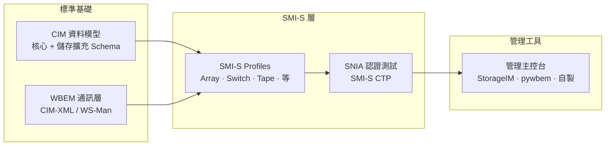
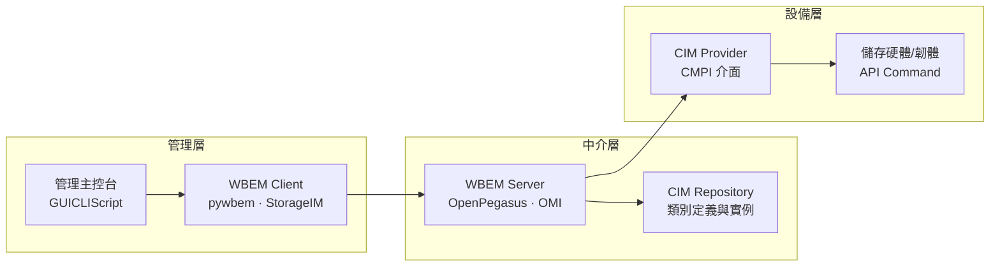
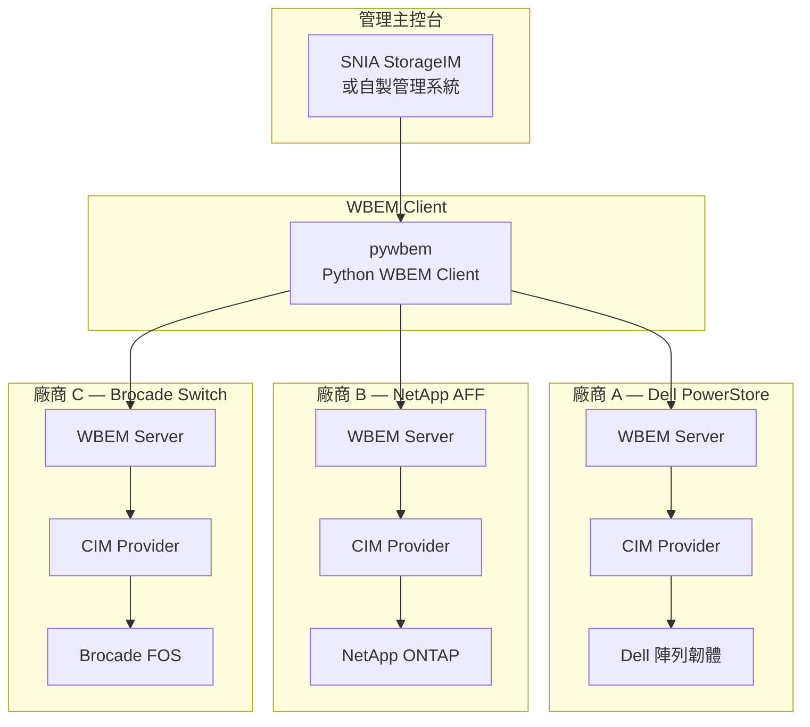

# Day 28：SMI-S — 企業儲存管理的 CIM 應用

昨天我們深入了 SMASH——資料中心伺服器管理的 CIM 應用。今天，我們將視角從伺服器轉向儲存：**SMI-S（Storage Management Initiative – Specification）**——由 SNIA（Storage Networking Industry Association）維護的企業儲存管理標準，也是 CIM 在儲存領域最成熟、最具規模的實戰應用。

如果你曾經使用過企業管理工具同時監控 Dell EMC、NetApp、HPE 3PAR 與 IBM Storwize 等不同廠商的磁碟陣列——那些統一的管理介面背後，極有可能就是 SMI-S 在發揮作用[^snia-smi-s]。

## SMI-S 的定位：為什麼 CIM 適合儲存管理？

### 儲存管理的核心挑戰

企業資料中心通常同時部署來自多家廠商的儲存設備——包括磁碟陣列（Disk Array）、光纖通道交換器（Fibre Channel Switch）、磁帶櫃（Tape Library）、虛擬化儲存引擎等。每家廠商的設備各有其管理介面、API 和資料模型，形成嚴重的 **管理碎片化**[^snia-smi-s-intro]。

SMI-S 的目標正是解決這個問題——它建基於 DMTF 的 CIM 與 WBEM 標準之上，為儲存管理定義了一套**廠商中立、跨平台、標準化**的管理模型與通訊協定[^smi-s-wiki]。

### SMI-S 技術堆疊



SMI-S 不是從零發明的新模型，而是在 CIM 的既有架構上定義**儲存專屬的 Profile**，並透過 SNIA 的認證計畫確保跨廠商互通性[^dmtf-cim-wbem]。

## 儲存專屬 Schema 與 Profile

### CIM Schema 中的儲存領域

在 DMTF 維護的 CIM Schema（目前 v2.56.0，2026 年 1 月釋出）中，儲存相關的類別散佈在多個領域子集[^dmtf-cim-schema]：

| 領域模組 | 代表類別 | 管理範疇 |
|----------|----------|----------|
| **Device** | `CIM_StoragePool`、`CIM_StorageVolume`、`CIM_DiskDrive` | 磁碟與容量抽象 |
| **System** | `CIM_ComputerSystem`、`CIM_FileSystem`、`CIM_Directory` | 主機與檔案系統 |
| **Network** | `CIM_NetworkPort`、`CIM_FCPort`、`CIM_ProtocolEndpoint` | 光纖通道與網路埠 |
| **Physical** | `CIM_PhysicalPackage`、`CIM_PhysicalMedia`、`CIM_TapeDrive` | 實體元件與媒體 |
| **Security** | `CIM_AuthorizationSubject`、`CIM_Credential` | 存取控制與認證 |

### SMI-S 的主要 Profile

一部實際的 SMI-S 規格書（ISO/IEC 24775，多部分構成）定義了數十個 Profile，以下是最核心的幾個[^smi-s-parts]：

| Profile 名稱 | 管理對象 | 典型實作 |
|-------------|----------|----------|
| **Array Profile** | 磁碟陣列（RAID 系統） | Dell PowerStore、NetApp AFF、HPE Primera |
| **Switch Profile** | 光纖通道與乙太網路儲存交換器 | Brocade SAN Switch、Cisco MDS |
| **Storage Virtualizer Profile** | 儲存虛擬化引擎 | IBM SVC、Huawei OceanStor |
| **Volume Management Profile** | 邏輯磁區管理 | LVM、Veritas Volume Manager |
| **Tape Drive Profile** | 磁帶機 | IBM TS1150、LTO-9 |
| **Tape Library Profile** | 磁帶櫃 | Quantum Scalar、Oracle SL150 |
| **Host Bus Adapter Profile** | 主機匯流排介面卡 | QLogic、Emulex FC HBA |
| **File System Profile** | 檔案系統共享與匯出 | NFS 伺服器、SMB 共用 |

### Profile 的組成結構

每一個 SMI-S Profile 定義了[^smi-s-profiles]：

1. **Health and Status**：如何以 `CIM_EnabledLogicalElement` 的 OperationalStatus、HealthState 等標準屬性回報設備健康狀態
2. **Connectivity**：實體與光纖通道拓撲的 `CIM_FCPort`、`CIM_ConnectivityCollection` 建模
3. **Capacity**：`CIM_StoragePool` 與 `CIM_StorageVolume` 的容量管理——已使用量、保留量、可分配量
4. **Replication Services**：快照（Snapshot）、本機複製（Clone）、遠端複製（Remote Replication）的 `CIM_StorageSynchronizationService` 管理
5. **Jobs and Scheduling**：以 `CIM_Job` 表示長時間執行的配置操作（如 LUN 建立、RAID 重建）

## CIM Provider Agent 與 SMI Agent 的協作

### 四層架構

SMI-S 的部署遵循標準的 CIM/WBEM 四層架構[^pywbem-concepts]：



每一層的職責如下：

1. **管理主控台（GUI/CLI）**：由使用者操作，透過 WBEM Client 向 WBEM Server 發送請求
2. **WBEM Client**：封裝 CIM-XML 請求，透過 HTTP/HTTPS 與 WBEM Server 通訊。常用實作包括 pywbem（Python 生態系）、OpenPegasus Client（C++）
3. **WBEM Server**：部署在儲存設備或其管理模組上，負責認證請求、查詢 CIM Repository、呼叫對應的 Provider
4. **CIM Provider**：實作特定 Profile 的程式碼，透過 CMPI（Common Management Provider Interface）標準介面與 WBEM Server 互動。Provider 是真實硬體與 CIM 世界之間的橋樑

### 協作流程：以「查詢磁碟陣列的健康狀態」為例

以下展示一個實際的 SMI-S 操作流程[^smis-cim-ops]：

```
Step 1: WBEM Client 發送 EnumerateInstances Request
        ─→ CIM-XML: 查詢 CIM_StorageArray 的所有實例
        
Step 2: WBEM Server 接收請求
        ─→ 查詢 CIM Repository 中的 RegisteredProfile
        ─→ 確認支援 Array Profile
        
Step 3: WBEM Server 呼叫 CIM Provider
        ─→ CMPI 介面: CIM_StorageArray.enumerateInstances()
        
Step 4: CIM Provider 查詢硬體
        ─→ 透過廠商專屬 API 讀取陣列狀態
        
Step 5: 資料向上傳遞
        ─→ Provider 回傳 CIM_StorageArray 實例
        ─→ WBEM Server 編碼為 CIM-XML Response
        ─→ WBEM Client 解碼並呈現給管理主控台
```

Pull 操作：對於擁有數千顆磁碟的大型陣列，SMI-S 支援 `OpenEnumerateInstances` / `PullInstancesWithPath` 機制，將大量物件分批次傳回，避免單次回應過大[^pywbem-pull]。

## 案例：大型 SAN 環境的 CIM 管理

### 場景描述

假設您是一家大型企業的儲存管理員，資料中心內部署了以下設備：

- 3 台 Dell PowerStore 磁碟陣列（Array）
- 2 台 NetApp AFF A-Series 儲存系統（Array）
- 4 台 Brocade G720 光纖通道交換器（Switch）
- 1 台 IBM TS4500 磁帶櫃（Tape Library）
- 2 台儲存虛擬化引擎 IBM SVC（Storage Virtualizer）

### 使用 pywbem 實現統一管理

以下展示如何透過 pywbem（Python 的 WBEM Client 函式庫）統一查詢所有 SMI-S 設備[^pywbem-home]：

```python
from pywbem import WBEMConnection

# 連線到三部磁碟陣列的 WBEM Server
connections = [
    WBEMConnection('https://powstore1.domain:5989', ('admin', 'password')),
    WBEMConnection('https://powstore2.domain:5989', ('admin', 'password')),
    WBEMConnection('https://netappa1.domain:5989',  ('admin', 'password')),
]

for conn in connections:
    # 查詢陣列支援的 Profile
    profiles = conn.EnumerateInstances('CIM_RegisteredProfile')
    
    for prof in profiles:
        if 'Array' in prof['RegisteredName']:
            print(f"設備: {prof['RegisteredName']}")
    
    # 查詢所有儲存陣列的容量資訊
    arrays = conn.EnumerateInstances('CIM_StorageArray')
    for arr in arrays:
        total = arr['TotalManagedSpace'] // (1024**3)  # 轉 GB
        free  = arr['RemainingManagedSpace'] // (1024**3)
        used  = total - free
        print(f"  {arr['ElementName']}: {used}GB/{total}GB ({free}GB free)")
```

這只是最基礎的查詢。SMI-S 管理的真正威力在於：

- **Provisioning**：透過 `InvokeMethod('CreateOrModifyStoragePool', ...)` 建立新的儲存池與 LUN
- **Replication**：透過 `CIM_StorageSynchronizationService` 建立遠端複製配對，用於災難備援
- **Monitoring**：Subscribe Indication 接收硬碟故障、風扇異常、溫度超限等事件
- **Capacity Planning**：聚合所有廠商的容量資料，進行長期趨勢分析

### 跨廠商儲存管理的視覺化



看點：**三個不同廠商的設備，實作相同的 SMI-S Array/Switch Profile**，因此管理主控台無需為每種設備撰寫專屬驅動程式——只要透過 WBEM Client 統一發送 CIM 操作即可。

## 真實世界的 SMI-S 現況

### 認證現狀

截至 2026 年，已有超過 **1,350 項產品**通過 SNIA 的 SMI-S 相容性測試（SMI-S CTP）[^snia-ctp]。SNIA 也定期舉辦 **Storage Management Lab Program（SM Lab）**——多家廠商齊聚一堂進行互通性測試。

### SMI-S 與 Swordfish 的關係

SNIA 近年也推出了 **Swordfish** ——一個基於 RESTful（OpenAPI/Swagger）的現代化儲存管理規格，使用 JSON 而非 XML，專為雲端與軟體定義資料中心設計[^snia-swordfish]。Swordfish 與 SMI-S 並非取代關係，而是並存——SMI-S 仍是 SAN 等傳統環境的主力，Swordfish 則面向新的可組合基礎設施（Composable Infrastructure）場景。

### SMI-S 版本演進

| 版本 | 日期 | 重點變化 |
|------|------|----------|
| Bluefin 1.0 | 2002 | 初始版本，由 Consortium 捐贈給 SNIA |
| SMI-S 1.0 | 2002 | 首次公開發表 |
| ANSI INCITS 388 | 2004 | 成為美國國家標準 |
| ISO/IEC 24775 | 2006 | 成為國際標準 |
| SMI-S 1.8.0 Rev 5 | 2020-03 | 目前最新版、支援 NVMe、SDS、雲端整合 |

## 今日總結

SMI-S 展示了 CIM 在真實世界中最大規模的企業級應用：它將 CIM 的物件導向模型與 WBEM 的通訊框架，套用在儲存管理這個高度複雜且講究跨廠商互通性的領域。透過統一的 Schema 與 Profile 定義，SMI-S 讓一台管理主控台能夠操控來自 Dell、NetApp、Brocade 等不同廠商的儲存設備——這正是 CIM「廠商中立管理模型」理念的最佳實證。

明天，我們將為整個系列做最後的展望：**CIM 的未來——v2.57+、CDM、VMAN、邊際管理與 AIOps 時代的角色**。

[^snia-smi-s]: Storage Networking Industry Association. (n.d.). SMI-S: The SNIA Standard for Storage Management. Retrieved 2026-10-03, from https://www.snia.org/tech_activities/standards/curr_standards/smi
[^snia-smi-s-intro]: SNIA. (n.d.). SMI-S Technical Overview. Retrieved 2026-10-03, from https://www.snia.org/sites/default/files/technical_activities/SMI/SMI-S_Technical_Overview.pdf
[^smi-s-wiki]: Wikipedia. (2026). Storage Management Initiative – Specification. Retrieved 2026-10-03, from https://en.wikipedia.org/wiki/Storage_Management_Initiative_%E2%80%93_Specification
[^dmtf-cim-wbem]: Distributed Management Task Force. (n.d.). DMTF Standards: CIM and WBEM. Retrieved 2026-10-03, from https://www.dmtf.org/standards/cim
[^dmtf-cim-schema]: DMTF. (2026). CIM Schema v2.56.0 Release. Retrieved 2026-10-03, from https://www.dmtf.org/standards/cim/cim_schema_v2560
[^smi-s-parts]: ISO. (2011). ISO/IEC 24775:2011 — Information technology — Storage management (multiple parts). Retrieved 2026-10-03, from https://www.iso.org/standard/55234.html
[^smi-s-profiles]: SNIA. (2020). SMI-S 1.8.0 Rev 5 Specification. Retrieved 2026-10-03, from https://www.snia.org/tech_activities/standards/curr_standards/smi
[^pywbem-concepts]: pywbem Development Team. (2026). pywbem Documentation — Concepts. Retrieved 2026-10-03, from https://pywbem.readthedocs.io/en/latest/concepts.html
[^smis-cim-ops]: pywbem Development Team. (2026). pywbem — WBEM Client Library. Retrieved 2026-10-03, from https://pywbem.readthedocs.io/en/latest/
[^pywbem-pull]: pywbem Development Team. (2026). Pull Operations in pywbem. Retrieved 2026-10-03, from https://pywbem.readthedocs.io/en/latest/pull_operations.html
[^pywbem-home]: pywbem Development Team. (2026). pywbem: Python WBEM Client and MOF Compiler. Retrieved 2026-10-03, from https://pywbem.readthedocs.io/en/latest/
[^snia-ctp]: SNIA. (n.d.). SMI-S Conformance Testing Program (CTP). Retrieved 2026-10-03, from https://www.snia.org/ctp
[^snia-swordfish]: SNIA. (n.d.). Swordfish: Scalable Storage Management API. Retrieved 2026-10-03, from https://www.snia.org/forums/smi/swordfish