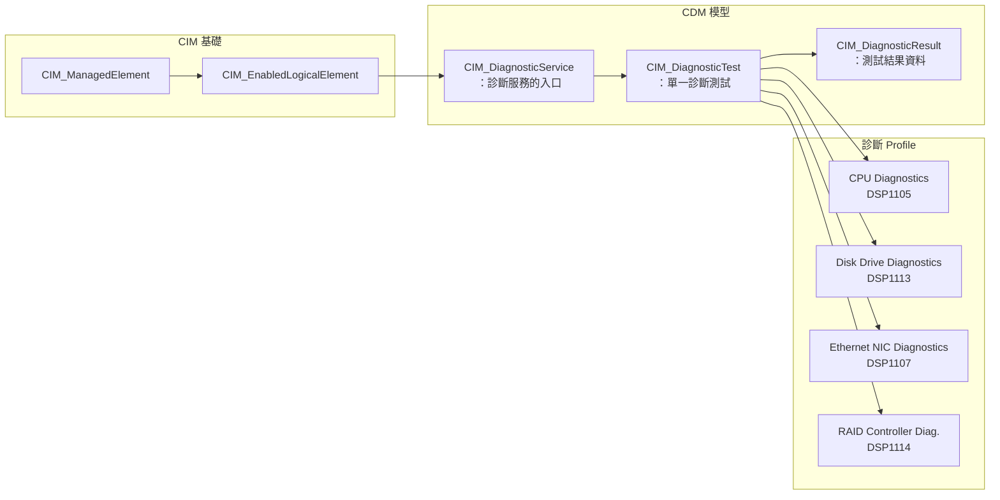
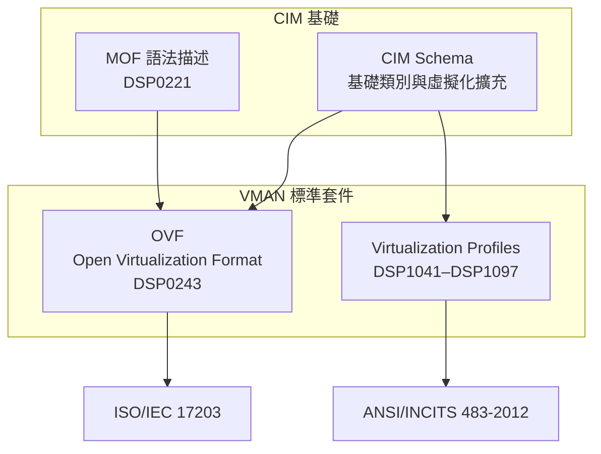
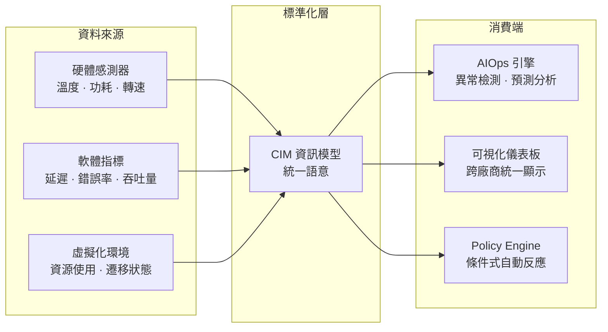

# Day 29：CIM 的未來 — 從 CDM、VMAN 到 AIOps 與邊際管理

昨天我們探討了 SMI-S——CIM 在企業儲存管理領域最成熟的應用。今天是系列倒數第二天，我們將視角從當前的應用轉向未來：**CIM 的下一個十年會走向何方？**

這不是一個憑空猜測的話題。DMTF 持續活躍於多個標準工作組——CIM Schema Task Force、CPPS Task Force 以及 PMCI/Redfish 論壇——從中可以清晰地看到 CIM 生態系的演進方向[^dmtf-cim-about]。

## Schema 持續演進的方向

### 版本數字不會說謊

CIM Schema 的版本演進是理解 DMTF 投入程度最直接的指標。自從 1999 年 CIM v2.0 問世以來，DMTF 平均每年發佈 1–2 個新版本[^dmtf-cim-schemas]：

| 版本 | 發佈日期 | 間隔 |
|------|----------|------|
| CIM 2.54.0 | 2020 年 10 月 | — |
| CIM 2.54.1 | 2022 年 3 月 | 17 個月 |
| CIM 2.55.0 | 2024 年 2 月 | 23 個月 |
| CIM 2.56.0 | 2026 年 1 月 | 23 個月 |

### v2.56.0 的改進方向

CIM 2.56.0（2026 年 1 月）於 DMTF 官網低調但正式地釋出，包含以下領域的類別更新[^dmtf-cim-2560]：

1. **MRDIMM（Multi-Rank DIMM）** — 記憶體模組的建模更新，因應新的記憶體技術規格
2. **Processor UpgradeMethod** — 處理器升級方式的新列舉值
3. **各領域的 Experimental 類別調整** — 持續根據業界回饋將 Experimental 類別提升為 Final

DMTF 在 2025 年度展望中明確指出：「CIM 與 SMBIOS 長達數十年的承諾將持續，2025 年將帶來這些標準的新版本。」[^dmtf-2025-outlook] 從 v2.56.0 在 2026 年 1 月準時兌現來看，這份承諾正在被認真履行。

### 未來可能的更新方向

根據 DMTF 工作組的公開活動，CIM Schema 的未來變動可能包括：

- **硬體技術更新**：CXL（Compute Express Link）動態記憶體管理、新一代處理器架構的 CIM 類別
- **新領域擴充**：液態散熱設備（Liquid Cooling）、加速器（Accelerator/GPU）的管理模型
- **與 Redfish Schema 的協調**：確保 CIM 與 Redfish 之間的資料模型對映保持同步

## CDM（Common Diagnostic Model）：系統健康度診斷

### CDM 的定位

**CDM（Common Diagnostic Model，共通診斷模型）** 是 CIM 家族中用於系統健康診斷的專屬領域擴充，由 **DSP0255（CDM Implementation Requirements 2.0.0）** 定義[^dmtf-cdm]。

CDM 的核心目標是提供一個 **OS 中立、平台中立** 的診斷架構，讓管理系統能夠：

1. **發現診斷能力** — 查詢平台支援哪些診斷測試
2. **控制診斷執行** — 啟動、排程、中斷診斷測試
3. **取得診斷結果** — 檢索測試結果並進行分析

### CDM 在 CIM 中的位置

CDM 不是與 CIM 平行的標準——它建基於 `CIM_ManagedElement` 之上，透過定義 `CIM_DiagnosticService`、`CIM_DiagnosticTest` 等類別，將診斷能力正規化為 CIM 模型的一部分[^dmtf-cdm-profiles]：



### 實際應用場景

CDM 最有價值的應用場景之一是 **工廠到現場（Factory-to-Field）** 的診斷重用。同一個 CPU 診斷測試（DSP1105）可以在[^dmtf-cdm]：

- **工廠階段**：伺服器出廠前的全面硬體檢測
- **部署階段**：伺服器上架後的驗證測試
- **運維階段**：故障排除時的定向診斷
- **維修階段**：元件更換後的確認測試

這避免了一個常見的痛點：同一顆 CPU 在工廠用一套工具測、在現場用另一套工具測，結果格式不同、無法直接比較。CDM 讓診斷從頭到尾使用同一套標準化的模型與格式。

## VMAN：虛擬化管理與 CIM 的擴展

### 從 CIM 到 VMAN

**VMAN（Virtualization Management）** 是 DMTF 針對虛擬化環境管理所制定的標準套件，已被 ANSI/INCITS 採納為 **INCITS 483-2012**[^dmtf-vman]。

VMAN 的核心概念很直接：CIM 定義了實體 IT 資源的管理模型，而 VMAN 則在此基礎上增加**虛擬化層**的管理語意。DMTF 為此在 CIM Schema 中擴充了虛擬網路等領域的類別[^dmtf-vman]。

### VMAN 的兩大支柱



**1. OVF（Open Virtualization Format，DSP0243 v2.1.1）**

OVF 是一種標準的虛擬機器包裝格式，定義了 VM 的磁碟映像、組態設定、資源需求等如何以標準化 XML 描述。想像一個 `OVA` 檔案可以在 VirtualBox 中匯入——OVF 就是此類交換格式的標準化版本，不同的是它同時攜帶了符合 CIM 模型的資源描述[^dmtf-ovf]。

**2. 虛擬化 Profiles（DSP1041–DSP1097）**

VMAN 定義了十多個 Profile，覆蓋虛擬化管理的各個面向[^dmtf-vman-profiles]：

| Profile | 管理對象 |
|---------|----------|
| **DSP1041 Resource Allocation** | 資源分配的生命週期管理 |
| **DSP1042 System Virtualization** | 系統虛擬化的整體管理 |
| **DSP1044 Processor Resource Virtualization** | CPU 資源的虛擬化分配 |
| **DSP1045 Memory Resource Virtualization** | 記憶體資源的虛擬化分配 |
| **DSP1047 Storage Resource Virtualization** | 儲存資源的虛擬化分配 |
| **DSP1050 Ethernet Port Resource Virtualization** | 網路埠的虛擬化分配 |
| **DSP1057 Virtual System** | 虛擬系統（Guest OS）的管理 |
| **DSP1097 Virtual Ethernet Switch** | 虛擬交換器的管理 |

### VMAN 的現實影響

雖然 VMAN 的名字在近年較少被提及，它的技術含量已經融入主流虛擬化管理——OVF 是業界廣泛使用的 VM 交換格式，而許多虛擬化管理工具對 CPU、記憶體、網路的資源分配語意，都能追溯到 VMAN Profile 的設計[^dmtf-vman]。

## IoT／邊際運算場景對 CIM 的新需求

### 從管理標準化的視角看 IoT

邊際運算環境對管理標準提出了新的挑戰：數百個小型感測器節點、異質的閘道器、有限的頻寬與運算資源——這些傳統上用 SNMP 或專屬協定管理的裝置，正在呼籲更高層次的模型抽象。

DMTF 目前透過 **Redfish Forum** 間接回應 IoT／邊際運算的需求[^dmtf-redfish]：

- **PICMG IoT.x 協作**：DMTF 與 **PICMG（PCI Industrial Computer Manufacturers Group）** 合作，將 IoT.x 的 IP 協定納入 Redfish API，實現模組化工廠中邊際設備的標準化管理[^dmtf-news]
- **ART（Automatic Recovery Trigger）for Edge Servers**（DSP-IS0026）：為邊際伺服器設計的自動復原觸發機制，在無人值守的邊際場景中尤為重要
- **液態散熱管理**：DSP2064（Redfish for Liquid Cooling Equipment）——隨著邊際資料中心的密度增加，液態散熱的管理需求也隨之增長

### CIM 在 IoT 中的潛在角色

以上這些主要由 Redfish 承載。然而，CIM 的設計哲學——**物件導向的管理模型、跨廠商的中立語意、多協定支援**——在 IoT 場景中同樣具有天然的適用性。CIM 的 `CIM_Sensor`、`CIM_ThresholdSetting` 等類別（Core & Common Schema）已經為感測器管理提供了基礎[^dmtf-cim-iot]。

如果未來 DMTF 正式將 CIM 擴充至邊際運算領域，可能的發展方向包括：

- **輕量級 CIM Profile**：為受限裝置設計最小子集
- **CIM-over-MQTT**：將 CIM 的資訊模型套用於 IoT 主流傳輸協定
- **CIM 與 OPC UA 的整合**：與工業自動化標準的資訊模型對映

## CIM 在 AIOps / Telemetry 時代的角色

### 可觀測性（Observability）的標準化

AIOps 時代的核心前提是：**大量高品質、結構化的管理資料**。如果管理資料缺少標準化的語意，AI 模型就無法有效跨平台理解和管理資訊。這是 CIM 最被低估的價值[^dmtf-redfish-telemetry]。

### DMTF 的 Telemetry 進展

DMTF 在 2024–2026 年間大幅加速了 Telemetry 領域的標準化：

**Redfish Streaming Telemetry（DSP-IS0027）**：仍在開發中的規範，定義了 Redfish 管理主控台如何以串流方式接收管理資料。相關的白皮書 **DSP2051（Redfish Telemetry White Paper v1.1.0）** 已於 2026 年 5 月發佈[^dmtf-2025-outlook]。

**PLDM Bulk Telemetry（DSP2091）**：於 **PMCI（Platform Management Communications Infrastructure）** 層定義大量傳記資料的模型，v1.0.0 仍在工作進展中（2026 年 9 月更新）[^dmtf-pmci]。

**PLDM Crash Dump Modeling（DSP2092）**：崩潰傾印的標準化模型，同樣在積極開發中。

### Policy 模型：AIOps 的關鍵催熟劑

2026 年 9 月釋出的 **Redfish 2026.2** 引入了一個重要新功能：**Policy 與 PolicyService schema**。這套模型允許管理員定義**條件式自動反應規則**[^dmtf-redfish-20262]：

```
IF（溫度 > 臨界值）
  AND（風扇轉速已達上限）
THEN（降低功耗上限）
  AND（發送警示事件）
```

這正是 AIOps 的基礎——從反應式監控進化為**條件式自動化**。CIM 的 `CIM_PolicyCondition`、`CIM_PolicyRule` 等類別（Policy Schema）自 CIM Schema 早期就已存在。Redfish 新引入的 Policy 模型在某種意義上是對 CIM Policy Schema 理念的現代化重現。

### CIM 在 Telemetry 時代的獨特優勢



CIM 的價值在於它不只是一種序列化格式或通訊協定——它是一種 **領域本體（Domain Ontology）**。當 AI 模型需要理解「一台 Dell 伺服器的 CPU 核心數」和「一台 HP 伺服器的 CPU 核心數」是同一個語意概念時，CIM 提供了這個橋樑。

## 小結：CIM 的恆久與變化

回顧 CIM 近 30 年的發展（1997–2026+），我們可以觀察到一個清晰的模式：

| 時期 | 核心關注 | CIM 的角色 |
|------|----------|-----------|
| **1997–2005** | 桌管與伺服器管理 | CIM 作為統一管理模型誕生 |
| **2005–2015** | 虛擬化與資料中心 | CIM 擴充至 VMAN/OVF |
| **2015–2025** | RESTful API 與雲端 | Redfish 崛起，CIM 作為基礎模型 |
| **2025–未來** | AIOps / 邊際 / Telemetry | CIM 的語意在本體層持續提供價值 |

CIM 本身可能不再是「風頭上的標準」——RESTful Redfish 與高效 PMCI/PLDM 承載了更多近年的創新能量。然而，這恰恰是 CIM 設計成功的證明：**一個好的資訊模型不應該被使用者直接察覺；它應該成為被上層標準信任的基礎，默默地在背後發揮作用。**

明天 Day 30，將是這個 30 天系列的最終章——完賽心得與總結。

---

## 參考資料

[^dmtf-cim-about]: DMTF. (n.d.). About DMTF CIM. Retrieved 2026-10-03, from https://www.dmtf.org/standards/cim
[^dmtf-cim-schemas]: DMTF. (n.d.). CIM Schema Releases. Retrieved 2026-10-03, from https://www.dmtf.org/standards/cim/schemas
[^dmtf-cim-2560]: DMTF. (2026). DMTF Releases CIM 2.56.0. Retrieved 2026-10-03, from https://www.dmtf.org/content/dmtf-releases-cim-256-0
[^dmtf-2025-outlook]: DMTF. (2025). ICYMI: What's Ahead in 2025 from the Desk of Mike Raineri, Board Chair. Retrieved 2026-10-03, from https://www.dmtf.org/content/icymi-whats-ahead-2025-desk-mike-raineri-board-chair
[^dmtf-cdm]: DMTF. (n.d.). Common Diagnostic Model (CDM). Retrieved 2026-10-03, from https://www.dmtf.org/standards/cdm
[^dmtf-cdm-profiles]: DMTF. (n.d.). CDM Profiles. Retrieved 2026-10-03, from https://www.dmtf.org/standards/cdm
[^dmtf-vman]: DMTF. (n.d.). Virtualization Management (VMAN). Retrieved 2026-10-03, from https://www.dmtf.org/standards/vman
[^dmtf-vman-profiles]: DMTF. (n.d.). VMAN Profiles. Retrieved 2026-10-03, from https://www.dmtf.org/standards/vman
[^dmtf-ovf]: DMTF. (n.d.). Open Virtualization Format (OVF). Retrieved 2026-10-03, from https://www.dmtf.org/standards/ovf
[^dmtf-news]: DMTF. (2025). DMTF Publishes PICMG IoT.x IP for Redfish API to Enable Modular Factories. Retrieved 2026-10-03, from https://www.dmtf.org/news
[^dmtf-redfish]: DMTF. (n.d.). Redfish Standard. Retrieved 2026-10-03, from https://www.dmtf.org/standards/redfish
[^dmtf-redfish-telemetry]: DMTF. (2026). Redfish Telemetry White Paper (DSP2051 v1.1.0). Retrieved 2026-10-03, from https://www.dmtf.org/standards/redfish
[^dmtf-redfish-20262]: DMTF. (2026). Redfish Release 2026.2 Now Available. Retrieved 2026-10-03, from https://www.dmtf.org/content/redfish-release-20262-now-available
[^dmtf-pmci]: DMTF. (n.d.). PMCI Standards. Retrieved 2026-10-03, from https://www.dmtf.org/standards/pmci
[^dmtf-cim-iot]: DMTF. (n.d.). DMTF Working Groups. Retrieved 2026-10-03, from https://www.dmtf.org/about/working-groups