# Day 30：完賽心得與總結 — 從概念到實戰，DMTF CIM 的 30 天旅程

今天是這個系列的最後一天。從 Day 1 的前言大綱到今天 Day 30，我們以 6 大階段、29 篇技術內容，走過了 DMTF CIM（Common Information Model）從基礎概念到實戰應用的完整旅程。本文不再是技術教學，而是回顧、總結與感謝。

## 30 天旅程回顧

### 從「為什麼」到「怎麼用」的完整曲線

回顧這 30 天的學習路線，可以清晰地看到一條從動機到實踐的知識曲線：

```mermaid
flowchart LR
    subgraph 第一階段[Days 2-6：CIM 基礎]
        Q[為什麼需要 CIM？<br/>管理標準的戰國時代]
        D[核心設計哲學<br/>物件導向 × 三層架構]
    end
    subgraph 第二階段[Days 7-11：Schema 架構]
        S[Core · System · Network<br/>Application · Event · Security]
    end
    subgraph 第三階段[Days 12-16：Metamodel & MOF]
        M[Metameta<br/>「模型的模型」]
        MOF[MOF 語法 · 實戰 · Compiler<br/>UML Profile]
    end
    subgraph 第四階段[Days 17-20：WBEM 協定]
        X[CIM-XML · WS-Management<br/>CIM-RS RESTful API]
    end
    subgraph 第五階段[Days 21-25：真實實作]
        P[Profiles · OpenPegasus<br/>pywbem · WMI/MI · SBLIM]
    end
    subgraph 第六階段[Days 26-29：應用與展望]
        APP[DASH · SMASH · SMI-S<br/>CDM · VMAN · AIOps 未來]
    end

    Q --> D --> S --> M --> MOF --> X --> P --> APP
```

這條曲線並非隨意安排，而是刻意設計的「階段劃分法」——每一個階段都建立在前一階段的基礎上。如果沒有理解 CIM 的三層架構（Core → Common → Extension），就很難讀懂 MOF 語法的繼承語意；如果沒有掌握 Metamodel 的 Qualifier 機制，就很難深入理解 Profile 的結構[^dmtf-cim-page]。

### 各階段回顧

**第一階段（Days 2–6）** 為我們奠定了基礎。我們從 1990 年代 SNMP、CMIP、DMI 百家爭鳴的「管理戰國時代」出發，理解了 CIM 為何在 1997 年誕生，以及它的物件導向設計如何從根本解決了資訊模型不互通的痛點。Day 6 的 Schema 版本演化讓我們看到 CIM 近 30 年持續維護的驚人生命力——從 1999 年的 v2.0 到 2026 年的 v2.56.0，未曾中斷[^dmtf-cim-2560]。

**第二階段（Days 7–11）** 深入了 Schema 的核心領域。`CIM_ManagedElement` 是所有管理物件的共同祖先，其屬性如 `OperationalStatus`、`HealthState` 的標準化語意，是 CIM 最被低估的設計成就。延伸到 System、Device、Network、Application、Event、Security、Policy、Physical 八大領域模組，CIM 展示了涵蓋整個資料中心管理範疇的野心與深度。

**第三階段（Days 12–16）** 是最「硬核」的一週。DSP0004 Metamodel 定義了「模型的模型」，Qualifier 機制讓類別與屬性可以附加豐富的 metadata。DSP0221 MOF 語法則提供了具體的描述語言——從零寫一個 `CIM_ComputerSystem` 的子類別，到使用 `mofcomp.exe` 編譯 MOF 至 WMI Repository，再到 UML Profile 的逆向工程。這些內容不常見於一般技術文章，但正是理解 CIM 靈魂的關鍵[^dmtf-dsp0004][^dmtf-dsp0221]。

**第四階段（Days 17–20）** 從模型轉向通訊。WBEM 三協定家族——CIM-XML（HTTP+XML RPC）、WS-Management（SOAP/WSDL）、CIM-RS（RESTful JSON）——各自代表了不同時代的技術風格。理解它們的設計取捨，也就理解了企業管理軟體的通訊演化史。

**第五階段（Days 21–25）** 將紙上標準落地為真實實作。Management Profile 的結構（Central Class + Scoping Class + 關聯類別）讓我們看到 CIM 如何為具體場景「調音」。OpenPegasus（C++）、pywbem（Python）、Windows WMI/MI、Linux SBLIM、Solaris WBEM Services——CIM 在各大平台都有實作，這不是一個僅存在於規格文件中的標準。

**第六階段（Days 26–29）** 展示了 CIM 在真實世界的應用。DASH 的桌管與行動裝置管理、SMASH 的資料中心伺服器管理、SMI-S 的企業儲存管理——這些 DMTF Initiative 每一個都是 CIM 在特定領域的規模化實戰。Day 29 則放眼未來：CDM（診斷模型）、VMAN（虛擬化管理）、以及 CIM 在 AIOps 和邊際運算時代的潛在角色。

## 技術成長總結

### 對 CIM 的整體理解

經過 30 天的沉浸，在此總結我對 CIM 的核心認識：

**CIM 不是一個工具，而是一種語言。** 它不是像 `htop` 或 `wmic` 那樣可以直接執行的管理工具——它是定義「管理資訊如何描述」的後設標準。就像 HTML 定義了網頁的結構、SQL 定義了資料庫查詢的語法，CIM 定義了 IT 管理領域的**語意模型**[^wikipedia-cim]。

**CIM 的三層架構是其耐久性的秘密。** Core Model 提供最抽象的基礎類別，Common Model 涵蓋標準 IT 元素的定義，Extension Schema 允許廠商擴充——這種設計讓 CIM 能夠在近 30 年中持續演進而不斷裂。每次新版本發佈時，既有類別的向後相容性是最高指導原則。

**MOF 是 CIM 的「原始碼」。** 就像閱讀原始碼才能理解軟體的真實行為，閱讀 `.mof` 檔案才能真正掌握 CIM 的細微設計——從繼承層次上的 Property 分佈，到 Qualifier 的語意約束，到 Association 的 Reference 語法。MOF Compiler 是從模型到實作的橋樑。

**WBEM 三協定的多樣性不是混亂，而是設計選擇。** CIM 定義的是「什麼」，WBEM 定義的是「怎麼傳」——這層分離使得 CIM 模型可以同時適用於 XML-based 的企業級整合（WS-Management）、輕量級的 RESTful 操作（CIM-RS）、以及傳統的 HTTP RPC 場景（CIM-XML）。

### 對技術寫作的體會

撰寫這個系列的過程本身也是一次學習。CIM 的官方規格文件（DSP 系列）總計數千頁——從 DSP0004 Metamodel 到 DSP0221 MOF，每一份都是高度精煉的規範文本。要將這些內容轉化為可讀的技術文章，需要的不僅是翻譯，而是重新組織、舉例、圖解、和實作驗證。

其中最大的挑戰是：CIM 是一門「看不見」的技術——它不像 React 或 Kubernetes 那樣有視覺化的產出，它的價值在於為管理工具提供底層的語意基礎。這使得每篇文章都需要刻意用圖表（mermaid）、MOF 片段、和真實案例來說明抽象概念。

## 心態轉變：從「枯燥」到「優雅」

老實說，第一次打開 DMTF 官網的 DSP0004 PDF 時，我的反應是：「這什麼？」——近百頁的形式化定義、UML 圖、Qualifier 表格，沒有任何華麗的 UI 或互動體驗。

然而，隨著閱讀的深入，我開始領悟這種「枯燥」背後的設計美學：

1. **一致性（Consistency）** — `CIM_ManagedElement` 是所有類別的統一起點，每一個屬性、方法、關聯都遵循相同的命名與語意規則。這種一致性讓學習曲線雖然起步較陡，但一旦掌握後就能舉一反三。

2. **完備性（Completeness）** — CIM Schema 涵蓋了從硬體（處理器、記憶體、感測器）到軟體（作業系統、應用程式、資料庫）再到抽象概念（政策、事件、指標）的完整範疇。這不是某家廠商某個產品的特定模型，而是 IT 管理的通用語言。

3. **穩定性（Stability）** — CIM v2.0 在 1999 年定義的 `CIM_ComputerSystem`，到今天 v2.56.0 依然存在且向後相容。在技術領域，28 年不間斷的標準維護本身就是一種成就。

這些特質讓我逐漸從「CIM 好枯燥」轉變為「CIM 的設計好優雅」。這是一個從抗拒形式化規範到欣賞其精確性的過程。

## 給未來學習 CIM 者的建議

如果你讀完本系列後想進一步深入 CIM，以下是一些具體的建議路徑：

### 入門者（已有基本概念）

- **先玩後讀** — 不要從讀規格開始。在裝有 Windows 的機器上打開 PowerShell，輸入 `Get-WmiObject Win32_ComputerSystem`；或在 Linux 上安裝 pywbem，從 `pywbemcli` 開始探索。先看到 CIM 物件的實際樣貌，再回頭讀理論[^pywbem-docs]。
- **從 Day 1 的 Core Schema 開始** — `CIM_ManagedElement`、`CIM_ManagedSystemElement`、`CIM_LogicalElement` 等基礎類別是所有後續理解的基石。讀懂它們的 Property 語意，等於拿到了 CIM 的入場券。

### 中級者（想深入了解 Schema）

- **下載 CIM Schema 2.56.0 ZIP** — 解壓縮後直接閱讀 `.mof` 檔案。建議從 `CIM_System.mof` 開始，逐步擴展到 `CIM_Network.mof`、`CIM_Application.mof`[^dmtf-cim-2560]。
- **追蹤一個類別的繼承鏈** — 例如 `Win32_ComputerSystem` 在 WMI 中對應到 `CIM_ComputerSystem`，一路追溯到 `CIM_ManagedElement`。這個過程會讓你深刻理解 CIM 的抽象層次設計。

### 進階者（想參與標準）

- **加入 DMTF CIM Forum** — DMTF 歡迎回饋與貢獻。Schema Task Force 的成員會議（限會員）是理解標準制定過程的最佳場所[^dmtf-cim-forum]。
- **閱讀 Management Profile 文件** — 從簡單的 Profile 開始（如 DSP1034 Simple Identity Management），逐步深入到複雜的領域 Profile。
- **研究 CIM 與 Redfish 的對映** — 這是 CIM 在現代 RESTful API 時代最活躍的傳承路徑。理解兩者如何對映，就理解了 DMTF 標準家族的整體演化策略。

## 本系列的緣起與未來展望

作為一個在中文社群中較少被討論的主題，我希望這 30 篇文章能夠填補一部分 DMTF CIM 在繁體中文圈的知識空白。

CIM 的概念——跨廠商的統一管理模型——在今天比 1997 年更加重要。當我們進入 AIOps 時代，當管理資料需要餵給機器學習模型進行異常檢測與根因分析時，缺乏標準化的管理語意將是最大的瓶頸。CIM 提供的不是一個華麗的解決方案，而是一個樸素但至關重要的基礎——讓不同的管理系統使用相同的語言描述世界。

未來的可能性包括：CIM 在邊際運算裝置上的輕量化 Profile、CIM-over-MQTT 的 IoT 應用、以及 CIM 與 Kubernetes CRD（Custom Resource Definition）的對映——這些都是值得持續關注的方向。

## 感謝

最後，感謝所有從 Day 1 追蹤到今天的讀者。

30 天是一個有趣的數字——說長不長，說短不短。在技術寫作的語境中，30 天意味著你需要至少 30 個可獨立討論的子主題、30 個不同的切入點、以及 30 次持續輸出的紀律。更重要的是，它要求你在第 15 天時仍然對主題保持熱情，而這個系列做到了。

如果你對系統管理標準、資訊模型設計、或跨平台管理工具有興趣，**CIM 絕對值得你投入時間**——它或許不會在短期內為你的履歷增加熱門關鍵字，但它會從根本上改變你對「管理資訊」這件事情的理解。

鐵人賽完賽，但 CIM 的探索永遠不會結束。

---

## 參考資料

[^dmtf-cim-page]: DMTF. (n.d.). CIM — Common Information Model. Retrieved 2026-10-03, from https://www.dmtf.org/standards/cim
[^dmtf-cim-2560]: DMTF. (2026). DMTF Releases CIM 2.56.0. Retrieved 2026-10-03, from https://www.dmtf.org/content/dmtf-releases-cim-256-0
[^dmtf-dsp0004]: DMTF. (2014). Common Information Model (CIM) Metamodel (DSP0004 v3.0.1). Retrieved 2026-10-03, from https://www.dmtf.org/sites/default/files/standards/documents/DSP0004_3.0.1.pdf
[^dmtf-dsp0221]: DMTF. (2012). Managed Object Format Specification (DSP0221 v3.0.0). Retrieved 2026-10-03, from https://www.dmtf.org/sites/default/files/standards/documents/DSP0221_3.0.0.pdf
[^dmtf-cim-forum]: DMTF. (n.d.). CIM Forum. Retrieved 2026-10-03, from https://www.dmtf.org/join/smf
[^wikipedia-cim]: Wikipedia. (2025). Common Information Model (computing). Retrieved 2026-10-03, from https://en.wikipedia.org/wiki/Common_Information_Model_(computing)
[^pywbem-docs]: pywbem Community. (n.d.). pywbem — Python WBEM Client and Provider Interface. Retrieved 2026-10-03, from https://pywbem.readthedocs.io